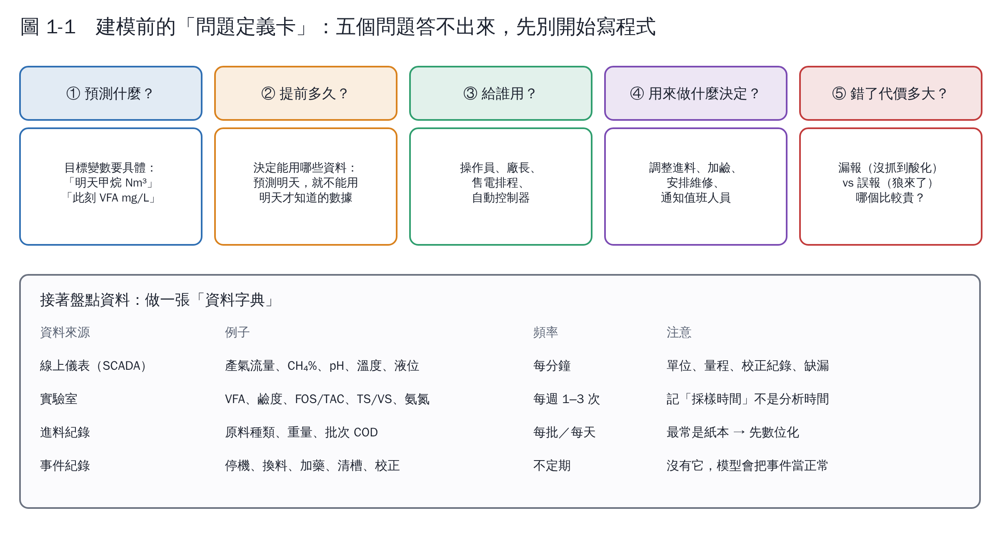

# 第 1 章　建模前：問題定義與資料盤點

模型做不出來，最常見的原因不是演算法不夠好，而是**問題沒定義清楚、資料沒整理好**。Rutland 等人（2023）回顧厭氧消化的機器學習研究時指出，許多模型只在實驗室規模驗證，搬到全尺度實廠就表現不佳 [1]；Gaida 等人（2017）也發現，實廠沼氣廠大多仍沒有閉迴路的進料控制，主因之一是缺乏穩健可靠的線上監測 [2]。

## 1.1 問題定義卡

開始寫程式之前，先和廠長、操作員一起把這五題寫下來：

| 問題 | 好的答案 | 不好的答案 |
|---|---|---|
| ① 預測什麼？ | 「明天的甲烷產量（Nm³）」「此刻消化槽 VFA（mg/L）」 | 「用 AI 優化沼氣廠」 |
| ② 提前多久？ | 「提前 1 天」「提前 12 小時發現酸化」 | 「越早越好」 |
| ③ 給誰用？ | 「早班操作員，每天早上 8 點看」 | 「管理階層」 |
| ④ 做什麼決定？ | 「決定今天進料量要不要減 20%」 | 「參考用」 |
| ⑤ 錯了代價？ | 「漏報一次酸化，損失約 2–4 週產氣；誤報一次，少進料一天」 | 「沒想過」 |

第 ⑤ 題決定模型怎麼調：如果漏報代價遠高於誤報，警報門檻就該偏保守，寧可多報幾次。

## 1.2 資料字典

把每一個要用的資料來源寫清楚（圖 1-1 下半部）。實務上最常出問題的四件事：

1. **時間**：實驗室數據要記「採樣時間」，不是「分析完成時間」；SCADA 的時鐘要和實驗室對齊。
2. **單位**：Nm³ 還是 m³？mg/L 還是 g/L？以乙酸計還是以 COD 計？
3. **事件**：停機、換料、清槽、儀表校正要有紀錄，否則模型會把這些當成正常變化去學（第 4 章會看到後果）。
4. **進料**：很多廠的進料紀錄還是手寫，原料成分沒有量。第 6 章會看到，進料資訊的品質直接影響數位孿生的表現。

## 1.3 資料要多少？

| 用途 | 建議最少資料 | 原因 |
|---|---|---|
| 產氣預測 | 一年的每日資料 | 要涵蓋季節與原料變化 |
| VFA 軟感測 | 一年、每週至少 1–2 次實驗室 VFA（約 50–100 筆） | 標籤稀少是軟感測最大的限制（第 5 章） |
| 異常預警 | 正常資料為主，最好包含幾次真實異常 | 沒看過異常，就很難評估警報好不好 |
| 數位孿生 | 進料特性＋產氣與氣體組成；用來校正模型參數 | 機理模型需要知道「吃進去什麼」 |

## 1.4 不要偷看未來

這是建模最常犯、也最難察覺的錯誤：**模型用到了「做預測時還不知道的資訊」**。例如：

- 預測「明天產氣」，卻用了「明天的 pH」當輸入。
- 實驗室 VFA 週四才出報告，卻當作週一就知道。
- 用整份資料算平均值做標準化，等於讓訓練資料「看過」測試期。

判斷方法：每一個輸入特徵都問一句「**在做決定的那一刻，我真的拿得到這個數字嗎？**」

## 本章重點

- 先寫問題定義卡：預測什麼、提前多久、給誰、做什麼決定、錯了代價多大。
- 做資料字典：時間、單位、事件、進料是最常出錯的地方。
- 每個特徵都要確認「做決定時拿得到」，否則就是偷看未來。

## 參考文獻

1. Rutland H, You J, Liu H, Bull L, Reynolds D (2023). A systematic review of machine-learning solutions in anaerobic digestion. *Bioengineering*, 10, 1410. https://doi.org/10.3390/bioengineering10121410
2. Gaida D, Wolf C, Bongards M (2017). Feed control of anaerobic digestion processes for renewable energy production: A review. *Renewable and Sustainable Energy Reviews*, 68, 869–875. https://doi.org/10.1016/j.rser.2016.06.096
