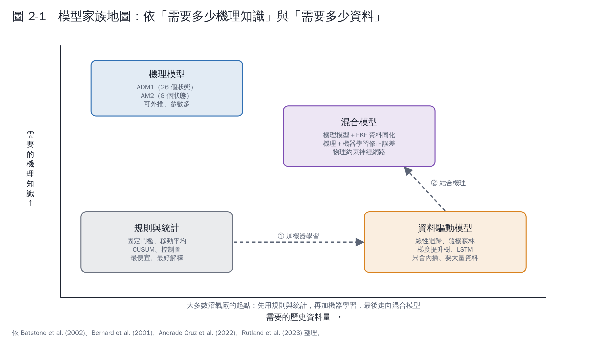

# 第 2 章　模型家族地圖：機理、資料驅動、混合

## 2.1 機理模型：用「微生物怎麼吃東西」的方程式

機理模型把厭氧消化寫成一組微分方程式：每一群微生物吃什麼、長多快、產生什麼。

| 模型 | 規模 | 適合 |
|---|---|---|
| **ADM1**（IWA 厭氧消化模型一號） | 約 26 個狀態變數、數十個參數，涵蓋水解、酸化、乙酸化、產甲烷與物化平衡 [1] | 設計、研究、詳細的數位孿生 |
| **AM2**（兩步驟模型） | 6 個狀態變數：酸化菌、產甲烷菌、有機物、VFA、鹼度、無機碳 [2] | 狀態估計、控制、資料不多的場站 |

AM2 的核心只有兩個反應：

1. **酸化**：有機物（S1）→ VFA（S2），由酸化菌（X1）進行，速率用 Monod 式。
2. **產甲烷**：VFA（S2）→ 甲烷＋CO₂，由產甲烷菌（X2）進行，速率用 Haldane 式。Haldane 式的意思是：VFA 太高反而會抑制產甲烷菌，這正是酸化惡性循環的數學表示。

**優點**：有物理意義，能預測沒見過的狀況（例如進料加倍會怎樣）。
**缺點**：參數要校正，不同研究識別出的參數差異很大；原料變化大時，模型會跟實廠漸行漸遠。

## 2.2 資料驅動模型：從歷史資料學規律

| 模型 | 白話說明 | 優點 | 缺點 |
|---|---|---|---|
| 線性迴歸 | 每個輸入乘一個權重加起來 | 最好解釋、會外推 | 抓不到非線性 |
| 隨機森林 [3] | 很多棵決策樹投票平均 | 準、穩、不太需要調參數 | 不會外推（只會在看過的範圍內預測） |
| 梯度提升樹 [4] | 一棵接一棵修正前面的錯誤 | 表格資料常是最準的 | 同上，且容易學到偶發事件的假規律（第 4 章） |
| LSTM 等循環神經網路 [5] | 有「記憶」的神經網路，適合時間序列 | 能學長時間的延遲效應 | 需要大量資料、難解釋 |

厭氧消化的機器學習綜述指出，ANN、隨機森林、支持向量機在產氣預測上的表現可靠 [6]，但 ANN 在可解釋性與擴大規模上有困難 [7]。

## 2.3 混合模型：兩者截長補短

| 做法 | 說明 | 本教材的例子 |
|---|---|---|
| 資料同化 | 機理模型往前算，再用量測值修正狀態 | 第 6 章 AM2＋擴展卡爾曼濾波 |
| 殘差修正 | 機理模型先算，機器學習學「模型和實際的差」 | 第 10 章 |
| 物理約束神經網路 | 神經網路訓練時加入質量守恆等物理方程式當限制 [8] | 第 10 章 |
| 用模擬資料預訓練 | 先用機理模型產生大量情境訓練，再用少量實廠資料微調 | 第 10 章 |

## 2.4 怎麼挑？

| 你的狀況 | 建議起點 |
|---|---|
| 資料不到半年 | 規則與統計（移動平均、控制圖）；同時開始累積資料 |
| 有一年以上每日資料 | 線性迴歸＋隨機森林，和簡單基準比較 |
| 實驗室數據很少 | 軟感測先用線性模型；考慮數位孿生 |
| 有建模合作者、進料資訊完整 | AM2 或 ADM1＋資料同化 |
| 需要給操作員看「為什麼」 | 線性模型或樹模型＋特徵重要性；避免純黑盒 |

## 本章重點

- 機理模型能外推但要校正；資料模型準但只會內插；混合模型截長補短。
- AM2 只有 6 個狀態，適合當沼氣廠數位孿生的起點。
- 樹模型在表格資料上常最準，但不會外推，要特別注意。

## 參考文獻

1. Batstone DJ, Keller J, Angelidaki I, et al. (2002). The IWA Anaerobic Digestion Model No 1 (ADM1). *Water Science and Technology*, 45(10), 65–73. https://doi.org/10.2166/wst.2002.0292
2. Bernard O, Hadj-Sadok Z, Dochain D, Genovesi A, Steyer JP (2001). Dynamical model development and parameter identification for an anaerobic wastewater treatment process. *Biotechnology and Bioengineering*, 75, 424–438. https://doi.org/10.1002/bit.10036
3. Breiman L (2001). Random forests. *Machine Learning*, 45, 5–32. https://doi.org/10.1023/A:1010933404324
4. Friedman JH (2001). Greedy function approximation: a gradient boosting machine. *The Annals of Statistics*, 29, 1189–1232. https://doi.org/10.1214/aos/1013203451
5. Hochreiter S, Schmidhuber J (1997). Long short-term memory. *Neural Computation*, 9, 1735–1780. https://doi.org/10.1162/neco.1997.9.8.1735
6. Andrade Cruz I, Chuenchart W, Long F, et al. (2022). Application of machine learning in anaerobic digestion: Perspectives and challenges. *Bioresource Technology*, 345, 126433. https://doi.org/10.1016/j.biortech.2021.126433
7. Rutland H, You J, Liu H, Bull L, Reynolds D (2023). A systematic review of machine-learning solutions in anaerobic digestion. *Bioengineering*, 10, 1410. https://doi.org/10.3390/bioengineering10121410
8. Raissi M, Perdikaris P, Karniadakis GE (2019). Physics-informed neural networks: A deep learning framework for solving forward and inverse problems involving nonlinear partial differential equations. *Journal of Computational Physics*, 378, 686–707. https://doi.org/10.1016/j.jcp.2018.10.045
