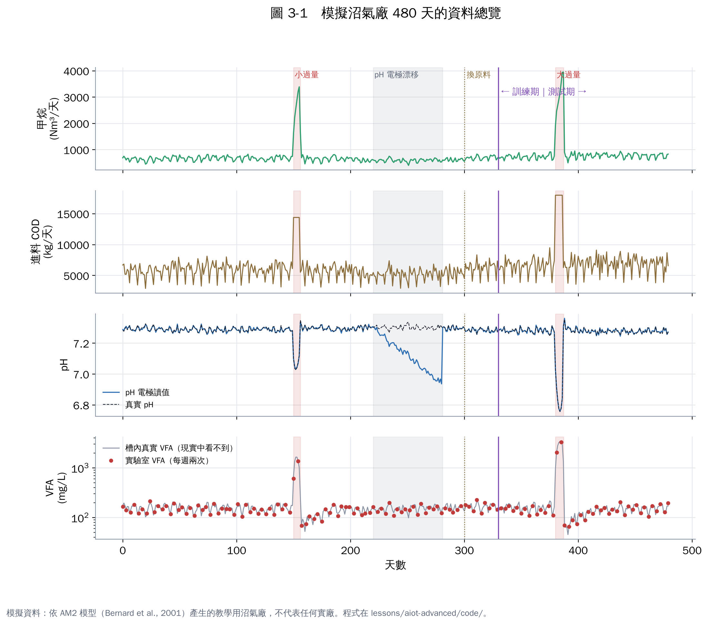
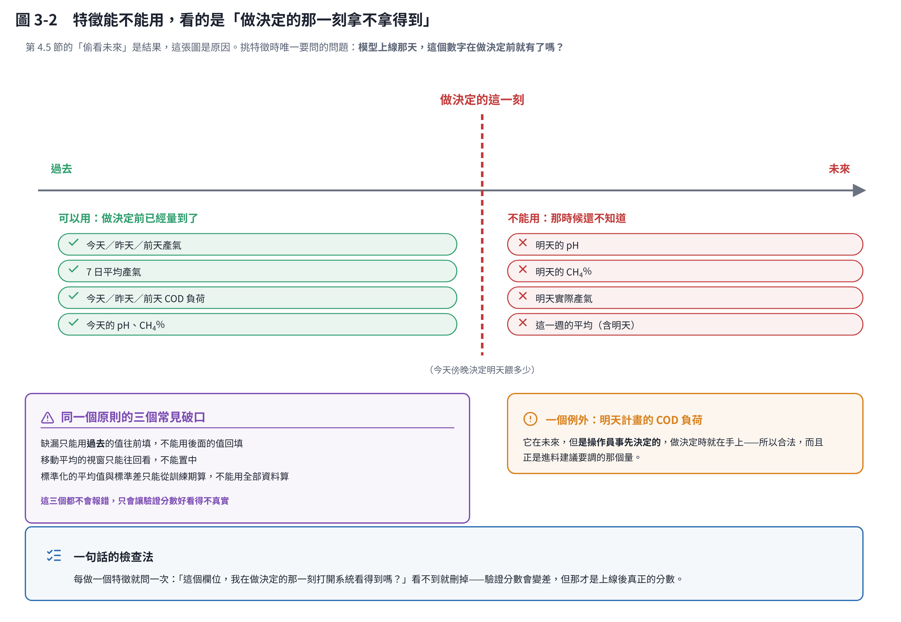

# 第 3 章　實作 0：認識模擬沼氣廠與資料準備

## 3.1 模擬廠長什麼樣子

為了能把每個步驟做給你看，我用 AM2 模型（第 2 章）寫了一座模擬沼氣廠 [1]：

| 項目 | 設定 |
|---|---|
| 消化槽 | 有效體積 2,000 m³，中溫，水力停留時間約 8 天 |
| 進料 | 類似廚餘漿：COD 每天變動約 ±10%，有季節起伏，週日進料較少 |
| 線上量測（每小時） | 甲烷流量、沼氣流量、CH₄%、pH、溫度、進料量；約 1% 資料缺漏 |
| 實驗室（每週一、四） | 消化液 VFA（5% 分析誤差）、進料 COD |
| 期間 | 480 天，前 330 天當訓練、後 150 天當測試 |
| 刻意安排的事件 | 第 150 天小過量進料、第 220–280 天 pH 電極漂移、第 300 天換原料、第 380 天大過量進料 |

「真實」模擬廠的參數故意和教科書值不同（例如產甲烷菌生長較慢），所以後面用教科書參數建的模型會有真實的誤差，就像實務一樣。

看這張圖先注意四件事：

1. **過量進料時，甲烷反而暴增**：因為多餵了很多有機物。所以「產氣增加」不一定是好事。
2. **pH 電極漂移**（第 220–280 天）：讀值慢慢往下掉，但真實 pH 沒變。如果直接拿來用，模型會被誤導。
3. **實驗室 VFA 只有零星的點**：大過量事件期間只抓到兩個點。
4. **換原料後**（第 300 天），進料負荷整體變高，這對模型是一種「概念漂移」。

## 3.2 資料準備的五個步驟

| 步驟 | 本練習怎麼做 | 實廠要注意 |
|---|---|---|
| ① 統一時間 | 全部換成「第幾天、第幾小時」 | 時區、夏令時間、SCADA 與實驗室時鐘不一致 |
| ② 處理缺漏 | 線上資料用前一筆值填補（只用過去，不用未來） | 長時間缺漏不要硬補，標記成缺漏 |
| ③ 彙總尺度 | 產氣預測用每日平均；軟感測與預警用過去 24 小時移動平均 | 決定尺度要配合「多久做一次決定」 |
| ④ 做特徵 | 見下表 | 每個特徵都要確認「做決定時拿得到」 |
| ⑤ 切分資料 | 依時間：前 330 天訓練、後 150 天測試 | 測試期最好包含季節變化或換料 |

產氣預測用的特徵（程式 `experiments.py` 的 `forecast_features`）：

| 特徵 | 為什麼放 |
|---|---|
| 今天、昨天、前天產氣；7 日平均 | 產氣有慣性（自我相關） |
| **明天計畫的 COD 負荷** | 明天要餵多少是操作員事先決定的，可以合法使用；也是進料建議的關鍵 |
| 今天、昨天、前天 COD 負荷 | 進料到產氣有延遲 |
| 今天 pH、CH₄% | 槽內狀態 |
| 明天是不是週日 | 週日進料少 |

**刻意不放的特徵**：明天的 pH、明天的 CH₄%（做預測時還不知道）。

這條界線值得畫成圖，因為它是整個資料準備裡**最容易無聲出錯**的一件事。判準不是「這個欄位和目標相關性高不高」，而是「模型上線那天，做決定的那一刻，我打開系統看得到這個數字嗎」。看不到就不能用，再相關也不行。

比較微妙的是那個例外：**明天計畫的 COD 負荷**雖然屬於未來，但它是操作員事先決定的，做決定時就在手上，所以合法——而且它正是第 8 章進料建議要調的那個量。

同一個原則還有三個常見破口：缺漏往回填不能用後面的值、移動平均視窗不能置中、標準化的平均與標準差只能從訓練期算。這三個都不會報錯，只會讓驗證分數好看得不真實——第 4.5 節的對照就是它的後果。

## 3.3 程式長什麼樣子

全部程式在 `lessons/aiot-advanced/code/`，結構很簡單：

- `am2.py`：AM2 模型（約 100 行）
- `plant.py`：模擬廠與量測雜訊
- `experiments.py`：五個練習
- `make_figures.py`：畫圖

在電腦上安裝 Python 後，執行 `pip install -r requirements.txt`，再執行 `python experiments.py`，約 20 秒就會跑完所有練習並輸出 `results.json`。教材裡的每一個數字都來自這份檔案。

## 本章重點

- 模擬廠刻意放了四種真實會遇到的狀況：過量進料、感測器漂移、換原料、稀少的實驗室數據。
- 資料準備五步驟：統一時間、處理缺漏、決定尺度、做特徵、依時間切分。
- 特徵只能用「做決定時拿得到」的資料。

## 參考文獻

1. Bernard O, Hadj-Sadok Z, Dochain D, Genovesi A, Steyer JP (2001). Dynamical model development and parameter identification for an anaerobic wastewater treatment process. *Biotechnology and Bioengineering*, 75, 424–438. https://doi.org/10.1002/bit.10036
