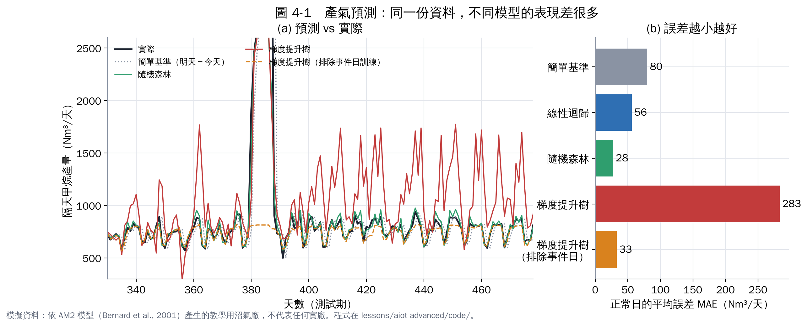
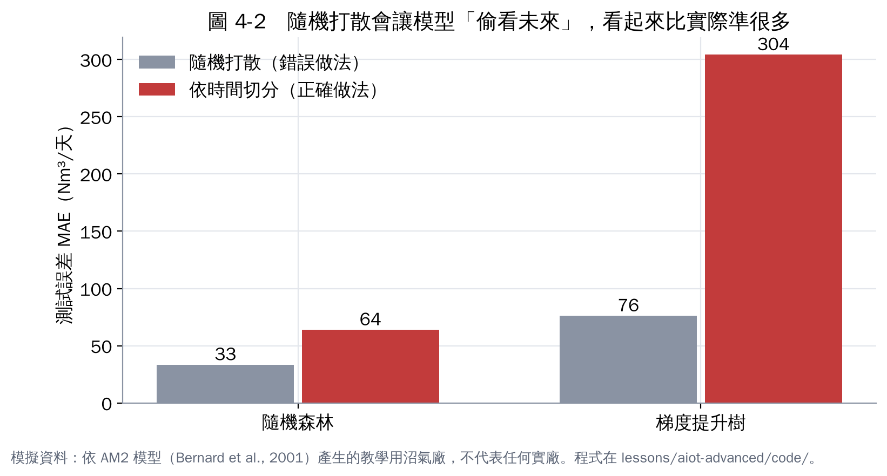

# 第 4 章　實作 1：產氣預測與正確的驗證方法

**題目**：每天早上，用到今天為止的資料，加上明天計畫的進料量，預測明天的甲烷產量（Nm³）。

## 4.1 先做一個「笨方法」當基準

最簡單的預測是「明天＝今天」。這個基準在測試期正常日的平均誤差（MAE）是 **80 Nm³/天，約 11%**。任何模型都要明顯比它好，才值得導入。

## 4.2 四種模型的比較

| 模型 | 正常日 MAE（Nm³/天） | 正常日誤差（%） |
|---|---|---|
| 簡單基準（明天＝今天） | 80 | 11.1% |
| 線性迴歸 | 56 | 7.3% |
| 隨機森林 | **28** | **3.6%** |
| 梯度提升樹 | 283 | 36.6% |
| 梯度提升樹（排除事件日重新訓練） | 33 | 4.2% |

（測試期第 330–478 天；「正常日」排除大過量事件前後。數字來自 `results.json`。）

## 4.3 為什麼梯度提升樹會失敗？

這是本章最重要的一課。看圖 4-1 的紅線：換原料（第 300 天）之後，梯度提升樹在很多正常日把產氣預測成 1,500 Nm³ 以上，幾乎是實際的兩倍。

原因是：

1. 換原料後，正常日的進料負荷落在約 7,000–7,500 kg COD/天，這個範圍在訓練期很少出現。
2. 訓練期裡，負荷特別高的日子幾乎都是「小過量事件」，那幾天產氣暴增。
3. 樹模型用「切一刀」的方式分組，它學到的是「負荷超過某個值 → 產氣暴增」，把換原料後的正常日誤分到事件那一組。

**修正方法**：把事件日從訓練資料排除（或標記成特徵），重新訓練後誤差就從 283 降到 33。這說明了第 1 章強調的：**事件紀錄不是可有可無**。

隨機森林為什麼沒事？它是很多棵樹的平均，比較不會被少數極端資料帶著走；但它同樣不會外推，碰到更極端的情況也會失準。

## 4.4 模型學到了什麼？

線性迴歸可以直接看權重。把每個特徵標準化後，影響最大的是：

| 特徵 | 標準化權重 | 白話 |
|---|---|---|
| 今天產氣 | +262 | 產氣有慣性 |
| 明天計畫 COD 負荷 | +159 | 餵多少，就產多少 |
| 昨天產氣 | −91 | 和今天一起看，代表「趨勢」 |

這種解釋對操作員很重要：模型的判斷要符合常識，大家才會信任。

## 4.5 驗證方法：依時間切分 vs 隨機打散

| 模型 | 隨機打散（錯誤） | 依時間切分（正確） |
|---|---|---|
| 隨機森林 | 33 | 64 |
| 梯度提升樹 | 76 | 304 |

（這裡是整個測試期的 MAE，含事件日。）

隨機打散時，訓練資料裡有「測試日的前一天和後一天」，模型等於看過答案附近的資料，誤差被**低估一半以上**。很多論文與廠商簡報的漂亮數字，問題就出在這裡。**請廠商報告準確度時，一定要問：是怎麼切分驗證資料的？**

## 4.6 怎麼讀預測誤差

| 指標 | 意思 | 什麼時候用 |
|---|---|---|
| MAE（平均絕對誤差） | 平均差多少（同單位） | 最直覺，給操作員看 |
| MAPE（平均百分比誤差） | 平均差幾 % | 不同規模的廠比較 |
| RMSE（均方根誤差） | 大錯被放大懲罰 | 大錯代價高時 |
| 預測區間 | 「明天 750 ± 60 Nm³」 | 決策需要知道不確定性時（例如售電排程） |

## 本章重點

- 先做簡單基準：模型要贏過「明天＝今天」才有意義。
- 隨機森林最好（誤差 3.6%）；梯度提升樹因為學到偶發事件的假規律而失敗，排除事件日後恢復。
- 驗證一定要依時間切分；隨機打散會把誤差低估一半以上。
- 用線性模型的權重檢查模型的判斷是否符合常識。

## 參考文獻

1. Breiman L (2001). Random forests. *Machine Learning*, 45, 5–32. https://doi.org/10.1023/A:1010933404324
2. Friedman JH (2001). Greedy function approximation: a gradient boosting machine. *The Annals of Statistics*, 29, 1189–1232. https://doi.org/10.1214/aos/1013203451
3. Andrade Cruz I, Chuenchart W, Long F, et al. (2022). Application of machine learning in anaerobic digestion: Perspectives and challenges. *Bioresource Technology*, 345, 126433. https://doi.org/10.1016/j.biortech.2021.126433
