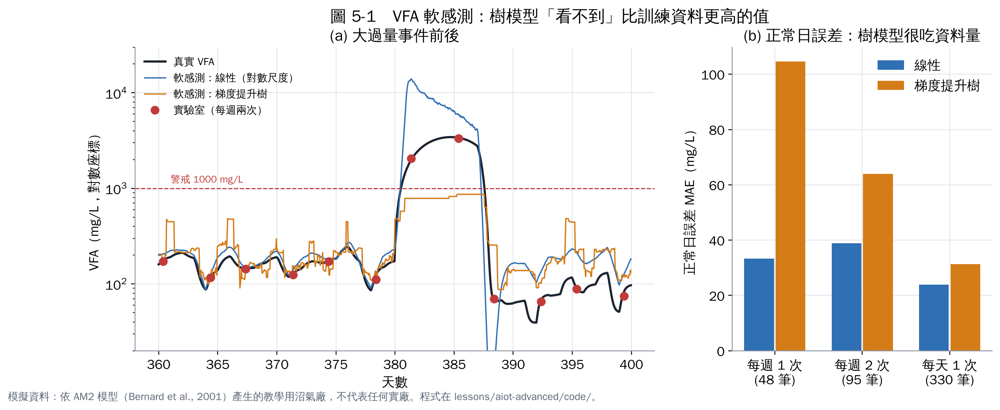

# 第 5 章　實作 2：VFA 軟感測

**題目**：VFA 是最好的酸化早期指標，但只能每週量一兩次。能不能用每小時都量得到的訊號，連續推估 VFA？

## 5.1 輸入與標籤

| 類別 | 內容 |
|---|---|
| 輸入（每小時更新） | 過去 24 小時的 CH₄%、pH、CH₄% 和 7 日平均的差、每 m³ 進料產甲烷量、CO₂ 流量、24 小時與 72 小時進料量 |
| 標籤（答案） | 實驗室 VFA。訓練期 330 天內，每週兩次約有 95 筆 |
| 目標轉換 | 對 VFA 取對數再建模：VFA 從 100 到 3,000 mg/L 差 30 倍，取對數讓模型同時照顧低值與高值 |

軟感測是用便宜、連續的訊號推估昂貴或稀少的指標，Haimi 等人（2013）回顧污水處理的軟感測時，就提醒必須定期用實驗室數據重新校正 [1]。

## 5.2 結果

| 實驗室頻率（訓練筆數） | 模型 | 正常日 MAE（mg/L） | 事件期最高估計值（真實 3,440） |
|---|---|---|---|
| 每週 1 次（48 筆） | 線性 | 33 | 3,444 |
| 每週 1 次（48 筆） | 梯度提升樹 | 105 | 770 |
| 每週 2 次（95 筆） | 線性 | 39 | 13,913 |
| 每週 2 次（95 筆） | 梯度提升樹 | 64 | 867 |
| 每天 1 次（330 筆，理想狀況） | 線性 | 24 | 7,793 |
| 每天 1 次（330 筆，理想狀況） | 梯度提升樹 | 31 | 1,564 |

## 5.3 三個重要觀察

**① 樹模型「看不到」比訓練資料更高的值。** 訓練期實驗室 VFA 最高只有約 1,360 mg/L。大過量事件時真實 VFA 到 3,440，但梯度提升樹最多只估到 770–867（每週一、二次的情況），**完全沒觸發 1,000 mg/L 的警報**。樹模型的預測永遠落在訓練資料的範圍內，這在異常偵測上是致命的。

**② 線性模型會外推，但會過頭。** 對數尺度的線性模型抓到「CH₄% 突然下降 → VFA 升高」的關係，事件時確實報警，但估計值衝到 13,913，是實際的四倍。對預警來說「方向對、有報警」比「數值準」更重要；但不能把這個數字直接拿去算加鹼量。

**③ 資料少的時候，結果會看運氣。** 每週一次的線性模型，事件峰值估得剛剛好（3,444），每週兩次反而高估很多。這不代表每週一次比較好，而是 50–100 筆資料時，結果對「剛好抓到哪幾天」非常敏感。在正常日，樹模型隨資料量增加而明顯變準（105 → 64 → 31），線性模型的變化則不大。

## 5.4 實務建議

1. **同時保留兩種模型**：線性模型負責「有沒有異常」（會外推、會報警），樹模型負責「正常時的精確值」。
2. **刻意收集異常時的實驗室數據**：一旦警示出現，就加做 VFA 分析。這些資料最稀有、也最有價值（第 10 章「主動學習」就是把這件事系統化）。
3. **軟感測值永遠和實驗室值並列顯示**，讓操作員判斷可信度。
4. **定期重新校正**：換原料、季節變化後，用新的實驗室數據重新訓練。

## 本章重點

- 軟感測用連續訊號推估 VFA，但標籤（實驗室數據）很少是最大的限制。
- 樹模型不會外推，事件時嚴重低估；線性模型會報警但會高估。
- 資料少時結果不穩定，要保守解讀；異常期間要加做實驗室分析。

## 參考文獻

1. Haimi H, Mulas M, Corona F, Vahala R (2013). Data-derived soft-sensors for biological wastewater treatment plants: An overview. *Environmental Modelling & Software*, 47, 88–107. https://doi.org/10.1016/j.envsoft.2013.05.009
2. （同濟大學研究團隊）(2024). Machine learning for enhancing prediction of biogas production and building a VFA/ALK soft sensor in full-scale dry anaerobic digestion of kitchen food waste. *Journal of Environmental Management*. https://www.sciencedirect.com/science/article/abs/pii/S0301479724031761
