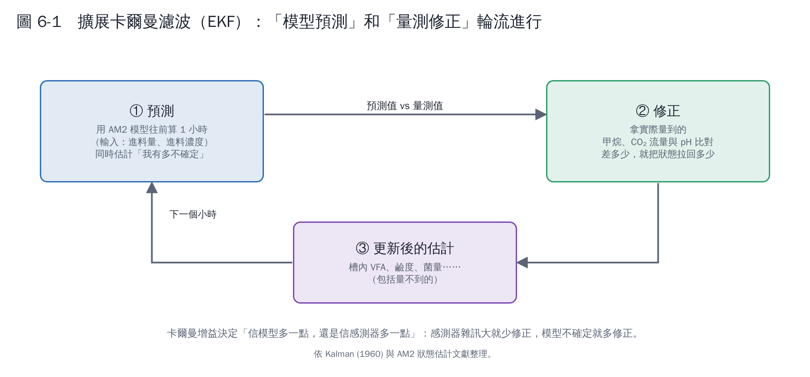
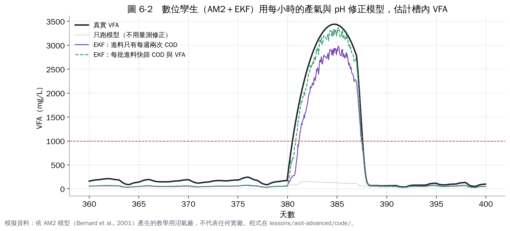

# 第 6 章　實作 3：數位孿生——AM2 模型＋擴展卡爾曼濾波

第 5 章的軟感測完全靠資料；這一章換個思路：**用懂微生物的機理模型當骨架，再用每小時的量測值不斷修正它**。這種「模型＋量測」的組合，就是數位孿生的核心，技術名稱叫「資料同化」或「狀態估計」。

## 6.1 擴展卡爾曼濾波（EKF）在做什麼

卡爾曼濾波由 Kalman（1960）提出 [1]，最早用在航太導航。「擴展」版本用於像 AM2 這種非線性模型。每小時做兩件事：

1. **預測**：用 AM2 模型 [2]，根據進料量與進料濃度，算出一小時後槽內的狀態（包括量不到的 VFA、菌量、鹼度）。
2. **修正**：拿實際量到的甲烷流量、CO₂ 流量、pH 和模型預測的比對，差多少就把狀態拉回多少。拉多少由「模型有多不確定」和「感測器有多不準」自動決定。

AM2 搭配 EKF、無跡卡爾曼濾波（UKF）、粒子濾波等估計器，是厭氧消化監測研究中常見的組合 [3]。

## 6.2 本練習的設定

| 項目 | 設定 | 為什麼 |
|---|---|---|
| 模型參數 | 用教科書值，和「真實」模擬廠不同 | 模擬真實世界的模型誤差 |
| 量測 | 每小時的甲烷流量、CO₂ 流量、pH | 都是一般沼氣廠有的儀表 |
| 進料資訊（情境 A） | 只有每週兩次的進料 COD；進料 VFA 不知道，用固定值猜 | 多數廠的現況 |
| 進料資訊（情境 B） | 每批進料都快篩 COD 與 VFA | 投資快篩設備後的狀況 |

## 6.3 結果

| 方法 | 測試期 VFA 估計誤差 MAE（mg/L） |
|---|---|
| 只跑模型、不用量測修正 | 223 |
| EKF，情境 A（每週兩次進料 COD） | 119 |
| EKF，情境 B（每批進料快篩） | 99 |

看圖 6-2 有三個重點：

1. **只跑模型完全看不到事件**（灰色虛線）：模型不知道那幾天進料的 VFA 特別高，所以算出來一切正常。這就是「沒有量測修正的模擬模型」的極限。
2. **EKF 從產氣與 pH 的變化「反推」出槽內 VFA 升高**：情境 A 雖然慢一點、低估一些，但抓到了事件。
3. **進料資訊越完整，估計越早、越準**：情境 B 幾乎貼著真實曲線。第 7 章會看到，這讓預警提早了約 8 小時。

另外注意：正常期間 EKF 的估計比真實 VFA 偏低約 100 mg/L。原因是模型參數和真實廠不同，產生固定偏差。實務上會用實驗室 VFA 定期校正參數，或在 EKF 中把關鍵參數也當成要估計的狀態。

## 6.4 EKF vs 軟感測，怎麼選？

| | 軟感測（第 5 章） | 數位孿生 EKF（本章） |
|---|---|---|
| 需要什麼 | 足夠的實驗室標籤 | 機理模型＋進料資訊＋懂模型的人 |
| 能外推嗎 | 樹模型不行，線性可以但會過頭 | 可以，模型本身有物理意義 |
| 還能做什麼 | 只估一個指標 | 同時估所有狀態，還能往前試算（第 8 章進料建議） |
| 維護 | 定期重新訓練 | 定期校正參數 |

兩者不互斥：實務上可以把 EKF 估計值當成軟感測的一個輸入特徵，這就是一種混合模型。

## 本章重點

- 數位孿生＝機理模型＋即時量測修正；EKF 是最常用的方法之一。
- 只跑模型會錯過事件；加上量測修正後，能從產氣與 pH 反推槽內 VFA。
- 進料資訊越完整，數位孿生越準、越早；投資進料快篩可能比投資 AI 更划算。

## 參考文獻

1. Kalman RE (1960). A new approach to linear filtering and prediction problems. *Journal of Basic Engineering*, 82, 35–45. https://doi.org/10.1115/1.3662552
2. Bernard O, Hadj-Sadok Z, Dochain D, Genovesi A, Steyer JP (2001). Dynamical model development and parameter identification for an anaerobic wastewater treatment process. *Biotechnology and Bioengineering*, 75, 424–438. https://doi.org/10.1002/bit.10036
3. Comparison of Unscented Kalman Filter Design for Agricultural Anaerobic Digestion Model（arXiv:2310.15958）. https://arxiv.org/abs/2310.15958
