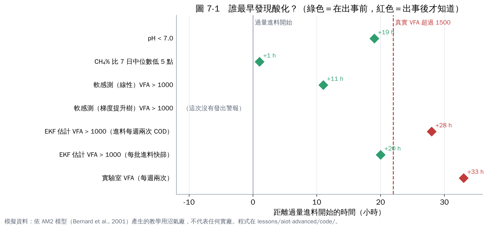
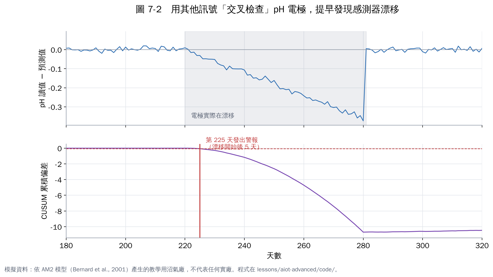

# 第 7 章　實作 4：異常預警與感測器健康

## 7.1 誰最早發現酸化？

把前面做出來的各種方法放在一起比：第 380 天開始大過量進料，真實 VFA 在 **22 小時後**超過 1,500 mg/L（定義為「出事」）。誰能在這之前發出警報？

| 警報方法 | 進料後幾小時發出 | 比出事早多久 | 測試期其他時間誤報天數 |
|---|---|---|---|
| CH₄% 比過去 7 日中位數低 5 個百分點 | 1 | **21 小時** | 0 |
| 軟感測（線性）VFA > 1,000 | 11 | 11 小時 | 0 |
| pH（過去 6 小時平均）< 7.0 | 19 | 3 小時 | 0 |
| EKF（每批進料快篩）VFA > 1,000 | 20 | 2 小時 | 0 |
| EKF（每週兩次進料 COD）VFA > 1,000 | 28 | 晚 6 小時 | 0 |
| 實驗室 VFA（每週兩次） | 33 | 晚 11 小時 | 0 |
| 軟感測（梯度提升樹）VFA > 1,000 | 沒有發出 | — | 0 |

## 7.2 怎麼解讀

1. **最簡單的規則反而最早**：CH₄% 突然下降（CO₂ 比例上升），在這個情境中最早反應。原因之一是這次的過量進料本身含很多酸，一進槽就改變氣體組成。**不同原因的異常，最早出現的訊號不同**，所以實務上要同時看多個指標。
2. **相對門檻比絕對門檻好**：「比過去 7 天低 5 點」會隨原料自動調整基準；固定的 pH < 7.0 則反應晚得多，因為鹼度會緩衝 pH 的下降。
3. **實驗室數據不適合當預警**：每週兩次的採樣，運氣好才剛好抓到事件。
4. **評估警報要同時看「提早多久」和「誤報多少」**：只追求提早，門檻設低一點就能做到，但誤報太多會讓操作員不再理會警報（「狼來了」效應）。

本練習只有一次大事件，樣本很少；實務評估要累積多次事件，計算偵測率與誤報率。

## 7.3 感測器健康：pH 電極在說謊嗎？

第 220 天起，模擬廠的 pH 電極開始慢慢漂移（每天 −0.006），讀值越來越低，但真實 pH 沒變。如果沒發現，模型和操作員都會被誤導。

**做法**：用其他訊號（CH₄%、產氣量、CO₂ 流量、進料量）訓練一個「預測 pH」的模型。正常時，量測 pH 和預測 pH 應該很接近；如果兩者的差距持續往同一個方向累積，就懷疑電極有問題。累積的方法用 CUSUM（累積和控制圖）。

結果：漂移從第 220 天開始，CUSUM 在**第 225 天**發出警報，這時漂移量只有約 0.03 pH，肉眼在趨勢圖上很難察覺。

這種「感測器交叉檢查」（又稱虛擬感測器、解析冗餘）成本很低，卻能保護後面所有的模型。**建議每一個關鍵感測器都要有一個交叉檢查**。

## 7.4 設計預警系統的檢查清單

| 項目 | 建議 |
|---|---|
| 多指標 | 至少結合一個氣體組成指標、一個 pH 或鹼度指標、一個模型估計 |
| 相對門檻 | 用「和近期基準比」取代固定值 |
| 警報分級 | 注意（黃）→ 警告（橙）→ 立即處理（紅），各有對應 SOP |
| 誤報管理 | 記錄每次警報的處理結果，每月檢討門檻 |
| 感測器健康 | 關鍵感測器要有交叉檢查；感測器異常時，相關模型要自動降級 |
| 觸發採樣 | 警報出現時自動通知加做實驗室分析 |

## 本章重點

- 在這次模擬事件中，CH₄% 相對下降最早（提早 21 小時），線性軟感測次之（11 小時），pH 只提早 3 小時。
- 評估警報要同時看提早多久與誤報多少；一次事件的結果不能過度推論。
- 用其他訊號交叉檢查 pH 電極，漂移 5 天就被抓到。

## 參考文獻

1. Drosg B (2013). *Process monitoring in biogas plants*. IEA Bioenergy Task 37 technical brochure. IEA Bioenergy.
2. Jimenez J, Latrille E, Harmand J, et al. (2015). Instrumentation and control of anaerobic digestion processes: a review and some research challenges. *Reviews in Environmental Science and Bio/Technology*, 14, 615–648. https://doi.org/10.1007/s11157-015-9382-6
