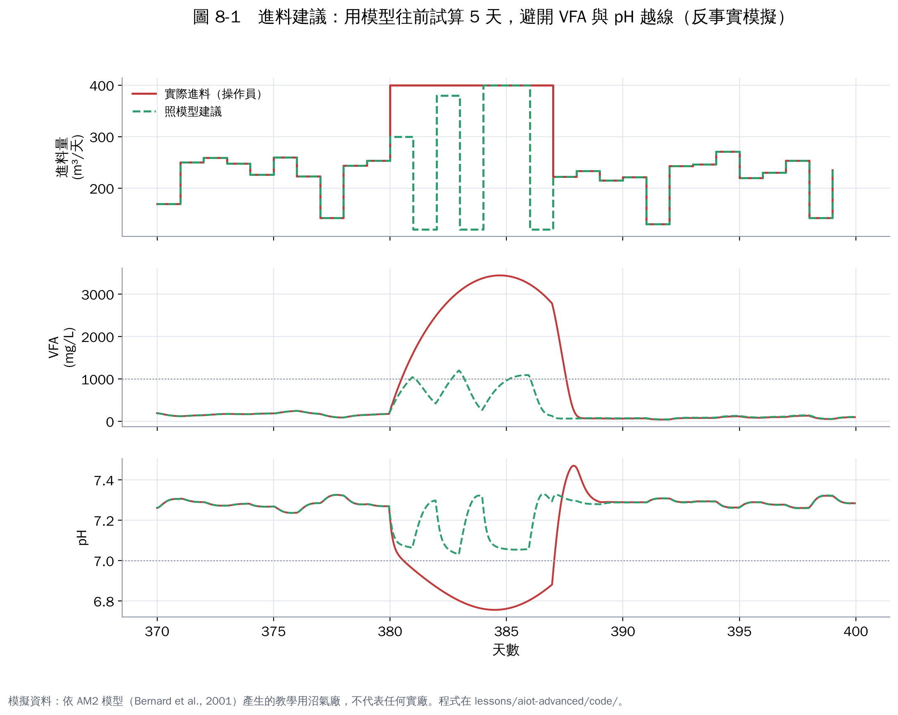
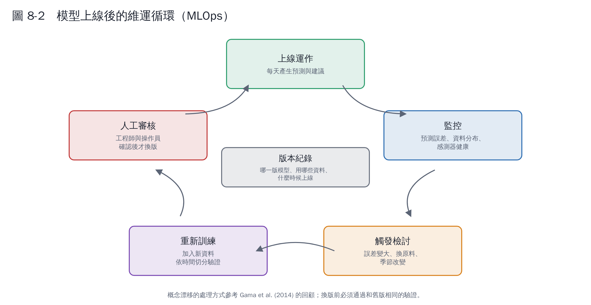

# 第 8 章　實作 5：進料建議與上線維運

預警只告訴你「出事了」；進料建議要回答「**今天該餵多少**」。這是從 L3（分析預測）走到 L4（建議與閉迴路）的關鍵一步。

## 8.1 做法：用模型往前試算

這種做法稱為「模型預測控制」（MPC）的簡化版。每天早上：

1. 從數位孿生（第 6 章）取得槽內目前的狀態。
2. 列出幾個候選進料量（例如從計畫量往下降 15 個等級）。
3. 每個候選量都用模型**往前模擬 5 天**。
4. 刪掉會讓 VFA 超過 1,000 mg/L 或 pH 低於 7.0 的方案。
5. 在剩下的方案中，選產甲烷最多的。
6. 建議值不超過操作員的原計畫（只會建議減量，不會建議加量）。

Gaida 等人（2017）回顧沼氣廠進料控制時指出，雖然已經有很多先進的控制器設計，實廠大多仍沒有閉迴路進料控制，原因包括缺乏可靠的線上量測，以及業界對全自動控制的保留態度 [1]。所以本練習把它定位成「給操作員的建議」，而不是自動執行。

## 8.2 反事實模擬：如果當時照建議做？

模擬廠的好處是可以「重來一次」：同樣在第 370–400 天，同樣的原料，只把進料量換成模型建議值，看結果有什麼不同。

| 指標（第 370–400 天） | 實際（操作員） | 照模型建議 |
|---|---|---|
| VFA 最高值 | 3,440 mg/L | 1,199 mg/L |
| pH 最低值 | 6.76 | 7.03 |
| 總進料量 | 7,937 m³ | 6,977 m³（−12%） |
| 總甲烷產量 | 40,899 Nm³ | 35,136 Nm³（−14%） |

**怎麼看這個結果？**

- 照建議做，VFA 只稍微超過警戒，pH 守住 7.0，避開了酸化。
- 代價是這 30 天少產 14% 甲烷，因為少餵了 12% 的料。在這個模擬中，酸化進料一停就恢復，所以「硬餵」看起來反而產氣比較多。
- 但真實的酸化常常不會這麼快恢復：產甲烷菌受損後，可能要數週到數月才能回到正常產氣，還可能需要加鹼、停止進料。**模擬模型低估了酸化的長期代價**，這也是要用實廠經驗補足的地方。

## 8.3 看出問題了嗎？建議值在跳

圖 8-1 上圖的綠色虛線：建議值在高、低之間來回跳（今天減到 120、明天又回到 380）。這在實務上不可行：

- 原料可能已經備好、不能說不用就不用。
- 進料大起大落本身就會讓消化槽不穩定。
- 操作員看到這種建議，很快就不信任系統。

**實務上的修正**：

| 修正 | 做法 |
|---|---|
| 變動幅度限制 | 每天建議值和前一天差不超過 ±20% |
| 平滑化 | 在目標函數加入「變動懲罰」 |
| 不確定性 | 模型參數有誤差，限制值要留安全餘裕（本練習中，照建議做 VFA 仍略超過 1,000，就是模型誤差造成） |
| 人工確認 | 建議值附上理由（例如「預估 3 天後 VFA 達 1,300」），由操作員決定 |

## 8.4 上線之後：模型維運（MLOps）

模型上線不是結束。原料、季節、菌群都會變，模型會慢慢變不準，這叫「概念漂移」（第 4 章換原料就是例子）。Gama 等人（2014）回顧了偵測與處理概念漂移的方法 [2]。實務上要建立：

| 項目 | 做法 |
|---|---|
| 監控 | 每天記錄預測誤差；每週看誤差趨勢 |
| 觸發條件 | 誤差連續超過門檻、換原料、季節轉換、儀表更換 |
| 重新訓練 | 加入新資料，**用和第一次相同的依時間切分方式驗證** |
| 人工審核 | 新版本要比舊版好，並經工程師與操作員確認才上線 |
| 版本紀錄 | 記錄每一版用了哪些資料、什麼時候上線，出問題可以退回 |
| 可解釋性 | 每次建議都附上主要影響因子；可用 SHAP 等方法說明樹模型的判斷 [3] |

## 本章重點

- 進料建議＝用數位孿生往前試算多個方案，挑出不越線且產氣最多的。
- 反事實模擬顯示：照建議能避開酸化，但短期少產 14% 甲烷；模擬低估了酸化的長期代價。
- 簡化版控制器的建議會劇烈跳動，實務上要加變動限制、安全餘裕與人工確認。
- 上線後要持續監控、定期重新訓練、版本管理。

## 參考文獻

1. Gaida D, Wolf C, Bongards M (2017). Feed control of anaerobic digestion processes for renewable energy production: A review. *Renewable and Sustainable Energy Reviews*, 68, 869–875. https://doi.org/10.1016/j.rser.2016.06.096
2. Gama J, Žliobaitė I, Bifet A, Pechenizkiy M, Bouchachia A (2014). A survey on concept drift adaptation. *ACM Computing Surveys*, 46(4), 44. https://doi.org/10.1145/2523813
3. Lundberg SM, Lee SI (2017). A unified approach to interpreting model predictions. *Advances in Neural Information Processing Systems*, 30. https://arxiv.org/abs/1705.07874
