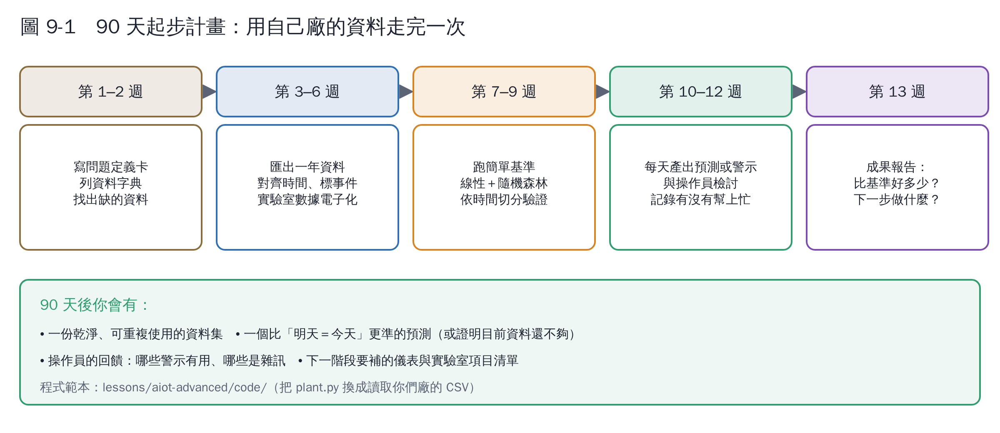

# 第 9 章　國內外文獻導讀與工具

這一章是閱讀地圖：先讀哪些、各篇能學到什麼、有哪些工具可以直接用。

## 9.1 閱讀順序建議

| 順序 | 讀什麼 | 為什麼 |
|---|---|---|
| 1 | 綜述 A1–A3 | 建立全貌：沼氣廠能量什麼、控制做到哪、機器學習用在哪 |
| 2 | 機理模型 B1–B2 | 看懂 ADM1 與 AM2 的結構（不必推導） |
| 3 | 實廠研究 C1–C2 | 看別人怎麼用全尺度資料建模、遇到什麼問題 |
| 4 | 方法基礎 E 類 | 遇到具體問題時再查 |

## 9.2 國外文獻

### A. 綜述（先讀這些）

| 編號 | 文獻 | 重點 |
|---|---|---|
| A1 | Jimenez et al. (2015) [1] | 厭氧消化儀表與控制的完整回顧，指出生物可及性評估與光譜分析是發展方向 |
| A2 | Gaida et al. (2017) [2] | 進料控制回顧：實廠大多仍無閉迴路控制；缺乏可靠線上量測是主因 |
| A3 | Andrade Cruz et al. (2022) [3] | 機器學習在厭氧消化的應用與挑戰；ANN、RF、SVM 最常見 |
| A4 | Rutland et al. (2023) [4] | 系統性回顧：實驗室模型搬到實廠常失準、可解釋性不足 |
| A5 | Haimi et al. (2013) [5] | 污水處理資料驅動軟感測的回顧，方法可直接借用 |

### B. 機理模型與數位孿生

| 編號 | 文獻 | 重點 |
|---|---|---|
| B1 | Batstone et al. (2002) [6] | ADM1 原始論文，業界標準模型 |
| B2 | Bernard et al. (2001) [7] | AM2 兩步驟模型，本教材模擬廠的基礎 |
| B3 | Torfs et al. (2022) [8] | 水處理模型如何轉變成數位孿生 |

### C. 全尺度實廠的機器學習研究

| 編號 | 文獻 | 重點 |
|---|---|---|
| C1 | 同濟大學團隊（2024）[9] | 4 座全尺度乾式廚餘消化槽、約 1.5 年資料、8 種演算法；CatBoost 最佳；VFA/ALK 軟感測可行 |
| C2 | Chemosphere（2023）工業規模廠研究 [10] | 實廠資料預測產氣，隨機森林表現最好 |
| C3 | 市政共消化產氣預測的特徵工程研究 [11] | 示範如何從營運資料做特徵 |
| C4 | 生物電化學厭氧消化的 FOS/TAC 軟感測 [12] | 用機器學習推估 FOS/TAC |

### D. 狀態估計（數位孿生的核心技術）

| 編號 | 文獻 | 重點 |
|---|---|---|
| D1 | Kalman (1960) [13] | 卡爾曼濾波原始論文 |
| D2 | 農業厭氧消化模型的 UKF 設計比較 [14] | EKF、UKF 等估計器在 AM2 類模型上的比較 |

### E. 機器學習方法基礎

隨機森林 [15]、梯度提升 [16]、LSTM [17]、物理約束神經網路 [18]、概念漂移 [19]、模型解釋 SHAP [20]、遷移學習 [21]。

## 9.3 臺灣的研究與資料

我在臺灣博碩士論文系統與各校典藏中**沒有找到以機器學習建模全尺度沼氣廠的研究**，相關研究多集中在實驗與操作面：

| 文獻 | 重點 | 對建模的價值 |
|---|---|---|
| 交通大學：豬場廢水厭氧消化與沼氣生成之研究 [22] | 批次與柱流式反應器試驗，建立產沼氣最佳化條件 | 提供豬場廢水的動力學參數參考 |
| 陽明交通大學：乾式廚餘厭氧消化產沼氣系統之研究 [23] | 乾式廚餘消化系統 | 乾式消化的操作經驗 |
| 畜殖廢水厭氧共消化提升沼氣產量之模場研究 [24] | 添加粗甘油與微藻殘渣共消化，HRT 8 天時沼氣量增加 39% | 共消化配方的參考數據 |
| 臺大農經所碩士論文 [25] | 養豬場沼氣發電的經濟分析；指出沼氣量不足曾是早期推廣失敗的原因之一 | 說明「產氣預測」對投資評估的重要性 |
| 工研院沼氣發電推動辦公室：沼氣發電機操作手冊 [26] | 沼氣再利用與發電機操作實務 | 了解現場的操作限制與資料來源 |

**這代表一個機會**：臺灣有大量養豬場與逐漸增加的廚餘厭氧設施，但全尺度資料驅動建模的研究很少。用本教材的方法整理一座廠的營運資料，就可能是國內少見的實廠研究。

## 9.4 工具

| 工具 | 用途 | 備註 |
|---|---|---|
| Python＋scikit-learn | 本教材所有機器學習練習 | 免費、資料最多 |
| 本教材程式（`lessons/aiot-advanced/code/`） | AM2 模擬、EKF、預測、軟感測、預警、進料建議 | 可當範本改成自己的資料 |
| QSDsan | 開源 Python 套件，內建 ADM1 等程序模型 [27] | 要做 ADM1 等級的數位孿生時參考 |
| IWA BSM2 基準模型 | 污水廠（含厭氧消化）控制策略的標準測試平台 | 比較控制策略時用 |

## 9.5 把程式換成自己廠的資料

1. 依第 1 章做資料字典，整理成兩個 CSV（每日營運資料、實驗室資料）。
2. 先跑第 4 章的產氣預測：只需要每日產氣與進料，最容易成功。
3. 有一年以上實驗室 VFA 或 FOS/TAC，再做第 5 章的軟感測。
4. 數位孿生（第 6 章）需要校正 AM2 參數，建議找有建模經驗的學術單位合作。

## 本章重點

- 先讀綜述（Jimenez 2015、Gaida 2017、Andrade Cruz 2022、Rutland 2023），再看實廠研究。
- 臺灣幾乎沒有全尺度沼氣廠的機器學習研究，這是機會。
- 工具：scikit-learn、本教材程式、QSDsan。

## 參考文獻

1. Jimenez J, Latrille E, Harmand J, et al. (2015). Instrumentation and control of anaerobic digestion processes: a review and some research challenges. *Reviews in Environmental Science and Bio/Technology*, 14, 615–648. https://doi.org/10.1007/s11157-015-9382-6
2. Gaida D, Wolf C, Bongards M (2017). Feed control of anaerobic digestion processes for renewable energy production: A review. *Renewable and Sustainable Energy Reviews*, 68, 869–875. https://doi.org/10.1016/j.rser.2016.06.096
3. Andrade Cruz I, Chuenchart W, Long F, et al. (2022). Application of machine learning in anaerobic digestion: Perspectives and challenges. *Bioresource Technology*, 345, 126433. https://doi.org/10.1016/j.biortech.2021.126433
4. Rutland H, You J, Liu H, Bull L, Reynolds D (2023). A systematic review of machine-learning solutions in anaerobic digestion. *Bioengineering*, 10, 1410. https://doi.org/10.3390/bioengineering10121410
5. Haimi H, Mulas M, Corona F, Vahala R (2013). Data-derived soft-sensors for biological wastewater treatment plants: An overview. *Environmental Modelling & Software*, 47, 88–107. https://doi.org/10.1016/j.envsoft.2013.05.009
6. Batstone DJ, Keller J, Angelidaki I, et al. (2002). The IWA Anaerobic Digestion Model No 1 (ADM1). *Water Science and Technology*, 45(10), 65–73. https://doi.org/10.2166/wst.2002.0292
7. Bernard O, Hadj-Sadok Z, Dochain D, Genovesi A, Steyer JP (2001). Dynamical model development and parameter identification for an anaerobic wastewater treatment process. *Biotechnology and Bioengineering*, 75, 424–438. https://doi.org/10.1002/bit.10036
8. Torfs E, Nicolaï N, Daneshgar S, et al. (2022). The transition of WRRF models to digital twin applications. *Water Science and Technology*, 85(10), 2840–2853. https://doi.org/10.2166/wst.2022.107
9. （同濟大學研究團隊）(2024). Machine learning for enhancing prediction of biogas production and building a VFA/ALK soft sensor in full-scale dry anaerobic digestion of kitchen food waste. *Journal of Environmental Management*. https://www.sciencedirect.com/science/article/abs/pii/S0301479724031761
10. (2023). Prediction of biogas production of industrial scale anaerobic digestion plant by machine learning algorithms. *Chemosphere*. https://www.sciencedirect.com/science/article/abs/pii/S0045653523012432
11. Feature engineering and supervised machine learning to forecast biogas production during municipal anaerobic co-digestion. PMC10928704. https://www.ncbi.nlm.nih.gov/pmc/articles/PMC10928704/
12. Application of machine learning for FOS/TAC soft sensing in bio-electrochemical anaerobic digestion. PMC11901494. https://www.ncbi.nlm.nih.gov/pmc/articles/PMC11901494/
13. Kalman RE (1960). A new approach to linear filtering and prediction problems. *Journal of Basic Engineering*, 82, 35–45. https://doi.org/10.1115/1.3662552
14. Comparison of Unscented Kalman Filter Design for Agricultural Anaerobic Digestion Model（arXiv:2310.15958）. https://arxiv.org/abs/2310.15958
15. Breiman L (2001). Random forests. *Machine Learning*, 45, 5–32. https://doi.org/10.1023/A:1010933404324
16. Friedman JH (2001). Greedy function approximation: a gradient boosting machine. *The Annals of Statistics*, 29, 1189–1232. https://doi.org/10.1214/aos/1013203451
17. Hochreiter S, Schmidhuber J (1997). Long short-term memory. *Neural Computation*, 9, 1735–1780. https://doi.org/10.1162/neco.1997.9.8.1735
18. Raissi M, Perdikaris P, Karniadakis GE (2019). Physics-informed neural networks: A deep learning framework for solving forward and inverse problems involving nonlinear partial differential equations. *Journal of Computational Physics*, 378, 686–707. https://doi.org/10.1016/j.jcp.2018.10.045
19. Gama J, Žliobaitė I, Bifet A, Pechenizkiy M, Bouchachia A (2014). A survey on concept drift adaptation. *ACM Computing Surveys*, 46(4), 44. https://doi.org/10.1145/2523813
20. Lundberg SM, Lee SI (2017). A unified approach to interpreting model predictions. *Advances in Neural Information Processing Systems*, 30. https://arxiv.org/abs/1705.07874
21. Pan SJ, Yang Q (2010). A survey on transfer learning. *IEEE Transactions on Knowledge and Data Engineering*, 22, 1345–1359. https://doi.org/10.1109/TKDE.2009.191
22. 國立交通大學機構典藏：豬場廢水厭氧消化與沼氣生成之研究。https://ir.nctu.edu.tw/handle/11536/45314
23. 國立陽明交通大學博碩士論文：乾式廚餘厭氧消化產沼氣系統之研究。https://thesis.lib.nycu.edu.tw/items/f1465dce-1fc1-486c-9f7f-1300d11b4858
24. 臺灣博碩士論文知識加值系統：畜殖廢水厭氧共消化提升沼氣產量之模場研究。https://ndltd.ncl.edu.tw/handle/97214015579017875807
25. 國立臺灣大學農業經濟學研究所碩士論文（2021），養豬場沼氣發電相關研究。https://tdr.lib.ntu.edu.tw/jspui/bitstream/123456789/80000/1/U0001-2007202115001900.pdf
26. 工業技術研究院中分院沼氣發電推動辦公室：沼氣再利用（發電）推廣與沼氣發電機操作手冊。https://www.biogas.com.tw/ReadFile/?p=Tech&n=c4902cef-9205-486b-9d76-e484440df6f9.pdf
27. QSDsan 說明文件（ADM1 相關單元）。https://qsdsan.readthedocs.io/en/latest/api/sanunits/junction.html
