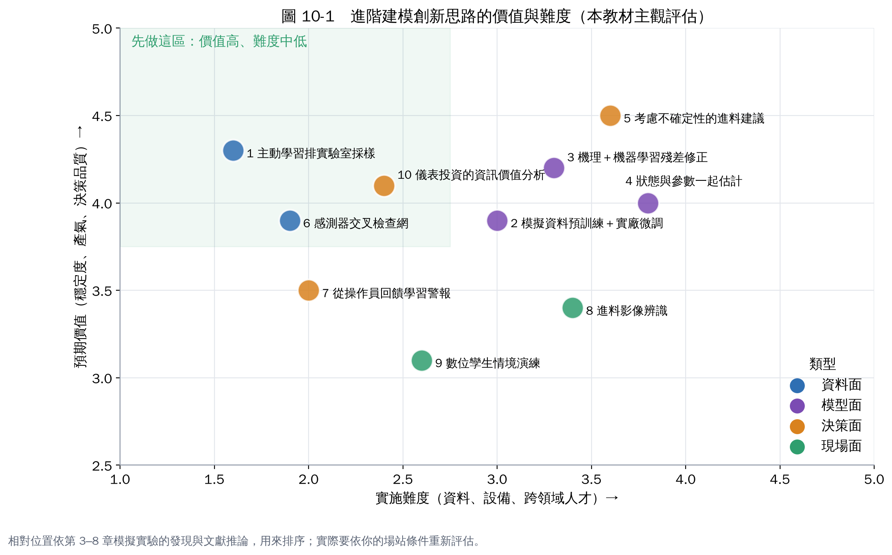

# 第 10 章　進階建模的創新思路

> **本章全部屬於推論**。每個想法都來自第 3–8 章模擬實驗暴露的問題，並附上方法上的文獻依據；但在沼氣實廠上，這些做法目前少見或沒有公開案例。適合當研究題目、產學合作或計畫亮點，執行前要先做可行性驗證。上一個分區第 8 章的九個想法（微生物預警、原料快篩、彈性發電等）仍然適用，這裡不重複。

## 1. 主動學習：讓模型決定什麼時候該送實驗室

**來自哪個發現**：第 5 章顯示，實驗室標籤是軟感測最大的限制，而且異常期間的標籤最稀有、最有價值。

**想法**：不要固定每週一、四採樣；讓軟感測模型在「自己最沒把握」或「估計值快速變化」時，通知操作員加做 VFA。同樣的分析預算，換來更有價值的資料。

**依據**：主動學習（active learning）是機器學習中專門研究「該標記哪些資料」的領域 [1]。

**起步**：保留固定採樣，另外每月給 2–4 次「模型觸發採樣」的額度，比較兩種標籤對模型的貢獻。

## 2. 用模擬資料預訓練，再用實廠資料微調

**來自哪個發現**：實廠很少發生酸化，模型沒看過異常就學不會（第 4、5 章）；但模擬廠可以產生上千種異常情境。

**想法**：用 AM2 或 ADM1 產生大量包含各種異常的模擬資料，先訓練模型認識「異常長什麼樣子」，再用少量實廠資料微調。

**依據**：遷移學習（transfer learning）研究如何把在一個領域學到的知識轉移到另一個領域 [2]。

**風險**：模擬和實廠差太多時，預訓練反而誤導（第 6 章就看到參數誤差造成的偏差）。

## 3. 機理＋機器學習的殘差修正

**來自哪個發現**：第 6 章的 EKF 在正常期間有約 100 mg/L 的固定偏差，來自模型參數和真實廠不同。

**想法**：讓機理模型先算，再用機器學習學「模型和實驗室實測值的差」，把兩者相加。機理模型負責外推與物理一致性，機器學習負責修正系統性誤差。

**依據**：混合模型是厭氧消化建模綜述普遍看好的方向 [3, 4]；物理約束神經網路則是把物理方程式直接放進神經網路的訓練 [5]。

## 4. 狀態與參數一起估計

**來自哪個發現**：同上，模型參數不準造成偏差；而且原料、菌群改變時，「正確的參數」也會跟著變。

**想法**：在 EKF 中把關鍵參數（例如產甲烷菌最大生長速率）也當成要估計的狀態，讓數位孿生隨時間自動校正。參數的變化本身就是有用的資訊：如果估出來的產甲烷菌活性持續下降，可能就是抑制的前兆。

**依據**：厭氧消化的估計器比較研究中，已有同時估計狀態與參數的做法 [6]。

## 5. 考慮不確定性的進料建議

**來自哪個發現**：第 8 章照建議做，VFA 仍略超過 1,000，因為模型有誤差；建議值也會劇烈跳動。

**想法**：不只算「最可能的未來」，而是用多組可能的參數各算一次，要求「大部分情境都不越線」才採用（機率約束）；再加上每日變動幅度限制。

**價值**：建議更保守但更可信，也比較容易被操作員接受。

## 6. 感測器交叉檢查網

**來自哪個發現**：第 7 章用其他訊號預測 pH，電極漂移 5 天就被發現，而且成本幾乎為零。

**想法**：對每一個關鍵感測器都建一個「用其他感測器預測它」的模型，形成交叉檢查網。任何一個感測器開始說謊，都會被其他感測器「指證」；系統同時自動把依賴這個感測器的模型降級。

**起步**：先做 pH、CH₄%、沼氣流量三個，每週出一份感測器健康報告。

## 7. 從操作員的回饋學習警報

**來自哪個發現**：第 7 章強調評估警報要看誤報；而操作員每天都在判斷「這個警報有沒有用」。

**想法**：每次警報讓操作員按一下「有用／誤報／已知原因」，這些回饋變成新的標籤，用來自動調整門檻與警報組合。

**價值**：警報系統會越用越準，也讓操作員參與 AIoT，而不是被 AIoT 指揮。

## 8. 進料影像辨識

**來自哪個發現**：第 6 章顯示進料資訊越完整，數位孿生越準、預警越早（每批快篩比每週兩次 COD 早約 8 小時）。

**想法**：在進料坑或輸送帶上裝攝影機，用影像辨識估計廚餘的組成（油脂、澱粉、蔬果、異物比例），轉換成數位孿生的進料濃度估計。比化學快篩便宜、每批都有。

**風險**：影像只看得到表面；需要一批化學分析當訓練標籤。

## 9. 數位孿生情境演練

**想法**：把模擬廠（像本教材的 AM2 模擬）做成操作員的訓練工具：系統隨機產生異常（過量進料、電極漂移、加熱故障），讓新進人員練習判斷與處理，並記錄反應時間。

**價值**：沼氣廠異常少，新人很難累積經驗；模擬演練可以補上。也能用來檢驗 SOP 是否完整。

## 10. 儀表投資的資訊價值分析

**來自哪個發現**：第 6、7 章的比較，其實就是在回答「多買一台進料快篩值不值得」：它讓預警提早約 8 小時。

**想法**：用數位孿生系統性地比較「加裝某個儀表或提高某項檢測頻率」能讓預測誤差、預警時間改善多少，再換算成避免酸化的期望損失，作為採購決策依據。

**價值**：多數廠買儀表靠經驗或廠商推銷；用模擬量化「資訊的價值」，能把有限預算花在最有效的地方。這也是寫計畫書時很有說服力的論證方式。

## 怎麼挑選

- **最容易起步**：1（主動學習採樣）、6（感測器交叉檢查）、10（資訊價值分析）。資料和程式都已經有雛形，主要是流程設計。
- **適合產學合作**：3、4、5，需要建模與控制背景。
- **需要硬體投資**：8（影像辨識）。
- **能提升人員能力**：7、9。

## 本章重點

- 十個想法都來自模擬實驗暴露的真實問題：標籤稀少、模型偏差、建議值跳動、感測器漂移、進料資訊不足。
- 優先順序：主動學習採樣、感測器交叉檢查、儀表資訊價值分析。
- 全部屬於推論，需要用實廠資料驗證。

## 參考文獻

1. Settles B (2009). *Active learning literature survey*. Computer Sciences Technical Report 1648, University of Wisconsin–Madison. https://burrsettles.com/pub/settles.activelearning.pdf
2. Pan SJ, Yang Q (2010). A survey on transfer learning. *IEEE Transactions on Knowledge and Data Engineering*, 22, 1345–1359. https://doi.org/10.1109/TKDE.2009.191
3. Andrade Cruz I, Chuenchart W, Long F, et al. (2022). Application of machine learning in anaerobic digestion: Perspectives and challenges. *Bioresource Technology*, 345, 126433. https://doi.org/10.1016/j.biortech.2021.126433
4. Rutland H, You J, Liu H, Bull L, Reynolds D (2023). A systematic review of machine-learning solutions in anaerobic digestion. *Bioengineering*, 10, 1410. https://doi.org/10.3390/bioengineering10121410
5. Raissi M, Perdikaris P, Karniadakis GE (2019). Physics-informed neural networks: A deep learning framework for solving forward and inverse problems involving nonlinear partial differential equations. *Journal of Computational Physics*, 378, 686–707. https://doi.org/10.1016/j.jcp.2018.10.045
6. Comparison of Unscented Kalman Filter Design for Agricultural Anaerobic Digestion Model（arXiv:2310.15958）. https://arxiv.org/abs/2310.15958
