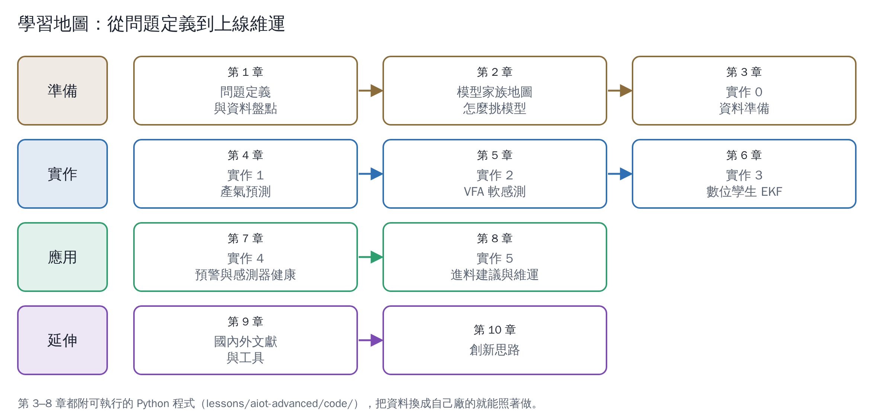

# 沼氣廠 AIoT 進階：模型怎麼建、怎麼驗證、怎麼上線

上一個分區講了 AIoT 是什麼、該做到什麼程度。這個分區往下挖一層：**模型到底怎麼建？** 我用一個依文獻模型產生的「模擬沼氣廠」，把預測、軟感測、數位孿生、預警、進料建議實際做一遍，圖和數字都是程式真正跑出來的。

| 章 | 主題 | 你會學到 |
|---|---|---|
| [1](01-problem-and-data.md) | 建模前：問題定義與資料盤點 | 問題定義卡、資料字典、最常被忽略的資料 |
| [2](02-model-families.md) | 模型家族地圖 | 機理模型、資料驅動、混合模型；怎麼挑 |
| [3](03-lab-data-preparation.md) | 實作 0：資料準備 | 模擬廠、時間對齊、特徵工程、不偷看未來 |
| [4](04-lab-forecasting.md) | 實作 1：產氣預測 | 基準線、三種模型比較、正確的驗證方法 |
| [5](05-lab-soft-sensor.md) | 實作 2：VFA 軟感測 | 實驗室頻率的影響、樹模型的外推陷阱 |
| [6](06-lab-digital-twin.md) | 實作 3：數位孿生（EKF） | 機理模型＋量測修正、進料資訊的價值 |
| [7](07-lab-early-warning.md) | 實作 4：預警與感測器健康 | 誰最早發現酸化、偵測 pH 電極漂移 |
| [8](08-lab-feed-advice-and-ops.md) | 實作 5：進料建議與上線維運 | 模型預測控制、反事實模擬、MLOps |
| [9](09-literature-and-tools.md) | 國內外文獻與工具 | 分類閱讀清單、開源工具、臺灣研究現況 |
| [10](10-innovation.md) | 創新思路（進階版） | 10 個少有人做、但按道理可行的建模方向 |

## 先講結論：模擬實驗教會我們的六件事

1. **一定要先有簡單基準**：「明天產氣＝今天產氣」在正常日的誤差約 11%；模型要比它好才有意義（第 4 章）。
2. **驗證要依時間切分**：隨機打散資料，會讓誤差看起來只有實際的一半，甚至更少（第 4 章）。
3. **同一類模型可以差很多**：梯度提升樹在換原料之後，把正常日誤判成「過量事件」，誤差暴增；排除事件日重新訓練就恢復正常（第 4 章）。
4. **樹模型不會外推**：VFA 軟感測用樹模型，最高只能估到訓練資料裡見過的值，事件時嚴重低估、沒有報警（第 5 章）。
5. **進料資訊很值錢**：數位孿生（EKF）如果每批進料都有快篩，比只有每週兩次 COD 更早發現酸化（第 6、7 章）。
6. **模型建議要有限制條件**：模型預測控制能避開酸化，但建議值會劇烈跳動，實務上要加上變動幅度限制與人工確認（第 8 章）。

## 關於模擬資料

- 模擬廠依 AM2 兩步驟厭氧消化模型（Bernard et al., 2001）建立，參數取文獻常用值並刻意調整成和「教科書參數」不同，讓建模時有真實的模型誤差。
- 模擬資料**不代表任何實廠**，數字只用來比較方法的相對好壞。換成真實資料時，結論可能不同。
- 程式在 [`code/`](code/)，照著 [`code/README.md`](code/README.md) 就能重跑，或換成自己廠的資料。
- 有 DOI 的文獻都由 GitHub Actions 自動到 Crossref 核對；第 10 章全部屬於推論。
