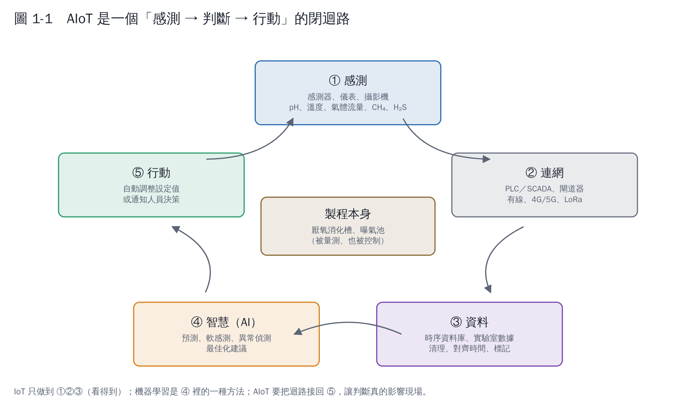
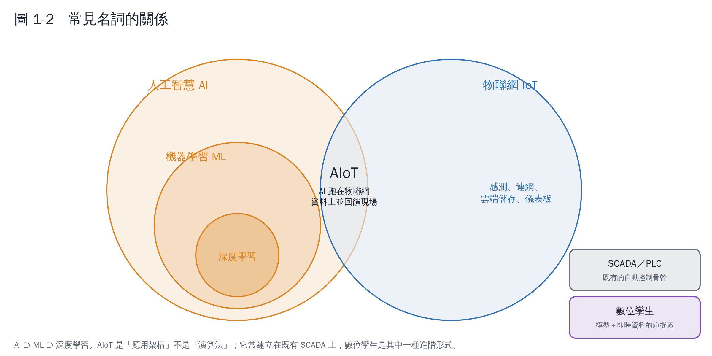

# 第 1 章　AIoT 是什麼？和機器學習有什麼不同

## 1.1 一句話定義

**AIoT（Artificial Intelligence of Things，人工智慧物聯網）＝ 物聯網收集的資料，交給人工智慧判斷，再把判斷結果回饋到現場。**

學術上，Zhang 與 Tao（2021）在 IEEE Internet of Things Journal 的綜述，把 AIoT 描述為「用 AI 讓物聯網系統具備感知、學習、推理與行動能力」，並把架構分成雲端、霧端（fog）與邊緣（edge）三層運算 [1]。換成水處理和沼氣廠的語言，就是下面這個迴路：

| 步驟 | 在沼氣廠長什麼樣子 |
|---|---|
| ① 感測 | 溫度計、pH 計、沼氣流量計、氣體分析儀（CH₄、CO₂、H₂S）、液位計、電錶、攝影機 |
| ② 連網 | PLC 與 SCADA 系統、網路閘道器、4G／5G 或光纖 |
| ③ 資料 | 時序資料庫保存每分鐘的數據，再加上實驗室分析（VFA、鹼度、TS/VS）與進料紀錄 |
| ④ 智慧 | 預測明天的產氣量、推估難量測的指標、提早發現異常、建議進料量 |
| ⑤ 行動 | 系統自動調整設定值，或推播給操作員，由人決定 |

## 1.2 先把名詞關係弄清楚

| 名詞 | 意思 | 跟 AIoT 的關係 |
|---|---|---|
| **IoT（物聯網）** | 讓設備能感測、連網、上傳資料 | AIoT 的基礎：沒有資料，就沒有 AI |
| **AI（人工智慧）** | 讓電腦做出類似人的判斷 | 最大的範圍，包含規則系統、最佳化、機器學習等 |
| **ML（機器學習）** | AI 的一種方法：從資料中「學」出規律，而不是人寫死規則 | AIoT 中最常用的「判斷」方法，但不是唯一 |
| **深度學習** | 機器學習的一種，用多層神經網路 | 適合影像、聲音；在沼氣廠的表格型資料中不一定比較好 |
| **SCADA／PLC** | 傳統的監控與自動控制系統 | 多數水處理廠早就有；AIoT 通常是「加在 SCADA 上面」，不是取代它 |
| **數位孿生（digital twin）** | 和實體廠同步運轉的虛擬模型 | AIoT 的進階形式：用模型＋即時資料做預測與試算 [2] |

機器學習的經典定義是：「如果一個程式在任務 T 上的表現（以 P 衡量）隨著經驗 E 而提升，就說它從經驗 E 中學習。」[3] 白話就是：**給它越多歷史資料，它就越會預測。**

## 1.3 AIoT 和機器學習：一樣與不一樣

| 比較 | 機器學習（ML） | AIoT |
|---|---|---|
| 本質 | 一種**方法**（演算法） | 一套**系統**（硬體＋網路＋資料＋演算法＋流程） |
| 核心問題 | 「怎麼從資料學出規律？」 | 「怎麼讓現場因為資料而變得更好？」 |
| 成果長什麼樣 | 一個模型、一個準確率數字 | 一個會運作的迴路：警報、建議、自動調整、節省的電與藥 |
| 需要什麼 | 整理好的資料集 | 感測器、網路、資料庫、模型、操作介面、維護流程、資安 |
| 可以離線嗎 | 可以，拿歷史資料在電腦上做 | 不行，必須和現場即時連動 |
| 失敗的常見原因 | 資料太少、過度擬合 | 感測器壞了沒人修、操作員不用、網路斷線、資安漏洞 |
| **相同之處** | 都依賴資料品質；都需要領域知識定義問題；都需要持續驗證 | ← 同左 |

所以一份「用機器學習預測產氣量」的論文，**不等於**一座 AIoT 沼氣廠。論文證明「可以預測」；AIoT 要做到「每天自動預測、預測結果出現在操作員面前、操作員因此調整進料、而且一年後還準」。

## 1.4 常見誤解

1. **「裝了感測器、有手機 App 看數據，就是 AIoT」**：這是 IoT（看得到），還沒有 AI 判斷。第 3 章會把它定在 L2。
2. **「AI 會取代 SCADA」**：不會。PLC 的安全連鎖（例如高壓洩壓、緊急停機）一定要獨立運作，AI 只負責在上層給建議或調整設定值 [4]。
3. **「AI 越複雜越好」**：多數沼氣廠的資料是每分鐘到每天一筆的表格資料，簡單的統計或樹模型常常就夠用，也比較容易讓操作員信任（第 5 章）。
4. **「先買平台，再想要做什麼」**：國內外綜述與案例反覆提到，先定義問題與補齊關鍵量測，才是成功關鍵（第 6 章）。

## 1.5 水處理自動化已經走了很久

AIoT 不是憑空出現的。水處理界從 1970 年代就在發展「儀表、控制與自動化」（ICA），Olsson（2012）回顧四十年的經驗後指出：**感測器的可靠度、控制目標是否明確、操作人員是否理解系統**，一直是決定自動化成敗的關鍵 [4]。AIoT 是這條路的延伸，舊問題並沒有消失。

## 本章重點

- AIoT＝IoT 的資料＋AI 的判斷＋回饋到現場的行動，是一個閉迴路。
- 機器學習是方法，AIoT 是系統；機器學習是 AIoT 裡「判斷」那一步最常用的工具。
- AIoT 通常建在既有 SCADA 之上，安全連鎖不交給 AI。
- 數位孿生是 AIoT 的進階形式。

## 參考文獻

1. Zhang J, Tao D (2021). Empowering things with intelligence: a survey of the progress, challenges, and opportunities in artificial intelligence of things. *IEEE Internet of Things Journal*, 8(10), 7789–7817. https://doi.org/10.1109/JIOT.2020.3039359
2. Torfs E, Nicolaï N, Daneshgar S, et al. (2022). The transition of WRRF models to digital twin applications. *Water Science and Technology*, 85(10), 2840–2853. https://doi.org/10.2166/wst.2022.107
3. Mitchell TM (1997). *Machine Learning*. McGraw-Hill.
4. Olsson G (2012). ICA and me – a subjective review. *Water Research*, 46, 1585–1624. https://doi.org/10.1016/j.watres.2011.12.054
