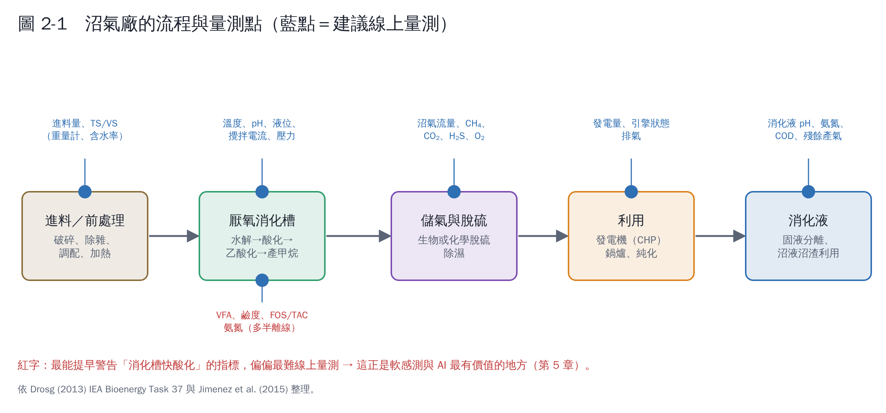
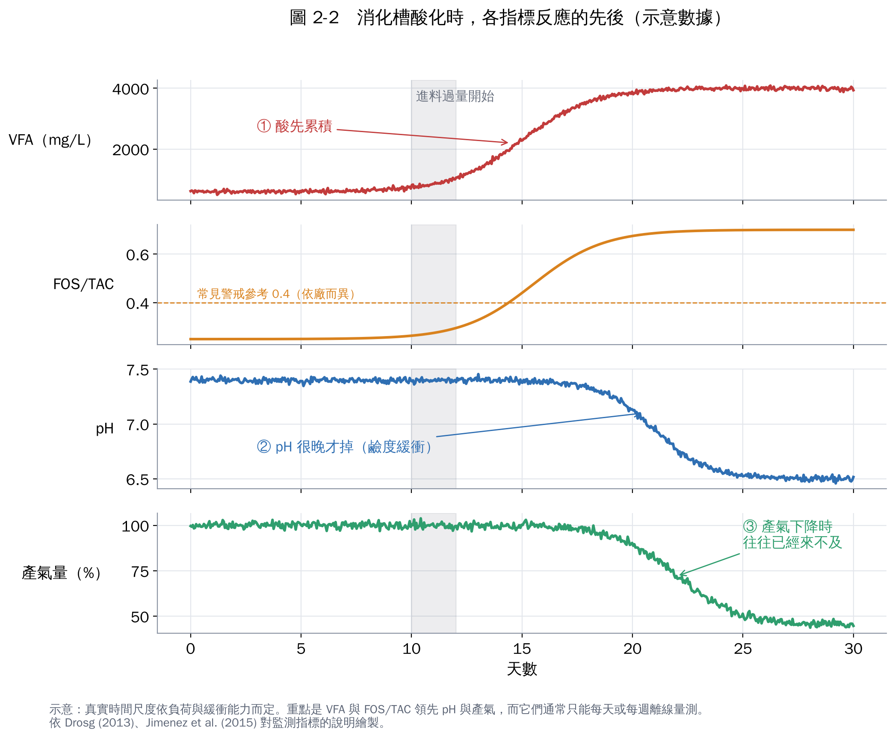

# 第 2 章　沼氣廠要量什麼？為什麼需要 AIoT

要設計 AIoT，先要懂製程：**哪裡容易出事、出事前有什麼徵兆、這些徵兆量不量得到**。AI 再厲害，也只能看到你量到的東西。

## 2.1 厭氧消化：一條很長的「微生物生產線」

有機物變成沼氣，要經過四群微生物接力 [1, 2]：

1. **水解**：把大分子（纖維、蛋白質、油脂）切成小分子。固體多的原料，這一步通常最慢。
2. **酸化**：小分子變成揮發性脂肪酸（VFA）、醇類、氫氣。這群菌長得快。
3. **乙酸化**：VFA 轉成乙酸與氫氣。
4. **產甲烷**：產甲烷古菌把乙酸、氫氣與 CO₂ 轉成甲烷。這群菌**長得最慢、也最敏感**。

問題就出在第 2 步和第 4 步速度不對等：進料一多，酸化菌很快產酸，產甲烷菌消化不了，**VFA 累積 → 鹼度被消耗 → pH 下降 → 產甲烷菌更受抑制**，形成惡性循環，嚴重時整槽「酸敗」，要花數週到數月重新養菌。

其他常見的抑制或故障原因 [3, 4]：

- **氨抑制**：高蛋白原料（豬糞、廚餘）分解會產生大量氨氮，游離氨會抑制產甲烷菌；溫度越高、pH 越高越嚴重（原理同氨氮教材第 1 章的 NH₃/NH₄⁺ 平衡）。
- **硫化氫（H₂S）**：會腐蝕發電機與管線，也會抑制微生物。
- **起泡**：槽內泡沫溢出，堵塞氣體管線，原因包括原料中的油脂、蛋白質、界面活性物質與負荷突變。
- **溫度波動**：中溫（約 35–40 °C）與高溫（約 50–55 °C）消化都需要穩定溫度，高溫消化對波動更敏感。

## 2.2 量測點：哪些量得到、哪些量不到

| 指標 | 告訴你什麼 | 線上即時量測？ | 說明 |
|---|---|---|---|
| 溫度 | 微生物環境是否穩定 | ✅ 容易 | 最基本，一定要有 |
| pH | 酸鹼狀態 | ✅ 可以，但電極在消化液中容易結垢、漂移 | **反應慢**：鹼度高的槽，pH 掉下來時通常已經很嚴重 |
| 沼氣流量 | 產氣多少 | ✅ 容易 | 最直接的績效指標，但也是「落後指標」 |
| 沼氣組成（CH₄、CO₂、H₂S、O₂） | 氣體品質、脫硫效果 | ✅ 氣體分析儀 | 需定期校正；H₂S 濃度高時感測器耗損快 |
| 進料量、進料 TS/VS | 給了多少「食物」 | ⚠️ 重量可線上；TS/VS 多靠實驗室 | 乾式與廚餘廠的原料變異很大 |
| **VFA（揮發性脂肪酸）** | 有沒有開始酸累積 | ❌ 多半實驗室分析 | **最好的早期警告指標之一** |
| **鹼度、FOS/TAC** | 緩衝能力還剩多少 | ❌ 多半人工滴定 | FOS/TAC＝揮發酸 ÷ 緩衝鹼度，常用的現場指標 |
| 氨氮 | 有沒有氨抑制風險 | ⚠️ 有線上分析儀但昂貴 | 高蛋白原料的廠要特別注意 |
| 液位、攪拌電流、壓力 | 起泡、攪拌是否正常 | ✅ 容易 | 常被忽略，其實是很好的異常偵測訊號 |

整理自 IEA Bioenergy Task 37 的監測手冊 [1] 與 Jimenez 等人的綜述 [2]。

IEA Bioenergy 的專家提醒：**沒有一組放諸四海皆準的「安全界限」**，各廠應該建立自己的正常範圍，觀察趨勢變化；有些指標用來提早發現失衡，有些用來找出原因 [1]。

## 2.3 為什麼這正是 AIoT 能發揮的地方

看這張圖就懂沼氣廠的痛點：

- **最早出現異常的是 VFA 與 FOS/TAC**，但它們通常一天甚至一週才量一次。
- **能連續量的 pH 與產氣量**，等到明顯變化時，往往已經錯過最佳處理時機。

AIoT 在沼氣廠最有價值的三件事，都是在補這個缺口：

1. **軟感測**：用連續量得到的訊號（產氣量、氣體組成、pH、溫度、進料）推估 VFA 或 FOS/TAC（第 5 章）。
2. **異常偵測**：學習「正常的樣子」，任何偏離提早警示，而不是等到超過固定門檻。
3. **進料建議**：根據原料特性與槽內狀態，建議今天該進多少、怎麼調配。

另外，機理模型如 IWA 的 ADM1（厭氧消化模型一號）能描述上述四個步驟的動力學 [5]，是數位孿生的基礎；但它的參數多，需要量測資料持續校正，這也是 AIoT 的資料能幫上忙的地方。

## 2.4 濕式、乾式、養豬場有什麼不同

| | 濕式消化 | 乾式消化 | 養豬場沼氣 |
|---|---|---|---|
| 典型原料 | 污水廠污泥、廚餘漿、食品廢水 | 廚餘、園藝廢棄物、固態有機物 | 豬糞尿、沖洗水 |
| 固體含量 | 低（可泵送） | 高（像泥土或垃圾） | 低，但水量隨清洗變動 |
| 槽內狀態 | 完全混合，取一個點大致代表全槽 | 柱塞流或批次，槽內不均勻 | 多為簡易覆膜槽或紅泥袋 |
| 量測難度 | 中 | 高（難取樣、難裝線上儀表） | 低儀表、低預算、人力少 |
| AIoT 的機會 | 軟感測、進料控制 | 進料紀錄、產氣預測 | 遠端監控、脫硫與發電機維護 |

第 7 章會依這三類分別建議該做到什麼程度。

## 本章重點

- 厭氧消化的弱點：產酸快、產甲烷慢，過量進料會引發酸化惡性循環。
- 最好的早期警告指標（VFA、FOS/TAC）偏偏最難線上量測；pH 與產氣是落後指標。
- AIoT 在沼氣廠的核心價值：軟感測、異常偵測、進料建議。
- 濕式、乾式、養豬場的量測條件差很多，目標也應不同。

## 參考文獻

1. Drosg B (2013). *Process monitoring in biogas plants*. IEA Bioenergy Task 37 technical brochure. IEA Bioenergy.
2. Jimenez J, Latrille E, Harmand J, et al. (2015). Instrumentation and control of anaerobic digestion processes: a review and some research challenges. *Reviews in Environmental Science and Bio/Technology*, 14, 615–648. https://doi.org/10.1007/s11157-015-9382-6
3. Chen Y, Cheng JJ, Creamer KS (2008). Inhibition of anaerobic digestion process: a review. *Bioresource Technology*, 99, 4044–4064. https://doi.org/10.1016/j.biortech.2007.01.057
4. Ganidi N, Tyrrel S, Cartmell E (2009). Anaerobic digestion foaming causes – a review. *Bioresource Technology*, 100, 5546–5554. https://doi.org/10.1016/j.biortech.2009.06.024
5. Batstone DJ, Keller J, Angelidaki I, et al. (2002). The IWA Anaerobic Digestion Model No 1 (ADM1). *Water Science and Technology*, 45(10), 65–73. https://doi.org/10.2166/wst.2002.0292
