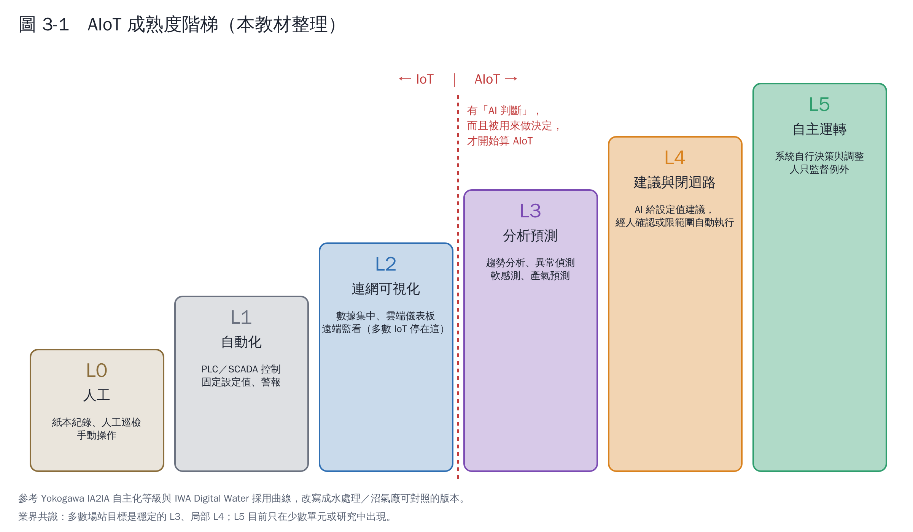

# 第 3 章　到什麼程度才能叫 AIoT？

「AIoT」沒有法定定義，廠商簡報上的用法也很寬鬆。要評估一個提案、或替自己的場站訂目標，需要一把尺。本章用一個六級的階梯當作這把尺。

## 3.1 成熟度階梯

這個階梯是本教材參考兩個業界框架改寫的：

- **Yokogawa 的 IA2IA（從工業自動化到工業自主）**：把工廠分成 Level 0–1 人工、Level 2 自動化、Level 3 半自主（自主元件與自動化設備由人協調）、Level 4 自主協調、Level 5 自主運轉；Yokogawa 也指出要直接跳到完全自主非常困難 [1]。
- **IWA 與 Xylem 的「Digital Water」白皮書**（2019）：訪談全球 40 家水務公司，提出「數位水採用曲線」，讓水務單位評估自己的數位成熟度、規劃下一步 [2]。

| 等級 | 名稱 | 判斷標準（全部符合才算到這一級） | 沼氣廠的例子 |
|---|---|---|---|
| L0 | 人工 | 靠人巡檢、手寫紀錄 | 每天抄錶、手動開關進料泵 |
| L1 | 自動化 | PLC／SCADA 依固定設定值運轉，有基本警報 | 溫度自動控制、液位高低自動停泵 |
| L2 | 連網可視化 | 資料集中保存、可遠端看即時與歷史趨勢 | 手機看產氣量、發電量、H₂S 濃度 |
| L3 | 分析預測 | 系統**自動**產生預測、異常警示或軟感測值，而且有人據此行動 | 每天自動預測明天產氣、FOS/TAC 推估超過警戒就通知 |
| L4 | 建議與閉迴路 | 系統提出**具體設定值**；經人確認後執行，或在限定範圍內自動執行 | 建議今天進料 42 噸；脫硫加藥量自動依 H₂S 預測調整 |
| L5 | 自主運轉 | 多個單元由系統自行協調決策，人只處理例外 | 目前在沼氣廠幾乎沒有實廠案例 |

## 3.2 一張檢查表：這個提案算不算 AIoT？

拿到廠商或內部提案時，問這六個問題：

1. **有沒有 AI 或模型在做判斷？**（不只是畫圖、設固定門檻）
2. **判斷的結果，誰會看、看了會做什麼？**（沒有人用的預測等於沒有）
3. **模型用的資料從哪裡來、多久更新一次？**（實驗室數據有沒有數位化？）
4. **模型準不準怎麼驗證？會不會隨時間變不準？誰負責重新訓練？**
5. **系統壞掉或網路斷線時，現場還能安全運轉嗎？**
6. **遠端連線的資安怎麼做？**

前兩題答不出來，就還停在 L2（IoT）；六題都答得出來，才是一個能長期運作的 AIoT。

## 3.3 業界目前的共識

綜合 IWA 白皮書 [2]、厭氧消化的機器學習綜述 [3, 4]、水處理數位孿生的回顧 [5]，以及 Olsson 對四十年水處理自動化的回顧 [6]，目前大致有這些共識：

| 共識 | 說明 |
|---|---|
| **資料比演算法重要** | 模型做不好，最常見的原因是感測器不準、資料缺漏、實驗室數據沒有數位化 |
| **從小處開始、逐步擴大** | 先挑一個痛點（例如酸化預警、曝氣節能），做出可量化的成果再擴展 |
| **人在迴路中（human-in-the-loop）** | 關鍵決策由人確認；AI 提供建議與解釋。完全自主不是近期目標 |
| **可解釋性很重要** | 操作員不信任「黑盒子」；能說明「為什麼建議這樣做」的模型比較會被採用 [4] |
| **實驗室模型不等於實廠模型** | 在小型反應槽訓練的模型，搬到全尺度常常失準；要用實廠資料重新驗證 [4] |
| **混合模型是主流方向** | 機理模型（如 ADM1）結合資料驅動模型，比單用其一更穩健 [3, 5] |
| **資安是前提，不是附加** | 連網就增加被攻擊的風險（第 6 章） |
| **效益要有基準線** | 導入前先量測現況，才能證明省了多少電、多產多少氣 |

## 3.4 數位孿生在階梯的哪裡？

數位孿生是「和實體廠同步運轉的虛擬模型」。Torfs 等人（2022）指出，水處理模型要成為真正的數位孿生，需要即時資料連結、自動校正與持續驗證，而不只是一個離線模擬模型 [5]。它通常出現在 L3–L4：用來預測、做「如果這樣調會怎樣」的試算，再把建議送給操作員。

## 本章重點

- AIoT 沒有法定定義，本教材用 L0–L5 階梯判斷；**L3 起才算 AIoT**。
- 關鍵分界：AI 的判斷有沒有被用來做決定。
- 業界共識：資料優先、小處開始、人在迴路中、可解釋、混合模型、資安優先、要有基準線。

## 參考文獻

1. Yokogawa Electric Corporation. IA2IA – Industrial Automation to Industrial Autonomy: definition and levels of autonomous operations. https://www.yokogawa.com/special/ia2ia/definition
2. International Water Association, Xylem (2019). *Digital Water: Industry leaders chart the transformation journey*（IWA Digital Water Programme 白皮書）. https://iwa-network.org/press/water-leaders-chart-the-digital-transformation-journey-for-utilities/
3. Andrade Cruz I, Chuenchart W, Long F, et al. (2022). Application of machine learning in anaerobic digestion: Perspectives and challenges. *Bioresource Technology*, 345, 126433. https://doi.org/10.1016/j.biortech.2021.126433
4. Rutland H, You J, Liu H, Bull L, Reynolds D (2023). A systematic review of machine-learning solutions in anaerobic digestion. *Bioengineering*, 10, 1410. https://doi.org/10.3390/bioengineering10121410
5. Torfs E, Nicolaï N, Daneshgar S, et al. (2022). The transition of WRRF models to digital twin applications. *Water Science and Technology*, 85(10), 2840–2853. https://doi.org/10.2166/wst.2022.107
6. Olsson G (2012). ICA and me – a subjective review. *Water Research*, 46, 1585–1624. https://doi.org/10.1016/j.watres.2011.12.054
