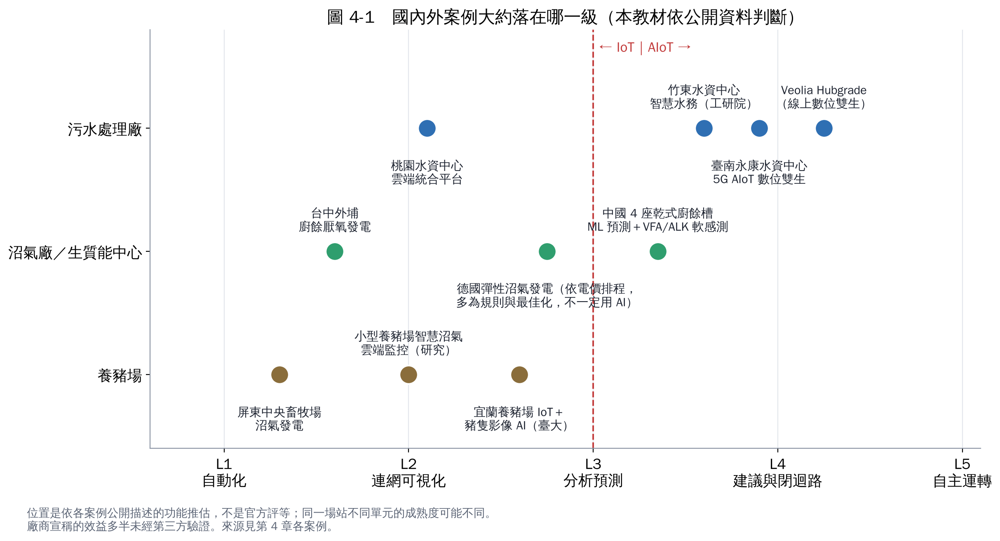

# 第 4 章　國內外案例與業界現況

本章整理公開可查的案例，並用第 3 章的階梯估計它們大約在哪一級。**實景照片請點各案例的原始報導連結**（照片有著作權，無法放進教材）。

閱讀提醒：

- 等級是本教材依公開描述推估，不是官方評等；同一場站不同單元的成熟度可能不同。
- 標示「預估」「廠商宣稱」的效益數字，多半沒有第三方驗證。

## 4.1 臺灣：污水處理廠（水資源回收中心）

污水廠的 AIoT 起步比沼氣廠早，主要原因是**曝氣鼓風機通常是全廠最大的用電**，節能效益容易計算。

### 臺南永康水資源回收中心：5G AIoT 智慧水務數位雙生

臺南市政府導入「5G AIoT 智慧水務數位雙生系統」，透過 AI 預測與智慧調控，**預估**每年降低 10% 能耗、減少約 270 公噸碳排；並規劃開發進階控制模型，預估再節省 10–15% 排泥用電 [1]。
**本教材估計：L3–L4**（有預測與調控，但效益仍為預估值）。

### 新竹竹東水資源回收中心：工研院智慧水務

工研院協助導入智慧水務操作系統，依污水量與水質彈性調整設備運轉，系統回傳最佳控制參數，透過變頻器控制機械設備（包括曝氣鼓風機）[2]。這是 2018 年前後的案例，屬於國內較早把「建議值」接回設備的例子。
**本教材估計：L3–L4**。

### 桃園市智慧水資源回收中心雲端統合管理平台

把廠區巡檢、水質採樣、設備維護保養等管理作業放上雲端平台 [3]。重點在**管理數位化**，公開資料未提到 AI 預測或控制。
**本教材估計：L2**。這也是很多場站的真實起點，而且是必要的一步。

### 國土管理署的分享資料

國土管理署的簡報提到，有業者的 AIoT 管理平台在應用案例中協助單元處理節電約 50%，並介紹磁浮離心式鼓風機等節能設備 [4]。這屬於**業者經驗陳述**，引用時要註明。

## 4.2 臺灣：沼氣廠與生質能中心

### 台中外埔綠能生態園區（廚餘厭氧發酵發電）

2019 年啟用，以厭氧發酵處理生廚餘產生沼氣發電，採 ROT 方式委託廠商營運；公開資料提到每日可產出約 4,300–4,700 立方公尺沼氣 [5]。台中市環保局 2026 年的議會專案報告則以「廚餘處理量暴增」為題，討論回饋金與二期進度 [6]。
公開資料**未見 AI 預測或控制**的描述，屬於自動化運轉的廠。
**本教材估計：L1–L2**。處理量變動大的廚餘廠，正是第 5 章「產氣預測」與「進料建議」最能發揮的地方。

### 桃園市生質能源中心

結合熱處理、厭氧消化與固化掩埋三個單元的設施，以 BOT 方式興建營運；據公視報導，厭氧消化單元當時仍在養菌階段 [7]。公開資料中，自動控制的描述集中在焚化端，厭氧消化端的監控細節未公開。

## 4.3 臺灣：養豬場

### 屏東中央畜牧場：沼氣發電

收集豬糞尿厭氧發酵、脫硫後發電，平均每天產出約 4,000–6,000 度電、以躉購方式賣給台電；場主與臺大教授合作生物脫硫系統 [8]。這是臺灣養豬場沼氣發電的代表案例，重點在**製程設計與穩定運轉**，而非 AI。
**本教材估計：L1**。

### 宜蘭養豬場 × 臺大動科系：IoT＋AI 影像

研究團隊在宜蘭一家養豬場導入 IoT，以深度攝影機、光學攝影機與空氣感測器，用 AI 辨識豬隻體型、體重與行為；廢水端則採用智慧化廢水處理與沼氣生物脫硫設施，處理狀況可用網頁或手機 App 遠端查看，平台以開源的 ThingsBoard 建構 [9]。
**本教材估計：豬隻端 L3、廢水沼氣端 L2**。這說明同一場站內，不同單元的成熟度可以差很多。

### 小規模養豬場的智慧沼氣系統

能源教育網站介紹一套針對小規模養豬場設計的系統，包含快速建置的厭氧發酵模組、智慧型沼氣發電模組與雲端監控模組，即時顯示各感測器數值，目的是降低管理人力與建置維運成本 [10]。
**本教材估計：L2**。小型場的關鍵是「便宜、好維護、遠端看得到」。

## 4.4 國外案例

### Veolia Hubgrade Performance Plant（污水廠線上數位孿生）

Veolia 稱該模組已安裝在全球 100 多座污水處理廠，以即時資料與演算法持續計算最佳設定值送給 PLC，屬於線上數位孿生；宣稱最高可節省 30% 曝氣能耗。白皮書中的 Nosedo 污水廠案例提到水力處理量提高 20%、混凝劑用量減少 58%，投資回收期常在 2–3 年 [11]。
**本教材估計：L4**。但以上數字皆為**廠商自述**。

### 中國：4 座全尺度乾式廚餘消化槽的機器學習研究

同濟大學團隊用 4 座全尺度乾式消化槽約 1.5 年的營運資料，比較 8 種機器學習演算法預測產氣量，並以 VFA／鹼度（VFA/ALK）比建立軟感測；CatBoost（一種梯度提升樹模型）表現最好，作者認為用 VFA/ALK 軟感測做即時監控是可行的 [12]。
**本教材估計：L3（研究階段）**。這是少見的「乾式、全尺度、長期資料」研究，對臺灣廚餘廠很有參考價值。

### 德國：依電價彈性發電的沼氣廠

德國再生能源法（EEG）提供「彈性溢價」，鼓勵沼氣廠加大儲氣與發電機容量，在電價高時多發電。DBFZ 的資料指出約有 3,300 座、約 2.2 GW 的沼氣廠領取彈性溢價，但一項 2020 年的研究發現，9,359 座中只有約 150 座真正彈性運轉支援電網，原因包括營運者對效益不確定、缺乏合適的運轉概念與增加的工作量 [13]。Purkus 等人（2018）的回顧也指出，彈性溢價與平衡市場收益確實帶動了部分投資，但現貨電價波動變小時誘因就會減弱 [14]。
**本教材估計：L2–L3**。這類調度多半靠規則與排程最佳化，不一定用到機器學習，但它示範了「沼氣廠接上電力市場」的方向（第 8 章 D）。

### 英國：用移動式量測找出沼氣廠甲烷逸散

研究團隊開車繞行英國南部 10 座沼氣廠量測甲烷煙流，估算甲烷損失佔產量的 0.02–8.1%，平均 3.7%；小型農場沼氣廠的逸散通常比大型廚餘廠高 [15]。這不是 AIoT 案例，但顯示**沼氣廠的「排放監測」是多數場站還沒數位化的盲點**（第 8 章 E）。

## 4.5 從案例看業界現況

1. **污水廠走得比沼氣廠前面**：曝氣節能的效益清楚，國內外都有 L3–L4 案例。
2. **沼氣廠多半停在 L1–L2**：有 SCADA、有遠端監看，但 VFA 等關鍵指標仍靠人工，AI 應用以研究為主。
3. **養豬場的 AI 先用在「豬」而不是「沼氣」**：影像辨識豬隻的成熟度高於廢水端。
4. **效益數字大多是預估或廠商自述**：引用時要註明，自己導入時要先建立基準線。

## 本章重點

- 國內 L3–L4 的例子集中在水資源回收中心（永康、竹東）；沼氣廠與養豬場多在 L1–L2。
- 國外有成熟的商用平台（如 Veolia Hubgrade），學術上已有全尺度乾式消化的 ML 研究。
- 沼氣廠接電力市場、甲烷逸散監測，是國外正在發展、國內還很少的方向。

## 參考文獻

1. 智慧城市展案例：5G AIoT 智慧水務數位雙生系統—以智水雲驅動永康水資中心。https://smartcity.org.tw/application_detail.php?id=149
2. DIGITIMES：竹東水資源回收中心導入工研院智慧水務方案。https://www.digitimes.com.tw/tech/dt/n/shwnws.asp?id=0000590285_G9N1ICJ49E7PQL4UMUWAG
3. 智慧城市展案例：桃園市智慧水資源回收中心雲端統合管理平台。https://smartcity.org.tw/application_detail.php?id=84
4. 內政部國土管理署：污水下水道節能與智慧化相關簡報。https://www.nlma.gov.tw/uploads/files/ab74b1fadaba5a31a63eb7ee05d984c8.pdf
5. 台灣永續行動獎：外埔綠能生態園區（非企業組 SDG7 銀級）。https://tcsaward.org.tw/en/award/award_detail/5455
6. 臺中市政府環境保護局（2026）。外埔綠能生態園區廚餘處理量暴增、回饋金檢討調整及二期進度專案報告。https://www.rdec.taichung.gov.tw/media/1443266/1150729-1-外埔綠能生態園區廚餘處理量暴增-回饋金檢討調整及二期進度專案報告-環保.pdf
7. 公視新聞網：桃園生質能中心相關報導。https://news.pts.org.tw/article/633588
8. 能源教育資源網：屏東縣中央畜牧場沼氣發電系統實例。https://learnenergy.tw/index.php?id=448&inter=knowledge
9. iThome：養豬也要智慧化管理，臺大團隊以 IoT 助養豬場提升管理效率，還結合 AI 影像辨識豬隻體態、行為及健康狀態。https://www.ithome.com.tw/news/147250
10. 能源教育資源網：小規模養豬場「智慧綠能畜牧沼氣發電系統」介紹。https://learnenergy.tw/index.php?inter=knowledge&caid=1&id=545
11. Veolia Water Technologies (2024). *Transforming the future of wastewater treatment plants with digital solutions*（Hubgrade Performance Plant 白皮書）. https://www.veoliawatertechnologies.com/sites/g/files/dvc2471/files/document/2024/08/WP%20All%20HUBGRADE%20Performance%20Plant%20White%20Paper%20EN.pdf
12. （同濟大學研究團隊）(2024). Machine learning for enhancing prediction of biogas production and building a VFA/ALK soft sensor in full-scale dry anaerobic digestion of kitchen food waste. *Journal of Environmental Management*. https://www.sciencedirect.com/science/article/abs/pii/S0301479724031761
13. Clean Energy Wire (2020). Small fraction of Germany's biogas plants contribute to grid stability – study. https://www.cleanenergywire.org/news/small-fraction-germanys-biogas-plants-contribute-grid-stability-study
14. Purkus A, Gawel E, Szarka N, et al. (2018). Contributions of flexible power generation from biomass to a secure and cost-effective electricity supply—a review of potentials, incentives and obstacles in Germany. *Energy, Sustainability and Society*, 8, 18. https://doi.org/10.1186/s13705-018-0157-0
15. Bakkaloglu S, Lowry D, Fisher RE, France JL, Nisbet EG (2021). Quantification of methane emissions from UK biogas plants. *Waste Management*, 124, 82–93. https://doi.org/10.1016/j.wasman.2021.01.011
