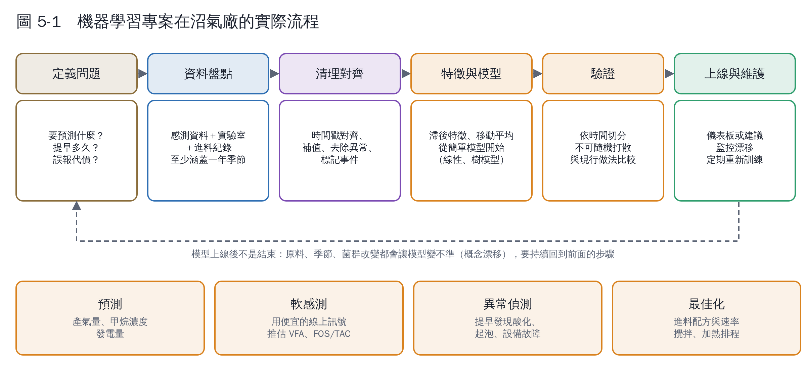
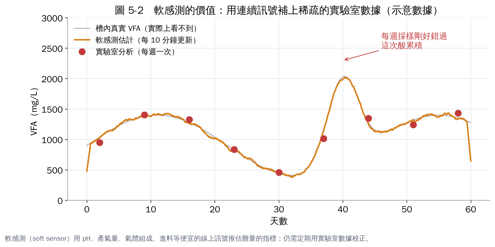

# 第 5 章　機器學習怎麼用在厭氧消化

## 5.1 四種常見任務

| 任務 | 問題長什麼樣 | 例子 | 輸出給誰用 |
|---|---|---|---|
| **預測** | 給過去的資料，預測未來的數字 | 明天產氣量、下週發電量 | 營運排程、售電規劃 |
| **軟感測** | 用便宜的線上訊號，推估昂貴或難量測的指標 | 用 pH、產氣、CH₄、進料推估 VFA 或 FOS/TAC | 提早酸化預警 |
| **異常偵測** | 學習「正常的樣子」，找出偏離 | 攪拌馬達電流異常、起泡前兆、感測器故障 | 維護與操作員 |
| **最佳化** | 在限制條件下找最好的操作方式 | 多種原料怎麼配比、每天進多少 | 進料決策（L4） |

文獻上最常見的是**預測產氣量**；Andrade Cruz 等人（2022）的回顧指出，類神經網路（ANN）、隨機森林（RF）、支持向量機（SVM）在產氣預測、穩定度監測與製程最佳化上表現可靠 [1]。Rutland 等人（2023）的系統性回顧則發現，ANN 最常被使用，但在規模擴大與可解釋性上有困難，而且**在實驗室規模訓練的模型，用在全尺度實廠時常常表現不佳** [2]。

## 5.2 實際流程：大部分時間花在資料上

幾個新手最容易忽略的細節：

1. **時間對齊**：SCADA 資料每分鐘一筆，實驗室 VFA 每週一筆，進料紀錄每天一筆，要先統一時間尺度，並考慮「延遲」（今天的進料，可能 2–3 天後才反映在產氣上）。
2. **驗證要按時間切**：用前 12 個月訓練、後 3 個月測試。**不能隨機打散**，否則模型等於「偷看到未來」，準確率會被高估。
3. **和「笨方法」比較**：先算「明天產氣＝今天產氣」這種最簡單的預測有多準，模型要明顯比它好才有意義。
4. **事件標記**：停機、換原料、儀表校正、清槽的日期要記錄下來，否則模型會把這些當成正常變化學習。

## 5.3 軟感測：AI 在沼氣廠最有價值的應用

軟感測（soft sensor）是用數學模型，把容易量的訊號轉換成難量的指標。Haimi 等人（2013）回顧了生物廢水處理的資料驅動軟感測，指出它能補足昂貴或維護困難的硬體分析儀，但需要**定期用實驗室數據重新校正**，否則會隨製程改變而漂移 [3]。

在厭氧消化上，同濟大學的全尺度乾式廚餘消化研究，用約 1.5 年的資料建立 VFA/ALK 軟感測，結論是可行的 [4]。這類應用的建議做法：

- 先維持**每週至少一到兩次**的實驗室 VFA／FOS-TAC 分析，當作校正資料。
- 軟感測值和實驗室值並列在儀表板上，讓操作員自己判斷信不信。
- 軟感測只作為**警示**，不直接拿來自動控制，直到累積足夠的信任與驗證。

## 5.4 機理模型 vs. 資料模型 vs. 混合模型

| 類型 | 代表 | 優點 | 缺點 |
|---|---|---|---|
| 機理模型 | ADM1 [5]、簡化的兩步驟模型（AM2）[6] | 有物理意義，可外推到沒看過的狀況 | 參數多、要校正；原料變化大時難以維持準確 |
| 資料模型 | 迴歸、樹模型、類神經網路 | 不需要懂機理，資料夠就能做 | 只會內插，遇到沒看過的狀況可能亂猜；不易解釋 |
| 混合模型 | 機理模型＋資料模型修正誤差；或用機理模型產生訓練資料 | 兼顧穩健與準確 | 需要跨領域團隊 |

綜述普遍認為混合模型是較有前景的方向 [1, 2]。Bernard 等人（2001）發展的 AM2 簡化模型，只用兩個主要反應描述酸化與產甲烷，參數少，常被用在控制與狀態估計 [6]，適合當作資料不多的場站的起點。

## 5.5 常見陷阱

| 陷阱 | 後果 | 對策 |
|---|---|---|
| 資料少於一年 | 學不到季節變化 | 先蒐集資料，同時做簡單的統計警示 |
| 感測器漂移沒校正 | 模型學到的是感測器誤差 | 建立校正排程，校正紀錄也要數位化 |
| 原料改變 | 模型突然變不準（概念漂移） | 監控預測誤差，超過門檻就重新訓練 |
| 只追求準確率 | 操作員不知道為什麼、不敢用 | 用可解釋的特徵、提供「主要影響因子」 |
| 用研究論文的模型直接套 | 實驗室條件不同，準確度落差大 [2] | 用自己場站的資料重新訓練與驗證 |

## 5.6 要開始做，最少需要什麼資料？

本教材建議的「最低起步資料集」（依綜述與案例歸納）：

- **每日**：進料種類與重量、產氣量、CH₄ 濃度、發電量、消化槽溫度與 pH。
- **每週 1–2 次**：VFA 或 FOS/TAC、鹼度、氨氮、進料與消化液的 TS/VS。
- **事件紀錄**：停機、換原料、加藥、清槽、儀表校正。
- **至少 12 個月**，而且全部有一致的時間戳。

## 本章重點

- 四種任務：預測、軟感測、異常偵測、最佳化；沼氣廠最有價值的是軟感測與異常偵測。
- 70% 的工作在資料：對齊時間、按時間驗證、標記事件、和簡單方法比較。
- 實驗室模型搬到實廠常失準；混合模型是主流方向。
- 起步至少需要一年、有時間戳的每日營運資料與每週實驗室數據。

## 參考文獻

1. Andrade Cruz I, Chuenchart W, Long F, et al. (2022). Application of machine learning in anaerobic digestion: Perspectives and challenges. *Bioresource Technology*, 345, 126433. https://doi.org/10.1016/j.biortech.2021.126433
2. Rutland H, You J, Liu H, Bull L, Reynolds D (2023). A systematic review of machine-learning solutions in anaerobic digestion. *Bioengineering*, 10, 1410. https://doi.org/10.3390/bioengineering10121410
3. Haimi H, Mulas M, Corona F, Vahala R (2013). Data-derived soft-sensors for biological wastewater treatment plants: An overview. *Environmental Modelling & Software*, 47, 88–107. https://doi.org/10.1016/j.envsoft.2013.05.009
4. （同濟大學研究團隊）(2024). Machine learning for enhancing prediction of biogas production and building a VFA/ALK soft sensor in full-scale dry anaerobic digestion of kitchen food waste. *Journal of Environmental Management*. https://www.sciencedirect.com/science/article/abs/pii/S0301479724031761
5. Batstone DJ, Keller J, Angelidaki I, et al. (2002). The IWA Anaerobic Digestion Model No 1 (ADM1). *Water Science and Technology*, 45(10), 65–73. https://doi.org/10.2166/wst.2002.0292
6. Bernard O, Hadj-Sadok Z, Dochain D, Genovesi A, Steyer JP (2001). Dynamical model development and parameter identification for an anaerobic wastewater treatment process. *Biotechnology and Bioengineering*, 75, 424–438. https://doi.org/10.1002/bit.10036
