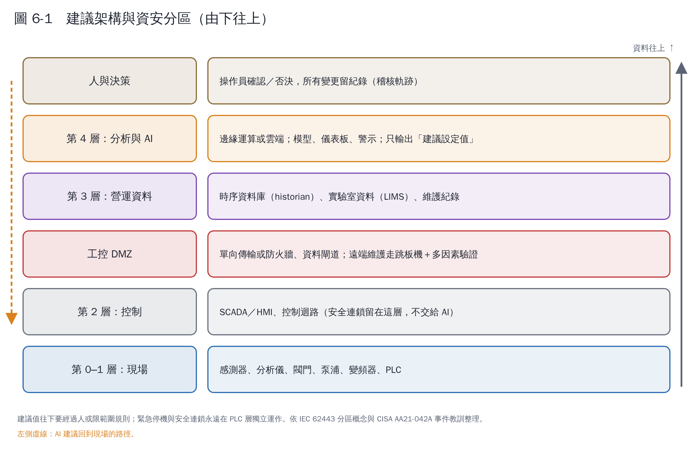
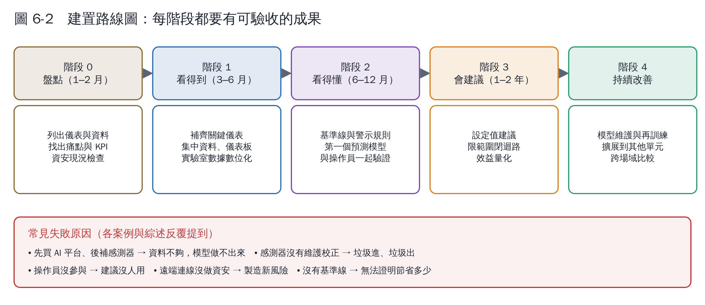

# 第 6 章　怎麼建置：架構、步驟、資料與資安

## 6.1 建議架構

三個設計原則：

1. **安全連鎖留在 PLC 層**：洩壓、緊急停機、高低液位保護，永遠在現場控制器獨立運作，不依賴網路或 AI [1]。
2. **資料往上、建議往下，中間有關卡**：現場資料可以往上送到分析層；AI 的建議要經過人確認，或在預先設定的安全範圍內才自動執行，而且每次變更都要留紀錄。
3. **用開放標準**：設備與平台之間優先採用 OPC UA、MQTT、Modbus 等通用協定，資料要能匯出成通用格式，避免被單一廠商綁住。

## 6.2 分階段路線圖

| 階段 | 要做什麼 | 可驗收的成果 |
|---|---|---|
| 0 盤點 | 列出所有儀表、控制點、資料來源；訪談操作員最頭痛的問題；檢查遠端連線與帳號 | 儀表清單、痛點排序、KPI 定義、資安現況報告 |
| 1 看得到（L2） | 補齊關鍵儀表；資料集中到時序資料庫；實驗室數據改用電子表單；儀表板 | 連續 3 個月資料完整率 > 95%；儀表板每天被使用 |
| 2 看得懂（L3） | 建立正常範圍與趨勢警示；第一個預測或軟感測模型；與操作員一起檢討誤報 | 模型在測試期優於簡單基準；警示誤報率可接受 |
| 3 會建議（L4） | 對單一單元提出設定值建議；限範圍自動調整；量化效益 | 與基準線相比的節能、增產或藥劑節省 |
| 4 持續改善 | 模型監控與再訓練；擴展到其他單元或場站 | 年度模型檢討報告 |

## 6.3 資料治理：最不起眼、最重要

| 項目 | 做法 |
|---|---|
| 標籤命名 | 每個訊號有唯一、有規則的名稱，例如「AD1_TEMP_01」，並有對照表寫明單位、位置、量測範圍 |
| 時間戳 | 全廠統一時區與時間同步；實驗室數據記錄「採樣時間」而不是「分析時間」 |
| 單位 | 明確寫出（例如 Nm³/h 或 m³/h；mg/L 或 g/L） |
| 品質旗標 | 校正中、維修中、超出量程的資料要標記，不要直接刪掉 |
| 實驗室資料 | 從紙本改為電子表單或 LIMS，與 SCADA 資料用同一套時間軸 |
| 保存 | 原始資料至少保存數年；模型訓練用的資料集要能重現 |
| 所有權 | 合約寫明資料屬於場站，廠商要能以通用格式完整匯出 |

臺灣法規對**放流水自動監測連線**的要求，也提醒了資料完整與不可竄改的重要：依水污染防治相關規定，達一定規模的事業要設置自動監測（視）設施並連線傳輸，主管機關的解釋函也明示數據傳輸不得經過影響原始數據的設備、不得變造監測數據 [2]；環境部 2025 年 9 月的修正預告，更擬要求大型事業與污水下水道系統在關鍵點設置獨立電表及水質水量傳輸設施 [3]。AIoT 平台的資料管理，最好一開始就符合這類要求。

## 6.4 資安：連網之前先想好

2021 年 2 月，美國佛州 Oldsmar 一座淨水廠的監控系統遭入侵，入侵者透過遠端桌面軟體試圖把氫氧化鈉加藥量調高，所幸操作人員即時發現並恢復。美國 FBI 與 CISA 的聯合通報指出，弱密碼、共用帳號與過時的作業系統是可能的入侵途徑 [1]。

沼氣廠有可燃氣體與壓力容器，資安事件可能直接造成安全事故。基本要求：

- **網路分區**：控制網路與辦公網路、雲端之間要有防火牆或單向傳輸，參考 IEC 62443 的分區（zone）與通道（conduit）概念 [4]。
- **遠端維護**：不要讓 TeamViewer 之類的軟體常駐在 SCADA 電腦上；遠端連線要經過跳板機、多因素驗證、用完就關。
- **帳號**：每個人一個帳號，不共用密碼，離職立即停用。
- **更新與備份**：作業系統與軟體要能更新；PLC 程式與設定要有離線備份。
- **AI 的權限**：AI 只能寫入「建議設定值」與限定範圍內的參數，不能直接觸碰安全連鎖。

## 6.5 團隊與採購

**最小團隊**：一位懂製程的工程師（定義問題、判斷建議合不合理）、一位懂資料的人（可以外包）、至少一位現場操作員代表（從第一天就參與）。

**採購時要問廠商的問題**：

1. 你的模型用哪些資料？我們目前沒有的，要補哪些儀表？
2. 準確度怎麼驗證？可以用我們的歷史資料先做概念驗證嗎？
3. 模型變不準時誰負責？再訓練的費用怎麼算？
4. 資料和模型的所有權歸誰？合約結束後可以完整匯出嗎？
5. 斷網時現場會怎樣？資安架構符合什麼標準？
6. 效益怎麼計算？基準線怎麼定？

## 本章重點

- 安全連鎖留在 PLC；AI 只輸出建議值，且要有人確認或範圍限制。
- 分階段推進，每階段都要有可驗收成果；先 L2 再 L3、L4。
- 資料治理（命名、時間戳、品質旗標、所有權）決定專案成敗。
- 連網前先做資安：分區、遠端維護管控、帳號、備份。

## 參考文獻

1. CISA, FBI (2021). Compromise of U.S. Water Treatment Facility（Joint Cybersecurity Advisory AA21-042A）. https://www.cisa.gov/news-events/cybersecurity-advisories/aa21-042a
2. 臺北市法規查詢系統：環境部有關水污染源自動監測（視）設施連線數據不得變造之解釋函。https://laws.gov.taipei/law/Interpretation/Content/FE323218
3. 旺得富理財網（2025）：環境部預告修正水污染防治措施及檢測申報管理辦法相關報導。https://wantrich.chinatimes.com/news/20250917900541-420501
4. International Electrotechnical Commission. IEC 62443 series: Security for industrial automation and control systems.
