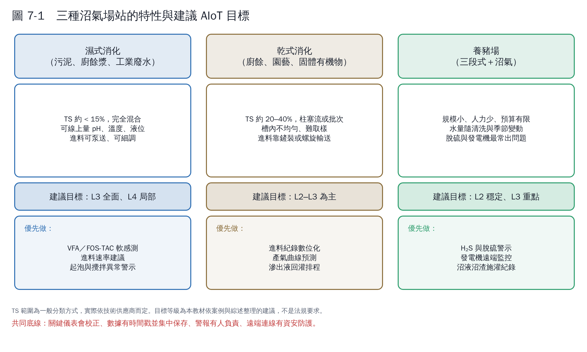

# 第 7 章　沼氣中心的 AIoT 應該做到什麼地步

本章回答最實際的問題：**我的場站該把目標訂在哪一級、要先裝什麼、怎麼判斷做成功了**。以下建議是本教材依第 2–6 章的文獻與案例整理，不是法規要求。

## 7.1 為什麼不建議一開始就追求 L5

- 厭氧消化的關鍵指標（VFA、FOS/TAC）多半還不能可靠地線上量測 [1, 2]，系統「看不全」，就不該「全自動」。
- 微生物系統出錯的代價很高：一次酸化可能要數週到數月才能恢復。
- 綜述指出實驗室模型搬到全尺度常失準 [3]，需要時間累積實廠驗證。

所以合理的路線是：**先讓系統「看得全、算得準、說得清楚」，再逐步讓它「動手」**。

## 7.2 共同的必備清單（所有類型）

| 類別 | 項目 | 為什麼 |
|---|---|---|
| 必備線上儀表 | 消化槽溫度、沼氣流量、CH₄ 濃度、H₂S 濃度、發電量 | 最基本的狀態與績效 |
| 必備紀錄 | 進料種類與重量（每批）、停機與維修事件 | 沒有輸入資料，就無法解釋輸出 |
| 必備實驗室 | 每週 VFA 或 FOS/TAC、鹼度、TS/VS；高蛋白原料加測氨氮 | 早期警告指標與模型校正資料 [1] |
| 必備資料系統 | 時序資料庫、統一時間戳、電子化實驗室表單 | 第 6 章資料治理 |
| 必備管理 | 儀表校正排程、警報負責人、資安基本措施 | 沒有維護的儀表比沒有儀表更危險 |

## 7.3 濕式消化（污泥、廚餘漿、食品廢水）

**建議目標：L3 全面、L4 局部**

| 項目 | 建議 |
|---|---|
| 加裝儀表 | 槽內 pH（含自動清洗或定期校正）、液位與泡沫偵測、攪拌馬達電流、進料流量計 |
| L3 應用 | FOS/TAC 或 VFA 軟感測、產氣預測、起泡前兆偵測、感測器故障偵測 |
| L4 應用 | 依軟感測與產氣預測，建議每日進料量；脫硫加藥量依 H₂S 預測調整 |
| KPI | 單位進料產氣量（m³/噸 VS）、酸化或起泡事件次數、非計畫停機時數、發電機妥善率 |

## 7.4 乾式消化（廚餘、園藝、固體有機物）

**建議目標：L2–L3 為主**

| 項目 | 建議 |
|---|---|
| 加裝儀表 | 進料地磅與批次紀錄、各段溫度、沼氣流量與組成、滲出液 pH 與流量 |
| L3 應用 | 產氣曲線預測、依進料組成估算產氣潛勢、滲出液回灌排程建議 |
| 難點 | 槽內不均勻，取一個點不代表全槽；原料變異大；量測點有限 |
| 參考 | 全尺度乾式廚餘槽已有用機器學習預測產氣並建立 VFA/ALK 軟感測的研究 [4] |
| KPI | 每噸廚餘產氣量、每批發酵時間、異物率與預處理損失 |

## 7.5 養豬場（三段式處理＋沼氣）

**建議目標：L2 穩定、L3 重點**

養豬場的限制是規模小、人力少、預算有限，所以目標是「**用最少的感測器、在手機上看到最重要的事、出問題第一時間知道**」。

| 項目 | 建議 |
|---|---|
| 加裝儀表 | 沼氣流量、H₂S（脫硫前後）、發電機運轉狀態與發電量、厭氧槽溫度 |
| L2 應用 | 手機遠端監看、發電機停機推播、每日產氣與發電報表 |
| L3 應用 | H₂S 突升預警（保護發電機）、產氣異常偵測、沼液沼渣施灌紀錄與肥分估算 |
| 參考 | 屏東中央畜牧場的經驗顯示，脫硫與消化槽設計是沼氣發電能否穩定的關鍵 [5] |
| KPI | 發電機年運轉時數、每頭豬發電量、H₂S 超標次數、脫硫劑或維修費用 |

## 7.6 計畫書可以這樣寫：分期目標範例

| 期程 | 目標等級 | 具體成果（可驗收） |
|---|---|---|
| 第 1 年上半 | L2 | 關鍵儀表補齊並完成校正；資料平台上線；實驗室數據電子化；資安盤點 |
| 第 1 年下半 | L2→L3 | 建立各指標正常範圍與趨勢警示；連續 6 個月資料完整率 > 95% |
| 第 2 年 | L3 | 產氣預測與 FOS/TAC 軟感測上線，誤差優於簡單基準；異常警示經操作員檢討 |
| 第 3 年 | L3→L4 | 單一單元（例如進料量或脫硫加藥）的設定值建議，經人確認後執行；量化效益 |

## 7.7 判斷「做成功了」的標準

1. **操作員每天會用**，而且能說出系統幫他避免了哪一次問題。
2. **有量化效益**：與導入前基準線相比，產氣更穩、停機更少、或藥劑與能源更省。
3. **模型有人維護**：知道它什麼時候會不準、誰負責更新。
4. **斷網時現場照常安全運轉**。

## 本章重點

- 濕式：L3 全面、L4 局部；乾式：L2–L3；養豬場：L2 穩定、L3 重點。
- 共同底線：關鍵儀表會校正、進料與事件有紀錄、實驗室數據電子化、資安基本措施。
- 計畫書用分期、可驗收的成果描述，而不是「導入 AI」這種口號。

## 參考文獻

1. Drosg B (2013). *Process monitoring in biogas plants*. IEA Bioenergy Task 37 technical brochure. IEA Bioenergy.
2. Jimenez J, Latrille E, Harmand J, et al. (2015). Instrumentation and control of anaerobic digestion processes: a review and some research challenges. *Reviews in Environmental Science and Bio/Technology*, 14, 615–648. https://doi.org/10.1007/s11157-015-9382-6
3. Rutland H, You J, Liu H, Bull L, Reynolds D (2023). A systematic review of machine-learning solutions in anaerobic digestion. *Bioengineering*, 10, 1410. https://doi.org/10.3390/bioengineering10121410
4. （同濟大學研究團隊）(2024). Machine learning for enhancing prediction of biogas production and building a VFA/ALK soft sensor in full-scale dry anaerobic digestion of kitchen food waste. *Journal of Environmental Management*. https://www.sciencedirect.com/science/article/abs/pii/S0301479724031761
5. 能源教育資源網：屏東縣中央畜牧場沼氣發電系統實例。https://learnenergy.tw/index.php?id=448&inter=knowledge
