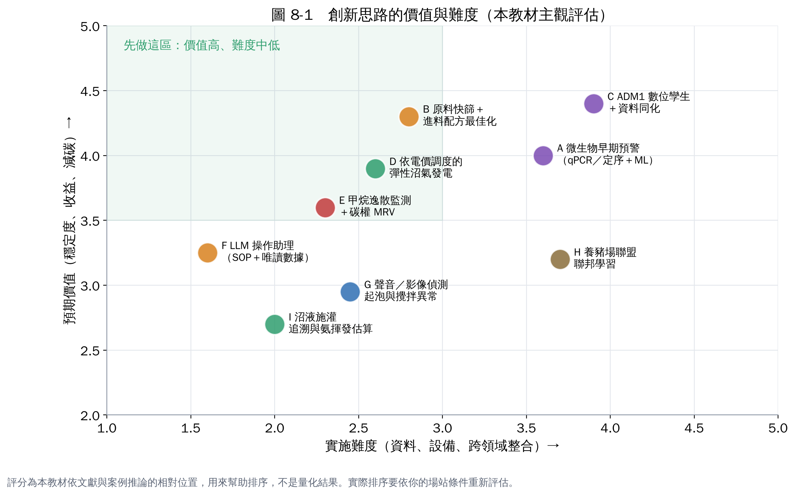

# 第 8 章　業界還沒做、但按道理可行的 AIoT 創新思路

> **本章全部屬於推論**：每個想法都附上「為什麼可行」的文獻依據，但組合方式與在沼氣廠的應用，目前在實廠少見或沒有。適合拿來發想研究題目或計畫亮點，執行前都需要可行性驗證。

## A. 微生物早期預警：把 qPCR／定序接進 AIoT

**想法**：定期（例如每週）採消化液做 qPCR 或 16S 定序，把產甲烷古菌、互營菌的數量變化當作模型輸入，預測「幾天後可能失衡」。

**依據**：微生物群落組成與功能的關聯已被廣泛研究，Carballa 等人（2015）主張從「管理微生物群落」的角度管理厭氧消化 [1]。化學指標反映的是已經發生的結果，微生物變化可能更早出現。qPCR 與定序的操作方法可參考本筆記本的氨氮教材第 5、6 章。

**需要**：穩定的採樣與 DNA 保存流程、外包定序的預算、至少一年的配對資料（微生物＋化學＋產氣）。

**風險**：成本高、時間延遲（送樣到結果要數天）；需要證明比 VFA 更早、更準。

**起步**：先做回顧型研究：在已知發生過酸化的期間前後補做樣品分析，看微生物是否真的提早變化。

## B. 原料快篩＋進料配方最佳化

**想法**：用近紅外光譜（NIR）在進料時快速估算原料的甲烷潛勢與組成，再用最佳化演算法建議多種原料的配比與進料量。

**依據**：已有研究以 NIR 快速推估固體廢棄物的生化甲烷潛勢（BMP），作為取代耗時數週 BMP 試驗的方法 [2]。廚餘、農業廢棄物共消化的原料變異大，配方決策目前多靠經驗。

**需要**：NIR 設備、建立自己原料的校正資料庫（需要一批 BMP 試驗）、進料紀錄數位化。

**起步**：先只做「產氣潛勢估算」，和實際產氣比對三個月，再談自動配方。

## C. ADM1 數位孿生＋資料同化

**想法**：用機理模型（ADM1 或簡化的 AM2）當骨架，每天用量測資料自動修正模型狀態（資料同化，例如卡爾曼濾波），得到「槽內此刻 VFA 大概多少」的估計，再用模型試算不同進料方案的後果。

**依據**：ADM1 是 IWA 的標準模型 [3]；AM2 參數少、常用於狀態估計與控制 [4]；水處理數位孿生的關鍵就是即時資料連結與自動校正 [5]。

**需要**：懂模型的研究人員、完整的進料特性資料。

**風險**：模型校正耗時；原料變異大的廠站，模型維護成本高。

**起步**：先用 AM2 做離線模擬，再接上每日資料。

## D. 依電價調度的彈性沼氣發電

**想法**：沼氣可以儲存，發電時段可以調整。用產氣預測加上電價或電網需求，排程發電機在最有價值的時段發電，甚至參與電力輔助服務。

**依據**：德國以「彈性溢價」鼓勵沼氣廠彈性發電，已有數千座廠領取，但真正彈性運轉的比例不高，主因是缺乏運轉概念與營運者的不確定感 [6, 7]，這正是 AI 排程能補上的。臺灣台電已設立電力交易平台採購輔助服務，沼氣發電能否、以何種方式參與，需要另外確認規則與門檻 [8]。

**需要**：足夠的儲氣容量、發電機可頻繁起停、產氣預測模型、了解電力市場規則。

**起步**：先算「如果只在尖峰時段發電，收益差多少」，評估儲氣容量是否足夠。

## E. 甲烷逸散監測＋碳權 MRV

**想法**：在儲氣設施、消化液貯槽、發電機周邊設置甲烷感測器或定期光學氣體成像（OGI），用 AI 判讀洩漏；把連續數據用在減碳量的監測、報告與查證（MRV）。

**依據**：英國 10 座沼氣廠的量測顯示，甲烷損失平均約 3.7%，小型農場廠通常更高 [9]。沼氣廠的減碳效益會被逸散吃掉，但多數廠沒有連續監測。

**需要**：固定式甲烷感測器或巡檢用 OGI 相機、氣象資料（風向風速）。

**起步**：先做一次全廠逸散盤點，找出主要洩漏點。

## F. LLM 操作助理（操作手冊＋唯讀數據）

**想法**：把操作手冊、SOP、設備說明書、歷年異常處理紀錄放進大型語言模型的檢索系統（RAG），再讓它「唯讀」SCADA 數據，回答「現在 H₂S 偏高，依 SOP 要檢查什麼？」

**依據**：已有研究把污水廠操作手冊建成向量資料庫，提升大型語言模型在污水廠操作問題上的專業度 [10]。新進人員訓練與夜間值班是沼氣廠的實際痛點。

**需要**：整理好的電子化文件、地端或私有部署的模型（避免資料外流）。

**風險**：模型可能「一本正經地說錯」；**只能唯讀，絕不能讓它直接下控制指令**（第 6 章）。

**起步**：先只做「問 SOP」，不接即時數據。

## G. 聲音／影像偵測起泡與攪拌異常

**想法**：在消化槽觀測窗、溢流口裝攝影機，在攪拌機、泵浦旁裝麥克風或振動感測器，用影像與聲音模型偵測起泡、攪拌失效、軸承異常。

**依據**：起泡是常見而且代價高的問題，成因多元 [11]；影像與聲音的異常偵測在製造業的設備預知保養已相當普遍。

**起步**：先錄一段時間的正常影像與聲音，等到發生事件時就有對照資料。

## H. 養豬場聯盟的聯邦學習

**想法**：單一小型養豬場資料太少，訓練不出好模型；多個場站在**不交出原始資料**的前提下共同訓練模型（聯邦學習），各場只分享模型參數。

**依據**：聯邦學習由 McMahan 等人（2017）提出，讓分散在多處的資料共同訓練模型而不集中原始資料 [12]。臺灣養豬場數量多、規模小，適合用聯盟或合作社模式。

**風險**：各場儀表規格不一致；需要中立的協調單位。

**起步**：先統一幾個場的儀表規格與資料格式。

## I. 沼液沼渣施灌追溯與氨揮發估算

**想法**：記錄每次施灌的地點、量、沼液氨氮濃度與天氣，估算氨揮發與作物可利用的氮量，產生農地施肥建議與追溯紀錄。

**依據**：沼液中的氨氮在 pH 高、溫度高時容易揮發（原理見氨氮教材第 1 章），施灌時機會影響肥效與空氣品質。

**起步**：先把施灌紀錄從紙本改成手機表單，加上簡易的氨氮快篩。

## 怎麼挑選

從圖 8-1 看，**B（原料快篩）、D（彈性發電）、E（甲烷逸散）**落在「價值高、難度中低」的區域，適合當第一個創新題目；**A（微生物預警）、C（數位孿生）**價值高但需要研究團隊，適合產學合作；**F、G、I** 容易起步，可當作展示亮點。

## 本章重點

- 九個方向：微生物預警、原料快篩配方、數位孿生、彈性發電、甲烷監測、LLM 助理、聲音影像偵測、聯邦學習、施灌追溯。
- 每個想法都有文獻依據，但在沼氣實廠的組合應用都還少見，需要先做可行性驗證。
- 安全原則不變：AI 只給建議，LLM 只能唯讀。

## 參考文獻

1. Carballa M, Regueiro L, Lema JM (2015). Microbial management of anaerobic digestion: exploiting the microbiome-functionality nexus. *Current Opinion in Biotechnology*, 33, 103–111. https://doi.org/10.1016/j.copbio.2015.01.008
2. Lesteur M, Latrille E, Bellon Maurel V, et al. (2011). First step towards a fast analytical method for the determination of Biochemical Methane Potential of solid wastes by near infrared spectroscopy. *Bioresource Technology*, 102, 2280–2288. https://doi.org/10.1016/j.biortech.2010.10.044
3. Batstone DJ, Keller J, Angelidaki I, et al. (2002). The IWA Anaerobic Digestion Model No 1 (ADM1). *Water Science and Technology*, 45(10), 65–73. https://doi.org/10.2166/wst.2002.0292
4. Bernard O, Hadj-Sadok Z, Dochain D, Genovesi A, Steyer JP (2001). Dynamical model development and parameter identification for an anaerobic wastewater treatment process. *Biotechnology and Bioengineering*, 75, 424–438. https://doi.org/10.1002/bit.10036
5. Torfs E, Nicolaï N, Daneshgar S, et al. (2022). The transition of WRRF models to digital twin applications. *Water Science and Technology*, 85(10), 2840–2853. https://doi.org/10.2166/wst.2022.107
6. Purkus A, Gawel E, Szarka N, et al. (2018). Contributions of flexible power generation from biomass to a secure and cost-effective electricity supply—a review of potentials, incentives and obstacles in Germany. *Energy, Sustainability and Society*, 8, 18. https://doi.org/10.1186/s13705-018-0157-0
7. Clean Energy Wire (2020). Small fraction of Germany's biogas plants contribute to grid stability – study. https://www.cleanenergywire.org/news/small-fraction-germanys-biogas-plants-contribute-grid-stability-study
8. 台灣電力公司。電力交易平台。https://etp.taipower.com.tw
9. Bakkaloglu S, Lowry D, Fisher RE, France JL, Nisbet EG (2021). Quantification of methane emissions from UK biogas plants. *Waste Management*, 124, 82–93. https://doi.org/10.1016/j.wasman.2021.01.011
10. (2024). A method for parsing and vectorization of semi-structured data used in retrieval augmented generation. arXiv:2405.03989. https://arxiv.org/abs/2405.03989
11. Ganidi N, Tyrrel S, Cartmell E (2009). Anaerobic digestion foaming causes – a review. *Bioresource Technology*, 100, 5546–5554. https://doi.org/10.1016/j.biortech.2009.06.024
12. McMahan B, Moore E, Ramage D, Hampson S, Agüera y Arcas B (2017). Communication-efficient learning of deep networks from decentralized data. *Proceedings of AISTATS*, PMLR 54, 1273–1282. https://proceedings.mlr.press/v54/mcmahan17a.html
