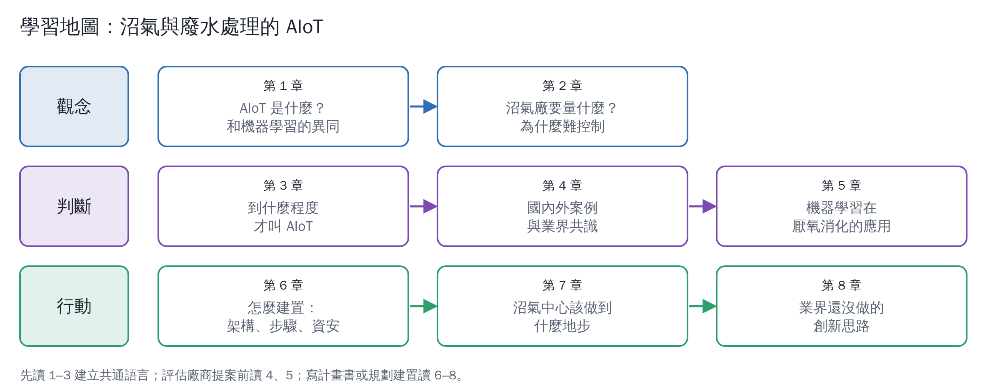

# 沼氣與廢水處理的 AIoT 入門

給要規劃或評估沼氣中心、廢水處理廠 AIoT 的人。不需要資訊或 AI 背景。共 8 章加導讀，每章都有圖，參考文獻列在每章最後。
這份教材也同步到 Folio 筆記本「Claude圖解教材」的「沼氣與廢水處理 AIoT」分區，一章一頁。

| 章 | 主題 | 你會學到 |
|---|---|---|
| [1](01-what-is-aiot.md) | AIoT 是什麼？ | IoT、AI、機器學習、SCADA、數位孿生的關係；AIoT 和機器學習的異同 |
| [2](02-why-biogas-needs-aiot.md) | 沼氣廠要量什麼？ | 厭氧消化為什麼難控制、關鍵指標、量測點、濕式／乾式／養豬場的差別 |
| [3](03-maturity-levels.md) | 到什麼程度才叫 AIoT？ | L0–L5 成熟度階梯、判斷清單、業界共識 |
| [4](04-cases.md) | 國內外案例 | 臺灣水資中心、沼氣廠、養豬場與國外案例，各落在哪一級 |
| [5](05-machine-learning-in-ad.md) | 機器學習怎麼用在厭氧消化 | 預測、軟感測、異常偵測、最佳化；常見陷阱 |
| [6](06-how-to-build.md) | 怎麼建置 | 架構、分階段路線圖、資料治理、資安、採購注意事項 |
| [7](07-biogas-center-targets.md) | 沼氣中心該做到什麼地步 | 依場站類型的目標等級、必備儀表、KPI、分期目標範例 |
| [8](08-innovation.md) | 業界還沒做的創新思路 | 9 個可行但少見的想法、依據、風險與起步方式 |

## 讀之前先記住三件事

1. **AIoT 不是一套軟體，是一個閉迴路**：感測 → 連網 → 資料 → 判斷 → 行動。只做到儀表板叫 IoT；判斷結果真的被用來調整現場，才算 AIoT（第 1、3 章）。
2. **機器學習是 AIoT 裡的一個零件，不是全部**。沼氣廠最常卡關的不是演算法，而是感測器、資料品質與現場操作人員的參與（第 5、6 章）。
3. **大部分場站的合理目標是 L3、局部 L4**：會預測、會提早警告、會給建議，關鍵動作仍由人確認。完全自主運轉目前並不是業界主流（第 3、7 章）。

## 關於資料來源

- 學術文獻有 DOI 的，都由 GitHub Actions 自動到 Crossref 核對標題與年份。
- 新聞與廠商資料的數字多半是**單方面宣稱**，文中會標明「廠商宣稱」或「預估」。
- 「本教材整理」「本教材判斷」「推論」等字樣，代表是依文獻歸納出的看法，不是某個機構的正式定義。第 8 章的創新思路全部屬於推論。
- 實景照片受著作權保護，無法直接放進教材；第 4 章各案例附有原始報導連結，可點進去看現場照片。
