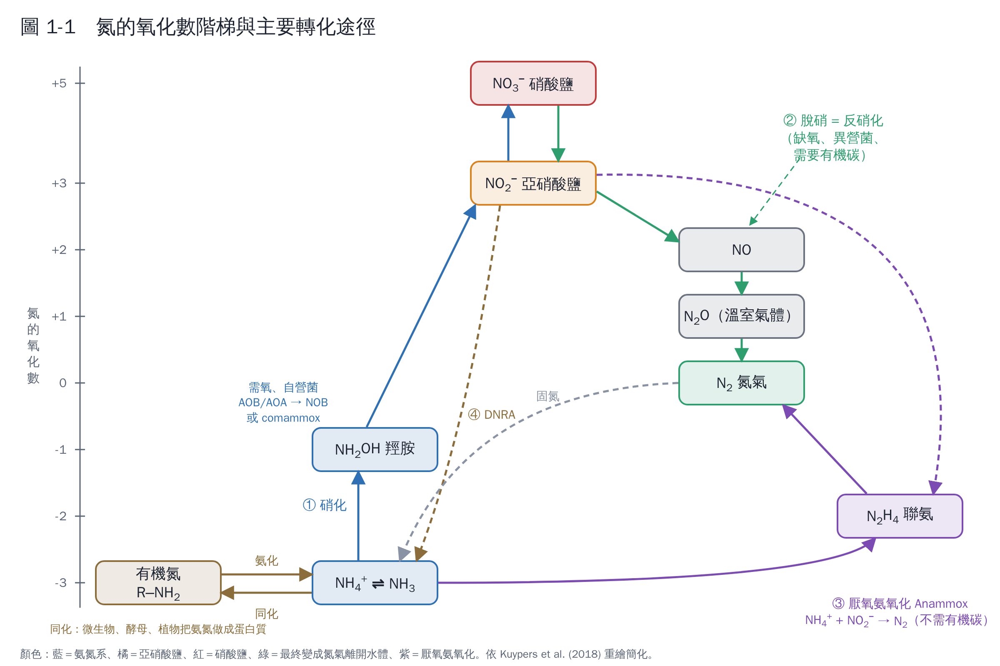
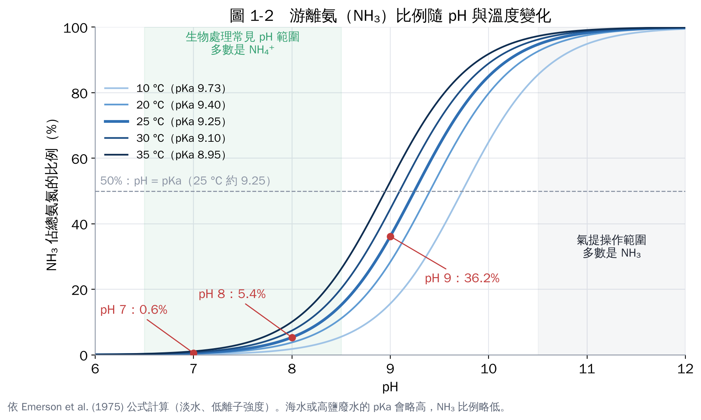
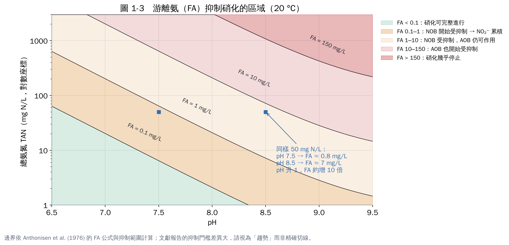

# 第 1 章　氨氮是什麼？pH 如何決定 NH₃ 與 NH₄⁺

## 1.1 先把名詞對齊

剛接觸這個領域，最容易卡在名詞。下面是本教材統一使用的說法：

| 中文 | 英文 | 意思 |
|---|---|---|
| 氨氮 | Ammonia nitrogen（NH₃-N） | 水中 NH₄⁺（銨離子）加 NH₃（游離氨）的總量，以「氮」計 |
| 總氨氮 | Total ammonia nitrogen（TAN） | 和「氨氮」同義，強調包含兩種形態 |
| 游離氨 | Free ammonia（FA） | 只指 NH₃ 這個不帶電的分子，毒性主要來自它 |
| 硝化 | Nitrification | 好氧下把 NH₄⁺ 氧化成 NO₂⁻、再到 NO₃⁻ |
| 脫硝＝反硝化 | Denitrification | 缺氧下把 NO₃⁻／NO₂⁻ 還原成 N₂ 氣體，氮才真正離開水體 |
| 厭氧氨氧化 | Anammox | NH₄⁺ 和 NO₂⁻ 直接反應成 N₂，不需要有機碳 |
| 脫氮 | Nitrogen removal | 泛指把氮從水中移走（通常 = 硝化 + 脫硝） |

> 你提到的「脫硝跟反脫硝」，在廢水領域其實是「**硝化**」和「**脫硝（＝反硝化）**」兩個步驟，沒有「反脫硝」這個正式名詞。另外要注意：空氣污染領域的「脫硝」（例如 SCR 脫硝）指的是去除煙道氣中的 NOₓ，和水處理是兩件事，查資料時別混在一起。

整個氮循環可以畫在「氧化數階梯」上：氨氮在最底下（−3），硝酸鹽在最上面（+5），氮氣在中間（0）。微生物就是靠把氮在這個階梯上「搬上搬下」來取得能量 [1]。

看圖的重點：

- **硝化（藍色箭頭）是往上爬**，需要氧氣當電子接受者。產物 NO₃⁻ 仍然溶在水裡，所以**只做硝化，總氮並沒有減少**。
- **脫硝（綠色箭頭）是往下走到 N₂**，需要有機碳提供電子。N₂ 是氣體，會離開水體。
- **Anammox（紫色）**是捷徑：NH₄⁺ 和 NO₂⁻ 直接變 N₂。
- **DNRA（褐色虛線）**會把硝酸鹽「變回」氨氮。如果你的實驗中氨氮莫名其妙上升，要想到它。

## 1.2 NH₄⁺ 與 NH₃ 的酸鹼平衡

水中的氨氮有兩種形態，兩者隨時在互相轉換：

**NH₄⁺ ⇌ NH₃ + H⁺**

這是一個弱酸的解離反應，平衡由 pKa 決定。25 °C 時 pKa 約 9.25。換算公式：

- NH₃ 佔總氨氮的比例 = 1 ÷（1 + 10^(pKa − pH)）
- pKa 隨溫度改變：**pKa = 0.09018 + 2729.92 ÷ T**（T 為絕對溫度 K）[2]

依上面公式計算的對照表（NH₃ 佔總氨氮的百分比）：

| 溫度 | pKa | pH 7 | pH 7.5 | pH 8 | pH 8.5 | pH 9 | pH 10 | pH 11 |
|---|---|---|---|---|---|---|---|---|
| 10 °C | 9.73 | 0.19% | 0.58% | 1.8% | 5.5% | 15.7% | 65.0% | 94.9% |
| 20 °C | 9.40 | 0.39% | 1.2% | 3.8% | 11.1% | 28.4% | 79.8% | 97.5% |
| 25 °C | 9.25 | 0.56% | 1.8% | 5.4% | 15.2% | 36.2% | 85.0% | 98.3% |
| 30 °C | 9.10 | 0.80% | 2.5% | 7.4% | 20.3% | 44.5% | 88.9% | 98.8% |
| 35 °C | 8.95 | 1.1% | 3.4% | 10.1% | 26.2% | 52.9% | 91.8% | 99.1% |

三個要記住的規則：

1. **pH 每升高 1，NH₃ 大約增加 10 倍**（在 pH 遠低於 pKa 時）。pH 7 到 pH 8，NH₃ 從 0.56% 變成 5.4%。
2. **溫度越高，NH₃ 比例越高**。同樣 pH 8，35 °C 的 NH₃ 比例是 10 °C 的 5 倍以上。
3. **pH 等於 pKa 時，兩種形態各佔一半**。pH 再往上，大部分就是 NH₃。

這個公式適用於淡水與低鹽廢水。海水或高鹽廢水的離子強度高，pKa 會略往上偏，NH₃ 比例略低；精確計算要做離子強度修正 [2]。

### 算一次看看

> 某養殖廢水：總氨氮 100 mg N/L、pH 8.0、水溫 30 °C。
>
> 1. pKa = 0.09018 + 2729.92 ÷ 303.15 = 9.10
> 2. NH₃ 比例 = 1 ÷（1 + 10^(9.10 − 8.0)）= 1 ÷（1 + 12.6）= 7.4%
> 3. 游離氨 = 100 × 7.4% = 7.4 mg N/L，換成 NH₃ 分子 = 7.4 × 17/14 ≈ 9.0 mg NH₃/L

## 1.3 為什麼要在意 NH₃ 和 NH₄⁺ 的比例？

### (1) 毒性：NH₃ 比 NH₄⁺ 毒得多

NH₃ 不帶電，可以穿過細胞膜；NH₄⁺ 則不容易。因此魚類與水生生物的氨毒性主要來自 NH₃。美國環保署的淡水氨氮水質基準就是隨 pH 和溫度調整的：同樣的總氨氮，pH 和溫度越高，允許值越低 [3]。

### (2) 微生物抑制：游離氨會抑制硝化菌

Anthonisen 等人（1976）的經典研究指出，游離氨在 **0.1–1.0 mg/L 就開始抑制亞硝酸氧化菌（NOB）**，**10–150 mg/L 開始抑制氨氧化菌（AOB）**；另外，游離亞硝酸（FNA，HNO₂）在 0.22–2.8 mg/L 也會抑制硝化 [4]。他們提出的游離氨計算式：

**FA（mg NH₃/L）＝ 17/14 × TAN × 10^pH ÷（e^(6334/(273+T)) ＋ 10^pH）**

（TAN 以 mg N/L 計，T 為 °C）

這張圖解釋了一個常見現象：**高氨氮廢水（例如厭氧消化液、養豬廢水）做硝化時，常會卡在亞硝酸鹽**。因為 NOB 比 AOB 更怕游離氨。後來的「短程硝化」製程就是故意利用這點（第 2 章）。

要注意：後續研究報告的抑制門檻差異很大，和菌群馴化程度有關。圖中的邊界請當作趨勢，不是精確切線。

### (3) 揮發：pH 高時氨會跑到空氣中

NH₃ 是氣體，會從水面揮發。這是「氨氣提」技術的原理（把 pH 調到 10.5 以上再曝氣，第 9 章）。反過來說，**做批次試驗時，如果 pH 偏高又有曝氣，氨氮下降可能只是揮發，不是微生物作用**。一定要做無菌對照。

### (4) 植物與藻類的耐受度

浮萍等水生植物偏好吸收 NH₄⁺，但高濃度 NH₃ 會毒害植物；降低 pH 可以讓植物耐受較高的總氨氮 [5]。第 8 章會再談。

## 1.4 單位換算：永遠寫「以氮計」

文獻和檢驗報告的單位五花八門，最常出錯的是「以什麼計」。建議一律換成 **mg N/L**：

| 你看到的 | 換成 mg N/L 要乘 |
|---|---|
| mg NH₄⁺/L | × 0.776（14/18） |
| mg NH₃/L | × 0.824（14/17） |
| mg NO₂⁻/L | × 0.304（14/46） |
| mg NO₃⁻/L | × 0.226（14/62） |
| mmol/L | × 14.0 |

例如「硝酸鹽 50 mg/L」如果是以 NO₃⁻ 計，其實只有 11.3 mg N/L，差了 4 倍多。

## 本章重點

- 氨氮 = NH₄⁺ + NH₃，比例由 pH 和溫度決定；25 °C 時 pKa ≈ 9.25。
- pH 每升 1，NH₃ 約增 10 倍；溫度升高也會增加 NH₃。
- NH₃ 有毒、會抑制硝化菌（NOB 比 AOB 敏感）、會揮發。
- 濃度一律寫成 mg N/L。

## 參考文獻

1. Kuypers MMM, Marchant HK, Kartal B (2018). The microbial nitrogen-cycling network. *Nature Reviews Microbiology*, 16, 263–276. https://doi.org/10.1038/nrmicro.2018.9
2. Emerson K, Russo RC, Lund RE, Thurston RV (1975). Aqueous ammonia equilibrium calculations: effect of pH and temperature. *Journal of the Fisheries Research Board of Canada*, 32, 2379–2383. https://doi.org/10.1139/f75-274
3. U.S. EPA (2013). Aquatic Life Ambient Water Quality Criteria for Ammonia – Freshwater 2013（EPA-822-R-13-001）. https://www.epa.gov/wqc/aquatic-life-criteria-ammonia
4. Anthonisen AC, Loehr RC, Prakasam TBS, Srinath EG (1976). Inhibition of nitrification by ammonia and nitrous acid. *Journal of the Water Pollution Control Federation*, 48(5), 835–852.
5. Körner S, Das SK, Veenstra S, Vermaat JE (2001). The effect of pH variation at the ammonium/ammonia equilibrium in wastewater and its toxicity to *Lemna gibba*. *Aquatic Botany*, 71, 71–78. https://doi.org/10.1016/S0304-3770(01)00158-9
