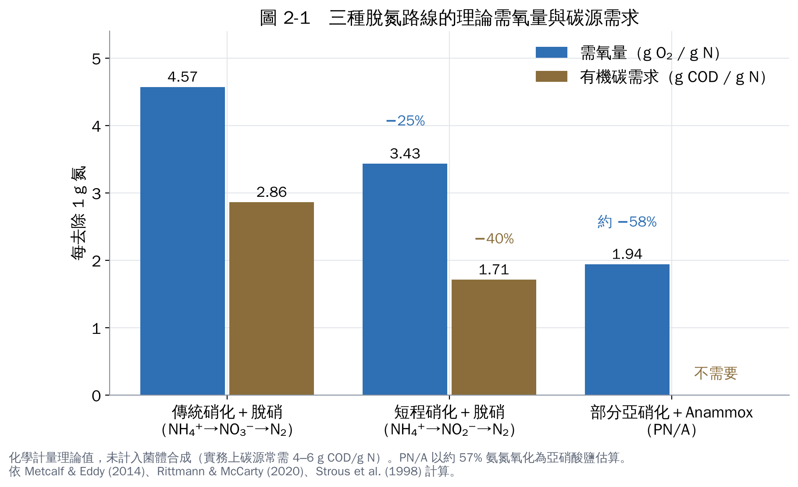
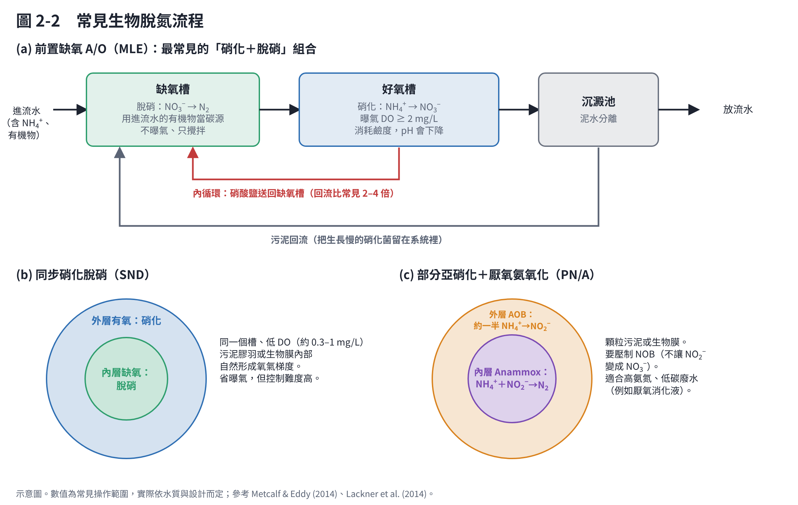

# 第 2 章　硝化、脫硝與新型生物脫氮

生物脫氮的主流做法有兩步：先在好氧下**硝化**，把氨氮變成硝酸鹽；再在缺氧下**脫硝**，把硝酸鹽變成氮氣。近 30 年又發展出幾條「捷徑」。本章先講反應，再講操作條件，最後介紹新製程。

## 2.1 硝化：氨氮 → 亞硝酸鹽 → 硝酸鹽

硝化分兩步，傳統上由兩群不同的自營菌完成 [1, 2]：

| 步驟 | 反應 | 負責的菌 | 需氧量 |
|---|---|---|---|
| 亞硝化（nitritation） | NH₄⁺ + 1.5 O₂ → NO₂⁻ + 2 H⁺ + H₂O | 氨氧化菌 AOB、氨氧化古菌 AOA | 3.43 g O₂/g N |
| 硝酸化（nitratation） | NO₂⁻ + 0.5 O₂ → NO₃⁻ | 亞硝酸氧化菌 NOB | 1.14 g O₂/g N |
| 合計 | NH₄⁺ + 2 O₂ → NO₃⁻ + 2 H⁺ + H₂O | | **4.57 g O₂/g N** |

2015 年兩個研究團隊同時發現，部分 *Nitrospira* 一隻菌就能從 NH₄⁺ 一路氧化到 NO₃⁻，稱為 **comammox**（complete ammonia oxidation）[3, 4]。這推翻了一百多年來「硝化一定要兩群菌」的看法，也影響 qPCR 的設計（第 6 章）。

硝化的三個實務重點：

1. **耗氧多**：每氧化 1 g 氨氮要 4.57 g 氧。曝氣通常是污水廠最大的耗電項目。
2. **消耗鹼度、讓 pH 下降**：反應產生 H⁺，每氧化 1 g 氨氮約消耗 7.14 g 鹼度（以 CaCO₃ 計）[1]。高氨氮廢水如果鹼度不夠，pH 會一路掉，硝化就停了。這時要加碳酸氫鈉或石灰。
3. **硝化菌長得很慢**：硝化菌是自營菌，從氧化氨氮得到的能量很少，生長速率遠低於分解有機物的異營菌。系統要有足夠長的污泥停留時間（SRT），否則硝化菌會被「洗出」[1, 2]。

## 2.2 脫硝（反硝化）：硝酸鹽 → 氮氣

脫硝菌是**異營菌**，在缺氧（沒有溶氧、但有硝酸鹽）時用硝酸鹽取代氧氣呼吸，需要有機物提供電子 [5]：

**NO₃⁻ → NO₂⁻ → NO → N₂O → N₂**

以甲醇當碳源為例：

**6 NO₃⁻ + 5 CH₃OH → 3 N₂ + 5 CO₂ + 7 H₂O + 6 OH⁻**

脫硝的三個實務重點：

1. **要有碳源**：理論上每還原 1 g 硝酸鹽氮需要 2.86 g COD；加上菌體生長，實務上常要 4–6 g COD/g N [1, 2]。進流水碳不夠（C/N 低）時，要外加甲醇、醋酸鈉或糖蜜等。
2. **要缺氧**：溶氧會讓脫硝菌優先用氧氣呼吸。缺氧槽 DO 通常控制在 0.2–0.5 mg/L 以下。
3. **會補回鹼度**：每還原 1 g 硝酸鹽氮約產生 3.57 g 鹼度（CaCO₃），大約補回硝化消耗的一半 [1]。這也是「前置缺氧」流程的好處之一。

## 2.3 操作條件總整理

| 條件 | 硝化 | 脫硝 |
|---|---|---|
| 溶氧 | ≥ 2 mg/L 較穩定 | 越低越好（< 0.2–0.5 mg/L） |
| pH | 約 7.0–8.0；低於 6.5 明顯變慢 | 約 7.0–8.0；pH 低容易累積 N₂O |
| 溫度 | 對溫度敏感，15 °C 以下速率大降 | 也受溫度影響，但比硝化耐受 |
| 碳源 | 不需要（以 CO₂ 為碳源）；有機物太多反而讓異營菌搶氧 | 需要，C/N 是關鍵 |
| 污泥停留時間 | 要長（硝化菌生長慢） | 較短也可以 |
| 常見抑制物 | 游離氨、游離亞硝酸、重金屬、酚類、硫化物、高鹽 | 溶氧、部分有毒物；亞硝酸鹽過高 |

數值為常見操作範圍，整理自 Metcalf & Eddy（2014）[1] 與 Rittmann & McCarty（2020）[2]；實際要依你的水質做試驗。

## 2.4 新型脫氮：三條「捷徑」

傳統路線要把氨氮一路氧化到硝酸鹽，再還原回氮氣，等於爬上山再走下來。新製程的想法是「不用爬到山頂」：

### (1) 短程硝化–脫硝（nitrite shunt）

只把氨氮氧化到亞硝酸鹽，接著直接脫硝。理論上省 25% 曝氣、40% 碳源 [1]。關鍵是**壓制 NOB**：利用 NOB 對游離氨較敏感（第 1 章圖 1-3）、在高溫下 AOB 長得比 NOB 快（SHARON 製程的原理），或控制低溶氧。

### (2) 厭氧氨氧化（Anammox）

1990 年代在荷蘭發現的細菌，在缺氧下直接用 NO₂⁻ 氧化 NH₄⁺ 產生 N₂，**完全不需要有機碳** [6]。Strous 等人量測的化學計量式：

**NH₄⁺ + 1.32 NO₂⁻ + 0.066 HCO₃⁻ + 0.13 H⁺ → 1.02 N₂ + 0.26 NO₃⁻ + 0.066 CH₂O₀.₅N₀.₁₅ + 2.03 H₂O**

（後續研究在不同培養條件下得到的 NO₂⁻:NH₄⁺ 比約 1.1–1.3，並非固定值。）

Anammox 菌生長極慢，Strous 等人估計倍增時間約 11 天 [6]，所以啟動一座反應槽常要數個月，並且需要顆粒污泥或生物膜把菌留住。

### (3) 部分亞硝化＋Anammox（PN/A）

先讓 AOB 把**約一半**的氨氮氧化成亞硝酸鹽，再由 Anammox 菌把剩下的氨氮和亞硝酸鹽一起變成氮氣。可以在兩個槽分開做，也可以在同一顆顆粒污泥內完成（圖 2-2c）。全球已有超過 100 座實廠，多數用來處理厭氧消化脫水液這類**高氨氮、低碳**的側流 [7]。

### 其他你會在文獻看到的名詞

- **同步硝化脫硝（SND）**：同一槽、低 DO，靠污泥膠羽內部的氧氣梯度同時硝化和脫硝（圖 2-2b）。
- **異營硝化–好氧脫硝（HN-AD）**：某些異營菌（如 *Paracoccus*、*Alcaligenes faecalis*、*Pseudomonas stutzeri*）能在有氧時同時氧化氨氮並脫硝 [8, 9]。很多純菌研究都在這個方向，第 7 章談酵母時會再看到。
- **DNRA**：把硝酸鹽還原成氨氮，與脫硝競爭；高 C/N、缺氧時較常見。

## 2.5 別忘了 N₂O

硝化與脫硝的中間產物 N₂O 是強效溫室氣體，100 年全球暖化潛勢約為 CO₂ 的 273 倍 [10]。低 DO、亞硝酸鹽累積、脫硝碳源不足、pH 偏低等狀況都容易增加 N₂O 排放 [11]。做脫氮研究時，如果能量測氣相 N₂O，結果會更完整，也是審查委員常問的問題。

## 本章重點

- 硝化：好氧、自營、耗氧 4.57 g O₂/g N、耗鹼度 7.14 g CaCO₃/g N、菌長得慢。
- 脫硝：缺氧、異營、需要碳源，會補回一半鹼度。
- 只做硝化不會減少總氮；要脫硝或 Anammox 才會變成 N₂。
- 新製程（短程硝化、Anammox、PN/A）的核心都是「省氧、省碳」，關鍵是壓制 NOB。

## 參考文獻

1. Metcalf & Eddy, Inc.（Tchobanoglous G, Stensel HD, Tsuchihashi R, Burton F）(2014). *Wastewater Engineering: Treatment and Resource Recovery*, 5th ed. McGraw-Hill Education.
2. Rittmann BE, McCarty PL (2020). *Environmental Biotechnology: Principles and Applications*, 2nd ed. McGraw-Hill Education.
3. Daims H, Lebedeva EV, Pjevac P, et al. (2015). Complete nitrification by *Nitrospira* bacteria. *Nature*, 528, 504–509. https://doi.org/10.1038/nature16461
4. van Kessel MAHJ, Speth DR, Albertsen M, et al. (2015). Complete nitrification by a single microorganism. *Nature*, 528, 555–559. https://doi.org/10.1038/nature16459
5. Zumft WG (1997). Cell biology and molecular basis of denitrification. *Microbiology and Molecular Biology Reviews*, 61, 533–616. https://doi.org/10.1128/mmbr.61.4.533-616.1997
6. Strous M, Heijnen JJ, Kuenen JG, Jetten MSM (1998). The sequencing batch reactor as a powerful tool for the study of slowly growing anaerobic ammonium-oxidizing microorganisms. *Applied Microbiology and Biotechnology*, 50, 589–596. https://doi.org/10.1007/s002530051340
7. Lackner S, Gilbert EM, Vlaeminck SE, Joss A, Horn H, van Loosdrecht MCM (2014). Full-scale partial nitritation/anammox experiences – an application survey. *Water Research*, 55, 292–303. https://doi.org/10.1016/j.watres.2014.02.032
8. Joo HS, Hirai M, Shoda M (2005). Characteristics of ammonium removal by heterotrophic nitrification-aerobic denitrification by *Alcaligenes faecalis* No. 4. *Journal of Bioscience and Bioengineering*, 100, 184–191. https://doi.org/10.1263/jbb.100.184
9. Zhang J, Wu P, Hao B, Yu Z (2011). Heterotrophic nitrification and aerobic denitrification by the bacterium *Pseudomonas stutzeri* YZN-001. *Bioresource Technology*, 102, 9866–9869. https://doi.org/10.1016/j.biortech.2011.07.118
10. Forster P, Storelvmo T, Armour K, et al. (2021). The Earth's energy budget, climate feedbacks, and climate sensitivity. In: *Climate Change 2021: The Physical Science Basis*（IPCC AR6 WG I, Chapter 7）. Cambridge University Press. https://doi.org/10.1017/9781009157896.009
11. Kampschreur MJ, Temmink H, Kleerebezem R, Jetten MSM, van Loosdrecht MCM (2009). Nitrous oxide emission during wastewater treatment. *Water Research*, 43, 4093–4103. https://doi.org/10.1016/j.watres.2009.03.001
