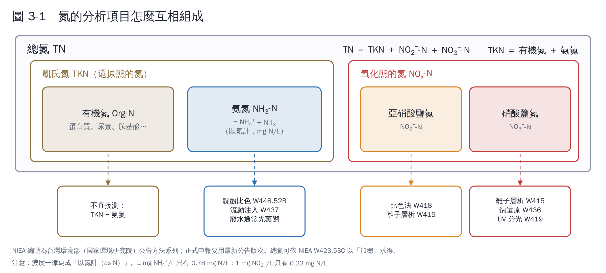
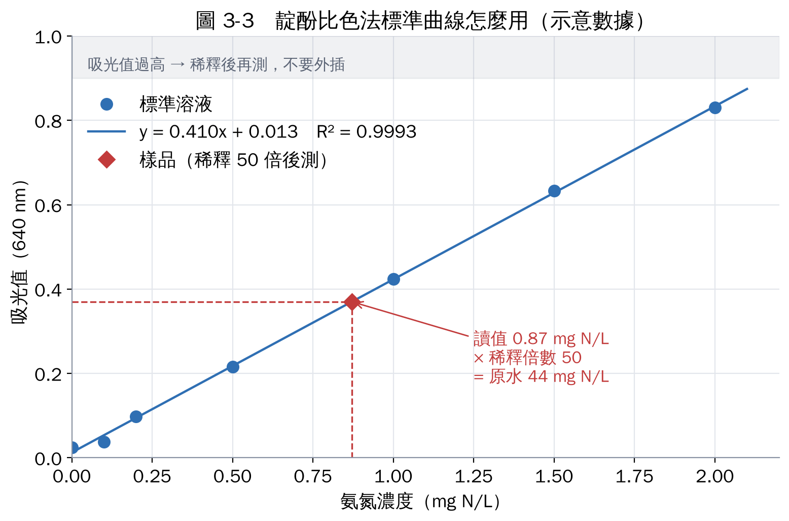
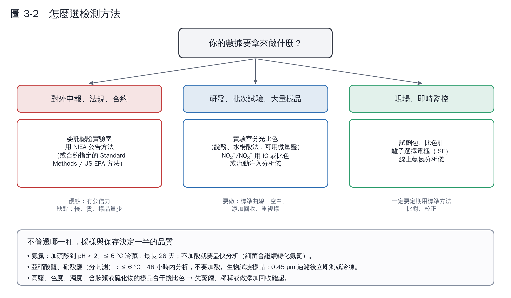

# 第 3 章　怎麼量？氮的正式檢測方法

做氨氮降解，最少要量四種氮：**氨氮、亞硝酸鹽氮、硝酸鹽氮、總氮**。只量氨氮，就無法判斷氨氮是「被降解」還是「換了形態」。

## 3.1 先搞懂各項目的關係

- **總氮（TN）＝ 凱氏氮（TKN）＋ 亞硝酸鹽氮 ＋ 硝酸鹽氮**
- **凱氏氮（TKN）＝ 有機氮 ＋ 氨氮**
- 有機氮通常不直接測，用 TKN 減氨氮求得。

台灣環境部公告的水中總氮檢測方法（NIEA W423.53C）就是用這個加總關係求總氮 [1]。

## 3.2 正式方法一覽

「正式方法」指主管機關公告、可用於法規申報的方法。台灣用 NIEA 方法；國際文獻常用美國的 *Standard Methods*（APHA）與 US EPA 方法；讀中國文獻會看到 HJ 標準。

| 項目 | 台灣 NIEA | Standard Methods | US EPA | 原理 |
|---|---|---|---|---|
| 氨氮 | W448.52B 靛酚比色法 | 4500-NH₃ F（酚鹽法） | 350.1 | 氨與酚、次氯酸鹽生成藍色靛酚，640 nm 比色 |
| 氨氮 | W437 流動注入分析（靛酚法） | 4500-NH₃ G/H（自動化） | 350.1 | 同上，自動化流動分析 |
| 氨氮 | 氨選擇性電極法 | 4500-NH₃ D | — | 加鹼使 NH₄⁺ 轉為 NH₃，以氣體透膜電極量測 |
| 氨氮（前處理） | 各方法的蒸餾步驟 | 4500-NH₃ B（蒸餾）、C（滴定） | — | 廢水干擾多時先蒸餾出氨 |
| 亞硝酸鹽氮 | W418 比色法 | 4500-NO₂⁻ B | — | 磺胺＋NED 偶氮染料（Griess 反應），約 543 nm |
| 硝酸鹽氮 | W436 鎘還原法 | 4500-NO₃⁻ E/F | 353.2 | 鎘柱把 NO₃⁻ 還原成 NO₂⁻ 再比色（量到的是兩者合計） |
| 硝酸鹽氮 | W419 紫外光分光光度計法 | 4500-NO₃⁻ B | — | 220 nm 吸收；只適用有機物少的乾淨水 |
| 陰離子（NO₂⁻、NO₃⁻） | W415 離子層析法 | 4110 B | 300.0 | 離子層析分離後以導電度偵測 |
| 凱氏氮 | 凱氏消化法 | 4500-N_org B/C | 351.2 | 硫酸消化把有機氮轉為氨，再測氨 |
| 總氮 | W423.53C（加總法） | 4500-N C（過硫酸鹽消化） | — | 加總，或過硫酸鹽氧化成硝酸鹽後測定 |

整理自 NIEA 公告方法 [1–3]、*Standard Methods* [4] 與 US EPA 方法 [5]。台灣的方法編號後面的版次（如 .52B）會改版，W448.52B 為民國 109 年 12 月 4 日公告、110 年 3 月 15 日施行的版本 [2]；**正式申報前務必到國家環境研究院（原環境檢驗所）網站確認最新版次**。

讀中國文獻常看到的兩個方法：HJ 535-2009 納氏試劑分光光度法、HJ 536-2009 水楊酸分光光度法。納氏試劑含汞，台灣與歐美已少用。

### 靛酚法的原理（最常用，值得多懂一點）

這個反應又叫 Berthelot 反應，水中氨在鹼性條件下與次氯酸鹽、酚反應，以亞硝醯鐵氰化鈉催化，生成深藍色的靛酚，顏色深淺與氨氮濃度成正比 [6]。實驗室常見的改良：

- **水楊酸法**：用水楊酸取代有毒的酚，原理相同，適合做成 96 孔盤微量法，一次測很多樣品。
- **OPA 螢光法**：鄰苯二甲醛與氨反應產生螢光，靈敏度高，適合低濃度天然水 [7]。

## 3.3 怎麼選方法？

給剛接手專案的建議：

1. **對外的數據（計畫成果、合約、法規）**：送 TAF 認證、且通過環境部許可的檢驗機構，用 NIEA 方法。
2. **自己實驗室的研發數據**：可以用微量盤比色或試劑包，但**一開始要和認證實驗室的結果比對一次**（同一批樣品分兩份），確認你的方法沒有系統性偏差。
3. **NO₂⁻ 和 NO₃⁻ 最好用離子層析**一次測完；用鎘還原法時，記得它量到的是 NO₂⁻ + NO₃⁻，要再扣掉單獨測的 NO₂⁻。

## 3.4 採樣與保存

生物樣品放著，微生物會繼續作用，所以「保存」和「分析」一樣重要。美國聯邦法規（40 CFR 136）的保存規定 [8]：

| 項目 | 保存方式 | 最長保存時間 |
|---|---|---|
| 氨氮 | ≤ 6 °C 冷藏，加硫酸至 pH < 2 | 28 天 |
| 亞硝酸鹽氮 | ≤ 6 °C 冷藏，不加酸 | 48 小時 |
| 硝酸鹽氮 | ≤ 6 °C 冷藏 | 48 小時 |
| 硝酸鹽＋亞硝酸鹽合計 | ≤ 6 °C 冷藏，加硫酸至 pH < 2 | 28 天 |
| 凱氏氮 | ≤ 6 °C 冷藏，加硫酸至 pH < 2 | 28 天 |

做批次試驗時的實務做法：

- 取樣後**立即**用 0.22 或 0.45 µm 濾膜過濾（或離心）去除菌體，停止反應。
- 過濾後的濾液可以冷凍（−20 °C）等待一起分析，但要在試驗計畫中寫清楚，並用標準品測試冷凍前後是否一致。
- 菌體或污泥另外保留，用來測菌體氮、做 DNA 萃取（第 5、6 章）。

## 3.5 品質管制：讓數據站得住腳

每一批分析都要有這些，否則審查時很難說服人：

| 品管項目 | 做法 | 用途 |
|---|---|---|
| 檢量線 | 5–7 個濃度點，涵蓋樣品範圍 | 濃度換算；樣品超出範圍要稀釋，不可外插 |
| 空白 | 試劑空白、方法空白 | 確認試劑或器材沒有污染（氨很容易從空氣、手汗污染） |
| 查核標準品 | 另一批次標準品配製的已知濃度 | 確認檢量線正確 |
| 重複樣 | 同一樣品分析兩次 | 精密度（相對差異百分比） |
| 添加回收 | 樣品中加入已知量標準品 | 確認基質沒有干擾；接受範圍依各方法規定 |

常見的干擾來源：

- **高鈣、鎂**：靛酚法在高 pH 下會產生沉澱，方法中通常加檸檬酸鹽或 EDTA 錯合。
- **色度、濁度**：先過濾，或做樣品空白（不加顯色劑）扣除。
- **培養基成分**：酵母萃取物、蛋白腖含大量有機氮，會在消化後變成氨；用這類培養基時一定要量總氮做平衡。
- **高鹽**：海水或高鹽廢水會影響顯色，標準曲線要用相同基質配製。

## 本章重點

- 最少量四項：氨氮、NO₂⁻-N、NO₃⁻-N、總氮（或 TKN）。
- 法規數據用 NIEA 方法並委託認證實驗室；研發可用微量法，但要先比對。
- 生物樣品取樣後立即過濾，依項目決定冷藏或加酸。
- 每批都要有檢量線、空白、重複樣、添加回收。

## 參考文獻

1. 環境部（2023）。水中總氮檢測方法（NIEA W423.53C）。112 年 8 月 15 日環署授檢字第 1127106488 號公告，112 年 11 月 15 日生效。行政院公報 第 29 卷第 152 期。https://gazette.nat.gov.tw/EG_FileManager/eguploadpub/eg029152/ch07/type1/gov60/num44/images/Eg01.pdf
2. 行政院環境保護署環境檢驗所（2020）。水中氨氮檢測方法－靛酚比色法（NIEA W448.52B）。109 年 12 月 4 日公告，110 年 3 月 15 日實施。https://www.epa.gov.tw/niea/1E6EC49F562D8981
3. 行政院環境保護署（2015）。水中硝酸鹽氮及亞硝酸鹽氮檢測方法－鎘還原法（NIEA W436.52C）。104 年 7 月 28 日環署檢字第 1040060441 號公告。https://www.nera.gov.tw/upload/cmNormalFile/2025-03-13/0e6b3ca8-edcb-4a24-a638-be907943d230/W43652C.pdf
4. APHA, AWWA, WEF (2023). *Standard Methods for the Examination of Water and Wastewater*, 24th ed. Methods 4110, 4500-NH₃, 4500-NO₂⁻, 4500-NO₃⁻, 4500-N, 4500-N_org. American Public Health Association.
5. U.S. EPA (1993). Method 350.1: Determination of ammonia nitrogen by semi-automated colorimetry; Method 353.2: Determination of nitrate-nitrite nitrogen by automated colorimetry; Method 300.0: Determination of inorganic anions by ion chromatography.
6. Solórzano L (1969). Determination of ammonia in natural waters by the phenolhypochlorite method. *Limnology and Oceanography*, 14, 799–801. https://doi.org/10.4319/lo.1969.14.5.0799
7. Holmes RM, Aminot A, Kérouel R, Hooker BA, Peterson BJ (1999). A simple and precise method for measuring ammonium in marine and freshwater ecosystems. *Canadian Journal of Fisheries and Aquatic Sciences*, 56, 1801–1808. https://doi.org/10.1139/f99-128
8. U.S. Code of Federal Regulations, 40 CFR 136.3, Table II – Required containers, preservation techniques, and holding times. https://www.ecfr.gov/current/title-40/chapter-I/subchapter-D/part-136/section-136.3
