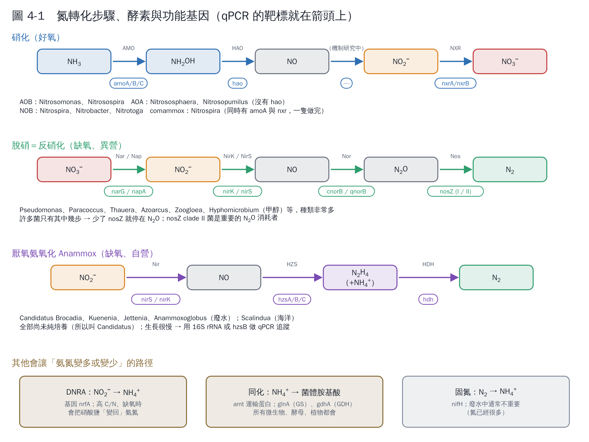

# 第 4 章　相關微生物與功能基因

氮轉化的每一步，都由特定的酵素催化；每個酵素由特定的基因編碼。**知道「哪一步由哪個基因負責」，就知道 qPCR 要測什麼**。

## 4.1 主要功能群一覽

| 功能群 | 做什麼 | 代表菌屬 | 生活方式 | 常用標記基因 |
|---|---|---|---|---|
| 氨氧化細菌 AOB | NH₃ → NO₂⁻ | *Nitrosomonas*、*Nitrosospira* | 好氧、自營 | *amoA*（細菌型） |
| 氨氧化古菌 AOA | NH₃ → NO₂⁻ | *Nitrososphaera*、*Nitrosopumilus*、*Nitrosocosmicus* | 好氧、自營；偏好低氨環境 | *amoA*（古菌型） |
| 亞硝酸氧化菌 NOB | NO₂⁻ → NO₃⁻ | *Nitrospira*、*Nitrobacter*、*Nitrotoga* | 好氧、多為自營 | *nxrA*、*nxrB*；16S rRNA |
| Comammox | NH₃ → NO₃⁻（一隻做完） | *Nitrospira*（clade A、B） | 好氧、自營；適應低氨 | comammox 專一 *amoA* |
| 脫硝菌 | NO₃⁻ → N₂ | *Pseudomonas*、*Paracoccus*、*Thauera*、*Azoarcus*、*Zoogloea*、*Hyphomicrobium* 等 | 缺氧、異營 | *narG*、*napA*、*nirK*、*nirS*、*norB*、*nosZ* |
| Anammox 菌 | NH₄⁺ + NO₂⁻ → N₂ | *Ca.* Brocadia、*Ca.* Kuenenia、*Ca.* Jettenia、*Ca.* Scalindua | 缺氧、自營、生長極慢 | *hzsA/B*、*hdh*；16S rRNA |
| DNRA 菌 | NO₃⁻/NO₂⁻ → NH₄⁺ | 多種腸道菌、*Geobacter* 等 | 缺氧、異營 | *nrfA* |
| 異營硝化–好氧脫硝菌 | NH₄⁺ → N₂（有氧） | *Paracoccus*、*Alcaligenes*、*Pseudomonas*、*Acinetobacter* 等 | 好氧、異營 | 尚無統一標記，常同時偵測多個基因 |

整理自 Kuypers et al.（2018）[1] 與本章引用的原始研究。

## 4.2 硝化菌：誰負責第一步？

**AOB** 是廢水處理中最傳統的氨氧化者，*Nitrosomonas* 在高氨氮的污水廠特別常見。

**AOA** 在 2005 年才第一次被分離出來 [2]。它對氨的親和力非常高，能在很低的氨濃度下生存，所以在海洋、土壤、低氨的飲用水處理中常比 AOB 多；在高氨氮廢水中則通常是 AOB 佔優勢 [3]。

**Comammox *Nitrospira*** 在 2015 年被發現 [4, 5]，也偏好低氨環境，在生物濾池、低負荷系統中常被偵測到。過去用 NOB 引子測到的 *Nitrospira*，有一部分其實是 comammox，這點在解讀舊文獻時要注意。

**AMO（氨單加氧酶）** 是第一步的關鍵酵素，由 *amoA*、*amoB*、*amoC* 基因編碼。*amoA* 是研究氨氧化者最常用的功能標記。AOB 用 HAO（羥胺氧化還原酶，*hao*）把羥胺氧化，近年研究發現 HAO 的產物其實是 NO，NO 再轉成 NO₂⁻ 的機制仍在研究中 [6]。AOA 沒有 *hao* 同源基因，走的是另一套尚未完全釐清的路徑。

## 4.3 NOB：*Nitrospira* 與 *Nitrobacter*

兩者都把亞硝酸鹽氧化成硝酸鹽（酵素 NXR，基因 *nxrA*/*nxrB*），但生態策略不同：*Nitrospira* 對亞硝酸鹽的親和力高，在低亞硝酸鹽、穩定的系統中佔優勢；*Nitrobacter* 在亞硝酸鹽濃度高、波動大的環境中較有競爭力 [7]。在多數污水廠中，*Nitrospira* 是主要的 NOB。

## 4.4 脫硝菌：種類多，要看基因

脫硝能力分散在非常多種的細菌中，無法用一兩個菌屬代表，所以研究上**多用功能基因**來追蹤 [8]：

| 步驟 | 酵素 | 基因 | 備註 |
|---|---|---|---|
| NO₃⁻ → NO₂⁻ | 膜結合型硝酸還原酶 Nar／周質型 Nap | *narG*／*napA* | Nap 在有氧時也可能作用 |
| NO₂⁻ → NO | 亞硝酸還原酶 NirK（含銅）／NirS（含細胞色素 cd₁） | *nirK*／*nirS* | 兩者通常不會同時存在同一菌中，常一起測 |
| NO → N₂O | 一氧化氮還原酶 | *cnorB*／*qnorB* | |
| N₂O → N₂ | 氧化亞氮還原酶 | *nosZ*（clade I、II） | 缺 *nosZ* 的菌會停在 N₂O |

有一個很實用的觀念：**很多菌只有部分脫硝基因**。例如只有 *nirK*、沒有 *nosZ* 的菌，產物就是 N₂O。2013 年研究發現另一群過去引子測不到的 *nosZ*（clade II），是重要的 N₂O 消耗者 [9]。所以 *nosZ* 的 qPCR 最好兩群都測。

## 4.5 Anammox 菌

Anammox 菌屬於浮黴菌門（Planctomycetes），到目前都沒有純培養，所以名字前面加 *Candidatus*。它們在細胞內一個特殊的胞器（anammoxosome）中，先把 NO₂⁻ 還原成 NO，再由**聯氨合成酶（HZS）**把 NO 和 NH₄⁺ 合成聯氨（N₂H₄，火箭燃料成分），最後由聯氨脫氫酶（HDH）把聯氨氧化成 N₂ [10]。*hzsB* 是 Anammox 專一的功能標記 [11]。

## 4.6 會讓氨氮「變多」的路徑

做降解實驗時，偶爾會看到氨氮不降反升。常見原因：

- **氨化**：培養基或廢水中的有機氮（蛋白質、尿素）被分解，釋出氨氮。
- **DNRA**：缺氧、高碳時，硝酸鹽被還原回氨氮（*nrfA*）。
- **菌體自解**：細胞死亡後釋出氮。

所以實驗設計一定要量總氮，才能分辨。

## 本章重點

- 氨氧化有三群：AOB、AOA、comammox；高氨氮廢水通常 AOB 為主。
- NOB 以 *Nitrospira* 為主；*Nitrobacter* 在高亞硝酸鹽時較常見。
- 脫硝菌種類太多，用功能基因（*nirK*、*nirS*、*nosZ* 等）追蹤比較實際。
- Anammox 菌沒有純培養，用 16S rRNA 或 *hzsB* 追蹤。

## 參考文獻

1. Kuypers MMM, Marchant HK, Kartal B (2018). The microbial nitrogen-cycling network. *Nature Reviews Microbiology*, 16, 263–276. https://doi.org/10.1038/nrmicro.2018.9
2. Könneke M, Bernhard AE, de la Torre JR, Walker CB, Waterbury JB, Stahl DA (2005). Isolation of an autotrophic ammonia-oxidizing marine archaeon. *Nature*, 437, 543–546. https://doi.org/10.1038/nature03911
3. Martens-Habbena W, Berube PM, Urakawa H, de la Torre JR, Stahl DA (2009). Ammonia oxidation kinetics determine niche separation of nitrifying Archaea and Bacteria. *Nature*, 461, 976–979. https://doi.org/10.1038/nature08465
4. Daims H, Lebedeva EV, Pjevac P, et al. (2015). Complete nitrification by *Nitrospira* bacteria. *Nature*, 528, 504–509. https://doi.org/10.1038/nature16461
5. van Kessel MAHJ, Speth DR, Albertsen M, et al. (2015). Complete nitrification by a single microorganism. *Nature*, 528, 555–559. https://doi.org/10.1038/nature16459
6. Caranto JD, Lancaster KM (2017). Nitric oxide is an obligate bacterial nitrification intermediate produced by hydroxylamine oxidoreductase. *PNAS*, 114, 8217–8222. https://doi.org/10.1073/pnas.1704504114
7. Daims H, Lücker S, Wagner M (2016). A new perspective on microbes formerly known as nitrite-oxidizing bacteria. *Trends in Microbiology*, 24, 699–712. https://doi.org/10.1016/j.tim.2016.05.004
8. Zumft WG (1997). Cell biology and molecular basis of denitrification. *Microbiology and Molecular Biology Reviews*, 61, 533–616. https://doi.org/10.1128/mmbr.61.4.533-616.1997
9. Jones CM, Graf DRH, Bru D, Philippot L, Hallin S (2013). The unaccounted yet abundant nitrous oxide-reducing microbial community: a potential nitrous oxide sink. *The ISME Journal*, 7, 417–426. https://doi.org/10.1038/ismej.2012.125
10. Kartal B, Maalcke WJ, de Almeida NM, et al. (2011). Molecular mechanism of anaerobic ammonium oxidation. *Nature*, 479, 127–130. https://doi.org/10.1038/nature10453
11. Harhangi HR, Le Roy M, van Alen T, et al. (2012). Hydrazine synthase, a unique phylomarker with which to study the presence and biodiversity of anammox bacteria. *Applied and Environmental Microbiology*, 78, 752–758. https://doi.org/10.1128/AEM.07113-11
