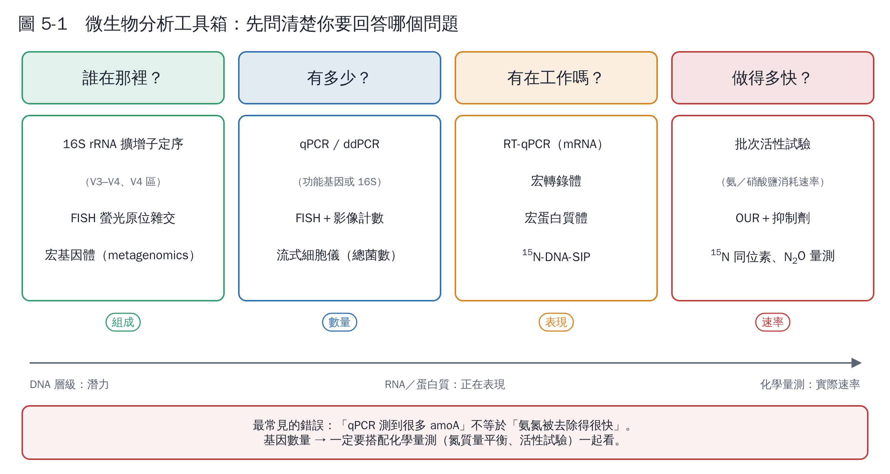
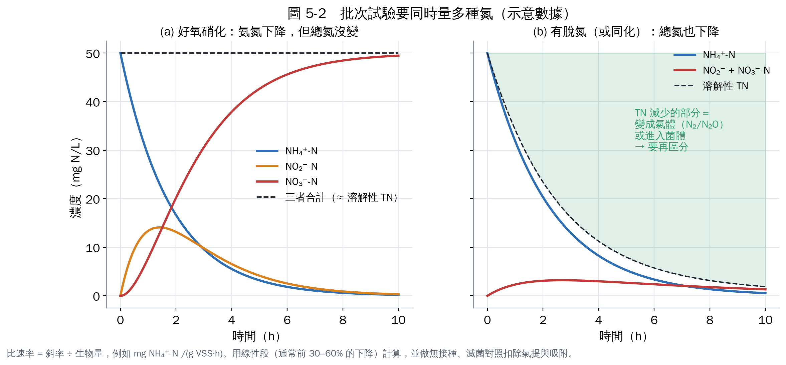
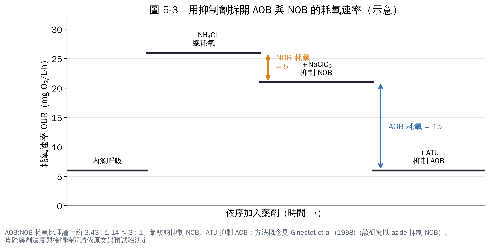

# 第 5 章　功能性檢測與菌群分析

微生物分析的工具很多，選錯工具最浪費時間。先想清楚你要回答哪個問題：

## 5.1 功能性檢測：菌群「做得多快」

功能性檢測（activity assay）直接量測化學物質的變化速率，是判斷菌群有沒有能力降解氨氮最直接的證據。

### (1) 批次活性試驗（最基本、最推薦先做）

把污泥或菌液放進瓶中，給定條件，定時取樣量各種氮，算出速率。

| 試驗 | 量測什麼 | 條件要點 |
|---|---|---|
| 比氨氧化速率（SAOR／AUR） | NH₄⁺ 下降、NO₂⁻＋NO₃⁻ 上升 | 曝氣使 DO > 2–3 mg/L；加碳酸氫鹽維持 pH 7.5–8；起始 NH₄⁺-N 約 20–50 mg/L |
| 比亞硝酸氧化速率 | NO₂⁻ 下降、NO₃⁻ 上升 | 同上，改加亞硝酸鹽 |
| 比脫硝速率（SDNR／NUR） | NO₃⁻ 下降 | 通氮氣去除溶氧、密封；碳源要充足（例如醋酸鈉），避免碳源限制速率 |
| Anammox 活性（SAA） | NH₄⁺ 與 NO₂⁻ 同時下降、產生 N₂ | 嚴格厭氧；NH₄⁺:NO₂⁻ 約 1:1.3；可量頂空壓力或 N₂ |

計算方式：**比速率 ＝ 線性段斜率 ÷ 生物量**，單位例如 mg N/(g VSS·h)。生物量用揮發性懸浮固體（VSS）或蛋白質量表示。

**一定要有的對照組：**

- **無接種（只有培養液）**：扣除化學反應與揮發。
- **滅菌污泥（高壓滅菌）**：扣除吸附。
- **無基質（不加氨氮）**：量測內源釋出的氨氮。
- **至少三重複**，報告平均與標準差。

### (2) 耗氧速率（OUR）搭配抑制劑

用溶氧計量測密閉瓶內 DO 下降的速度。依序加入選擇性抑制劑，可以把 AOB 和 NOB 的貢獻拆開 [1]：

- **ATU（allylthiourea，烯丙基硫脲）**：抑制 AMO，也就是抑制氨氧化。
- **氯酸鈉或疊氮化鈉**：抑制 NOB 的亞硝酸氧化。
- 1-辛炔（1-octyne）可抑制 AOB 但對 AOA 影響小，用來區分 AOA 與 AOB 的貢獻 [2]。

抑制劑濃度與接觸時間要依原始文獻設定，並先做預試驗確認抑制完全、且不影響其他族群。

### (3) 穩定同位素 ¹⁵N

加入 ¹⁵NH₄⁺ 或 ¹⁵NO₃⁻，追蹤 ¹⁵N 跑到哪裡（N₂、N₂O、菌體）。可以分辨脫硝與 Anammox 各自產生多少 N₂，是最嚴謹的方法，但需要同位素質譜等設備 [3, 4]。

### (4) N₂O 量測

用氣相層析（GC-ECD）測頂空氣體，或用 N₂O 微電極即時量測。乙炔會抑制 N₂O 還原酶，「乙炔抑制法」可以估算總脫硝量（因為 N₂O 不再轉成 N₂），但乙炔也會抑制硝化，使用時要注意 [3]。

## 5.2 菌群組成分析：「誰在那裡」

### (1) 16S rRNA 擴增子定序（最常用）

萃取 DNA → 用通用引子放大 16S rRNA 基因的一段（例如 V4 區的 515F/806R [5, 6]，或 V3–V4 區的 341F/805R [7]）→ 高通量定序 → 分析。

分析流程常用 DADA2 產生 ASV（擴增子序列變異）[8]、QIIME 2 整合分析 [9]。如果你的樣品是廢水處理污泥，建議用 **MiDAS 資料庫**做分類註解，它專門收錄污水廠的微生物，分類比通用資料庫準確 [10]。

**最重要的限制：定序結果是「相對豐度」**（每個菌佔全部序列的百分比）。如果某個菌從 5% 變成 10%，可能是它變多，也可能是其他菌變少。這類資料在統計上屬於「組成資料」，需要特殊的分析方法 [11]。要知道「真的變多了嗎」，就要搭配 qPCR 做絕對定量（第 6 章）。

### (2) FISH 螢光原位雜交

用帶螢光的寡核苷酸探針，直接在顯微鏡下「看到」特定菌群，並可計算比例、觀察空間分布（例如顆粒污泥中 AOB 在外層、Anammox 在內層）[12]。常用探針：

| 探針 | 目標 | 文獻 |
|---|---|---|
| EUB338 I–III | 大多數細菌 | Daims et al. 1999 [13] |
| NSO190、NSO1225 | β-變形菌綱的 AOB | Mobarry et al. 1996 [14] |
| Ntspa662 | *Nitrospira* 屬 | 可在 probeBase 查詢 [15] |
| NIT3 | *Nitrobacter* | 可在 probeBase 查詢 [15] |
| Amx368 | 所有已知 Anammox 菌 | 可在 probeBase 查詢 [15] |

探針序列、雜交條件（甲醯胺濃度）請到 probeBase 查原始文獻 [15]。

### (3) 宏基因體、宏轉錄體

- **宏基因體（metagenomics）**：把所有 DNA 打散定序，可以找到全部功能基因、甚至組裝出個別菌的基因體（MAG），能回答「誰有哪些基因」。
- **宏轉錄體（metatranscriptomics）**：定序 RNA，看哪些基因正在表現。
- 費用與分析難度較高，適合在確認現象後深入研究。

### (4) DNA-SIP：誰真的吃了氨氮？

給 ¹³C 標記的碳源（自營硝化菌給 ¹³C-碳酸氫鹽），活躍的菌會把 ¹³C 合成進 DNA，DNA 變「重」，用超高速離心分離後再定序，就能知道**哪些菌真的在做事** [16]。

## 5.3 建議的分析組合

| 你的階段 | 建議做 |
|---|---|
| 剛開始，確認有沒有降解能力 | 批次活性試驗＋完整氮平衡 |
| 想知道菌群組成 | 16S 擴增子定序（初期、中期、末期） |
| 想知道關鍵菌有多少、有沒有增加 | qPCR（*amoA*、*nxrB*、*nirS*/*nirK*、*nosZ*、16S） |
| 想證明某菌真的負責 | FISH 觀察、DNA-SIP、純菌驗證 |
| 想發表高影響力研究 | 宏基因體／宏轉錄體＋¹⁵N 同位素 |

## 本章重點

- 「有沒有降解」看化學（批次試驗），「誰在、有多少」看分子。
- 批次試驗一定要有無接種、滅菌、無基質對照，並做氮平衡。
- 16S 定序是相對豐度，要搭配 qPCR 才知道絕對數量。
- 污水廠樣品用 MiDAS 資料庫註解。

## 參考文獻

1. Ginestet P, Audic JM, Urbain V, Block JC (1998). Estimation of nitrifying bacterial activities by measuring oxygen uptake in the presence of the metabolic inhibitors allylthiourea and azide. *Applied and Environmental Microbiology*, 64, 2266–2268. https://doi.org/10.1128/AEM.64.6.2266-2268.1998
2. Taylor AE, Vajrala N, Giguere AT, et al. (2013). Use of aliphatic n-alkynes to discriminate soil nitrification activities of ammonia-oxidizing thaumarchaea and bacteria. *Applied and Environmental Microbiology*, 79, 6544–6551. https://doi.org/10.1128/AEM.01928-13
3. Groffman PM, Altabet MA, Böhlke JK, et al. (2006). Methods for measuring denitrification: diverse approaches to a difficult problem. *Ecological Applications*, 16, 2091–2122. https://doi.org/10.1890/1051-0761(2006)016[2091:MFMDDA]2.0.CO;2
4. Thamdrup B, Dalsgaard T (2002). Production of N₂ through anaerobic ammonium oxidation coupled to nitrate reduction in marine sediments. *Applied and Environmental Microbiology*, 68, 1312–1318. https://doi.org/10.1128/AEM.68.3.1312-1318.2002
5. Parada AE, Needham DM, Fuhrman JA (2016). Every base matters: assessing small subunit rRNA primers for marine microbiomes with mock communities, time series and global field samples. *Environmental Microbiology*, 18, 1403–1414. https://doi.org/10.1111/1462-2920.13023
6. Apprill A, McNally S, Parsons R, Weber L (2015). Minor revision to V4 region SSU rRNA 806R gene primer greatly increases detection of SAR11 bacterioplankton. *Aquatic Microbial Ecology*, 75, 129–137. https://doi.org/10.3354/ame01753
7. Klindworth A, Pruesse E, Schweer T, et al. (2013). Evaluation of general 16S ribosomal RNA gene PCR primers for classical and next-generation sequencing-based diversity studies. *Nucleic Acids Research*, 41, e1. https://doi.org/10.1093/nar/gks808
8. Callahan BJ, McMurdie PJ, Rosen MJ, Han AW, Johnson AJA, Holmes SP (2016). DADA2: High-resolution sample inference from Illumina amplicon data. *Nature Methods*, 13, 581–583. https://doi.org/10.1038/nmeth.3869
9. Bolyen E, Rideout JR, Dillon MR, et al. (2019). Reproducible, interactive, scalable and extensible microbiome data science using QIIME 2. *Nature Biotechnology*, 37, 852–857. https://doi.org/10.1038/s41587-019-0209-9
10. Dueholm MKD, Nierychlo M, Andersen KS, et al. (2022). MiDAS 4: A global catalogue of full-length 16S rRNA gene sequences and taxonomy for studies of bacterial communities in wastewater treatment plants. *Nature Communications*, 13, 1908. https://doi.org/10.1038/s41467-022-29438-7
11. Gloor GB, Macklaim JM, Pawlowsky-Glahn V, Egozcue JJ (2017). Microbiome datasets are compositional: and this is not optional. *Frontiers in Microbiology*, 8, 2224. https://doi.org/10.3389/fmicb.2017.02224
12. Amann RI, Ludwig W, Schleifer KH (1995). Phylogenetic identification and in situ detection of individual microbial cells without cultivation. *Microbiological Reviews*, 59, 143–169. https://doi.org/10.1128/mr.59.1.143-169.1995
13. Daims H, Brühl A, Amann R, Schleifer KH, Wagner M (1999). The domain-specific probe EUB338 is insufficient for the detection of all Bacteria: development and evaluation of a more comprehensive probe set. *Systematic and Applied Microbiology*, 22, 434–444. https://doi.org/10.1016/S0723-2020(99)80053-8
14. Mobarry BK, Wagner M, Urbain V, Rittmann BE, Stahl DA (1996). Phylogenetic probes for analyzing abundance and spatial organization of nitrifying bacteria. *Applied and Environmental Microbiology*, 62, 2156–2162. https://doi.org/10.1128/aem.62.6.2156-2162.1996
15. Greuter D, Loy A, Horn M, Rattei T (2016). probeBase—an online resource for rRNA-targeted oligonucleotide probes and primers: new features 2016. *Nucleic Acids Research*, 44, D586–D589. https://doi.org/10.1093/nar/gkv1232
16. Radajewski S, Ineson P, Parekh NR, Murrell JC (2000). Stable-isotope probing as a tool in microbial ecology. *Nature*, 403, 646–649. https://doi.org/10.1038/35001054
