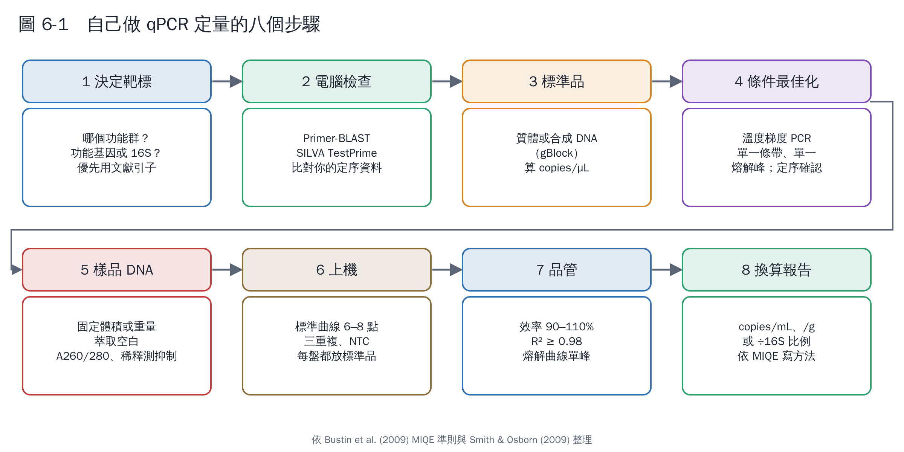
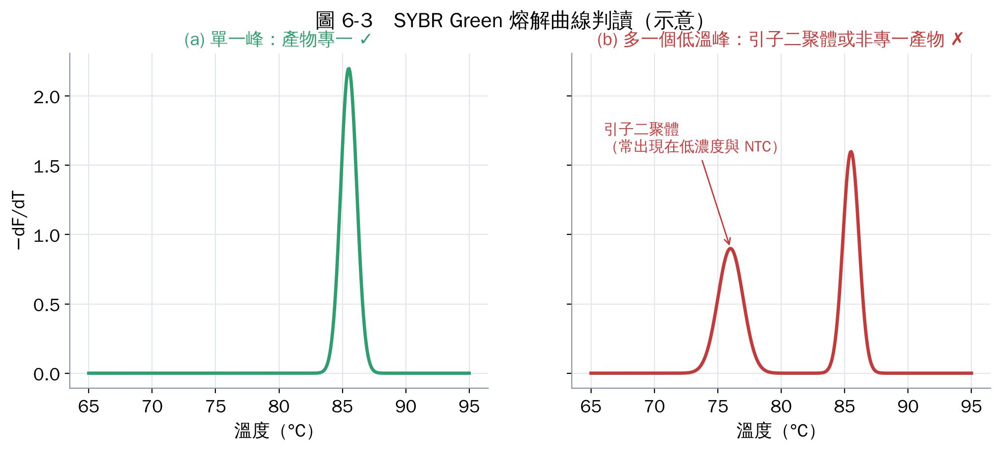
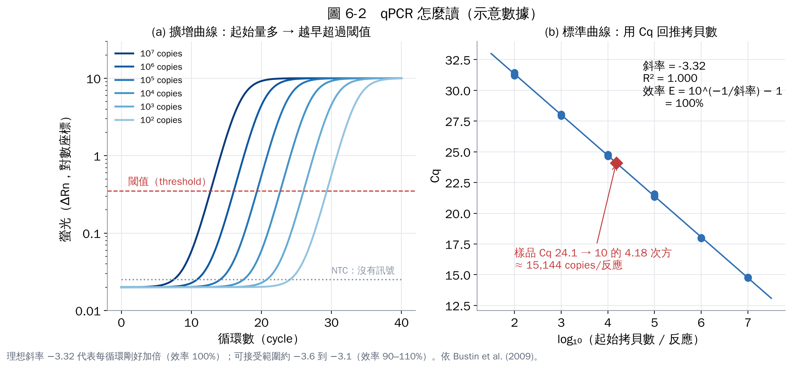

# 第 6 章　用 qPCR 定量功能菌群

qPCR（即時定量 PCR）可以回答「樣品裡有多少個某基因」。搭配第 4 章的功能基因，就能追蹤 AOB、NOB、脫硝菌、Anammox 菌的數量變化。本章依序說明怎麼設計、怎麼驗證、怎麼換算，並整理常用引子。

## 6.1 第一步：決定測什麼

| 你想知道 | 建議靶標 |
|---|---|
| 全部細菌有多少（當分母） | 細菌 16S rRNA 基因 |
| 氨氧化細菌 | AOB *amoA* |
| 氨氧化古菌 | AOA *amoA* |
| Comammox | comammox *amoA*（clade A、B 分開） |
| NOB | *Nitrospira* 16S rRNA 或 *nxrB*；*Nitrobacter* *nxrA* |
| 脫硝能力 | *nirS*、*nirK*（兩者都測）；*nosZ* clade I 與 II |
| Anammox | Anammox 16S rRNA 或 *hzsB* |

**優先使用文獻中已驗證的引子**，不要一開始就自己設計。已發表的引子被很多實驗室驗證過，你的結果也才能和文獻比較。

## 6.2 常用引子

下表依原始文獻整理，序列為 5′→3′（簡併鹼基：R=A/G、Y=C/T、S=G/C、K=G/T、M=A/C）。**訂購前請逐字對照原文**，並依你的試劑與儀器重新最佳化黏合溫度。

| 靶標 | 引子 | 序列（5′→3′） | 產物長度 | 文獻 |
|---|---|---|---|---|
| 細菌 16S | 341F | CCTACGGGAGGCAGCAG | 約 194 bp | Muyzer 1993 [1] |
|  | 534R | ATTACCGCGGCTGCTGG |  |  |
| AOB *amoA* | amoA-1F | GGGGTTTCTACTGGTGGT | 491 bp | Rotthauwe 1997 [2] |
|  | amoA-2R | CCCCTCKGSAAAGCCTTCTTC |  |  |
| AOA *amoA* | Arch-amoAF | STAATGGTCTGGCTTAGACG | 635 bp | Francis 2005 [3] |
|  | Arch-amoAR | GCGGCCATCCATCTGTATGT |  |  |
| Comammox *amoA* | comaA-244f／comaA-659r（clade A）；comaB-244f／comaB-659r（clade B） | 簡併度高，請見原文 | 約 415 bp | Pjevac 2017 [4] |
| *Nitrospira* 16S | NSR1113f | CCTGCTTTCAGTTGCTACCG | 約 151 bp | Dionisi 2002 [5] |
|  | NSR1264r | GTTTGCAGCGCTTTGTACCG |  |  |
| *Nitrospira nxrB* | nxrB169f | TACATGTGGTGGAACA | 約 485 bp | Pester 2014 [6] |
|  | nxrB638r | CGGTTCTGGTCRATCA |  |  |
| *nirS* | cd3aF | GTSAACGTSAAGGARACSGG | 約 425 bp | Michotey 2000 [7]；Throbäck 2004 [8] |
|  | R3cd | GASTTCGGRTGSGTCTTGA |  |  |
| *nirK* | F1aCu | ATCATGGTSCTGCCGCG | 約 473 bp | Hallin & Lindgren 1999 [9] |
|  | R3Cu | GCCTCGATCAGRTTGTGGTT |  |  |
| *nosZ* clade I | nosZ2F | CGCRACGGCAASAAGGTSMSSGT | 約 267 bp | Henry 2006 [10] |
|  | nosZ2R | CAKRTGCAKSGCRTGGCAGAA |  |  |
| *nosZ* clade II | nosZ-II-F／nosZ-II-R | 含肌苷（I），請見原文 | 約 690–720 bp | Jones 2013 [11] |
| *narG*、*napA* | narG-F／narG-R、napA-V17F／napA4R | 請見原文 | — | Bru 2007 [12] |
| Anammox 16S | Amx809F | GCCGTAAACGATGGGCACT | 約 257 bp | Tsushima 2007 [13] |
|  | Amx1066R | AACGTCTCACGACACGAGCTG |  |  |
| Anammox *hzsB* | hzsB_396F／hzsB_742R | 請見原文 | 約 350 bp | Wang 2012 [14] |

幾個要注意的地方：

- *amoA*（491 bp）、Arch-*amoA*（635 bp）的產物比 SYBR Green qPCR 理想的 80–250 bp 長，效率可能偏低，但因為使用廣泛、方便比較，仍是主流選擇。
- 功能基因引子多含簡併鹼基，**覆蓋率與專一性要在你的樣品上確認**（6.4 節）。
- 引子會有已知的漏測。例如早期的 *nosZ* 引子測不到 clade II [11]；用 NOB 引子測到的 *Nitrospira* 可能包含 comammox。

## 6.3 自己設計引子（文獻沒有合適引子時）

1. **收集序列**：從 NCBI 下載目標基因的序列，最好再加上你自己樣品的定序結果。
2. **多重序列比對**：用 MAFFT 或 MUSCLE，找出保守區。
3. **設計條件**：產物 80–250 bp、引子長 18–25 nt、Tm 約 58–62 °C（兩支相差 < 2 °C）、GC 40–60%、3′ 端避免簡併與連續 G/C。可用 Primer3 [15]。
4. **電腦檢查專一性**：Primer-BLAST 檢查會不會放大到非目標序列 [16]；16S 引子用 SILVA TestPrime 計算覆蓋率。

## 6.4 實驗驗證：沒有驗證的 qPCR 數字沒有意義

1. **溫度梯度 PCR**：找出黏合溫度。
2. **電泳**：確認只有一條、大小正確的條帶。
3. **熔解曲線**：SYBR Green 法一定要做，只能有一個峰。

4. **定序確認**：把產物選殖或直接做擴增子定序，確認放大到的真的是目標基因。
5. **抑制測試**：環境樣品（污泥、底泥）常含腐植酸等 PCR 抑制物。把 DNA 稀釋 10 倍，Cq 應該延後約 3.3 個循環；如果延後很少甚至提早，代表原液有抑制，要用稀釋後的 DNA。

## 6.5 標準品與標準曲線

**標準品**可以用：(1) 含目標片段的質體；(2) 合成雙股 DNA 片段（例如 gBlock）。質體建議先線性化。用螢光定量（Qubit）測濃度，換算拷貝數：

**拷貝數/µL ＝ DNA 濃度（ng/µL）× 6.022 × 10²³ ÷（長度 bp × 660 × 10⁹）**

> 例：質體 3,000 bp + 插入片段 491 bp = 3,491 bp，濃度 10 ng/µL
> → 10 × 6.022×10²³ ÷（3,491 × 660 × 10⁹）≈ 2.6 × 10⁹ copies/µL

把標準品做 10 倍序列稀釋（例如 10² 到 10⁸ copies/反應，6–7 點），每點三重複。

**品管標準**（依 MIQE 準則 [17] 與常見做法）：

| 項目 | 可接受範圍 |
|---|---|
| 擴增效率 E ＝ 10^(−1/斜率) − 1 | 90–110%（斜率約 −3.6 到 −3.1） |
| 標準曲線 R² | ≥ 0.98（多數期刊期望 ≥ 0.99） |
| 無模板對照（NTC） | 無擴增，或 Cq 比最低標準點晚很多且熔解峰不同 |
| 三重複 Cq 差異 | 通常 < 0.5 循環 |
| 定量範圍 | 樣品 Cq 要落在標準曲線範圍內，不可外插 |

## 6.6 從 Cq 換算成樣品中的拷貝數

**拷貝數/mL 樣品 ＝ 每反應拷貝數 ×（DNA 洗脫體積 ÷ 每反應模板體積）÷ 萃取的樣品體積**

> 例：標準曲線算出每反應 1.5 × 10⁴ copies；每反應加 2 µL DNA；DNA 萃取後洗脫成 100 µL；當初萃取 2 mL 污泥
> → 1.5×10⁴ × (100 ÷ 2) ÷ 2 ≈ 3.8 × 10⁵ copies/mL

報告方式可以選：

- **每單位體積或重量**：copies/mL、copies/g 濕重、copies/g VSS。最直觀，但受萃取效率影響。
- **相對比例**：功能基因 ÷ 16S rRNA 基因。可以抵銷萃取效率差異，但要注意**每個細菌的 16S 拷貝數不同（1 到十幾個）**[18]，AOB 基因體中 *amoA* 也常有 2–3 個拷貝 [19]，所以這個比例**不等於細胞比例**。

## 6.7 進階選項

- **RT-qPCR**：先把 RNA 反轉錄成 cDNA 再定量，代表基因的「表現量」，比 DNA 更接近活性。RNA 容易降解，取樣後要立即用 RNA 保存液或液態氮處理，並做 DNase 處理與「不加反轉錄酶」對照。
- **TaqMan 探針**：比 SYBR Green 更專一，適合多重 PCR，但功能基因序列變異大，探針設計較難。
- **數位 PCR（ddPCR）**：不需要標準曲線、對抑制物較不敏感，適合低濃度靶標的絕對定量。

## 6.8 寫進方法章節的檢查清單

依 MIQE 準則 [17]、並參考環境微生物學的 qPCR 回顧 [20]，方法至少要寫：

- 樣品處理與保存、DNA 萃取套組與萃取量、DNA 濃度與純度。
- 引子序列與出處、反應體積、試劑、循環條件、儀器型號。
- 標準品來源、拷貝數計算、標準曲線斜率、截距、R²、效率。
- NTC 結果、熔解曲線、抑制測試方法。
- 換算公式與報告單位。

## 本章重點

- 先用文獻引子；自己設計要經過電腦與實驗雙重驗證。
- 效率 90–110%、R² ≥ 0.98、熔解曲線單峰、NTC 無擴增。
- 一定要做抑制測試（稀釋 10 倍看 Cq 是否延後約 3.3）。
- 功能基因 ÷ 16S 不等於細胞比例；依 MIQE 寫方法。

## 參考文獻

1. Muyzer G, de Waal EC, Uitterlinden AG (1993). Profiling of complex microbial populations by denaturing gradient gel electrophoresis analysis of polymerase chain reaction-amplified genes coding for 16S rRNA. *Applied and Environmental Microbiology*, 59, 695–700. https://doi.org/10.1128/aem.59.3.695-700.1993
2. Rotthauwe JH, Witzel KP, Liesack W (1997). The ammonia monooxygenase structural gene *amoA* as a functional marker: molecular fine-scale analysis of natural ammonia-oxidizing populations. *Applied and Environmental Microbiology*, 63, 4704–4712. https://doi.org/10.1128/aem.63.12.4704-4712.1997
3. Francis CA, Roberts KJ, Beman JM, Santoro AE, Oakley BB (2005). Ubiquity and diversity of ammonia-oxidizing archaea in water columns and sediments of the ocean. *PNAS*, 102, 14683–14688. https://doi.org/10.1073/pnas.0506625102
4. Pjevac P, Schauberger C, Poghosyan L, et al. (2017). AmoA-targeted polymerase chain reaction primers for the specific detection and quantification of comammox *Nitrospira* in the environment. *Frontiers in Microbiology*, 8, 1508. https://doi.org/10.3389/fmicb.2017.01508
5. Dionisi HM, Layton AC, Harms G, Gregory IR, Robinson KG, Sayler GS (2002). Quantification of *Nitrosomonas oligotropha*-like ammonia-oxidizing bacteria and *Nitrospira* spp. from full-scale wastewater treatment plants by competitive PCR. *Applied and Environmental Microbiology*, 68, 245–253. https://doi.org/10.1128/AEM.68.1.245-253.2002
6. Pester M, Maixner F, Berry D, et al. (2014). NxrB encoding the beta subunit of nitrite oxidoreductase as functional and phylogenetic marker for nitrite-oxidizing *Nitrospira*. *Environmental Microbiology*, 16, 3055–3071. https://doi.org/10.1111/1462-2920.12300
7. Michotey V, Méjean V, Bonin P (2000). Comparison of methods for quantification of cytochrome cd₁-denitrifying bacteria in environmental marine samples. *Applied and Environmental Microbiology*, 66, 1564–1571. https://doi.org/10.1128/AEM.66.4.1564-1571.2000
8. Throbäck IN, Enwall K, Jarvis Å, Hallin S (2004). Reassessing PCR primers targeting *nirS*, *nirK* and *nosZ* genes for community surveys of denitrifying bacteria with DGGE. *FEMS Microbiology Ecology*, 49, 401–417. https://doi.org/10.1016/j.femsec.2004.04.011
9. Hallin S, Lindgren PE (1999). PCR detection of genes encoding nitrite reductase in denitrifying bacteria. *Applied and Environmental Microbiology*, 65, 1652–1657. https://doi.org/10.1128/AEM.65.4.1652-1657.1999
10. Henry S, Bru D, Stres B, Hallet S, Philippot L (2006). Quantitative detection of the *nosZ* gene, encoding nitrous oxide reductase, and comparison of the abundances of 16S rRNA, *narG*, *nirK*, and *nosZ* genes in soils. *Applied and Environmental Microbiology*, 72, 5181–5189. https://doi.org/10.1128/AEM.00231-06
11. Jones CM, Graf DRH, Bru D, Philippot L, Hallin S (2013). The unaccounted yet abundant nitrous oxide-reducing microbial community: a potential nitrous oxide sink. *The ISME Journal*, 7, 417–426. https://doi.org/10.1038/ismej.2012.125
12. Bru D, Sarr A, Philippot L (2007). Relative abundances of proteobacterial membrane-bound and periplasmic nitrate reductases in selected environments. *Applied and Environmental Microbiology*, 73, 5971–5974. https://doi.org/10.1128/AEM.00643-07
13. Tsushima I, Kindaichi T, Okabe S (2007). Quantification of anaerobic ammonium-oxidizing bacteria in enrichment cultures by real-time PCR. *Water Research*, 41, 785–794. https://doi.org/10.1016/j.watres.2006.11.024
14. Wang Y, Zhu G, Harhangi HR, et al. (2012). Co-occurrence and distribution of nitrite-dependent anaerobic ammonium and methane-oxidizing bacteria in a paddy soil. *FEMS Microbiology Letters*, 336, 79–88. https://doi.org/10.1111/j.1574-6968.2012.02654.x
15. Untergasser A, Cutcutache I, Koressaar T, et al. (2012). Primer3—new capabilities and interfaces. *Nucleic Acids Research*, 40, e115. https://doi.org/10.1093/nar/gks596
16. Ye J, Coulouris G, Zaretskaya I, Cutcutache I, Rozen S, Madden TL (2012). Primer-BLAST: a tool to design target-specific primers for polymerase chain reaction. *BMC Bioinformatics*, 13, 134. https://doi.org/10.1186/1471-2105-13-134
17. Bustin SA, Benes V, Garson JA, et al. (2009). The MIQE guidelines: minimum information for publication of quantitative real-time PCR experiments. *Clinical Chemistry*, 55, 611–622. https://doi.org/10.1373/clinchem.2008.112797
18. Stoddard SF, Smith BJ, Hein R, Roller BRK, Schmidt TM (2015). rrnDB: improved tools for interpreting rRNA gene abundance in bacteria and archaea and a new foundation for future development. *Nucleic Acids Research*, 43, D593–D598. https://doi.org/10.1093/nar/gku1201
19. Norton JM, Alzerreca JJ, Suwa Y, Klotz MG (2002). Diversity of ammonia monooxygenase operon in autotrophic ammonia-oxidizing bacteria. *Archives of Microbiology*, 177, 139–149. https://doi.org/10.1007/s00203-001-0369-z
20. Smith CJ, Osborn AM (2009). Advantages and limitations of quantitative PCR (Q-PCR)-based approaches in microbial ecology. *FEMS Microbiology Ecology*, 67, 6–20. https://doi.org/10.1111/j.1574-6941.2008.00629.x
