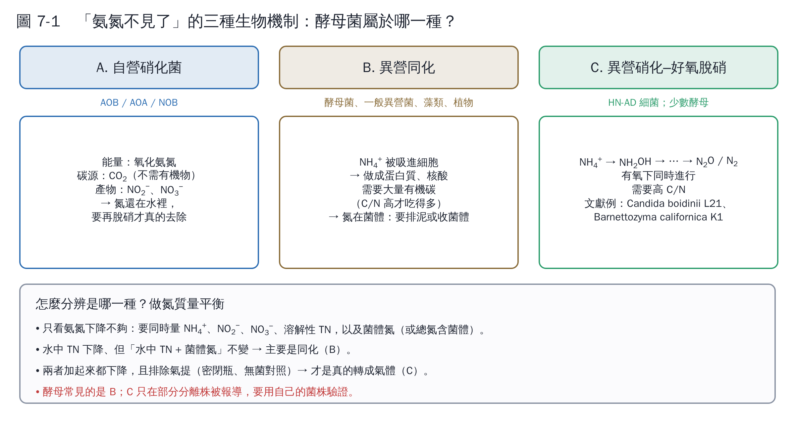

# 第 7 章　酵母菌也能降解氨氮嗎？

簡短回答：**酵母菌可以「去除」水中的氨氮，但大多數情況是把氨氮吃進菌體（同化），不是像硝化菌那樣把它轉化掉。** 少數分離株被報導具有「異營硝化–好氧脫硝」能力，能把氨氮轉成氣體，但這類研究還不多，需要自己用嚴謹的實驗驗證。

## 7.1 機制一：同化，酵母最主要的方式

所有活細胞都需要氮來合成蛋白質和核酸。對酵母菌來說，**銨是最好用的氮源之一**：

- 銨由細胞膜上的銨運輸蛋白（*S. cerevisiae* 的 Mep1、Mep2、Mep3）吸收進細胞 [1]。
- 進入細胞後，主要由**麩胺酸脫氫酶**（GDH，基因 *GDH1*、*GDH3*）把銨和 α-酮戊二酸合成麩胺酸；氨濃度低時改由**麩醯胺合成酶–麩胺酸合成酶**（GS–GOGAT，*GLN1*、*GLT1*）路徑 [2]。
- 有銨這類「好氮源」時，酵母會關掉利用其他氮源（例如脯胺酸、尿囊素）的基因，這叫**氮代謝物阻遏**（NCR）[3]。

這代表什麼？

| 特性 | 對氨氮去除的意義 |
|---|---|
| 需要有機碳 | 每吸收一份氮，要搭配大約十倍左右的碳來長菌體；碳不夠，氨氮就吃不完 |
| 氮進入菌體 | 水中的氨氮下降，但氮還在系統裡；要把菌體分離（離心、沉降、排泥）才算移除 |
| 菌體死亡會釋放 | 菌體自解後，氮又會以氨的形式回到水中 |
| 可回收 | 菌體富含蛋白質，可以當飼料蛋白、肥料或厭氧消化產沼氣的原料 |

用估算體會一下：微生物菌體約含 10% 上下（乾重）的氮（細菌常以 C₅H₇O₂N 估算，含氮 12.4%）[4]。要把 100 mg/L 的氨氮全部同化，大約要長出 0.8–1 g/L 的菌體；以好氧生長產率 0.4–0.5 g 菌體/g 葡萄糖粗估，大約需要 2 g/L 的葡萄糖。**如果你的廢水碳少氮多，同化路線很難把氨氮去乾淨。**

## 7.2 機制二：異營硝化–好氧脫硝（HN-AD）

有些異營菌在有氧下也能把氨氮氧化（異營硝化），並同時把產物還原成氣體（好氧脫硝）。細菌的例子很多（第 2 章），近年也有少數**酵母**被報導有這種能力：

| 菌株 | 來源 | 文獻報導的結果 | 文獻 |
|---|---|---|---|
| *Barnettozyma californica* K1 | 底泥 | 以蔗糖為碳源、140 mg N/L 時，48 小時氨氮去除率約 99%；作者報告偵測到 *amoA*、*nirK*、*nosZ* | Fang et al. 2021 [5] |
| *Candida boidinii* L21 | 深圳灣 | 移除約 75–136 mg/L 無機氮，並以氮平衡與酵素分析探討路徑；應用於實際廢水 | Fang et al. 2024 [6] |
| *Pichia kudriavzevii* XTY1 | 旱地土壤 | 能轉化有機氮，但**不經由羥胺與亞硝酸鹽**；超過 60% 的氮進入細胞內，N₂O 少於 0.3% | Xu et al. 2022 [7] |

讀這類文獻時要注意：

1. **「去除率」常只是水中氨氮下降**，不一定代表變成氣體。要看作者有沒有量菌體氮、總氮，以及有沒有做無菌對照、氣提對照。
2. **真核生物（酵母、真菌）通常不具有細菌型的 *amoA* 基因**。如果文獻說在酵母中測到 *amoA*，最好看作者有沒有用全基因體定序確認，因為 PCR 偵測可能來自污染或引子非專一放大。
3. Xu 等人的研究就是一個好例子：用 ¹⁵N 標記後發現，大部分氮其實進入了細胞，而不是轉化成氣體 [7]。

## 7.3 真菌脫硝

有些真菌（例如 *Fusarium*）在缺氧時會進行脫硝，但它們缺少 N₂O 還原酶，**產物主要是 N₂O**，由一種特殊的細胞色素 P450（P450nor）催化 [8]。如果你的系統以真菌或酵母為主，N₂O 排放值得注意。

## 7.4 如果你的專案要用酵母，建議這樣驗證

1. **先釐清目標**：是想「從水中移除氨氮並回收菌體蛋白」（同化就夠了），還是想「把氮變成氮氣」（需要證明 HN-AD）？
2. **完整氮平衡**：量 NH₄⁺、NO₂⁻、NO₃⁻、溶解性總氮，**加上菌體氮**（離心後的菌體做凱氏氮或元素分析）。
3. **對照組**：無接種、滅菌菌液、無碳源、密閉瓶（排除揮發）。pH 高於 8 又有曝氣時，氨氣提的影響可能很大（第 1 章）。
4. **中間產物**：量羥胺（NH₂OH）、亞硝酸鹽、N₂O；有條件的話用 ¹⁵NH₄⁺ 追蹤 [7]。
5. **C/N 試驗**：設計不同碳氮比，觀察去除率變化；同化與 HN-AD 都很依賴碳源。
6. **菌株鑑定**：ITS 與 26S rRNA D1/D2 區定序；如果要宣稱特殊路徑，最好做全基因體定序。

## 本章重點

- 酵母主要靠同化吸收銨（Mep 運輸蛋白、GDH、GS–GOGAT），需要大量有機碳，氮留在菌體中。
- 少數酵母被報導有 HN-AD 能力，但證據要求高：氮平衡、對照組、¹⁵N。
- 真菌脫硝的產物常是 N₂O。
- 酵母方案的優勢在「回收菌體蛋白」，適合碳源充足的廢水（例如食品廢水）。

## 參考文獻

1. Marini AM, Soussi-Boudekou S, Vissers S, André B (1997). A family of ammonium transporters in *Saccharomyces cerevisiae*. *Molecular and Cellular Biology*, 17, 4282–4293. https://doi.org/10.1128/MCB.17.8.4282
2. Mara P, Fragiadakis GS, Gkountromichos F, Alexandraki D (2018). The pleiotropic effects of the glutamate dehydrogenase (GDH) pathway in *Saccharomyces cerevisiae*. *Microbial Cell Factories*, 17, 170. https://doi.org/10.1186/s12934-018-1018-4
3. Magasanik B, Kaiser CA (2002). Nitrogen regulation in *Saccharomyces cerevisiae*. *Gene*, 290, 1–18. https://doi.org/10.1016/S0378-1119(02)00558-9
4. Rittmann BE, McCarty PL (2020). *Environmental Biotechnology: Principles and Applications*, 2nd ed. McGraw-Hill Education.
5. Fang J, Liao S, Zhang S, Li L, Tan S, Li W, Wang A, Ye J (2021). Characteristics of a novel heterotrophic nitrification-aerobic denitrification yeast, *Barnettozyma californica* K1. *Bioresource Technology*, 339, 125665. https://doi.org/10.1016/j.biortech.2021.125665
6. Fang J, Liao S, Gu T, Lu W, Lu X, Yu M, Li B, Ye J (2024). Efficient nitrogen removal by heterotrophic nitrification-aerobic denitrification yeast *Candida boidinii* L21: Performance, pathway and application. *Bioresource Technology*, 131621. https://doi.org/10.1016/j.biortech.2024.131621
7. Xu et al. (2022). Fungus *Pichia kudriavzevii* XTY1 and heterotrophic nitrifying bacterium *Enterobacter asburiae* GS2 cannot efficiently transform organic nitrogen via hydroxylamine and nitrite. *Frontiers in Microbiology*, 13, 1038599. https://doi.org/10.3389/fmicb.2022.1038599
8. Shoun H, Kim DH, Uchiyama H, Sugiyama J (1992). Denitrification by fungi. *FEMS Microbiology Letters*, 94, 277–281. https://doi.org/10.1111/j.1574-6968.1992.tb05331.x
