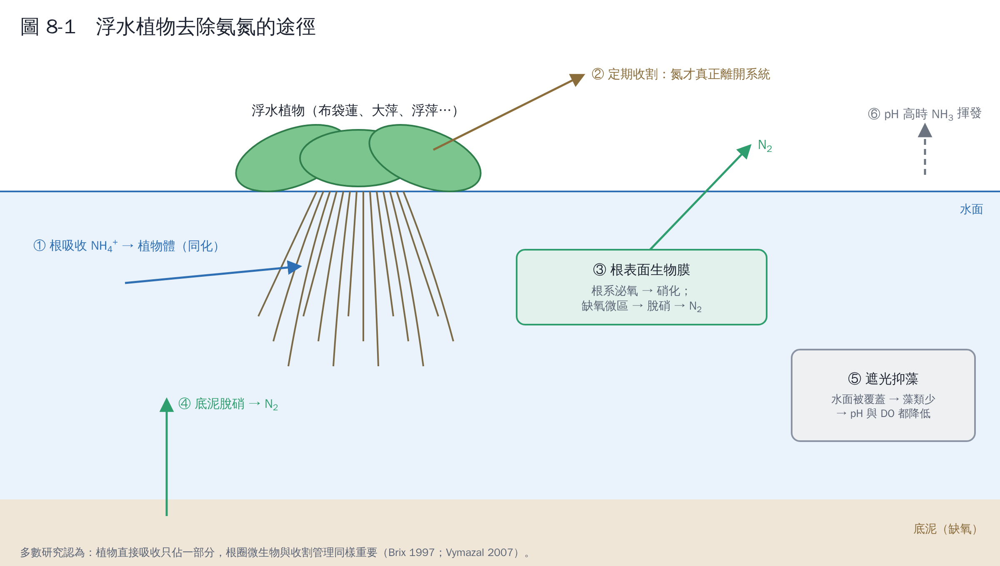

# 第 8 章　水芙蓉與其他水生植物

## 8.1 先確認：「水芙蓉」是哪一種植物？

在台灣，**「水芙蓉」通常指大萍（*Pistia stratiotes*，天南星科）**，葉片像一朵綠色的花浮在水面。它和**布袋蓮**（*Eichhornia crassipes*，近年分類修訂為 *Pontederia crassipes* [1]）是不同的植物，但兩者常被混在一起講，查文獻時要用學名確認。

英文文獻中：大萍是 **water lettuce**，布袋蓮是 **water hyacinth**，浮萍類是 **duckweed**（*Lemna*、*Spirodela*、*Wolffia* 等）。

> 兩者在台灣都是**外來種**。農業部的外來種介紹指出，大萍由園藝業者引進，繁殖快，常布滿水面並淤塞河道 [2]。做實驗或實場應用時**必須圍封、不可任意排放或丟棄到自然水體**，收割的植體也要妥善處理。

## 8.2 水芙蓉有降解氨氮的功能嗎？

**有去除氨氮的效果，但嚴格來說不是「降解」**。植物去除氨氮靠的是幾條路徑同時作用：

1. **植物吸收（同化）**：根部吸收 NH₄⁺ 和 NO₃⁻ 合成植物體。只有**定期收割**，這些氮才真正離開系統；不收割，植物死亡腐爛後氮又回到水中。
2. **根圈微生物**：根系提供大面積讓微生物附著形成生物膜，根部釋出的氧氣支持硝化，缺氧微區進行脫硝。許多研究認為這部分貢獻和植物吸收一樣重要，甚至更重要 [3, 4]。
3. **遮光**：浮水植物覆蓋水面，抑制藻類，間接降低 pH 與藻類釋出的有機物。
4. **揮發**：pH 高時部分 NH₃ 揮發（浮水植物覆蓋反而會降低這部分）。

研究證據：

- Reddy 與 DeBusk（1985）比較多種水生植物的營養鹽去除潛力，布袋蓮與大萍都屬於生長快、吸收營養鹽能力高的物種 [5]。
- Lu 等人（2010）用大萍處理富營養化的暴雨逕流，證實能有效降低氮、磷 [6]。
- Ting 等人（2018）回顧布袋蓮去除氨氮的研究，整理了去除機制、適用條件與限制 [7]。

## 8.3 有沒有更適合的水生植物？

要看你的水質、濃度與目標。下表是定性比較：

| 植物 | 優點 | 限制 | 適合情境 |
|---|---|---|---|
| 布袋蓮 | 生長極快、生物量大、根系發達，研究最多 [7] | 外來入侵種；植體含水量高、收割處理量大；怕寒 | 溫暖地區、可嚴格圍封的處理池 |
| 大萍（水芙蓉） | 生長快、根系可供微生物附著 [6] | 外來入侵種；怕寒；生物量比布袋蓮小 | 與布袋蓮類似，規模較小的處理 |
| 浮萍類（*Lemna*、*Spirodela*） | **偏好吸收 NH₄⁺**；繁殖快；蛋白質含量高，可做飼料；容易撈取 [8] | 對游離氨敏感，高 pH、高濃度會抑制生長 [9, 10] | 養殖或畜牧廢水的後段處理、營養鹽回收 |
| 挺水植物（蘆葦、香蒲、美人蕉） | 人工濕地的主力，根系供氧、耐受度高；本土種選擇多 | 佔地大、植物吸收比例較低，主要靠微生物 [3, 11] | 人工濕地、長期穩定處理 |
| 浮島植栽（各種挺水植物） | 不需挖池，可放在現有水體 [12] | 去除量受面積限制 | 魚塭、池塘、河道的水質改善 |
| 微藻（例如 *Chlorella*） | 吸收快、可回收生質 | 需要光；光合作用使 pH 升高，可能造成氨揮發；採收困難 [13] | 光照充足、可回收藻體的系統 |

**關於浮萍與 pH 的重點**：浮萍偏好 NH₄⁺，但游離氨會抑制它的生長。Körner 等人（2001）證實，同樣的總氨氮，pH 越高毒性越大；把 pH 控制在偏中性，浮萍就能耐受較高的總氨氮 [10]。這正是第 1 章 NH₃/NH₄⁺ 平衡的實際應用。

## 8.4 植物方案的現實限制

1. **濃度**：植物適合低到中濃度（例如生活污水二級放流、養殖廢水）。高濃度氨氮廢水（例如數百 mg/L 以上的厭氧消化液）會造成毒害，要先稀釋或前處理。
2. **面積與時間**：植物去除速率以「每平方公尺每天幾克」計，處理量受面積限制，不適合空間有限的工廠。
3. **季節**：低溫時生長與微生物活性都下降，冬季效果明顯變差。
4. **收割與處置**：不收割等於沒有移除。收割的植體可以堆肥，或送去厭氧消化產沼氣，正好可以和生質能題目結合。
5. **外來種管理**：布袋蓮與大萍逸散到自然水體會造成生態問題 [2]。

## 8.5 如果要做植物實驗，建議設計

- **四組對照**：(1) 植物＋水；(2) 只有水（無植物）；(3) 滅菌或加抑制劑的植物組（區分植物吸收與微生物作用）；(4) 不同 pH 或濃度梯度。
- **量測**：氨氮、NO₂⁻、NO₃⁻、總氮、pH、DO、水溫；**植物鮮重、乾重與植體含氮量**（用來算植物吸收佔多少）。
- **根圈微生物**：取根部生物膜做 16S 定序或 qPCR（第 5、6 章），看硝化、脫硝菌有沒有增加。

## 本章重點

- 台灣的「水芙蓉」是大萍，不是布袋蓮；兩者都是外來種，要圍封管理。
- 植物去除氨氮靠吸收＋根圈微生物，要收割才算真正移除。
- 偏好氨氮且容易回收：浮萍；生物量最大：布袋蓮；長期穩定：人工濕地挺水植物。
- 植物適合低到中濃度與後段處理，高濃度廢水要先處理。

## 參考文獻

1. Pellegrini MOO, Horn CN, Almeida RF (2018). Total evidence phylogeny of Pontederiaceae (Commelinales) sheds light on the necessity of its recircumscription and synopsis of *Pontederia* L. *PhytoKeys*, 108, 25–83. https://doi.org/10.3897/phytokeys.108.27652
2. 農業部。外來種介紹：大萍（水芙蓉）、布袋蓮。https://www.moa.gov.tw/ws.php?id=2613
3. Brix H (1997). Do macrophytes play a role in constructed treatment wetlands? *Water Science and Technology*, 35(5), 11–17. https://doi.org/10.1016/S0273-1223(97)00047-4
4. Vymazal J (2007). Removal of nutrients in various types of constructed wetlands. *Science of the Total Environment*, 380, 48–65. https://doi.org/10.1016/j.scitotenv.2006.09.014
5. Reddy KR, DeBusk WF (1985). Nutrient removal potential of selected aquatic macrophytes. *Journal of Environmental Quality*, 14, 459–462. https://doi.org/10.2134/jeq1985.00472425001400040001x
6. Lu Q, He ZL, Graetz DA, Stoffella PJ, Yang X (2010). Phytoremediation to remove nutrients and improve eutrophic stormwaters using water lettuce (*Pistia stratiotes* L.). *Environmental Science and Pollution Research*, 17, 84–96. https://doi.org/10.1007/s11356-008-0094-0
7. Ting WHT, Tan IAW, Salleh SF, Wahab NA (2018). Application of water hyacinth (*Eichhornia crassipes*) for phytoremediation of ammoniacal nitrogen: A review. *Journal of Water Process Engineering*, 22, 239–249. https://doi.org/10.1016/j.jwpe.2018.02.011
8. Cheng J, Bergmann BA, Classen JJ, Stomp AM, Howard JW (2002). Nutrient recovery from swine lagoon water by *Spirodela punctata*. *Bioresource Technology*, 81, 81–85. https://doi.org/10.1016/S0960-8524(01)00098-0
9. Caicedo JR, van der Steen NP, Arce O, Gijzen HJ (2000). Effect of total ammonia nitrogen concentration and pH on growth rates of duckweed (*Spirodela polyrrhiza*). *Water Research*, 34, 3829–3835. https://doi.org/10.1016/S0043-1354(00)00128-7
10. Körner S, Das SK, Veenstra S, Vermaat JE (2001). The effect of pH variation at the ammonium/ammonia equilibrium in wastewater and its toxicity to *Lemna gibba*. *Aquatic Botany*, 71, 71–78. https://doi.org/10.1016/S0304-3770(01)00158-9
11. Kadlec RH, Wallace SD (2009). *Treatment Wetlands*, 2nd ed. CRC Press.
12. Headley TR, Tanner CC (2012). Constructed wetlands with floating emergent macrophytes: an innovative stormwater treatment technology. *Critical Reviews in Environmental Science and Technology*, 42, 2261–2310. https://doi.org/10.1080/10643389.2011.574108
13. Cai T, Park SY, Li Y (2013). Nutrient recovery from wastewater streams by microalgae: Status and prospects. *Renewable and Sustainable Energy Reviews*, 19, 360–369. https://doi.org/10.1016/j.rser.2012.11.030
