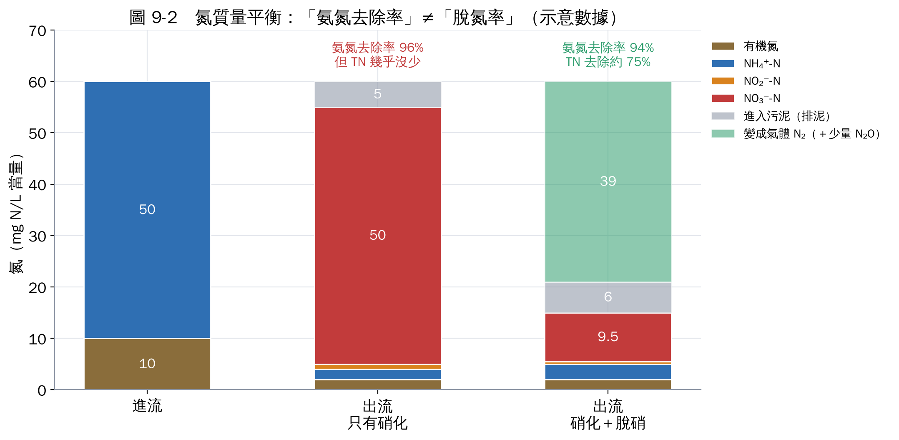
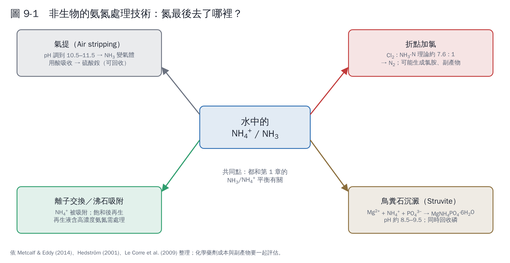

# 第 9 章　你還應該知道的事

這一章整理你沒有問到、但接手專案後很快會碰到的問題。

## 9.1 先問清楚專案的五個問題

接手專案第一週，建議先把這五件事問清楚，它們決定後面所有的選擇：

1. **水是哪裡來的？** 養殖廢水、畜牧廢水、厭氧消化液、垃圾滲出水、工業廢水、生活污水，氨氮濃度與共存物質差很多。
2. **濃度多少？** 個位數 mg/L、數十 mg/L，還是上千 mg/L？（決定生物法、植物法或物化法）
3. **有多少有機碳（COD 或 BOD）？** 碳氮比決定能不能靠傳統脫硝，還是要走 Anammox 或外加碳源。
4. **目標是什麼？** 符合放流水標準？回收氮資源？發表論文？
5. **成功的指標是什麼？** 氨氮去除率？總氮去除率？處理成本？

## 9.2 法規：氨氮管制正在加嚴

環境部於民國 113 年 12 月 18 日修正發布「放流水標準」，針對多種事業與污水下水道系統增列或加嚴氨氮、磷、銅等管制，並訂有改善緩衝期 [1, 2]。新聞稿提到新增氨氮管制的對象包括金屬表面處理業或電鍍業、製革業、廢棄物掩埋場、發電廠等事業，以及石油化學專業區以外的工業區污水下水道系統 [2]。

各行業適用的附表與限值不同，施行日期也分階段。**如果專案要對應特定行業，請直接查全國法規資料庫「放流水標準」的附表** [1]，不要依賴二手整理。

## 9.3 「去除率」要說清楚是哪一種

這是審查和投稿時最常被問的問題：

| 指標 | 公式 | 代表意義 |
|---|---|---|
| 氨氮去除率 | （進流 NH₄⁺ − 出流 NH₄⁺）÷ 進流 NH₄⁺ | 氨氮減少多少（可能只是變成硝酸鹽） |
| 總氮去除率 | （進流 TN − 出流 TN）÷ 進流 TN | 氮真正離開水相多少 |
| 硝化率 | 出流 NO₂⁻＋NO₃⁻ 增加量 ÷ 氨氮減少量 | 氨氮有多少被硝化 |
| 氮平衡回收率 | 所有形態（含菌體、氣體）加總 ÷ 投入 | 越接近 100%，數據越可信 |

## 9.4 實驗設計檢查清單

| 項目 | 為什麼重要 |
|---|---|
| 至少三重複，報告平均與標準差 | 生物試驗變異大，單一數據沒有說服力 |
| 無接種、滅菌、無基質對照 | 扣除揮發、吸附、內源釋放 |
| 同步記錄 pH、DO、水溫、鹼度 | pH 決定游離氨（第 1 章）；硝化會消耗鹼度（第 2 章） |
| 量 COD 或 TOC | 判斷碳源是否足夠、計算 C/N |
| 量生物量（VSS、OD₆₀₀ 或蛋白質） | 計算比速率，才能比較不同條件 |
| 取樣量不超過總體積的 10% | 避免體積改變影響結果；或做體積修正 |
| 取樣後立即過濾 | 停止反應（第 3 章） |
| DNA／RNA 樣品同步保存 | 化學與分子數據才能對應（第 5、6 章） |

## 9.5 非生物的處理技術

有時候生物法不是最好的選擇，例如濃度太高、需要快速啟動、或要回收氮資源。常見的物化技術：

| 技術 | 原理 | 適合 | 注意 |
|---|---|---|---|
| 氨氣提 | pH 調到 10.5 以上，曝氣讓 NH₃ 揮發，再用酸吸收成銨鹽 [3] | 高濃度廢水，可回收硫酸銨肥料 | 加鹼成本、低溫效率差、結垢 |
| 折點加氯 | 加氯把氨氧化成 N₂，理論 Cl₂:NH₃-N 約 7.6:1 [3] | 低濃度的最終修飾 | 藥劑量大、產生消毒副產物 |
| 離子交換／沸石 | 沸石選擇性吸附 NH₄⁺ [4] | 低到中濃度、需要穩定出水 | 飽和後要再生，再生液需處理 |
| 鳥糞石沉澱 | Mg²⁺ + NH₄⁺ + PO₄³⁻ 形成 MgNH₄PO₄·6H₂O [5] | 同時含高氨氮與磷的廢水（例如消化液） | 需要加鎂、控制 pH；通常主要用來回收磷 |

這些技術的共同點，都和第 1 章的 NH₃/NH₄⁺ 平衡有關。生物法與物化法也常組合使用，例如先氣提回收大部分氨，再用生物法處理剩餘的氨氮。

## 9.6 溫室氣體與碳排

生物脫氮可能排放 N₂O，100 年暖化潛勢約為 CO₂ 的 273 倍 [6]。曝氣耗電也是碳排來源。近年的研究與補助計畫越來越重視「低碳脫氮」，例如 Anammox 省曝氣、省碳源；計畫書中可以把碳足跡當作評估指標。

## 9.7 實驗室安全

| 物質 | 用在哪裡 | 注意 |
|---|---|---|
| 氨水、氨氣 | 標準品、氣提試驗 | 刺激性氣體，在排煙櫃操作 |
| 酚 | 靛酚法試劑 | 有毒、可經皮膚吸收；可改用水楊酸法 |
| 亞硝醯鐵氰化鈉 | 靛酚法催化劑 | 有毒，避免接觸酸（可能釋出氰化物） |
| 納氏試劑 | 舊式氨氮方法 | 含汞，建議不用 |
| 鎘 | 硝酸鹽鎘還原法 | 重金屬廢液需分類回收 |
| 硫酸 | 樣品保存、凱氏消化 | 腐蝕性；稀釋時酸加入水 |
| ATU、疊氮化鈉、氯酸鈉 | 抑制劑試驗 | 疊氮化鈉劇毒；廢液分類 |
| 廢水與污泥樣品 | 所有試驗 | 可能含病原菌，戴手套、做好消毒 |

## 9.8 推薦的延伸資源

| 資源 | 用途 |
|---|---|
| Metcalf & Eddy《Wastewater Engineering》第 5 版 [3] | 廢水處理的標準教科書，設計參數與計算 |
| Rittmann & McCarty《Environmental Biotechnology》第 2 版 [7] | 微生物動力學與化學計量 |
| *Standard Methods for the Examination of Water and Wastewater* [8] | 分析方法的原始依據 |
| 國家環境研究院（原環境檢驗所）NIEA 方法查詢 | 台灣公告檢測方法 |
| MiDAS Field Guide（https://www.midasfieldguide.org） | 污水廠微生物的生理與生態資料 |
| NCBI Primer-BLAST、probeBase | 引子與探針設計、查詢（第 5、6 章） |

## 9.9 名詞速查

| 縮寫 | 全名 | 中文 |
|---|---|---|
| TAN | Total ammonia nitrogen | 總氨氮 |
| FA／FNA | Free ammonia／Free nitrous acid | 游離氨／游離亞硝酸 |
| TKN | Total Kjeldahl nitrogen | 凱氏氮 |
| TN | Total nitrogen | 總氮 |
| DO | Dissolved oxygen | 溶氧 |
| SRT | Solids retention time | 污泥停留時間 |
| HRT | Hydraulic retention time | 水力停留時間 |
| VSS | Volatile suspended solids | 揮發性懸浮固體（生物量指標） |
| COD | Chemical oxygen demand | 化學需氧量 |
| C/N | Carbon to nitrogen ratio | 碳氮比 |
| AOB／AOA | Ammonia-oxidizing bacteria／archaea | 氨氧化細菌／古菌 |
| NOB | Nitrite-oxidizing bacteria | 亞硝酸氧化菌 |
| Comammox | Complete ammonia oxidation | 完全氨氧化 |
| Anammox | Anaerobic ammonium oxidation | 厭氧氨氧化 |
| PN/A | Partial nitritation/anammox | 部分亞硝化／厭氧氨氧化 |
| SND | Simultaneous nitrification-denitrification | 同步硝化脫硝 |
| HN-AD | Heterotrophic nitrification–aerobic denitrification | 異營硝化–好氧脫硝 |
| DNRA | Dissimilatory nitrate reduction to ammonium | 異化性硝酸鹽還原成銨 |
| OUR | Oxygen uptake rate | 耗氧速率 |
| Cq | Quantification cycle | 定量循環數 |
| MIQE | Minimum information for qPCR experiments | qPCR 實驗最低資訊準則 |

## 本章重點

- 先問清楚水源、濃度、碳氮比、目標、成功指標。
- 放流水標準的氨氮管制正在加嚴，對應行業要查原始附表。
- 報告時分清楚氨氮去除率與總氮去除率，並做氮平衡。
- 物化法（氣提、沸石、鳥糞石、折點加氯）適合高濃度或需要回收的情境。

## 參考文獻

1. 環境部。放流水標準（113 年 12 月 18 日環部水字第 1131081975 號令修正發布）。全國法規資料庫。https://law.moj.gov.tw/LawClass/LawAll.aspx?pcode=O0040004
2. 環境部（2024）。環境部修正發布「放流水標準」。環境部新聞專區。https://enews.moenv.gov.tw/Page/3B3C62C78849F32F/68e5ac00-2db5-4cda-b9ca-536f127f1f07
3. Metcalf & Eddy, Inc.（Tchobanoglous G, Stensel HD, Tsuchihashi R, Burton F）(2014). *Wastewater Engineering: Treatment and Resource Recovery*, 5th ed. McGraw-Hill Education.
4. Hedström A (2001). Ion exchange of ammonium in zeolites: a literature review. *Journal of Environmental Engineering*, 127, 673–681. https://doi.org/10.1061/(ASCE)0733-9372(2001)127:8(673)
5. Le Corre KS, Valsami-Jones E, Hobbs P, Parsons SA (2009). Phosphorus recovery from wastewater by struvite crystallization: a review. *Critical Reviews in Environmental Science and Technology*, 39, 433–477. https://doi.org/10.1080/10643380701640573
6. Forster P, Storelvmo T, Armour K, et al. (2023). The Earth's energy budget, climate feedbacks, and climate sensitivity. In: *Climate Change 2021: The Physical Science Basis*（IPCC 第六次評估報告第一工作組第 7 章，2021 年發布，2023 年正式出版）. Cambridge University Press. https://doi.org/10.1017/9781009157896.009
7. Rittmann BE, McCarty PL (2020). *Environmental Biotechnology: Principles and Applications*, 2nd ed. McGraw-Hill Education.
8. APHA, AWWA, WEF (2023). *Standard Methods for the Examination of Water and Wastewater*, 24th ed. American Public Health Association.
