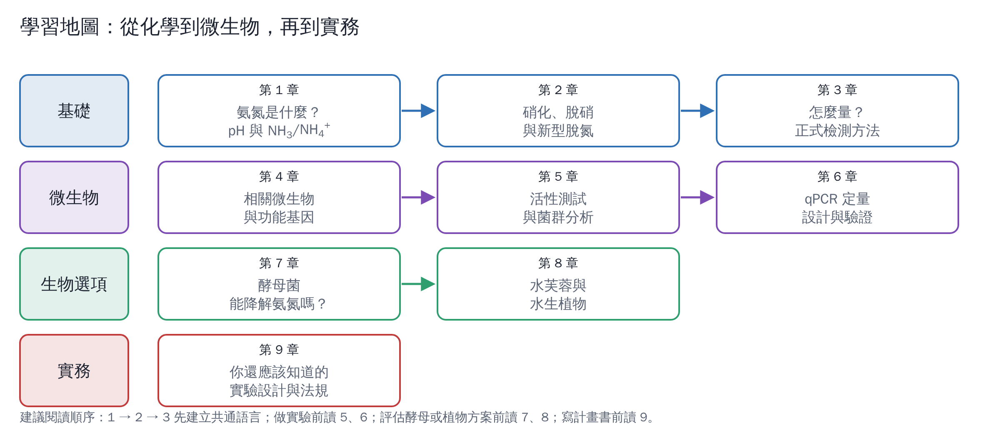

# 氨氮降解入門教材

給剛接手氨氮降解專案、還沒有背景知識的人。全部共 9 章，每章都有圖，參考文獻列在每章最後。
這份教材也會同步到 Folio 筆記本「氨氮降解教材」，一章一頁。

| 章 | 主題 | 你會學到 |
|---|---|---|
| [1](01-ammonia-chemistry.md) | 氨氮是什麼？pH 與 NH₃/NH₄⁺ | 名詞、酸鹼平衡、溫度影響、游離氨毒性、單位換算 |
| [2](02-nitrification-denitrification.md) | 硝化、脫硝與新型脫氮 | 反應式、需氧量與碳源、操作條件、Anammox 等新製程 |
| [3](03-analytical-methods.md) | 怎麼量？正式檢測方法 | NIEA／Standard Methods／US EPA 方法、採樣保存、品管 |
| [4](04-microbes-and-genes.md) | 相關微生物與功能基因 | AOB、AOA、NOB、comammox、脫硝菌、Anammox 與基因 |
| [5](05-activity-and-community.md) | 活性測試與菌群分析 | 批次試驗、OUR、16S 定序、FISH、宏基因體 |
| [6](06-qpcr-design.md) | qPCR 定量設計 | 引子表、標準品、效率、換算、MIQE |
| [7](07-yeast.md) | 酵母菌能降解氨氮嗎？ | 同化與異營硝化的差別、文獻案例、驗證方法 |
| [8](08-aquatic-plants.md) | 水芙蓉與水生植物 | 水芙蓉是哪種植物、各種植物比較、入侵種管理 |
| [9](09-what-else.md) | 你還應該知道的 | 法規、質量平衡、實驗設計、非生物技術、安全 |

## 讀之前先記住三件事

1. **氨氮被「去除」不等於被「降解成氮氣」。** 氨氮可能變成硝酸鹽（還在水裡）、進入菌體或植物、或從水面揮發。要分得清楚，就要量總氮並做質量平衡（第 3、9 章）。
2. **pH 和溫度決定氨氮是 NH₄⁺ 還是 NH₃。** 這同時影響毒性、微生物活性、揮發與植物耐受度（第 1 章）。
3. **基因存在 ≠ 正在作用。** qPCR 與定序告訴你「誰在、有多少」，速率要靠化學量測（第 5、6 章）。

## 關於資料來源

- 每章的事實都附文獻編號，對應該章最後的「參考文獻」。有 DOI 的文獻由 GitHub Actions 自動到 Crossref 核對標題與 DOI 是否一致（[`check_refs.py`](tools/check_refs.py)）。
- 圖中標示「示意」的是模擬數據，只用來說明判讀方式。其他圖的數值依文獻公式計算，程式在 [`figures/src/`](figures/src/)。
- 台灣官方方法（NIEA）會改版，正式申報前請到國家環境研究院（原環境檢驗所）網站確認最新版次。
