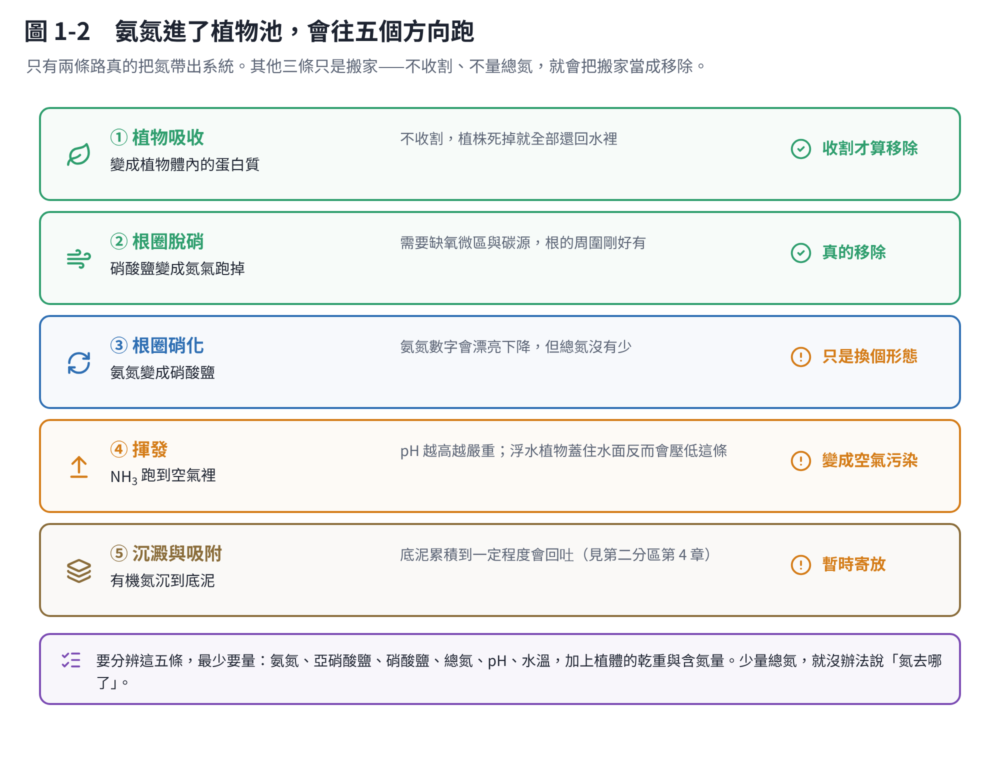
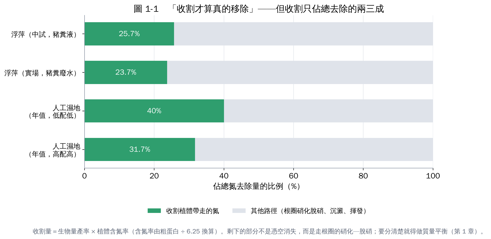

# 第 1 章　先講清楚：去除、降解、移除是三件事

## 1.1 一個很容易得到的假成功

把水生植物放進氨氮廢水裡，兩週後量氨氮，數字掉了八成。

這很可能是真的有效，也很可能什麼都沒發生。因為「水樣裡的氨氮變少」至少有五個原因，其中只有兩個算真的把氮處理掉。



| 去向 | 發生什麼 | 算不算把氮處理掉 |
|---|---|---|
| 植物吸收 | 氮變成植物體內的蛋白質 | **收割才算**。不收割，植株死掉腐爛就全部還回水裡 |
| 根圈脫硝 | 硝酸鹽被還原成氮氣跑掉 | **算**，而且這是唯一「不用搬東西」就把氮送走的路 |
| 根圈硝化 | 氨氮變成亞硝酸鹽、硝酸鹽 | **不算**。氨氮的數字會很漂亮，總氮完全沒有少 |
| 揮發 | NH₃ 跑到空氣裡 | **不算**，而且變成空氣污染。pH 越高越嚴重 |
| 沉澱與吸附 | 有機氮沉進底泥 | **暫時寄放**。底泥累積到一定程度會回吐 |

所以只量氨氮，就沒有辦法分辨你做到的是哪一種。**最少要同時量氨氮、亞硝酸鹽、硝酸鹽、總氮，加上 pH 與水溫。**

## 1.2 收割到底帶走多少？

「收割才算移除」聽起來很有力，但實際上收割帶走的氮佔比沒有想像中高。

收割帶走的氮可以直接算：

```
收割移除的氮（g N/m²/d）＝ 生物量產率（g 乾重/m²/d）× 植體含氮率（%）
```

植體含氮率通常由粗蛋白換算（蛋白質含氮約 16%，所以含氮率 ≈ 粗蛋白 ÷ 6.25）。



拿文獻的數字算出來：

| 系統 | 生物量產率 | 含氮率 | 收割帶走 | 佔總去除 |
|---|---|---|---|---|
| 浮萍中試（豬糞液）[1] | 5.5 g 乾重/m²/d | 5.6% | 0.31 g N/m²/d | **25.7%** |
| 浮萍實場（豬糞廢水）[2] | 18.6 g 乾重/m²/d | 5.6%（粗蛋白 35% ÷ 6.25） | 1.04 g N/m²/d | **23.7%** |
| 人工濕地（年值）[3] | — | — | 100–200 g N/m²/年 | **32–40%** |

三個完全不同的系統，收割佔比都落在兩到四成。**剩下的六到八成是根圈微生物做的**——硝化加脫硝。

這個結論有兩個實務意義：

1. **植物的角色一半是「基質」。** 它提供根表面讓微生物附著、把氧氣送到根圈、遮光抑制藻類。選哪一種植物當然有差，但「有沒有給微生物一個好環境」更關鍵。
2. **如果你的目標是回收氮（做飼料、做肥料），那你只能回收兩三成。** 其他的被微生物變成氮氣跑掉了。想提高回收比例，就要壓抑脫硝——那會和「讓放流水達標」的目標衝突（分區三第 5 章會再談）。

> **一個反過來算的例子。** 布袋蓮那篇文獻 [4] 同時給了「最適條件下吸氮 2.161 g N/m²/d」與「生物量 53 g 乾重/m²/d」。兩個相除，隱含的植體含氮率是 **4.08%**——比一般草本植物高不少。這可能是奢侈吸收（luxury uptake，植物在氮充足時吸超過自己需要的量），也可能是兩個數字來自不同處理組。摘要看不出來，所以這筆只能當上限參考。

## 1.3 質量平衡：唯一能分辨的方法

要說「氮去哪了」，就要做質量平衡：

```
進水總氮 － 出水總氮 ＝ 收割帶走的氮 ＋ 底泥累積 ＋ 脫硝（氮氣）＋ 揮發（NH₃）
```

實務上通常這樣分配：

- **收割帶走的氮**：量植體乾重與含氮量，直接算得出來。
- **底泥累積**：定期取底泥測總氮，或用沉積板。
- **揮發**：量 pH 與水溫，用游離氨比例估（第 3 章的公式），或用密閉罩實測。
- **脫硝**：通常當「剩下的那一項」，也就是前面三項都算完之後的差額。這代表前面三項的誤差全部堆到脫硝身上——所以如果有人跟你說「脫硝佔 60%」，要先問他前面三項怎麼量的。

## 1.4 那到底要不要用植物？

要，但要知道它擅長什麼：

**適合的情境**

- 低到中濃度、水量大、有地（生活污水二級放流、養殖排水、河道、滯洪池）
- 需要景觀、生態或社區接受度
- 希望把氮回收成有價值的東西（飼料、肥料、沼氣）

**不適合的情境**

- 高濃度氨氮（數百 mg/L 以上）直接種——植物會先死（分區二第 3 章）
- 空間有限、要求穩定達標、有嚴格的放流時限
- 冬季不能降載的場合（低溫時植物與微生物一起變慢）

## 本章重點

- 氨氮在植物池裡有五個去向，只有「收割」與「脫硝」真的把氮帶出系統。
- 只量氨氮會把「變成硝酸鹽」誤認為「處理掉了」。最少要加量總氮。
- 收割帶走的氮，在三個獨立的系統裡都只佔總去除的 **24–40%**；其餘靠根圈微生物。
- 想知道氮去哪了，只有質量平衡一條路，而且「脫硝」通常是差額項，誤差最大。
- 植物適合低中濃度、大水量、有地、要景觀或要回收氮的場合。

## 參考文獻

1. A Pilot-Scale Evaluation of Duckweed Cultivation for Pig Manure Treatment and Feed Production (2025). *Plants*, 14, 2680. https://doi.org/10.3390/plants14172680
2. Mohedano RA, Costa RHR, Tavares FA, Belli Filho P (2012). High nutrient removal rate from swine wastes and protein biomass production by full-scale duckweed ponds. *Bioresource Technology*, 112, 98–104. https://doi.org/10.1016/j.biortech.2012.02.083
3. Vymazal J (2007). Removal of nutrients in various types of constructed wetlands. *Science of the Total Environment*, 380, 48–65. https://doi.org/10.1016/j.scitotenv.2006.09.014
4. Reddy KR, Tucker JC (1983). Productivity and nutrient uptake of water hyacinth, *Eichhornia crassipes* I. Effect of nitrogen source. *Economic Botany*, 37, 237–247. https://doi.org/10.1007/BF02858790
