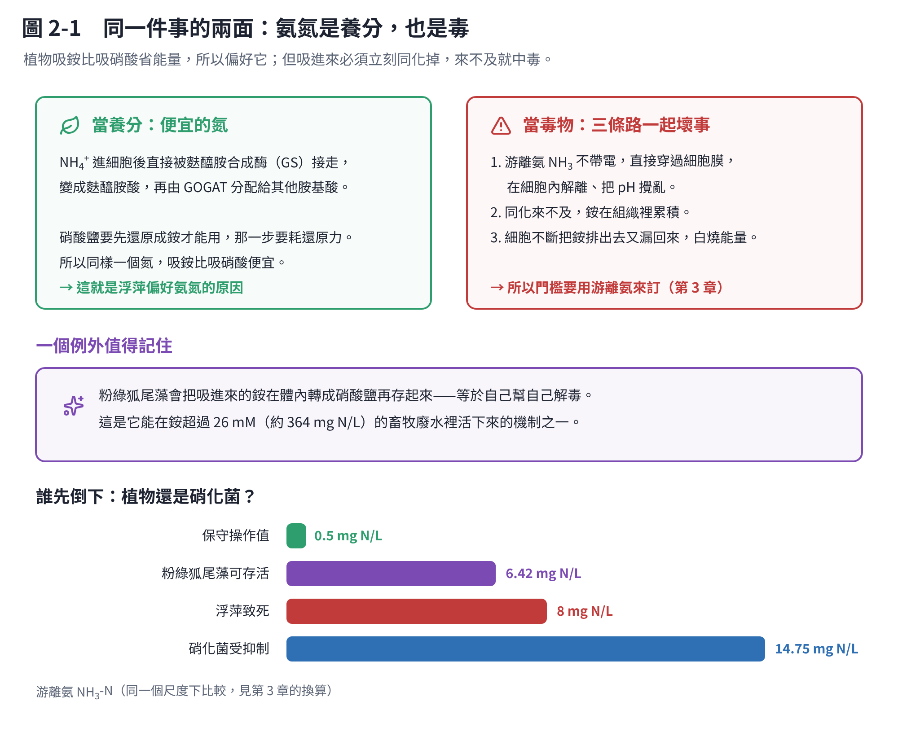

# 第 2 章　植物怎麼用氨氮，又怎麼被氨氮毒死

## 2.1 對植物來說，銨是比較便宜的氮

植物可以吸收兩種無機氮：銨（NH₄⁺）與硝酸鹽（NO₃⁻）。兩者的差別在於**要花多少力氣才能用**。

硝酸鹽進到細胞之後，要先被硝酸還原酶還原成亞硝酸鹽，再被亞硝酸還原酶還原成銨，才能進入胺基酸合成。這兩步都要消耗還原力。銨不用——它一進來就可以直接被麩醯胺合成酶（GS）接走，變成麩醯胺酸，再由 GOGAT 把氮分配給其他胺基酸。

**所以同樣一個氮原子，吸銨比吸硝酸便宜。** 這就是為什麼浮萍類偏好吸收 NH₄⁺。

偏好有多強？有研究在 *Lemna gibba* 上測到，加入銨之後，硝酸鹽的淨吸收速率**立刻下降至少 60%** [1]；另一篇在 *Lemna minor* 上的結果是葉片的硝酸鹽吸收平均降低約 52%，但根部的硝酸鹽吸收不受葉片端供應的銨影響 [2]。

也就是說：**水裡同時有銨和硝酸鹽時，植物會優先把銨吃掉。** 這對廢水處理是好消息——氨氮正是我們想先處理掉的那一個。

> **吸收動力學的數字**（`secondary`，轉述自搜尋摘要，沒核對原始摘要）：*Lemna minor* 的銨吸收最大速率約 0.082 mg/(g 鮮重·h)、Michaelis 常數約 1.88 mg/L [2]。Km 這麼低代表**在低濃度時吸收就已經接近飽和**——所以浮萍在低濃度水裡效率很好，但你不能靠「提高濃度」來加快它。

## 2.2 同一個分子，過量就是毒

銨的毒性有三條路，通常一起發生：

1. **游離氨（NH₃）直接穿膜。** NH₃ 不帶電，可以直接擴散過細胞膜；進到細胞內的酸性環境後接受質子變回 NH₄⁺，把細胞內的 pH 和離子平衡攪亂。**這是為什麼毒性要用游離氨來算，不是用總氨氮**（第 3 章整章在講這件事）。
2. **同化來不及，銨在組織裡累積。** GS/GOGAT 的處理速度有上限；供應超過上限，銨就在細胞裡堆積。
3. **白燒能量的循環。** 細胞不斷把累積的銨主動排出去，它又被動漏回來，能量就這樣消耗掉。

結果是生長速率下降、淨光合作用下降、蒸散下降，並出現氧化逆境的指標——脯胺酸與丙二醛（MDA）上升、超氧化物歧化酶（SOD）被抑制。這些是四種濕地植物在高氨氮下量到的實際反應 [3]。

## 2.3 一個例外：把銨自己轉成硝酸鹽

粉綠狐尾藻（*Myriophyllum aquaticum*）能在銨超過 **26 mM（約 364 mg N/L）** 的畜牧廢水裡活下來 [4]。它的機制之一是：**把吸進來的銨在體內轉成硝酸鹽再儲存**，避免銨在組織裡累積 [4]。

這是個漂亮的解法——硝酸鹽在液泡裡存著不會毒害細胞，要用的時候再還原回來。代價是要花還原力，等於把第 2.1 節講的「便宜」又吐回去。**它用能量換耐受度。**

另有研究指出麩醯胺合成酶（GS）在這株植物的銨耐受性裡扮演重要角色（`secondary`，只看到標題）。如果要深入，這是值得追的線索。

## 2.4 植物先倒，還是硝化菌先倒？

這個問題在設計耦合系統（分區三）時很關鍵：如果氨氮高到植物受不了，硝化菌還活著嗎？

把幾個門檻換算到同一個尺度（游離氨 NH₃-N）之後：

| 對象 | 門檻（游離氨 NH₃-N） | 來源 |
|---|---|---|
| 保守操作值 | 0.5 mg N/L | 我們訂的操作建議，不是文獻值 |
| 粉綠狐尾藻「可存活」 | 約 6.4 mg N/L（假設 pH 7.5） | [4] |
| 浮萍（*Lemna gibba*）致死 | 8 mg N/L | [5] |
| 硝化菌受抑制 | 13.3–16.2 mg N/L（中點 14.75） | [6] |

**順序是：植物先倒，硝化菌後倒。** 這其實是個好消息——代表在植物已經撐不住的濃度下，硝化菌通常還能工作。所以「先硝化、再給植物」（分區三第 1 章）在生物學上是說得通的。

> 要注意的是，上表裡粉綠狐尾藻那一筆的 pH 是我們假設的（文獻摘要沒給）。如果實際 pH 是 7.0，同樣的 TAN 只對應 2.1 mg N/L 的游離氨，那它的「耐受度」就沒有看起來那麼突出。**這類換算的不確定性，第 3 章會攤開來講。**

## 本章重點

- 植物吸銨比吸硝酸便宜（不用還原那兩步），所以浮萍類偏好 NH₄⁺。
- 銨存在時，硝酸鹽的吸收會被壓下去 50–60%——水裡兩種氮都有時，氨氮會先被吃掉。
- 毒性有三條路：游離氨穿膜攪亂細胞內 pH、同化來不及而累積、排出又漏回的能量浪費。
- 粉綠狐尾藻的解法是把銨轉成硝酸鹽存起來，用能量換耐受度。
- 以游離氨為尺度，植物（約 8 mg N/L 致死）比硝化菌（約 13–16 mg N/L 受抑制）先倒——這是「先硝化再給植物」的生物學基礎。

## 參考文獻

1. Nitrogen Utilization in *Lemna*: III. Short-Term Effects of Ammonium on Nitrate Uptake and Nitrate Reduction (1987). *Plant Physiology*. https://doi.org/10.1104/pp.85.3.865
2. Cedergreen N, Madsen TV (2002). Nitrogen uptake by the floating macrophyte *Lemna minor*. *New Phytologist*. https://doi.org/10.1046/j.1469-8137.2002.00463.x
3. Wang et al. (2016). The inhibition and adaptability of four wetland plant species to high concentration of ammonia wastewater and nitrogen removal efficiency in constructed wetlands. *Bioresource Technology*, 202, 198–205. https://doi.org/10.1016/j.biortech.2015.11.049
4. Wang C, Zhang S, Li W, et al. (2019). Complex regulatory network allows Myriophyllum aquaticum to thrive under high-concentration ammonia toxicity. *Scientific Reports*, 9. https://doi.org/10.1038/s41598-019-41236-8
5. Körner S, Das SK, Veenstra S, Vermaat JE (2001). The effect of pH variation at the ammonium/ammonia equilibrium in wastewater and its toxicity to *Lemna gibba*. *Aquatic Botany*, 71, 71–78. https://doi.org/10.1016/S0304-3770(01)00158-9
6. Microbial removal and plant uptake of nitrogen in constructed wetlands: mesocosm tests on influencing factors (2019). *Environmental Science and Pollution Research*. https://doi.org/10.1007/s11356-018-3543-4
