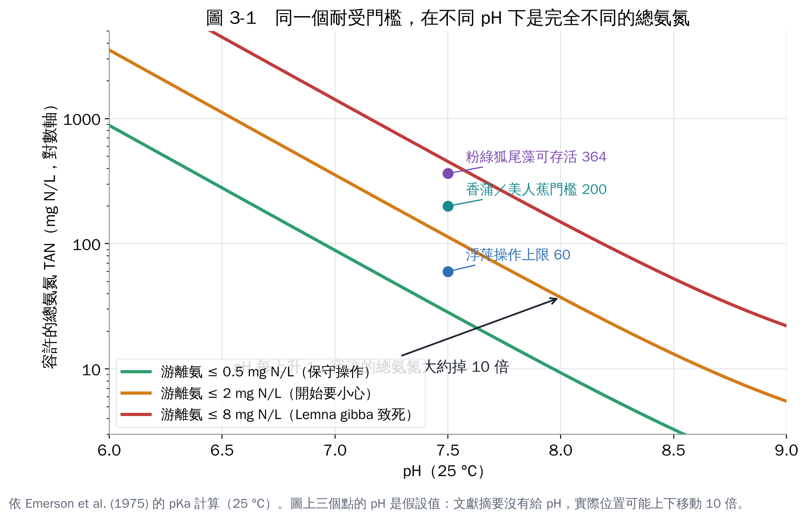
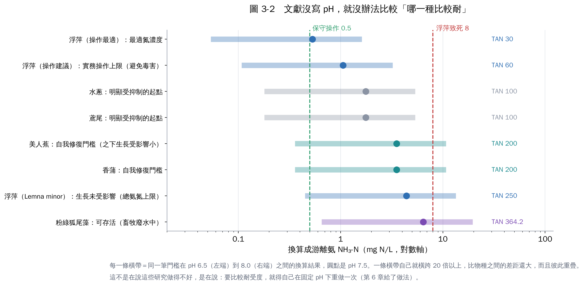
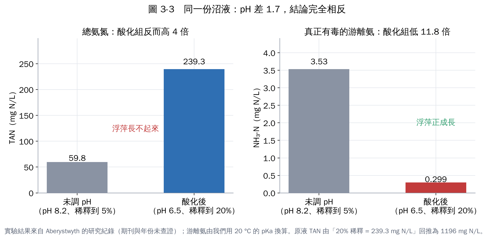

# 第 3 章　耐受度：你查到的那個數字，多半不能用

## 3.1 一個看起來矛盾的狀況

查浮萍的氨氮耐受度，會查到這些：

- 游離氨超過 **8 mg N/L** 就死亡 [1]
- 總氨氮到 **250 mg/L** 生長都不受影響（`secondary`）
- 實務建議控制在 **60 mg N/L** 以下 [2]
- 最適濃度約 **30 mg N/L**（`secondary`）

差了三十倍。這四筆**可能全部都是對的**，因為它們量的不是同一件事，也不是在同一個 pH 下量的。

## 3.2 真正的門檻是游離氨

第 1 章提過，水裡的氨氮有兩種形態，比例由 pH 和溫度決定：

```
NH₄⁺ ⇌ NH₃ + H⁺
pKa = 0.09018 + 2729.92 / T(K)      （Emerson et al. 1975）
NH₃ 佔總氨氮的比例 = 1 / (1 + 10^(pKa − pH))
```

25 °C 時 pKa ≈ 9.25。代幾個 pH 進去：

| pH（25 °C） | 6.5 | 7.0 | 7.5 | 8.0 | 8.5 | 9.0 |
|---|---|---|---|---|---|---|
| NH₃ 佔比 | 0.18% | 0.56% | 1.76% | 5.37% | 15.2% | 36.2% |

**pH 每上升一個單位，游離氨比例大約變成十倍。** 所以同樣 100 mg N/L 的總氨氮，在 pH 7.0 是 0.56 mg N/L 的游離氨（很安全），在 pH 8.5 是 15.2 mg N/L（浮萍會死）。

## 3.3 反過來用：你的 pH 容許多少總氨氮

把公式倒過來就得到一條實用的曲線：

```
容許的總氨氮 = 游離氨上限 ÷ NH₃ 佔比
```



取「游離氨 ≤ 2 mg N/L」當一個中間的操作目標（25 °C）：

| pH | 6.5 | 7.0 | 7.5 | 8.0 | 8.5 |
|---|---|---|---|---|---|
| 容許 TAN（mg N/L） | 1117 | 355 | 114 | 37 | 13 |

更保守的「游離氨 ≤ 0.5 mg N/L」：pH 7.0 容許 89 mg N/L，pH 8.0 只剩 9.3 mg N/L。

**這張表是這一章最有用的東西。** 量出自己水的 pH 和溫度，就知道總氨氮的操作上限大概在哪。

## 3.4 所以「哪一種比較耐」常常答不出來

把文獻上的門檻換算成游離氨之後，會發現一件讓人洩氣的事：**同一筆數字在 pH 6.5 到 8.0 之間換算出來的結果，自己就差 20 倍以上**——比物種之間的差異還大。



圖上每一條橫帶是同一筆門檻在 pH 6.5（左端）到 8.0（右端）之間的換算範圍。橫帶彼此重疊，代表：

> **在文獻沒給 pH 的情況下，你沒辦法判斷香蒲比浮萍耐還是浮萍比香蒲耐。**

這不是在說那些研究做得不好——很多研究的目的本來就不是建立耐受度曲線。
但如果你要拿這些數字來**選物種**，就得自己在固定 pH 下重做一次（第 6 章給流程）。

目前查到的門檻（全部 `abstract` 或 `secondary`，都沒核對過全文）：

| 物種 | 文獻寫的門檻 | 意義 | 可信度 |
|---|---|---|---|
| 粉綠狐尾藻 | 銨 > 26 mM（約 364 mg N/L） | 可在畜牧廢水中存活 [3] | abstract |
| 香蒲、美人蕉 | 總氨氮約 200 mg/L | 「自我修復門檻」，100–200 mg/L 區間甚至促進生長 [4] | abstract |
| 水蔥、鳶尾 | 總氨氮 100 mg/L | 超過就明顯受抑制 [4] | secondary |
| 浮萍（*Lemna gibba*） | 游離氨 8 mg N/L | 致死 [1] | abstract |
| 浮萍（操作建議） | 總氨氮 60 mg N/L | 實務避免毒害的上限 [2] | abstract |

## 3.5 最有說服力的一組對照：pH 比濃度重要

有一份研究把厭氧消化牛糞液拿去養浮萍 [5]：

- **不調 pH（pH 8.2）**：稀釋到只剩 5% 濃度，浮萍還是長不起來
- **酸化到 pH 6.5**：稀釋到 20%（總氨氮 239.3 mg N/L）仍然是正成長



用 20 °C 的 pKa 把兩組換算成游離氨（原液總氨氮由「20% 稀釋 = 239.3」回推為 1196 mg N/L）：

| | 總氨氮 | 游離氨 | 結果 |
|---|---|---|---|
| 未調 pH（pH 8.2、5% 稀釋） | 59.8 mg N/L | **3.53 mg N/L** | 長不起來 |
| 酸化後（pH 6.5、20% 稀釋） | 239.3 mg N/L | **0.30 mg N/L** | 正成長 |

**總氨氮高 4 倍的那一組活得好，因為游離氨低了 11.8 倍。**

這一組對照把整章的重點講完了：**控制 pH 比稀釋更有效，而且省水**（分區二第 3 章會算省多少水）。

## 3.6 量測與記錄的最低要求

如果你要產出別人能用的耐受度數字，至少要記：

- 總氨氮（以 N 計，寫清楚是 TAN 還是 NH₄⁺-N）
- **pH，而且是實驗期間的變化不是只有起始值**（植物光合作用會把 pH 拉高）
- 水溫
- 換算後的游離氨（自己算出來寫上去，不要讓讀者猜）

少寫 pH 這一項，你的數字就會變成這一章前面那些「不能用」的數字之一。

> **可以把 pH 當控制變數。** 有研究直接用比例–積分控制器把浮萍槽的 pH 維持在 6.5，以此壓低出流的氮濃度 [6]。
> 如果你的系統有加藥能力，pH 不只是要記錄的環境參數，它是一個可以操作的旋鈕。

## 本章重點

- 決定毒性的是游離氨（NH₃），不是總氨氮。pH 每升 1，游離氨比例約變十倍。
- 反過來用公式，就能算出自己的 pH 下容許多少總氨氮：游離氨 ≤ 2 mg N/L 時，pH 7.0 容許 355 mg N/L，pH 8.5 只剩 13。
- 文獻沒寫 pH 的門檻無法拿來比較物種——換算的不確定性比物種差異還大。
- 一份沼液的實驗顯示：酸化到 pH 6.5 後，總氨氮高 4 倍的那組反而長得好，因為游離氨低了 11.8 倍。
- 自己做實驗時，pH 的全程紀錄和換算後的游離氨一定要寫出來。

## 參考文獻

1. Körner S, Das SK, Veenstra S, Vermaat JE (2001). The effect of pH variation at the ammonium/ammonia equilibrium in wastewater and its toxicity to *Lemna gibba*. *Aquatic Botany*, 71, 71–78. https://doi.org/10.1016/S0304-3770(01)00158-9
2. Nitrogen and phosphorus removal from anaerobic baffled reactor effluent using *Lemna minor* and fertiliser value of the biomass for ryegrass production (2025). *Environmental Monitoring and Assessment*. https://doi.org/10.1007/s10661-025-14592-4
3. Wang C, Zhang S, Li W, et al. (2019). Complex regulatory network allows Myriophyllum aquaticum to thrive under high-concentration ammonia toxicity. *Scientific Reports*, 9. https://doi.org/10.1038/s41598-019-41236-8
4. Wang et al. (2016). The inhibition and adaptability of four wetland plant species to high concentration of ammonia wastewater and nitrogen removal efficiency in constructed wetlands. *Bioresource Technology*, 202, 198–205. https://doi.org/10.1016/j.biortech.2015.11.049
5. Lowering pH enables duckweed (*Lemna minor* L.) growth on toxic concentrations of high-nutrient agricultural wastewater (2023). *Journal of Cleaner Production*. https://doi.org/10.1016/j.jclepro.2023.136392
6. Walsh É, Margassery LM, Coughlan NE, et al. (2022). Online Control of *Lemna minor* L. Phytoremediation: Using pH to Minimize the Nitrogen Outlet Concentration. *Plants*, 11, 1456. https://doi.org/10.3390/plants11111456
