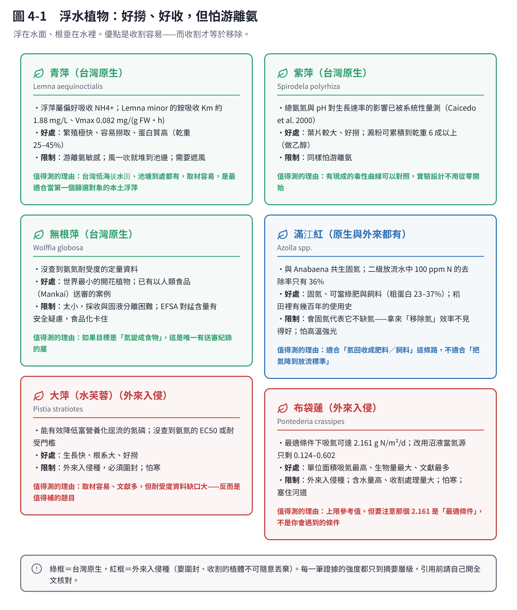

# 第 4 章　浮水植物圖鑑：好撈、好收，但怕游離氨

## 4.1 浮水植物的共同特性

浮在水面、根垂在水裡。這個形態有三個後果：

1. **收割容易**——撈就好。第 1 章講過「收割才算移除」，所以這一點很重要。
2. **遮光**——蓋住水面抑制藻類，也壓低水面的氨揮發。
3. **怕游離氨**——整株泡在水裡，沒有像挺水植物那樣的逃逸空間。

## 4.2 六種值得考慮的

| 中文名 | 學名 | 台灣狀態 | 一句話 |
|---|---|---|---|
| 青萍 | *Lemna aequinoctialis* | 原生 | 最容易取得的本土浮萍，第一個該測的 |
| 紫萍 | *Spirodela polyrhiza* | 原生 | 有現成的毒性曲線可以對照 [1] |
| 無根萍 | *Wolffia globosa* | 原生 | 世界最小的開花植物；「氮變食物」那條路唯一有送審紀錄的 |
| 大萍（水芙蓉） | *Pistia stratiotes* | **外來入侵** | 文獻多，但耐受度資料缺口大 |
| 布袋蓮 | *Pontederia crassipes* | **外來入侵** | 單位面積吸氮最高的參考值 [2] |
| 滿江紅 | *Azolla* spp. | 原生與外來都有 | 會固氮——適合回收氮，不適合移除氮 |

### 浮萍類（青萍、紫萍、無根萍）

**為什麼值得測**：偏好吸收 NH₄⁺（第 2 章）、繁殖極快、蛋白質高（乾重 25–45%）、撈起來就能收割。台灣低海拔的水田與池塘到處都是，取材不用花錢。

**限制**：對游離氨敏感（致死門檻約 8 mg N/L [3]）、風一吹就堆到池邊（實務上要設擋風與分隔浮框）、冬季低溫幾乎停長。

**無根萍特別的地方**：它是這群裡唯一有「人類食品」送審紀錄的——商品名 Mankai 的 *Wolffia globosa* 粉末已送 EFSA 審查。結論是**錳攝取量有安全疑慮，安全性無法確立** [4]；英國的顧問委員會也表示資訊不足、無法做成結論。所以「浮萍當人類蛋白質」目前在歐盟還沒過關。拿來做**動物飼料**則沒有這個障礙。

### 布袋蓮

**為什麼值得測**：文獻最多、生物量最大、根系最發達。它提供的是**上限參考值**：最適條件、無機氮源下吸氮可達 2.161 g N/m²/d [2]。

**但要注意兩件事**：

1. 同一篇文獻裡，**改用沼液（消化液）當氮源，吸氮速率只剩 0.124–0.602 g N/m²/d** [2]——掉到不到四分之一。你實際面對的水通常比較像沼液，不像實驗室的無機氮溶液。
2. 它是外來入侵種。農業部的外來種介紹把布袋蓮與大萍都列入 [5]，實驗與實場都必須圍封。

### 大萍（水芙蓉）

台灣講「水芙蓉」通常指大萍，不是布袋蓮——查文獻時要用學名確認。大萍在富營養化逕流的氮磷去除上有實證 [6]，但**我們沒有查到氨氮的 EC50 或耐受門檻**。這是一個明確的文獻缺口：取材最容易的物種之一，反而沒有可用的耐受度曲線。

### 滿江紅

滿江紅與 *Anabaena azollae* 共生，會固定空氣中的氮。這件事決定了它的定位：

- **會固氮代表它不缺氮。** 拿來「把水裡的氮移除」效率不見得好——有研究在 100 ppm 氮的二級放流水中測到氮去除率只有 36% [7]。
- **但它是很好的氮回收與綠肥作物。** 粗蛋白 23–37%，稻田使用有幾百年歷史；文獻中以滿江紅作基肥或分次施用，可提供每公頃數十公斤的氮（不同研究從約 30 到 94 kg N/ha 都有，`secondary`）。

另外，滿江紅屬在台灣原生種與外來種都有（例如 *A. filiculoides* 是引進的），用的時候要用學名確認。

## 4.3 實務上怎麼起步

1. **先用青萍做第一輪篩選。** 取材容易、生長快、七天就有結果（第 6 章）。
2. **把布袋蓮當對照組的上限**，不要當目標。它的 2.161 g N/m²/d 是最適條件下的數字。
3. **如果目標是回收成飼料**，浮萍是最成熟的路線（分區二第 2 章有實場數據）。
4. **如果目標是「氮變成食物」**，先去確認法規——無根萍在歐盟都還沒過。
5. **用到外來入侵種就要圍封**：試驗池加攔截網、收割的植體不可丟進溝渠或自然水體。

## 本章重點

- 浮水植物的最大優點是收割容易，最大缺點是對游離氨敏感。
- 浮萍類偏好 NH₄⁺、乾重 25–45% 是粗蛋白，適合把氮回收成飼料。
- 布袋蓮的 2.161 g N/m²/d 是「最適條件」的上限；同一篇文獻改用沼液就掉到 0.602 以下。
- 大萍取材最容易，但氨氮耐受度沒有可用的定量資料——這是值得補的題目。
- 滿江紅會固氮，適合回收與綠肥，不適合當「把氮降到放流標準」的主力。
- 布袋蓮與大萍是外來入侵種，必須圍封。

## 參考文獻

1. Caicedo JR, van der Steen NP, Arce O, Gijzen HJ (2000). Effect of total ammonia nitrogen concentration and pH on growth rates of duckweed (*Spirodela polyrrhiza*). *Water Research*, 34, 3829–3835. https://doi.org/10.1016/S0043-1354(00)00128-7
2. Reddy KR, Tucker JC (1983). Productivity and nutrient uptake of water hyacinth, *Eichhornia crassipes* I. Effect of nitrogen source. *Economic Botany*, 37, 237–247. https://doi.org/10.1007/BF02858790
3. Körner S, Das SK, Veenstra S, Vermaat JE (2001). The effect of pH variation at the ammonium/ammonia equilibrium in wastewater and its toxicity to *Lemna gibba*. *Aquatic Botany*, 71, 71–78. https://doi.org/10.1016/S0304-3770(01)00158-9
4. EFSA NDA Panel (2021). Safety of *Wolffia globosa* powder as a Novel food pursuant to Regulation (EU) 2015/2283. https://www.ncbi.nlm.nih.gov/pmc/articles/PMC8693246/
5. 農業部。外來種介紹：大萍（水芙蓉）、布袋蓮。https://www.moa.gov.tw/ws.php?id=2613
6. Lu Q, He ZL, Graetz DA, Stoffella PJ, Yang X (2010). Phytoremediation to remove nutrients and improve eutrophic stormwaters using water lettuce (*Pistia stratiotes* L.). *Environmental Science and Pollution Research*, 17, 84–96. https://doi.org/10.1007/s11356-008-0094-0
7. Wastewater Treatment by *Azolla filiculoides*: A Study on Color, Odor, COD, Nitrate, and Phosphate Removal. https://agris.fao.org/search/en/records/663cc858d0c460b11a24fb7b
