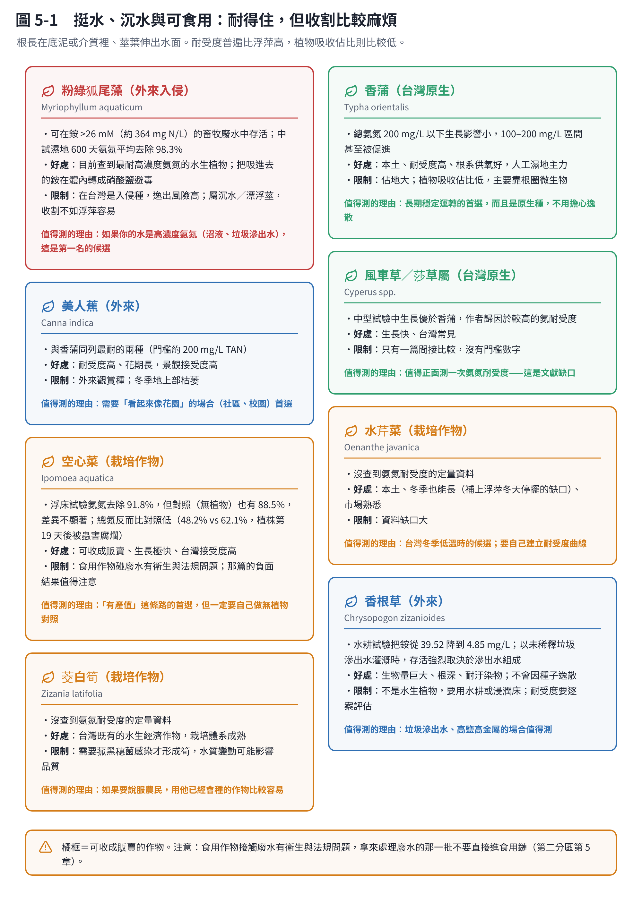

# 第 5 章　挺水、沉水與可食用物種：耐得住，收割比較麻煩

## 5.1 這一群的共同特性

根長在底泥或介質裡、莖葉伸出水面（挺水），或整株在水中但有漂浮莖（沉水）。相對於浮水植物：

- **耐受度普遍比較高**——目前查到最耐高濃度氨氮的兩類都在這裡。
- **植物吸收佔比比較低**——主要貢獻是提供根表面與供氧，讓根圈微生物工作（第 1 章）。
- **收割比較麻煩**——要割、要運，含水量一樣高。
- **冬季比較撐得住**——地上部可能枯萎，但根系還在，隔年會回來。

## 5.2 高耐受度的三種

### 粉綠狐尾藻（*Myriophyllum aquaticum*）

**這是目前查到最耐高濃度氨氮的水生植物。**

| 項目 | 數字 | 可信度 |
|---|---|---|
| 可存活的銨濃度 | > 26 mM（約 364 mg N/L）[1] | abstract |
| 中試濕地氨氮去除率 | 98.3%（600 天平均）[2] | abstract |
| 當時的氮負荷 | 9 kg N/ha/d（＝ 0.9 g N/m²/d）[2] | abstract |
| 氨氮／總氮去除率（另一組中試）| 87.7–97.9%／85.4–96.1% [4] | abstract |
| 收割回收的總氮 | 120–222 g N/m²/年（進流總氮 21.8–282 mg/L）[4] | abstract |
| 質量平衡：植物吸收／底泥／微生物 | **13.0–55.0%／4.9–8.0%／33.0–67.5%**（佔進流總氮負荷）[4] | abstract |

600 天的連續運轉資料在這個領域很少見，值得一讀。

最後一列是同一個團隊另一組中試做的質量平衡 [4]，它比第 1 章那個「收割佔兩三成」的說法複雜一些：
**植物吸收佔進流氮負荷 13.0–55.0%，微生物佔 33.0–67.5%，底泥只佔 4.9–8.0%。**
同一篇還指出，收割帶走的氮佔「總去除量」的比例在不同濕地單元之間是 **0.85–100%**——
範圍大到幾乎沒有代表性。所以「植物吸收大約兩三成」是個中位數的印象，不是一條定律；
**進流濃度、收割頻率與濕地單元的位置都會把它推到兩端。**

**代價**：它在台灣是外來種，而且是沉水／漂浮莖形態，逸出風險高、收割不如浮萍容易。要用它就要把圍封寫進計畫。

### 香蒲（*Typha orientalis*）與美人蕉（*Canna indica*）

在同一篇四物種的比較裡，這兩種是耐受度最好的：**總氨氮 200 mg/L 以下生長受影響小，100–200 mg/L 區間甚至被促進** [3]。相對地，水蔥（*Schoenoplectus validus*）與鳶尾（*Iris tectorum*）超過 100 mg/L 就明顯受抑制 [3]。

- **香蒲是台灣原生種**，全島低海拔水域常見，是人工濕地的主力。不用擔心逸散問題。
- **美人蕉是外來觀賞種**，花期長、景觀接受度高，適合社區與校園這種「要看起來像花園」的場合。

> 第 3 章提醒過：這篇沒有給 pH。如果實際 pH 偏鹼，「200 mg/L」對應的游離氨會比我們假設的高很多。拿來設計之前，最好自己在目標 pH 下驗一次。

## 5.3 可以收成賣錢的四種

| 作物 | 學名 | 現況 |
|---|---|---|
| 空心菜 | *Ipomoea aquatica* | 浮床研究最多的食用作物 |
| 水芹菜 | *Oenanthe javanica* | 冬季也能長，補上浮萍停擺的季節 |
| 茭白筍 | *Zizania latifolia* | 台灣既有的水生經濟作物，栽培體系成熟 |
| 香根草 | *Chrysopogon zizanioides* | 不是食用，但生物量巨大、耐污染 |

### 空心菜：一個誠實的負面結果

空心菜浮床是華語圈最常見的示範，但有一篇研究的結果值得貼出來 [4]：

- 氨氮去除率：**有植物 91.8%，沒有植物的對照組 88.5%**——作者自己寫「差異不顯著」。
- 總氮去除率：**有植物 48.2%，對照組 62.1%**——植物組反而比較差。作者把原因歸於第 19 天後植株受蟲害腐爛。

**這不是在說空心菜沒用，而是在說兩件事：**

1. 沒有「無植物對照組」，你會把 91.8% 當成植物的功勞（第 6 章的四組對照就是為了這個）。
2. **植物死掉腐爛會把氮還回水裡**——第 1 章那句「不收割就等於沒移除」的實測版本。

另外，食用作物接觸廢水有衛生與法規問題。拿來處理廢水的那一批不要直接進食用鏈（分區二第 5 章）。

### 水芹菜與茭白筍：台灣的空白

這兩種都是台灣熟悉的水生作物，但**我們沒有查到任何氨氮耐受度的定量資料**。這代表：

- 短期：不能照抄文獻，要自己建曲線。
- 長期：這是一個沒有人做、而且對台灣有意義的題目。水芹菜的冬季生長力尤其值得測——浮萍冬天停擺是植物方案最大的季節弱點。

### 香根草：高鹽、高金屬、垃圾滲出水

香根草不是水生植物，但在水耕與浸潤床的配置下被用來處理高污染廢水。水耕試驗把銨從 39.52 降到 4.85 mg/L [6]；以**未稀釋的垃圾滲出水**灌溉時，存活強烈取決於滲出水的組成，作者的結論是**必須逐案評估耐受性** [6]。

## 5.4 風車草與莎草屬：一個值得正面測的缺口

有一項中型試驗發現莎草屬（*Cyperus* spp.）的生長優於香蒲，作者把原因歸於它的氨耐受度較高 [7]。但這是間接比較，**沒有門檻數字**。

莎草屬在台灣常見、生長快、好取得。要找一個「值得做、做得出來、文獻還沒做」的題目，這是一個。

## 5.5 選種的三個問題

1. **你的總氨氮（配上 pH）換算成游離氨是多少？** 超過 2 mg N/L 就不要考慮浮水植物了，往香蒲、美人蕉、粉綠狐尾藻去。
2. **你要不要賣收成？** 要的話走空心菜、水芹菜、茭白筍，但先確認法規與買家。
3. **可不可以用外來種？** 不能的話，本土的選擇是香蒲、開卡蘆、風車草、水芹菜、茭白筍——而且你得自己建耐受度資料。

## 本章重點

- 挺水與沉水植物耐受度較高、冬季較撐得住，但收割麻煩、植物吸收佔比低。
- 粉綠狐尾藻是查到最耐的（銨 > 26 mM 可存活、中試 600 天氨氮去除 98.3%），但在台灣是外來種。
- 香蒲（本土）與美人蕉的門檻約 200 mg/L TAN，水蔥與鳶尾超過 100 mg/L 就受抑制。
- 空心菜浮床的一篇研究裡，有植物與無植物的氨氮去除差異不顯著，總氮甚至更差——對照組不可省。
- 水芹菜、茭白筍、莎草屬在台灣常見卻沒有耐受度資料，是明確的研究空白。

## 參考文獻

1. Wang C, Zhang S, Li W, et al. (2019). Complex regulatory network allows Myriophyllum aquaticum to thrive under high-concentration ammonia toxicity. *Scientific Reports*, 9. https://doi.org/10.1038/s41598-019-41236-8
2. Sun H, Liu F, Xu S, et al. (2017). Myriophyllum aquaticum Constructed Wetland Effectively Removes Nitrogen in Swine Wastewater. *Frontiers in Microbiology*, 8, 1932. https://doi.org/10.3389/fmicb.2017.01932
3. Wang et al. (2016). The inhibition and adaptability of four wetland plant species to high concentration of ammonia wastewater and nitrogen removal efficiency in constructed wetlands. *Bioresource Technology*, 202, 198–205. https://doi.org/10.1016/j.biortech.2015.11.049
4. Luo P, Liu F, Zhang S, et al. (2018). Nitrogen removal and recovery from lagoon-pretreated swine wastewater by constructed wetlands under sustainable plant harvesting management. *Bioresource Technology*. https://doi.org/10.1016/j.biortech.2018.03.017
5. Effect of *Ipomoea aquatica* floating-bed on the quantity and distribution of nitrogen cycling bacteria and nitrogen removal. https://pure.ecnu.edu.cn/en/publications/effect-of-ipomoea-aquatica-floating-bed-on-the-quantity-and-distr/
6. Phytoremediatory efficiency of *Chrysopogon zizanioides* in the treatment of landfill leachate: a case study (2019). *Environmental Science and Pollution Research*. https://pubmed.ncbi.nlm.nih.gov/30756356/
7. Microbial removal and plant uptake of nitrogen in constructed wetlands: mesocosm tests on influencing factors (2019). *Environmental Science and Pollution Research*. https://doi.org/10.1007/s11356-018-3543-4
