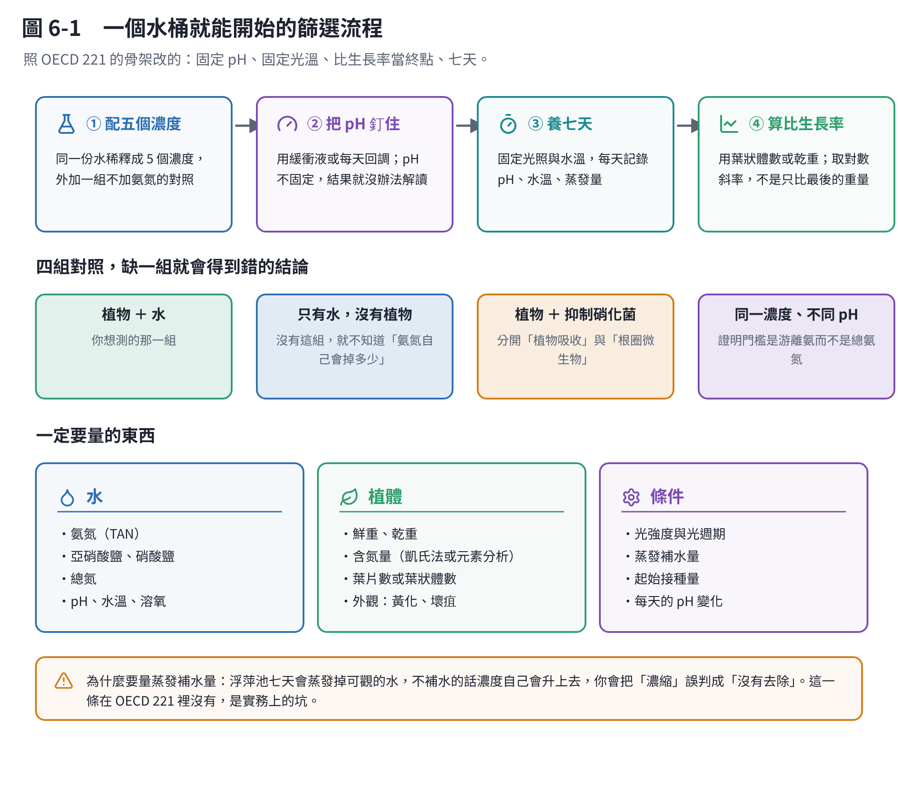

# 第 6 章　怎麼篩選：一個水桶就能開始

## 6.1 先決定你在問什麼

篩選實驗最常見的失敗不是技術問題，是問題沒問清楚。三種問法會導向完全不同的設計：

| 你要問的 | 實驗長什麼樣 | 終點 |
|---|---|---|
| 這種植物**撐不撐得住**我的水？ | 濃度梯度、固定 pH、七天 | 比生長率（EC50 或抑制起點） |
| 這種植物**去除得多快**？ | 固定濃度、連續或半連續進流 | g N/m²/d |
| 植物**貢獻了多少**（相對於微生物）？ | 有植物 vs 無植物 vs 抑制微生物 | 各組的總氮質量平衡 |

本章講第一種（最便宜、最快），並說明怎麼接到第二、三種。

## 6.2 骨架：改編 OECD 221

浮萍的生長抑制試驗有國際標準方法——OECD 測試準則 221 [1]。它本來是用來測化學品毒性的，骨架正好可以拿來測氨氮：

| OECD 221 的規定 | 內容 |
|---|---|
| 試驗生物 | *Lemna gibba* 或 *Lemna minor* |
| 期間 | **7 天** |
| 濃度 | 至少 5 個濃度 |
| 主要終點 | **平均比生長率**（對數增量），不是最終生物量 |
| 次要終點 | 產量（yield），部分法規需要 |
| 結果表示 | ErCx（生長率）／EyCx（產量） |
| 對照組的有效性 | 七天內約增加七倍（相當於比生長率 0.275 /天） |

「用比生長率而不是最終重量」這一條特別重要：**起始接種量只要有一點差異，最終重量就會差很多，但比生長率不會。**

## 6.3 四組對照，缺一組就會得到錯的結論

| 對照組 | 為什麼需要 |
|---|---|
| 植物 ＋ 水 | 你想測的那一組 |
| **只有水，沒有植物** | 不然不知道「氨氮自己會掉多少」（揮發、硝化、吸附）。第 5 章空心菜那篇的教訓 |
| 植物 ＋ 抑制硝化菌 | 分開「植物吸收」與「根圈微生物」。可用硝化抑制劑，或先滅菌 |
| 同一濃度、不同 pH | 證明門檻是游離氨而不是總氨氮（第 3 章）。這一組最能提升你的結果的價值 |

第四組是多數文獻沒做的，也是為什麼第 3 章說「文獻的門檻多半不能用」。**你只要多做這一組，你的數字就比大部分文獻好用。**

## 6.4 一定要量的東西

**水**：氨氮（TAN）、亞硝酸鹽、硝酸鹽、總氮、pH、水溫、溶氧
**植體**：鮮重、乾重、含氮量（凱氏法或元素分析）、葉片數或葉狀體數、外觀（黃化、壞疽）
**條件**：光強度與光週期、**蒸發補水量**、起始接種量、每天的 pH 變化

> **蒸發補水量為什麼要量**（OECD 221 沒寫，是實務上的坑）：浮萍池七天會蒸發掉可觀的水。不補水的話濃度會自己升上去，你會把「濃縮」誤判成「沒有去除」，或把「稀釋」誤判成「去除」。每天補到固定水位，並把補水量記下來。

## 6.5 把濃度梯度設在哪裡

用第 3 章的公式反推。假設你的水 pH 7.5、25 °C：

| 游離氨目標 | 對應的總氨氮 |
|---|---|
| 0.5 mg N/L（保守） | 28 mg N/L |
| 2 mg N/L（開始要小心） | 114 mg N/L |
| 8 mg N/L（浮萍致死） | 454 mg N/L |

所以在 pH 7.5 做浮萍試驗，五個濃度設在 **0（對照）、30、60、120、250、450 mg N/L** 附近就能涵蓋從「沒事」到「死掉」的整個範圍。
pH 8.5 的話，同樣的游離氨對應的總氨氮要除以約 8.6——濃度梯度整個往下搬。

**先算再配，不要憑印象抓濃度。** 憑印象抓最常見的失敗是「五個濃度全部都沒事」或「五個全死」，七天白做。

## 6.6 做完之後怎麼接下去

1. **得到耐受度曲線**（比生長率 vs 游離氨）→ 選出 2–3 種要進一步測的。
2. **改成半連續進流**，量單位面積去除速率（g N/m²/d）→ 這個數字才能拿去算面積（分區二第 2 章）。
3. **加上植體含氮量**，算收割帶走多少、佔總去除多少（第 1 章）。
4. **把根部生物膜拿去做 16S 定序或 qPCR**，看硝化與脫硝菌有沒有增加（見「氨氮降解基礎教材」第 5、6 章）。

## 6.7 一個三個月的實際排程

| 週 | 做什麼 |
|---|---|
| 1 | 量自己的水：TAN、pH、水溫、總氮、鹼度、COD。採集植物並馴化 |
| 2–3 | 第一輪篩選：3–4 種植物 × 5 個濃度 × 固定 pH，七天 |
| 4 | 整理耐受度曲線，選 2 種進入第二輪 |
| 5–8 | 第二輪：半連續進流，量去除速率與質量平衡 |
| 9–10 | 加 pH 變因（同一濃度、兩個 pH），驗證游離氨假設 |
| 11–12 | 整理數據、算面積需求、寫下「這個規模要多大一塊地」 |

**第 1 週不要跳過。** 沒有自己的水質數據，後面每一步都是猜的。

## 本章重點

- 先決定你在問「撐不撐得住」「去除多快」還是「植物貢獻多少」，三種問法的實驗不同。
- OECD 221 的骨架可以直接拿來改：五個濃度、七天、用比生長率當終點。
- 四組對照缺一不可，其中「無植物對照」和「同濃度不同 pH」最常被省略。
- 蒸發補水量一定要量，否則會把濃縮誤判成沒有去除。
- 濃度梯度用第 3 章的公式反推再配，不要憑印象抓。

## 參考文獻

1. OECD (2006). Test No. 221: *Lemna* sp. Growth Inhibition Test. OECD Guidelines for the Testing of Chemicals, Section 2. https://www.oecd.org/en/publications/test-no-221-lemna-sp-growth-inhabition-test_9789264016194-en.html
