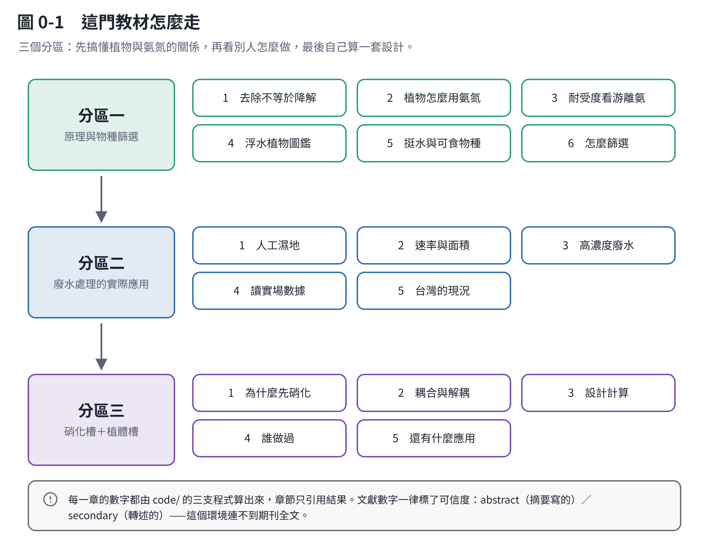

# 水生植物與氨氮：從能不能用，到怎麼用

這門教材回答四個問題：

1. **哪些水生植物值得測試？**（分區一第 4、5 章）
2. **文獻裡有哪些植物真的被用過？**（分區二）
3. **廢水處理真的有人用水生植物嗎？**（分區二第 1、5 章——有，而且台灣就有一整群）
4. **有沒有人做「硝化槽＋植體槽」的設計？**（分區三——有，至少四種版本）

外加一個你可能沒問的問題：**除了把氮去掉，這些植體還能拿來做什麼？**（分區三第 5 章）



## 三個分區

| 分區 | 章數 | 在回答 |
|---|---|---|
| 水生植物與氨氮：原理與物種篩選 | 6 | 植物怎麼用氨氮、怎麼被氨氮毒死、哪些值得測、怎麼測 |
| 水生植物處理廢水：濕地、浮島與實場案例 | 5 | 別人做過什麼、效果多少、要多大面積、台灣的狀況 |
| 硝化槽＋植體槽：耦合設計與延伸應用 | 5 | 怎麼把硝化和植物接起來、怎麼算、還能做什麼 |

## 讀之前先記住三件事

1. **「去除」不等於「降解」，也不等於「移除」。** 氨氮消失在水樣裡，可能是變成硝酸鹽（還在水裡）、進了植物（不收割就會還回來）、揮發到空氣（變成空污），或沉到底泥（之後會回吐）。只有**收割**與**脫硝**兩條路真的把氮帶出系統（第 1 章）。
2. **決定植物死活的是游離氨（NH₃），不是總氨氮（TAN）。** 同一個 TAN，pH 7.0 和 pH 8.5 的毒性差 20 倍以上。文獻如果只寫 TAN 不寫 pH，那個門檻就沒辦法拿來用（第 3 章）。
3. **植物吸收通常只佔總氮去除的兩三成。** 其餘靠根圈的微生物。所以「選哪一種植物」沒有想像中重要，「有沒有給微生物一個好環境」更重要（第 1、6 章，分區二第 1 章）。

## 關於資料來源（請先讀這一段）

這份教材的每一個數字都標了來源與可信度：

| 標記 | 意思 |
|---|---|
| `abstract` | 文獻摘要或資料庫紀錄裡明確寫出的數字 |
| `secondary` | 回顧文章、搜尋摘要或政府網頁的轉述，連原始摘要都沒核對過 |
| `inference` | 我們自己從別的數字推出來的，**不是任何一篇文獻的結論** |

**沒有任何一筆核對過期刊全文**——製作這份教材的環境連不到期刊網站，只能用搜尋摘要。
引用到正式報告或論文之前，請自己開全文核對。

圖與表裡的數值由三支程式產生，結果存成 JSON，章節引用那份 JSON：

| 程式 | 做什麼 |
|---|---|
| [`code/tolerance.py`](code/tolerance.py) | 把各篇文獻的耐受門檻換算成同一個尺度（游離氨），算安全曲線 |
| [`code/sizing.py`](code/sizing.py) | 單位面積去除速率、面積需求、收割佔比、硝化槽的氧氣與鹼度 |
| [`code/literature.py`](code/literature.py) | 物種表、案例表、文獻清單（每一筆都綁著可信度與來源） |

重跑：

```bash
python lessons/aquatic-plants/code/tolerance.py
python lessons/aquatic-plants/code/sizing.py
python lessons/aquatic-plants/code/literature.py
python lessons/aquatic-plants/figures/src/charts.py
python lessons/aquatic-plants/figures/src/diagrams.py
```

## 這門教材和「氨氮降解基礎教材」的關係

氨氮降解那門的第 1 章（NH₃/NH₄⁺ 平衡）、第 2 章（硝化與脫硝）、第 3 章（檢測方法）是這門的前置知識。
那門的第 8 章用兩頁講了水生植物，這門把那兩頁展開成 16 章。
