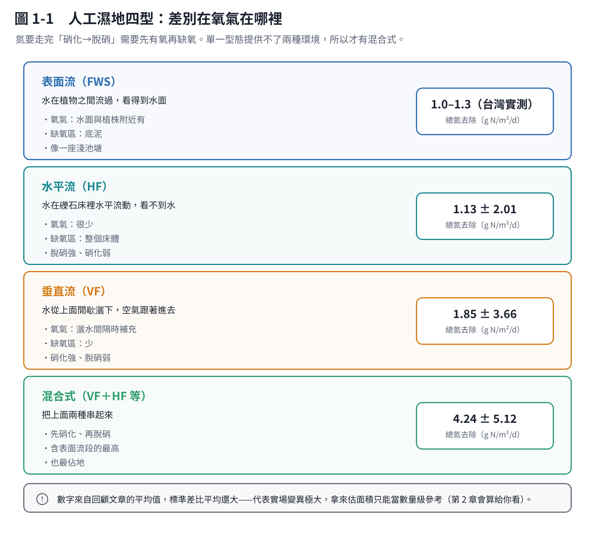

# 第 1 章　人工濕地：最成熟的那一套

## 1.1 什麼是人工濕地

把濕地的淨化機制工程化：挖一塊地、鋪不透水層、填介質（或不填）、種植物、讓廢水慢慢流過。靠的是植物、介質與微生物的組合。

它成熟到什麼程度？有標準教科書（*Treatment Wetlands*）、有國際協會、有數十年的實場資料，台灣也有一整群在運轉的案例（第 5 章）。**如果你的目標是「處理廢水」而不是「做研究」，這是預設選項。**

## 1.2 四型：差別在氧氣在哪裡

氮要真的離開系統，要走完「硝化 → 脫硝」：硝化需要氧，脫硝需要缺氧。**單一型態的濕地提供不了兩種環境**，這是理解四種型態的關鍵 [1]。

| 型態 | 長相 | 氧氣 | 擅長 | 總氮去除（g N/m²/d） |
|---|---|---|---|---|
| 表面流（FWS） | 像一座淺池塘，看得到水面 | 水面與植株附近 | 兩者都有一點 | 1.0–1.3（台灣實測，`secondary`）[2] |
| 水平流（HF） | 礫石床內水平流動，看不到水 | 很少 | 脫硝強、硝化弱 | 1.13 ± 2.01 [3] |
| 垂直流（VF） | 從上面間歇灑水，空氣跟著進去 | 灑水間隔時補充 | 硝化強、脫硝弱 | 1.85 ± 3.66 [3] |
| 混合式（VF＋HF 等） | 把兩種串起來 | 分段控制 | 兩段都做 | 4.24 ± 5.12 [3] |

**注意那個標準差。** 1.13 ± 2.01 的意思是標準差比平均還大——實場變異極大。這些數字只能當數量級參考，不能當設計值（第 2 章會示範怎麼用）。

## 1.3 為什麼單一型態做不好總氮

Vymazal 的回顧講得很直接：**單一型態的人工濕地無法達到高的總氮去除，因為它不能同時提供好氧與厭氧環境** [1]。同一篇回顧指出，各型濕地的總氮去除率大約在 **40–55%**，移除負荷依型態與進流負荷在 **250–630 g N/m²/年** 之間 [1]。

把 250–630 g N/m²/年換算成每日：**0.68–1.73 g N/m²/d**。這和上表的 HF、VF 數字對得起來，也和分區一算出來的浮萍塘速率是同一個數量級。

## 1.4 植物在裡面做什麼

這是人工濕地領域一個有年代的爭論。Brix 1997 年的那篇〈Do macrophytes play a role in constructed treatment wetlands?〉[4] 就是在問這件事。

目前的共識大致是：

1. **直接吸收的佔比不高。** Vymazal 的回顧指出，收割植物移除的氮大約是 100–200 g N/m²/年 [1]，對應上面的總移除量是**三到四成**（第一分區第 1 章算過）。
2. **植物的主要貢獻是間接的**：根系提供巨大的生物膜附著面積、把氧氣送進根圈形成好氧微區、根部釋出的有機碳當脫硝的碳源、植株遮光抑制藻類、冬季的枯枝落葉提供保溫。
3. **所以「種什麼」比不上「怎麼配置」重要。** 選物種影響的是耐受度與維護成本（第一分區第 5 章），不是去除率的數量級。

## 1.5 設計時真正會卡住的三件事

**停留時間與短流。** 水在濕地裡的實際停留時間常常遠低於設計值，因為走了捷徑。這是濕地最常見的失效模式，而且光看進出流水質看不出來——要做示蹤劑試驗（第 4 章）。

**底泥累積。** 懸浮固體與死掉的植體會累積在前段，久了會淤積、短流、甚至回吐氨氮。有研究專門在量老化的表面流濕地的氨氮釋出（`secondary`）。實務上要設前處理（沉澱池）並排定清淤。

**冬季。** 低溫時植物停長、硝化菌活性下降。年平均數字會蓋掉冬天那三個月，設計時要用最壞月份而不是年平均。

## 本章重點

- 人工濕地是這個領域最成熟的做法，有數十年實場資料與現成設計準則。
- 四型的差別在氧氣：FWS 兩者兼有、HF 缺氧（脫硝強）、VF 好氧（硝化強）、混合式分段做。
- 單一型態無法同時提供好氧與厭氧，所以總氮去除率普遍只有 40–55%。
- 收割植物移除的氮約 100–200 g N/m²/年，佔總移除三到四成；植物更大的貢獻是提供根圈環境。
- 真正會卡住的是短流、底泥累積與冬季降效——都不是選物種能解決的。

## 參考文獻

1. Vymazal J (2007). Removal of nutrients in various types of constructed wetlands. *Science of the Total Environment*, 380, 48–65. https://doi.org/10.1016/j.scitotenv.2006.09.014
2. 大漢溪畔表面流人工濕地除氮機制相關碩士論文（臺灣博碩士論文知識加值系統）。https://ndltd.ncl.edu.tw/cgi-bin/gs32/gsweb.cgi?o=dnclcdr&s=id=%22103NCHU5105069%22.&searchmode=basic
3. Vymazal J (2013). The use of hybrid constructed wetlands for wastewater treatment with special attention to nitrogen removal: A review of a recent development. *Water Research*, 47, 4795–4811. https://www.sciencedirect.com/science/article/pii/S0043135413004375
4. Brix H (1997). Do macrophytes play a role in constructed treatment wetlands? *Water Science and Technology*, 35(5), 11–17. https://doi.org/10.1016/S0273-1223(97)00047-4
