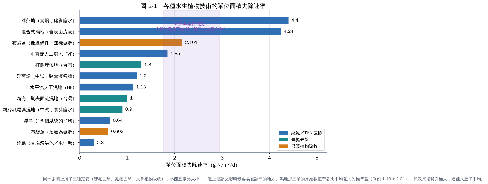
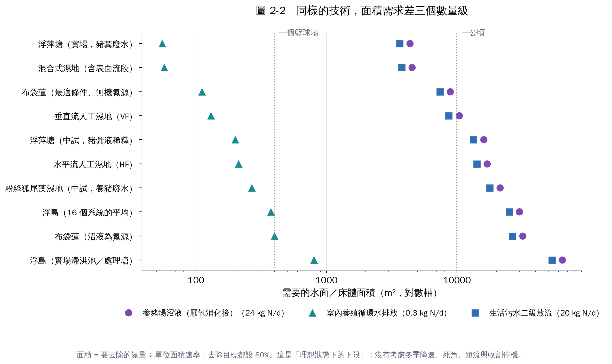

# 第 2 章　速率與面積：我的水要多大一塊地

## 2.1 先把所有數字換成同一個單位

文獻報效果的方式至少有四種：百分比、mg/L 下降、kg N/ha/d、g N/m²/d。要比較就得統一。這一章一律用 **g N/m²/d**（每平方公尺水面或床體，每天去除幾克氮）。



| 技術 | 速率（g N/m²/d） | 量的是什麼 | 可信度 |
|---|---|---|---|
| 浮萍塘（實場，豬糞廢水）[1] | 4.4 | TKN 去除 | abstract |
| 混合式濕地（含表面流段）[2] | 4.24 ± 5.12 | 總氮去除 | secondary |
| 布袋蓮（最適條件、無機氮源）[3] | 2.161 | **只算植物吸收** | abstract |
| 垂直流人工濕地（VF）[2] | 1.85 ± 3.66 | 總氮去除 | secondary |
| 打鳥埤濕地（台灣）[4] | 1.3 | 氨氮去除 | secondary |
| 浮萍塘（中試，豬糞液）[5] | 1.2 | 總氮去除 | abstract |
| 水平流人工濕地（HF）[2] | 1.13 ± 2.01 | 總氮去除 | secondary |
| 新海二期表面流濕地（台灣）[4] | 1.0 | 氨氮去除 | secondary |
| 粉綠狐尾藻濕地（中試，養豬廢水）[6] | 0.9 | 氨氮去除 | abstract |
| 浮島（16 個系統的平均）[7] | 0.64（範圍 0.0015–2.8） | 總氮去除 | secondary |
| 布袋蓮（沼液為氮源）[3] | 0.602 | 只算植物吸收 | abstract |
| 浮島（實場滯洪池／處理塘）[8] | 0.3（原文 0.06–0.57） | 總氮去除 | abstract |

**這張表有一個陷阱**：裡面混了三種定義。「總氮去除」「氨氮去除」「只算植物吸收」不是同一件事，不能直接比大小。布袋蓮那兩筆只算植物吸收，如果把根圈微生物也算進去，數字會高一截。

## 2.2 面積怎麼算

```
要去除的氮量（kg N/d）＝ 流量（m³/d）× 進流總氨氮（mg N/L）÷ 1000 × 去除目標
需要的面積（m²）＝ 要去除的氮量（g N/d）÷ 單位面積速率（g N/m²/d）
```

三個情境（去除目標都設 80%）：



### 情境一：養豬場沼液　30 m³/d × 800 mg N/L ＝ 24 kg N/d

| 技術 | 面積 |
|---|---|
| 浮萍塘（實場速率 4.4） | 4,364 m²（0.44 ha） |
| 布袋蓮（最適條件 2.161） | 8,885 m²（0.89 ha） |
| 水平流濕地（1.13） | 16,991 m²（1.7 ha） |
| 粉綠狐尾藻濕地（0.9） | 21,333 m²（2.1 ha） |
| 布袋蓮（沼液為氮源 0.602） | 31,894 m²（3.2 ha） |

**而且這還沒算稀釋。** 800 mg N/L 的沼液不能直接給浮萍（第 3 章），要先稀釋 13.3 倍——那會讓水量從 30 m³/d 變成 400 m³/d，池子要能裝下這些水。

### 情境二：生活污水二級放流　1,000 m³/d × 20 mg N/L ＝ 20 kg N/d

| 技術 | 面積 |
|---|---|
| 浮萍塘（4.4） | 3,636 m²（0.36 ha） |
| 布袋蓮（2.161） | 7,404 m²（0.74 ha） |
| 水平流濕地（1.13） | 14,159 m²（1.4 ha） |

**這是人工濕地最適合的情境**：濃度低、水量大、通常有地。台灣的大漢溪濕地群就在做這件事（第 5 章）。

### 情境三：室內養殖循環水排放　100 m³/d × 3 mg N/L ＝ 0.3 kg N/d

| 技術 | 面積 |
|---|---|
| 浮萍塘（4.4） | 55 m² |
| 布袋蓮（2.161） | 111 m² |
| 浮島（0.3） | 800 m² |

**濃度低到用幾十平方公尺就夠。** 這個量級的系統反而該考慮的是第三分區的耦合設計——把植物當成「生產單元」而不是「處理單元」。

## 2.3 這些面積是下限，不是設計值

上面算出來的是理想狀態下的下限。實際設計至少要再考慮：

- **冬季降速**：低溫時速率可能掉一半以上。用最壞月份算，不要用年平均。
- **短流與死角**：實際有效面積小於幾何面積。
- **收割停機**：收割期間的去除率會掉。
- **進流變動**：峰值負荷而不是平均負荷。

實務上常見的做法是在算出來的面積上**乘 1.5 到 2 倍**的安全係數。這個係數沒有文獻依據，是工程慣例——寫進報告時要標明是假設。

## 2.4 一個有意思的交叉驗證

第三分區第 3 章會算魚菜共生的設計：文獻建議的投餵率是每平方公尺植栽面積每天 60–100 g 飼料。把它換算成氨氮負荷（飼料蛋白 32%、PTAN 係數 0.092）得到 **1.8–2.9 g N/m²/d**。

這個區間剛好落在上面那張表的中段——和人工濕地、浮萍塘實測的去除速率同一個數量級。

> **這是推論，不是哪一篇文獻的結論。** 兩套文獻（魚菜共生的設計準則、濕地的去除速率）互相獨立，沒有人把它們放在一起比過。但它們對得起來這件事本身是有意義的：代表「每平方公尺植物每天能處理幾克氮」大約就在 1–4 g N/m²/d 這個範圍，不管你叫它濕地還是叫它魚菜共生。

## 本章重點

- 比較之前先把單位統一成 g N/m²/d，並注意文獻量的是總氮、氨氮還是只有植物吸收。
- 實測速率大致落在 0.3–4.4 g N/m²/d，最高的是實場浮萍塘與含表面流段的混合式濕地。
- 面積 ＝ 要去除的氮量 ÷ 單位面積速率。沼液 30 m³/d 要 0.44–3.2 ha，生活污水 1,000 m³/d 要 0.36–1.4 ha。
- 算出來的是下限，實務要乘 1.5–2 倍安全係數（工程慣例，不是文獻值）。
- 魚菜共生的投餵率換算成氮負荷是 1.8–2.9 g N/m²/d，和濕地文獻同一個數量級——這是推論，但兩邊對得起來。

## 參考文獻

1. Mohedano RA, Costa RHR, Tavares FA, Belli Filho P (2012). High nutrient removal rate from swine wastes and protein biomass production by full-scale duckweed ponds. *Bioresource Technology*, 112, 98–104. https://doi.org/10.1016/j.biortech.2012.02.083
2. Vymazal J (2013). The use of hybrid constructed wetlands for wastewater treatment with special attention to nitrogen removal: A review of a recent development. *Water Research*, 47, 4795–4811. https://www.sciencedirect.com/science/article/pii/S0043135413004375
3. Reddy KR, Tucker JC (1983). Productivity and nutrient uptake of water hyacinth, *Eichhornia crassipes* I. Effect of nitrogen source. *Economic Botany*, 37, 237–247. https://doi.org/10.1007/BF02858790
4. 大漢溪畔表面流人工濕地除氮機制相關碩士論文（臺灣博碩士論文知識加值系統）。https://ndltd.ncl.edu.tw/cgi-bin/gs32/gsweb.cgi?o=dnclcdr&s=id=%22103NCHU5105069%22.&searchmode=basic
5. A Pilot-Scale Evaluation of Duckweed Cultivation for Pig Manure Treatment and Feed Production (2025). *Plants*, 14, 2680. https://doi.org/10.3390/plants14172680
6. Sun H, Liu F, Xu S, et al. (2017). Myriophyllum aquaticum Constructed Wetland Effectively Removes Nitrogen in Swine Wastewater. *Frontiers in Microbiology*, 8, 1932. https://doi.org/10.3389/fmicb.2017.01932
7. Application of floating treatment wetlands for stormwater runoff: A critical review of the recent developments with emphasis on heavy metals and nutrient removal. https://www.researchgate.net/publication/349737859
8. Field Evaluation of a Constructed Floating Wetland for Nutrients and PFAS Attenuation in a Treatment Lagoon. *ACS ES&T Water*. https://pubs.acs.org/aewcaa/article/6/4/2278/5146861/
