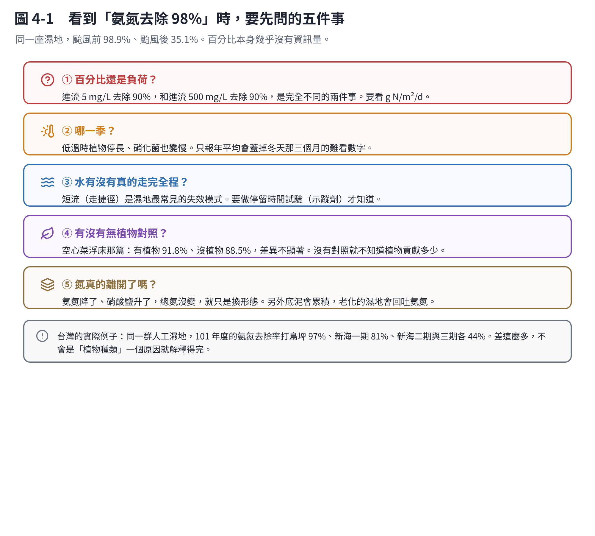

# 第 4 章　看到「氨氮去除 98%」時，要先問的五件事

## 4.1 一個真實的例子

台灣新海二期表面流人工濕地，同一座：

- **2007 年柯羅莎颱風前：氨氮去除 98.9%**
- **颱風後：約 35.1%**（地上部被沖走、底部殘留淤積物）[1]

同一群濕地在 2012 年（民國 101 年度）的氨氮去除率：打鳥埤 97%、新海一期 81%、城林 78%、新海二期 44%、新海三期 44% [2]。

**同一條溪、同一年、同一種設計思路，從 44% 到 97%。** 所以單看一個百分比幾乎沒有資訊量。



## 4.2 五個要問的問題

### ① 百分比，還是負荷？

進流 5 mg/L 去除 90%，和進流 500 mg/L 去除 90%，是差一百倍的兩件事。

**要看 g N/m²/d。** 如果文獻只給百分比，就自己換算：

```
g N/m²/d ＝ 流量（m³/d）× 進流濃度（mg N/L）× 去除率 ÷ 1000 ÷ 面積（m²）
```

換算不出來（沒給流量或面積），那個百分比就只能當作「有在運轉」的證明。

### ② 哪一季？

低溫時植物停長、硝化菌活性下降。只報年平均會蓋掉冬天那三個月。

**設計時要用最壞月份。** 看到年平均數字，先問有沒有月資料。

### ③ 水有沒有真的走完全程？

短流（走捷徑）是濕地最常見的失效模式。水從進水口直接抄到出水口，大部分面積根本沒用到。

光看進出流水質看不出來——**要做示蹤劑試驗**（放鹽或染料，量出水的濃度曲線），比較實際停留時間與設計停留時間。兩者差很多就是短流。

### ④ 有沒有無植物對照？

第一分區第 5 章那個例子：空心菜浮床的氨氮去除 91.8%，**無植物對照組 88.5%**，差異不顯著 [3]。

沒有對照組，你會把 91.8% 全部記在植物頭上。實場很難設無植物對照，但至少要知道「這個水放著不動會掉多少」。

### ⑤ 氮真的離開了嗎？

氨氮降了、硝酸鹽升了、總氮沒變 → 只是換形態（第一分區第 1 章）。

另外要注意底泥：**老化的表面流濕地會回吐氨氮**（有研究專門在量這件事，`secondary`）。前幾年很漂亮的濕地，第八年可能開始變差，原因在底泥不在植物。

## 4.3 颱風那一筆教的事

颱風前 98.9%、颱風後 35.1% [1]，這個落差告訴我們兩件事：

1. **地上部被沖走 ＝ 收割量歸零 ＋ 根圈生物膜受損。** 恢復要時間。
2. **在台灣，極端事件要寫進設計。** 不只是颱風，還有暴雨造成的水力衝擊與稀釋。濕地的設計流量要考慮這些。

這也是為什麼實場資料比實驗室資料有價值——**實驗室不會有颱風**。

## 4.4 怎麼寫出別人能用的實場報告

如果你自己在做實場，報告裡至少要有：

| 項目 | 為什麼 |
|---|---|
| 面積、流量、停留時間（設計值與實測值） | 不然沒辦法換算負荷 |
| 進出流的氨氮、亞硝酸鹽、硝酸鹽、**總氮** | 不然分不清去除與轉化 |
| 月資料，不只年平均 | 冬季與夏季差很多 |
| pH 與水溫 | 游離氨與反應速率都靠它 |
| 植物的收割量與含氮量 | 不然算不出植物貢獻 |
| 異常事件紀錄（颱風、暴雨、清淤、植物死亡） | 解釋離群值 |

## 本章重點

- 同一群台灣濕地的氨氮去除率從 44% 到 97%，同一座濕地颱風前後從 98.9% 掉到 35.1%——百分比本身資訊量很低。
- 五個要問的：是百分比還是負荷、哪一季、有沒有短流、有沒有無植物對照、總氮有沒有變。
- 短流要靠示蹤劑試驗才看得出來，進出流水質看不出來。
- 老化的濕地底泥會回吐氨氮，前幾年的好成績不保證第八年還在。
- 在台灣，颱風與暴雨要寫進設計與報告。

## 參考文獻

1. 大漢溪畔表面流人工濕地除氮機制相關碩士論文（臺灣博碩士論文知識加值系統）。https://ndltd.ncl.edu.tw/cgi-bin/gs32/gsweb.cgi?o=dnclcdr&s=id=%22103NCHU5105069%22.&searchmode=basic
2. 行政院環境保護署（現環境部）。淡水河流域 5 處人工濕地（新海、浮洲、打鳥埤、城林、鹿角溪）101 年度水質淨化成效。https://enews.moenv.gov.tw/File/18B1FAD90A675052
3. Effect of *Ipomoea aquatica* floating-bed on the quantity and distribution of nitrogen cycling bacteria and nitrogen removal. https://pure.ecnu.edu.cn/en/publications/effect-of-ipomoea-aquatica-floating-bed-on-the-quantity-and-distr/
