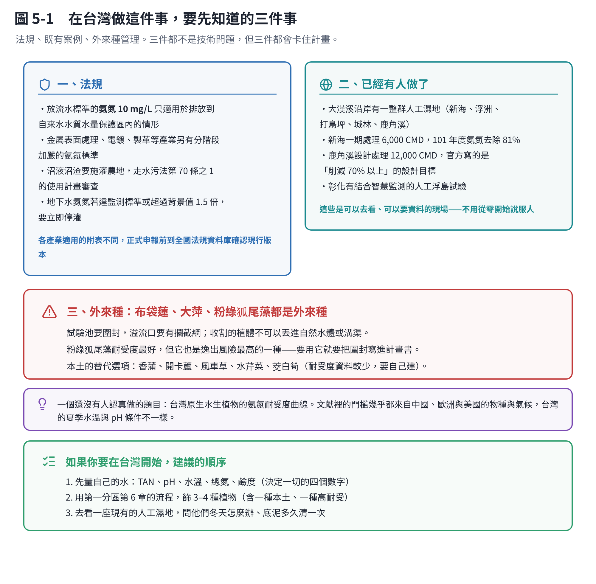

# 第 5 章　在台灣做這件事：法規、現場與外來種

## 5.1 三件會卡住計畫的事

## 5.2 法規

**放流水標準的氨氮限值是 10 mg/L，但適用範圍有限**——查到的版本寫明適用於「排放於自來水水質水量保護區內者」[1]。也就是說，不是所有事業都受這個數字管。

另外幾件要知道的：

- 金屬表面處理、電鍍、製革等產業有**分階段加嚴**的氨氮標準（環境部 106 年修訂，第一階段 110 年、第二階段 113 年生效，`secondary`）。
- **沼液沼渣要施灌農地**，走的是《水污染防治措施及檢測申報管理辦法》第 70 條之 1 的使用計畫審查：先經農業主管機關審查同意，再報環保主管機關備查 [2]。
- 施灌的監測門檻和「停灌」條件通常寫在地方政府的核准條件裡，例如**地下水氨氮達第二類地下水污染監測標準（0.25 mg/L）或下游井超過背景值 1.5 倍就要立即停灌**（`secondary`，來自地方政府的申請文件）。

> **各產業適用的附表不同，而且會改版。** 正式申報前請到全國法規資料庫確認現行條文——這一節的內容是為了讓你知道「要去查什麼」，不是可以直接引用的法源。

## 5.3 已經有人做了

**新北大漢溪沿岸有一整群人工濕地**：新海、浮洲、打鳥埤、城林、鹿角溪 [3]。

| 場址 | 規模／成效 | 可信度 |
|---|---|---|
| 新海一期 | 處理 6,000 CMD；101 年度 BOD 58%、SS 47%、**氨氮 81%** [3] | secondary |
| 新海二期、三期 | 101 年度氨氮去除率各 44% [3] | secondary |
| 打鳥埤 | 101 年度氨氮去除率 97% [3] | secondary |
| 城林 | 101 年度氨氮去除率 78% [3] | secondary |
| 鹿角溪 | 設計處理 12,000 CMD，官方描述是「削減 70% 以上」的**設計目標**，不是實測值 [4] | secondary |

另外彰化有結合智慧監測的人工浮島試驗，報告氨氮去除 83%、亞硝酸氮 87%、硝酸氮 70%；值得注意的是**七月因硝化作用亞硝酸鹽一度衝到 13 mg/L** [5]——這正是第三分區第 1 章要講的「硝化只做一半」的實例。

**這些都是可以去看、可以要資料的現場。** 做台灣的計畫不用從零開始說服人——先去走一趟，問他們冬天怎麼辦、底泥多久清一次、颱風後怎麼復原。

## 5.4 外來種：這一節請不要跳過

**布袋蓮、大萍（水芙蓉）、粉綠狐尾藻都是外來種**，而前兩者在農業部的外來種介紹裡被明確點名 [6]。

實務上要做到：

- 試驗池**圍封**，溢流口設攔截網。
- 收割的植體**不可以**丟進自然水體、溝渠或排水。堆肥、厭氧消化或焚化都可以，隨手倒掉不行。
- 粉綠狐尾藻耐受度最好（第一分區第 5 章），但它是**沉水／漂浮莖**，一小段莖就能繁殖，逸出風險最高。要用它，就要把圍封措施寫進計畫書。

**本土的替代選項**：香蒲、開卡蘆、風車草（莎草屬）、水芹菜、茭白筍。代價是耐受度資料幾乎都要自己建（第一分區第 5 章）。

## 5.5 食用作物的那條紅線

空心菜、水芹菜、茭白筍拿來處理廢水，收成怎麼辦？

- **衛生**：廢水裡可能有病原菌、重金屬、藥物殘留。
- **法規**：食用作物的生產環境有規範，廢水處理池不是農地。
- **市場**：就算檢驗合格，「廢水種的菜」在市場上很難賣。

務實的做法是**把處理用的植體和食用的分開**：處理池收的植體走飼料、堆肥或厭氧消化（第三分區第 5 章），食用那一批用處理過的水去種。這兩件事不要混在同一個池子裡。

## 5.6 一個還沒有人做的題目

**台灣原生水生植物的氨氮耐受度曲線。**

文獻裡的門檻幾乎都來自中國、歐洲與美國的物種與氣候。台灣的夏季水溫更高（pKa 更低 ＝ 同樣 pH 下游離氨更多）、pH 條件也不一樣。而香蒲、開卡蘆、水芹菜、茭白筍、莎草屬這些本土或在地作物，耐受度資料幾乎是空白。

這個題目的好處是：**便宜**（一個水桶就能開始，見第一分區第 6 章）、**有用**（任何人要在台灣設計植物處理都會需要）、**沒有人做過**（所以結果一定是新的）。

## 5.7 如果你要在台灣開始，建議的順序

1. **先量自己的水**：TAN、pH、水溫、總氮、鹼度。這五個數字決定後面每一個選擇。
2. **用第一分區第 6 章的流程篩 3–4 種植物**，至少含一種本土種與一種高耐受種。
3. **去看一座現有的人工濕地**，問他們冬天怎麼辦、底泥多久清一次、颱風後怎麼復原。
4. **把法規確認寫進第一個月的工作項目**，不要等到要放流才發現附表不對。

## 本章重點

- 放流水標準的氨氮 10 mg/L 只適用於特定情形（保護區內），各產業附表不同且會改版，要自己查現行條文。
- 沼液沼渣施灌農地要走水污法第 70 條之 1 的使用計畫審查，並有地下水氨氮的停灌門檻。
- 台灣大漢溪沿岸有一整群運轉中的人工濕地，101 年度氨氮去除率從 44% 到 97%，是可以去看、可以要資料的現場。
- 布袋蓮、大萍、粉綠狐尾藻都是外來種，要圍封，收割的植體不可丟進自然水體。
- 處理用的植體與食用的要分開，不要混在同一個池子。
- 台灣原生水生植物的氨氮耐受度曲線是一個便宜、有用、還沒有人做的題目。

## 參考文獻

1. 放流水標準（中華民國 108 年 4 月 29 日修正）。https://www.epb.taichung.gov.tw/media/521086/放流水標準.pdf
2. 水污染防治措施及檢測申報管理辦法第 70 條之 1（沼渣沼液農地肥分使用）。https://kmweb.moa.gov.tw/subject/subject.php?id=16984
3. 行政院環境保護署（現環境部）。淡水河流域 5 處人工濕地 101 年度水質淨化成效。https://enews.moenv.gov.tw/File/18B1FAD90A675052
4. 經濟部水利署。國內案例：新北市樹林區鹿角溪人工濕地自然淨化工程。https://www.wra.gov.tw/News_Content.aspx?n=25153&s=88319
5. Evaluation of the Water Quality and Farming Growth Benefits of an Intelligence Aquaponics System (2021). *Sustainability*, 13, 4210. https://doi.org/10.3390/su13084210
6. 農業部。外來種介紹：大萍（水芙蓉）、布袋蓮。https://www.moa.gov.tw/ws.php?id=2613
