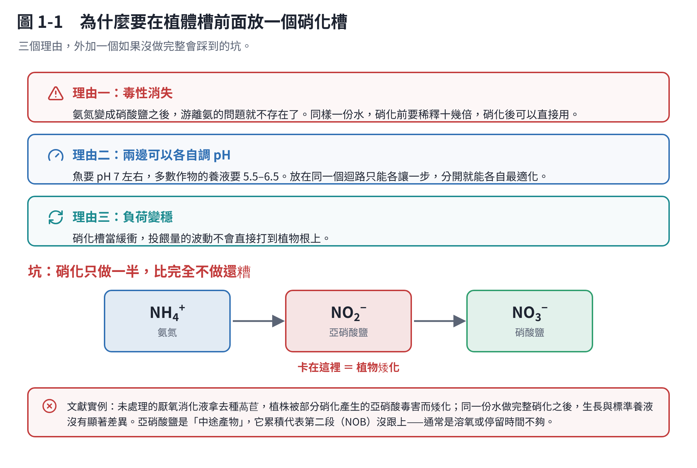

# 第 1 章　為什麼要在植體槽前面放一個硝化槽

## 1.1 三個理由



### 理由一：毒性消失

氨氮變成硝酸鹽之後，游離氨的問題就不存在了。硝酸鹽對植物幾乎沒有毒性（高濃度會有滲透壓問題，但那是另一個數量級）。

**同一份水，硝化前要稀釋十幾倍，硝化後可以直接用。** 分區二第 3 章算過：800 mg N/L 的沼液要給浮萍，得稀釋 13.3 倍、每天多 370 m³ 的水。硝化之後這筆水費就省下來了。

### 理由二：兩邊可以各自調 pH

魚要 pH 7 左右，多數作物的水耕養液要 5.5–6.5（偏酸才能讓鐵、錳等微量元素維持可溶）。

放在同一個迴路，只能取一個折衷值——通常是 pH 6.8–7.0，魚和植物都不滿意。分開之後兩邊可以各自最適化（第 2 章）。

### 理由三：負荷變穩

硝化槽當緩衝。投餵量的日間波動、假日沒餵、魚群換批，這些變動不會直接打到植物根上。

## 1.2 坑：硝化只做一半，比完全不做還糟

硝化是兩段反應，由兩群不同的菌做：

```
NH₄⁺  --（AOB／AOA）-->  NO₂⁻  --（NOB）-->  NO₃⁻
氨氮                    亞硝酸鹽              硝酸鹽
```

**卡在中間就是災難。** 亞硝酸鹽對植物和魚都有毒。

文獻實例：未處理的厭氧消化液拿去種萵苣，**植株被「部分硝化」產生的亞硝酸毒害而矮化**；同一份水先做完整硝化之後，生長與標準養液沒有顯著差異 [1]。

也就是說：那份水的問題不是「氮太多」，而是**氮的形態不對，而且中途卡住了**。

分區二第 5 章提過的彰化浮島試驗也看到同一件事：七月因硝化作用，亞硝酸鹽一度衝到 13 mg/L [2]。

**亞硝酸鹽累積通常代表第二段（NOB）跟不上**，常見原因是：

- 溶氧不足（NOB 對氧的親和力比 AOB 差）
- 停留時間不夠（菌還沒長起來就被沖走）
- 游離氨太高（NOB 比 AOB 更早被游離氨抑制——這正是部分硝化製程刻意利用的機制）
- 溫度太低

所以**啟動期一定要量亞硝酸鹽**，而且要等它降下來再接植物。這是整個設計裡最容易被跳過、後果最大的一步。

## 1.3 要付的代價：鹼度

硝化是耗鹼反應。依反應式：

```
NH₄⁺ + 2 O₂ → NO₃⁻ + 2 H⁺ + H₂O
```

每氧化 1 g 氨氮，產生 2 莫耳 H⁺，需要 **7.14 g CaCO₃ 的鹼度**去中和（算法見第 3 章）。

鹼度被吃光之後 pH 會急墜，硝化菌自己先被壓住，整個系統停擺。**所以「鹼度」是這類系統最該盯的參數之一**，比 pH 更早反映問題（pH 在鹼度還夠的時候看起來很穩，一旦鹼度用完就崩）。

## 1.4 什麼時候不需要硝化槽

不是每個系統都需要：

- **氨氮本來就低**（例如 < 5 mg N/L 的養殖排水、二級放流）：植物與根圈微生物自己處理得了。
- **目標是回收氮當蛋白質**：浮萍偏好吸收 NH₄⁺（第一分區第 2 章），硝化反而把它最愛的形態換掉了。這種情況下，**控制 pH 讓游離氨變低**比硝化更合理。
- **用的是高耐受度植物**：粉綠狐尾藻可以直接進高濃度水（第一分區第 5 章）。

**判斷原則**：如果你的水「游離氨太高」而不是「氮太多」，先想 pH；如果是「氮的形態不適合作物」（例如要種水耕蔬菜），才需要硝化。

## 本章重點

- 先硝化的三個理由：毒性消失（省掉十幾倍稀釋水）、兩邊各自調 pH、負荷變穩。
- 硝化只做一半會累積亞硝酸鹽，對植物與魚都有毒——文獻裡萵苣矮化的實例就是這樣來的。
- 亞硝酸鹽累積代表 NOB 跟不上，常見原因是溶氧、停留時間、游離氨抑制或低溫。
- 硝化耗鹼：每克氨氮要 7.14 g CaCO₃。鹼度比 pH 更早反映問題。
- 若目標是把氮回收成蛋白質，浮萍偏好 NH₄⁺——這時控制 pH 比硝化更合理。

## 參考文獻

1. The applicability of anaerobically treated domestic wastewater as a nutrient medium in hydroponic lettuce cultivation: Nitrogen toxicity and health risk assessment. *Science of the Total Environment*. https://doi.org/10.1016/j.scitotenv.2021.146482
2. Evaluation of the Water Quality and Farming Growth Benefits of an Intelligence Aquaponics System (2021). *Sustainability*, 13, 4210. https://doi.org/10.3390/su13084210
