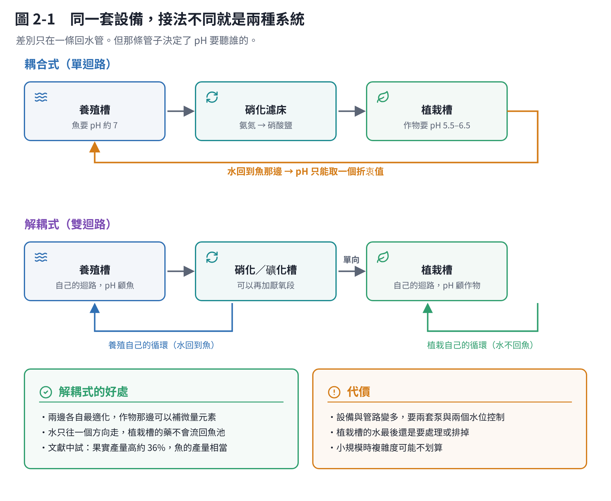

# 第 2 章　耦合式與解耦式：差別只在一條回水管

## 2.1 兩種接法

**耦合式（單迴路）**：養殖槽 → 硝化濾床 → 植栽槽 → **水回到養殖槽**。一個迴路，所有水共用。

**解耦式（雙迴路）**：養殖槽與硝化槽自成一個循環（水回到魚）；硝化後的水**單向**送到植栽槽；植栽槽自己也是一個循環，水不回魚池。

差別只有一條管子，但後果很大。

## 2.2 那條管子決定了什麼

| | 耦合式 | 解耦式 |
|---|---|---|
| pH | 只能取一個折衷值（通常 6.8–7.0） | 魚那邊顧魚、植物那邊顧作物 |
| 補充養分 | 不能加——加進去的鐵、錳會跟著水回到魚池 | 可以在植栽端自由補微量元素 |
| 用藥 | 植栽端的藥會流回魚池 | 不會 |
| 水的去向 | 封閉循環，蒸發補水為主 | 植栽端的水最後要處理或排掉 |
| 設備 | 一套泵、一個水位控制 | 兩套 |
| 複雜度 | 低 | 高 |

**最重要的那一條是「補充養分」。** 魚飼料提供的營養比例不等於作物需要的比例——鐵、錳、鉀、鈣通常不夠。耦合式沒辦法補，只能接受作物長得普通；解耦式可以把植栽端當成一般水耕來調配。

## 2.3 實測的差別

一篇德國的中試比較（耦合式單迴路 vs 解耦式雙迴路，真實生產條件）[1]：

- **解耦式的果實產量高約 36%**
- **魚的產量兩者相當**
- 作者把差異歸於 pH 與肥料管理更好

作者也指出，這是**第一篇在真實生產條件下比較耦合與解耦的研究**。所以這是目前最直接的證據，但也只有這一篇。

## 2.4 多迴路：再往前走一步

Goddek 等人把解耦的概念往前推，提出多迴路（multi-loop）系統 [2, 3]：在養殖與植栽之外，再加上處理魚污泥的反應器（厭氧消化或礦化），把污泥裡的氮磷也拉回植栽端。

幾個他們強調的設計點：

- 污泥處理可以用兩段式反應器，把固體裡的養分釋放成植物可吸收的形態。
- **上流式厭氧反應器的脫硝能力很強**，所以從養殖端到植栽端必須是**單向流**，才控制得住硝酸鹽的劑量 [2]。
- 多迴路的目標是「養分與水的使用效率」，不是單純的產量 [3]。

> 這一段的細節來自摘要與章節簡介，沒有核對全文。要做實際設計，建議直接讀 Goddek 的原文。

## 2.5 怎麼選

| 情況 | 建議 |
|---|---|
| 小規模、示範、教學 | 耦合式。設備少、好懂、好維護 |
| 要賣作物、在意產量與品質 | 解耦式。可以補養分、可以調 pH |
| 進料是沼液或尿液（不是魚） | 本來就是解耦的——沒有魚要顧，直接硝化後進植栽 |
| 要處理污泥、追求零排放 | 多迴路 |

**一個常被忽略的點**：解耦式的植栽端最後會排水。那些水含硝酸鹽，還是要處理——可以接浮萍塘（回收成蛋白）或人工濕地（脫硝）。**解耦不等於零排放，只是把問題往後推一段。**

## 本章重點

- 耦合式是單迴路（水回到魚），解耦式是雙迴路（水單向進植栽、不回魚）。
- 那條回水管決定了 pH 能不能各自最適化、能不能補微量元素、植栽端的藥會不會流回魚池。
- 中試比較的結果：解耦式果實產量高約 36%，魚產量相當——但目前只有這一篇真實生產條件的比較。
- 多迴路再加上污泥處理反應器；從養殖端到植栽端必須單向流，否則厭氧反應器會把硝酸鹽脫掉。
- 解耦式的植栽端排水仍含硝酸鹽，要另外處理——接浮萍塘或人工濕地都可以。

## 參考文獻

1. Monsees H, Kloas W, Wuertz S (2017). Decoupled systems on trial: Eliminating bottlenecks to improve aquaponic processes. *PLOS ONE*, 12, e0183056. https://doi.org/10.1371/journal.pone.0183056
2. Goddek S, et al. (2016). Navigating towards Decoupled Aquaponic Systems: A System Dynamics Design Approach. *Water*, 8, 303. https://doi.org/10.3390/w8070303
3. Goddek S, et al. (2020). Improving nutrient and water use efficiencies in multi-loop aquaponics systems. *Aquaculture International*. https://doi.org/10.1007/s10499-020-00600-6
