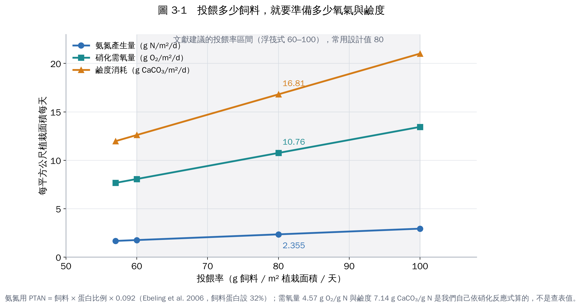

# 第 3 章　設計計算：從飼料算到要多大的植栽槽

## 3.1 一條線算到底

這一章把一件事從頭算到尾：**投餵多少飼料 → 產生多少氨氮 → 需要多少氧氣 → 吃掉多少鹼度 → 要多大的植栽面積。**

每一步都有公式，而且公式很短。

## 3.2 第一步：飼料 → 氨氮

水產養殖的標準估法 [1]：

```
PTAN ＝ F × PC × 0.092

PTAN：每日產生的總氨氮（kg N/d）
F   ：每日投餵量（kg/d）
PC  ：飼料蛋白比例（小數）
```

那個 0.092 是怎麼來的？文獻寫得很清楚：**0.16 × 0.80 × 0.80 × 0.90**——蛋白質含氮 16%、氮被攝食吸收 80%、再乘兩個代謝係數 [1]。

用飼料蛋白 32% 代進去：

| 投餵量 | 飼料裡的氮 | 變成氨氮 | 佔飼料氮的比例 |
|---|---|---|---|
| 每 1 kg 飼料 | 51.2 g N | 29.4 g N | **57.5%** |

**超過一半的飼料氮會以氨氮排到水裡。** 剩下的進了魚體、糞便與未攝食的飼料。

## 3.3 第二步：氨氮 → 氧氣與鹼度

這兩個數字不用查表，依硝化反應式就能算：

```
NH₄⁺ + 2 O₂ → NO₃⁻ + 2 H⁺ + H₂O

需氧量 ＝ 2 × 32 ÷ 14.007 ＝ 4.57 g O₂ / g N
鹼度   ＝ 2 × 50 ÷ 14.007 ＝ 7.14 g CaCO₃ / g N
```

（50 g/eq 是 CaCO₃ 的當量重。）

教科書與推廣資料常看到 **4.3 g O₂/g N**（例如 [2]），比純化學計量略低——因為實際上有一部分氮被硝化菌拿去合成菌體，沒有被氧化。用 4.57 是保守（偏安全）的估法。

鹼度的 7.14 則幾乎所有資料都一致 [2]。

## 3.4 第三步：投餵率 → 植栽面積

魚菜共生領域有一個直接的經驗法則：**投餵率比（feeding rate ratio）**，單位是「每平方公尺植栽面積每天投餵幾克飼料」。

| 來源 | 數值 |
|---|---|
| UVI 商業規模系統實測 [3] | 57 g/m²/d |
| 浮筏式的建議範圍 [2] | 60–100 g/m²/d |
| 常用設計值 [2] | 80 g/m²/d |
| 薄膜水耕（NFT） [2] | 浮筏式的 25–75% |

把前面三步串起來：



| 投餵率（g 飼料/m²/d） | 氨氮（g N/m²/d） | 需氧（g O₂/m²/d） | 鹼度（g CaCO₃/m²/d） |
|---|---|---|---|
| 57（UVI 實測） | 1.68 | 7.67 | 11.98 |
| 60 | 1.77 | 8.07 | 12.61 |
| **80（設計值）** | **2.36** | **10.76** | **16.81** |
| 100 | 2.94 | 13.45 | 21.02 |

## 3.5 一個完整的例子

假設：**300 kg 的魚、每天餵體重的 1.5%、飼料蛋白 32%、浮筏式設計值 80 g/m²/d。**

| 項目 | 計算 | 結果 |
|---|---|---|
| 每日投餵量 | 300 × 1.5% | **4.5 kg/d** |
| 產生的氨氮 | 4.5 × 0.32 × 0.092 | **132.5 g N/d** |
| 硝化需氧量 | 132.5 × 4.57 | **605 g O₂/d** |
| 鹼度消耗 | 132.5 × 7.14 | **946 g CaCO₃/d** |
| 植栽面積 | 4,500 g ÷ 80 | **56 m²**（範圍 45–75 m²） |

**那 946 g CaCO₃/d 是這個表最容易被忽略的一行。** 一天快一公斤的碳酸鈣（或等量的碳酸氫鈉、氫氧化鈣）要補進去，不然 pH 會一路掉到硝化停擺。
很多小型魚菜共生系統「養著養著就不行了」，原因就在這裡——不是菌死了，是鹼度用完了。

> 上面每一個係數（投餵率 1.5% 體重、飼料蛋白 32%、投餵率比 80）都是假設值。換成自己的數字再算一次，`code/sizing.py` 可以直接改。

## 3.6 檢查：這個負荷植物吃得完嗎？

投餵率 80 g/m²/d 對應的氨氮負荷是 **2.36 g N/m²/d**。

分區二第 2 章整理的實測去除速率是 **0.3–4.4 g N/m²/d**，中位數在 1–2 之間。所以 2.36 落在可行範圍的中上段——**設計值 80 已經是偏積極的**，新手從 60 開始比較安全。

> **這個對照是推論，不是文獻結論。** 魚菜共生的投餵率比與人工濕地的去除速率來自兩套互相獨立的文獻，沒有人把它們放在一起比過。但兩邊對得起來這件事本身值得記住：不管你叫它濕地還是魚菜共生，**每平方公尺植物每天大約就是處理 1–4 克氮**。

## 3.7 還要檢查的三件事

1. **氧氣夠不夠？** 605 g O₂/d 只是硝化要的，還要加上魚的呼吸與有機物分解。曝氣能力要分開算。
2. **硝化槽的體積？** 投餵率比決定的是植栽面積，不是硝化槽大小。硝化槽要用生物濾床的表面積負荷（g N/m² 介質/d）另外算，那是水產工程的標準題目。
3. **植物吃不完的氮去哪？** 硝酸鹽會累積。耦合式系統靠換水稀釋，解耦式靠排放（第 2 章）——那些水還是要處理。

## 本章重點

- PTAN ＝ 飼料 × 蛋白比例 × 0.092；飼料蛋白 32% 時，超過一半的飼料氮會變成水裡的氨氮。
- 需氧量 4.57 g O₂/g N 與鹼度 7.14 g CaCO₃/g N 可以直接從硝化反應式算出來，不必查表。
- 投餵率比 60–100 g 飼料/m² 植栽面積/d（常用設計值 80）是魚菜共生的核心設計參數。
- 300 kg 魚的例子：4.5 kg 飼料/d → 132.5 g N/d → 605 g O₂/d → 946 g CaCO₃/d → 56 m² 植栽。
- 鹼度那一行最容易被忽略，也是小型系統「養著養著就不行了」最常見的原因。

## 參考文獻

1. Ebeling JM, Timmons MB, Bisogni JJ (2006). Engineering analysis of the stoichiometry of photoautotrophic, autotrophic, and heterotrophic removal of ammonia–nitrogen in aquaculture systems. *Aquaculture*, 257. https://ag.arizona.edu/azaqua/ista/ISTA7/RecircWorkshop/
2. Oklahoma State University Extension / SRAC-5007。Principles of Small-Scale Aquaponics。https://extension.okstate.edu/fact-sheets/print-publications/srac/principles-of-small-scale-aquaponics-srac-5007.pdf
3. Rakocy JE, Bailey DS, Shultz RC, Danaher JJ。A Commercial-Scale Aquaponic System Developed at the University of the Virgin Islands。https://tag2grow.org/wp-content/uploads/2021/09/UVI-Aquaponics.pdf
