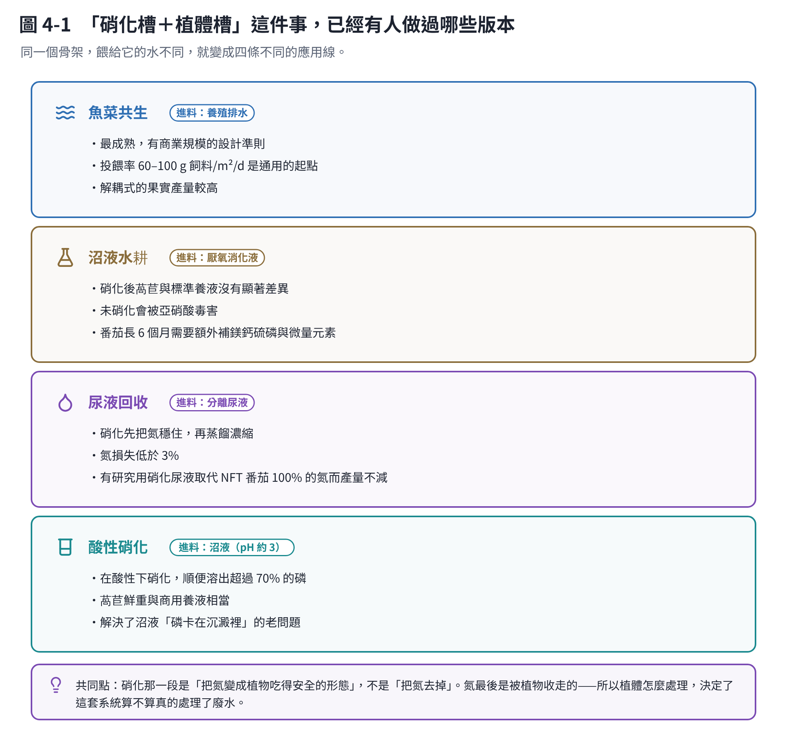

# 第 4 章　誰做過：四個版本

## 4.1 同一個骨架，四種進料

## 4.2 魚菜共生：最成熟的那一個

進料是養殖排水。這是唯一有**商業規模設計準則**的版本——投餵率比、鹼度補充、面積比例都有現成的數字可以抄（第 3 章）。

- 美屬維京群島大學（UVI）的商業規模系統是最常被引用的參考設計 [1]。
- 耦合式與解耦式的中試比較：**解耦式果實產量高約 36%，魚產量相當** [2]。
- 近年（2025）有研究比較 20、40、60 g 飼料/m²/d，結論是 60 的總生產力最高（`secondary`）。

**對台灣的意義**：魚菜共生在台灣有一定的社群與業者基礎，要找人討論、要找設備都不難。彰化那個結合智慧監測的浮島研究也屬於這一類 [3]。

## 4.3 沼液水耕：成功與失敗都很清楚

進料是厭氧消化液。這個版本的文獻特別有教學價值，因為**成功與失敗的對照很乾淨**：

| 做法 | 結果 |
|---|---|
| 未處理的消化液直接種萵苣 | 被部分硝化產生的**亞硝酸毒害而矮化** [4] |
| 同一份水先做完整硝化 | 生長與標準養液**沒有顯著差異** [4] |
| 豬糞消化液 + 硝化反應器種番茄（6 個月） | 元素組成不足，**要額外補鎂、鈣、硫、磷與微量元素**；果實變大但品質下降 [5] |

第三筆特別值得記住：**硝化解決的是「氮的形態」，不是「養分完整性」。** 消化液不是配方養液，氮多但其他元素不成比例。長期栽培一定要補。

## 4.4 尿液回收：氮損失低於 3%

進料是源頭分離的尿液。瑞士 Eawag 的 VUNA 流程是兩段：**先硝化把氮穩住，再蒸餾濃縮** [6]。

- 為什麼要先硝化？尿液裡的尿素會水解成氨，pH 升到 9 以上，直接加熱濃縮的話氮會以 NH₃ 跑掉。硝化先把一部分氨變成硝酸鹽、把 pH 壓下來，之後蒸餾就留得住氮。
- 結果：**氮損失低於 3%**，幾乎所有養分都進到乾燥的產品裡 [6]。
- 代價：能量。該研究估計基本的硝化＋蒸餾流程需要傳統污水除氮約 **4–5 倍的初級能源**；若先用逆滲透移除八成的水再做蒸氣壓縮蒸餾，可以拉回接近傳統製程的水準 [6]。
- 下游應用：有研究在循環式薄膜水耕（NFT）番茄上，用硝化尿液**取代 100% 的氮**（以及 22% 的鉀、35% 的磷）而產量沒有顯著下降（`abstract`，德國 DLR 的研究）。

**這個版本對台灣的意義**：尿液分離在台灣幾乎沒有推動，短期不現實。但它示範了一件事——**「硝化 → 穩住氮 → 再利用」這個骨架，對任何高氨氮、高 pH 的廢流都適用**，不只是沼液。

## 4.5 酸性硝化：順便把磷解出來

進料一樣是沼液，但硝化是在 **pH 約 3** 的條件下做的 [7]。

這解決的是沼液的另一個老問題：**磷卡在沉澱裡**。沼液的磷大多以磷酸鈣、鳥糞石等形式沉澱，植物吃不到。酸性條件下這些沉澱會溶解。

結果：**溶出超過 70% 的磷，萵苣鮮重與商用養液相當** [7]。

酸性硝化聽起來違反直覺（硝化菌的最適 pH 通常在 7–8），但確實有能在酸性下工作的硝化菌群。這是個還很新的方向。

## 4.6 四個版本的共同點

**硝化那一段做的是「把氮變成植物吃得安全的形態」，不是「把氮去掉」。**

氮最後是被植物收走的。所以：

- 植體怎麼處理，決定了這套系統算不算真的處理了廢水（第一分區第 1 章）。
- 如果植體賣掉或餵給動物，氮就真的離開了這個場。
- 如果植體堆在旁邊爛掉，氮會回到環境裡——只是換了個地方。

## 本章重點

- 「硝化槽＋植體槽」至少有四個版本：魚菜共生、沼液水耕、尿液回收、酸性硝化。
- 魚菜共生最成熟，有商業規模的設計準則可以直接抄。
- 沼液水耕的對照最乾淨：未硝化的被亞硝酸毒害，硝化後與標準養液無顯著差異。
- 硝化解決的是氮的形態，不是養分完整性——長期栽培要補鎂鈣硫磷與微量元素。
- 尿液回收（硝化＋蒸餾）氮損失低於 3%，但能耗是傳統除氮的 4–5 倍。
- 酸性硝化（pH 約 3）順便溶出超過 70% 的磷，解決沼液「磷吃不到」的老問題。

## 參考文獻

1. Rakocy JE, Bailey DS, Shultz RC, Danaher JJ。A Commercial-Scale Aquaponic System Developed at the University of the Virgin Islands。https://tag2grow.org/wp-content/uploads/2021/09/UVI-Aquaponics.pdf
2. Monsees H, Kloas W, Wuertz S (2017). Decoupled systems on trial: Eliminating bottlenecks to improve aquaponic processes. *PLOS ONE*, 12, e0183056. https://doi.org/10.1371/journal.pone.0183056
3. Evaluation of the Water Quality and Farming Growth Benefits of an Intelligence Aquaponics System (2021). *Sustainability*, 13, 4210. https://doi.org/10.3390/su13084210
4. The applicability of anaerobically treated domestic wastewater as a nutrient medium in hydroponic lettuce cultivation: Nitrogen toxicity and health risk assessment. *Science of the Total Environment*. https://doi.org/10.1016/j.scitotenv.2021.146482
5. Organic Waste-Based Fertilizer in Hydroponics Increases Tomato Fruit Size but Reduces Fruit Quality. *Frontiers in Plant Science*. https://doi.org/10.3389/fpls.2021.680030
6. Udert KM, Wächter M (2012). Complete nutrient recovery from source-separated urine by nitrification and distillation. *Water Research*（線上先行 2011）。 https://www.eawag.ch/fileadmin/Domain1/Abteilungen/eng/projekte/vuna/doc/VUNA_Handbook_Urine_Treatment.pdf
7. Acidophilic nitrification of biogas digestates accelerates sustainable hydroponics by enhancing phosphorus dissolution (2023). *Environmental Technology & Innovation*. https://www.sciencedirect.com/science/article/abs/pii/S2589014X23000622
