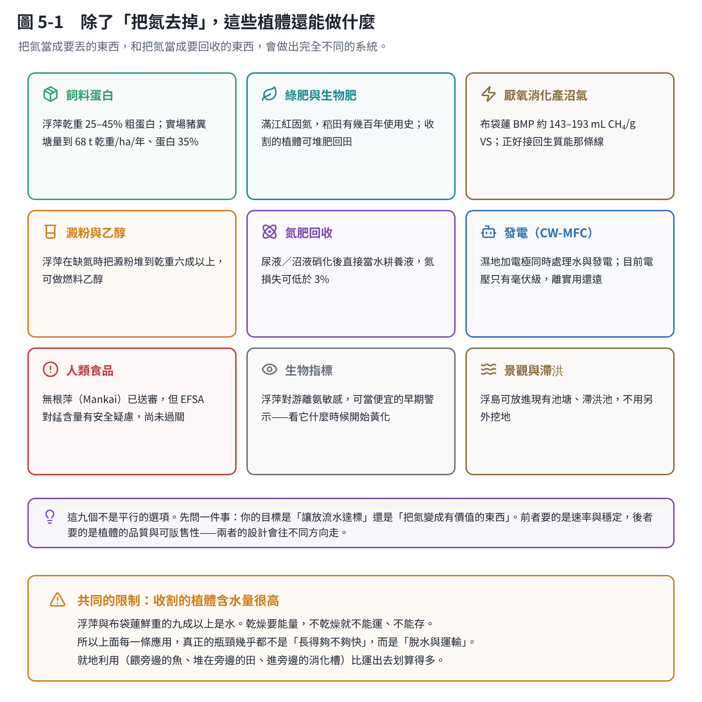
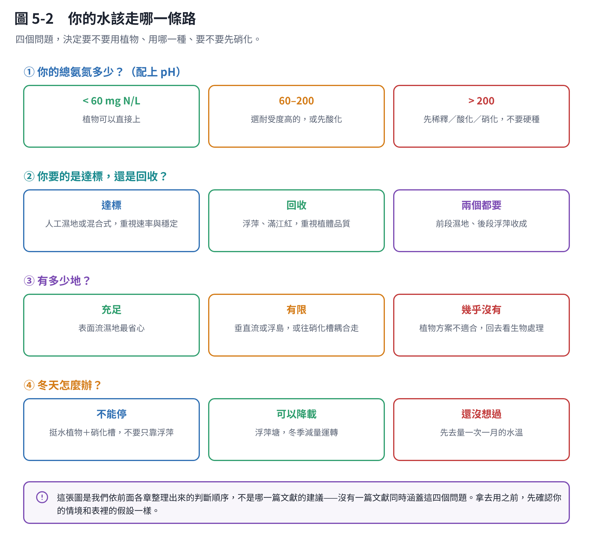

# 第 5 章　你可能還沒想到的應用

## 5.1 先換一個問法

前面十五章都在問「怎麼把氮弄掉」。這一章換個問法：**這些植體還能幹嘛？**



| 應用 | 數字 | 可信度 |
|---|---|---|
| **飼料蛋白** | 浮萍乾重 25–45% 粗蛋白；實場豬糞塘量到 68 t 乾重/ha/年、粗蛋白 35% [1] | abstract |
| **綠肥與生物肥** | 滿江紅固氮，稻田使用史數百年；收割植體可堆肥回田 | secondary |
| **厭氧消化產沼氣** | 布袋蓮 BMP 約 143 mL CH₄/g VS（未處理）、193（熱風前處理）[2] | abstract |
| **澱粉與乙醇** | 浮萍在逆境下澱粉可達乾重 6 成以上，可做燃料乙醇 [3] | abstract |
| **氮肥回收** | 尿液／沼液硝化後直接當水耕養液，氮損失可低於 3%（第 4 章）[4] | abstract |
| **發電（CW-MFC）** | 濕地加電極同時處理水與發電；報告的電壓只有 4–152 mV [5] | secondary |
| **人類食品** | 無根萍（Mankai）已送 EFSA 審查，但**錳含量有安全疑慮、安全性無法確立** [6] | abstract |
| **生物指標** | 浮萍對游離氨敏感，可當便宜的早期警示 | inference |
| **景觀與滯洪** | 浮島可放進現有池塘、滯洪池，不用另外挖地 | secondary |

## 5.2 接回生質能這條線

這個 repo 的另一條主線是生質能。收割的植體拿去厭氧消化，可以算出來：

以實場浮萍塘的生物量產率 **18.6 g 乾重/m²/d**、假設 VS 佔乾重 85%、取浮萍共消化的甲烷產率 193 mL CH₄/g VS：

```
甲烷產量 ＝ 18.6 × 0.85 × 193 ÷ 1000 ≈ 3.05 L CH₄/m²/d
能量     ≈ 109 kJ/m²/d （以甲烷低熱值 35.8 MJ/m³ 計）
```

一公頃的浮萍塘大約是 **30 m³ CH₄/d**，熱值約 1.1 GJ/d。

> **VS 佔乾重 85% 是假設值**（沒查到浮萍的實測 VS/TS）。甲烷產率的文獻範圍也很寬（111–468 mL CH₄/g VS 都有人報），所以這個數字只能當數量級參考。

**把這條路放進設計的理由不是能源收入**（一公頃一天 1.1 GJ 不多），**而是處置**：收割的植體本來就要處理，厭氧消化可以同時減量、除臭、產氣，消化後的沼液還可以回到系統前端。

## 5.3 共同的瓶頸：含水量

浮萍與布袋蓮鮮重的九成以上是水（上面那張圖最下面那一條）。這件事決定了上面每一條應用的經濟性：

- **乾燥要能量。** 把含水 95% 的植體乾到 10%，要蒸發掉的水是乾物質的十幾倍重。
- **不乾燥就不能運、不能存。** 鮮植體幾天就開始腐敗。
- **所以真正的瓶頸幾乎都不是「長得夠不夠快」，而是「脫水與運輸」。**

**結論是：就地利用比運出去划算得多。**

- 餵旁邊的魚（不用乾燥）
- 堆在旁邊的田（不用乾燥）
- 進旁邊的厭氧消化槽（不用乾燥，而且高含水正好）

如果你的計畫書裡寫「收割後運到 50 公里外的加工廠」，先算一次運費和乾燥成本。

## 5.4 幾個值得記住的「不要」

- **不要把發電（CW-MFC）當賣點。** 目前文獻報告的電壓是毫伏級 [5]，離實用還很遠。它有研究價值，沒有工程價值。
- **不要假設浮萍可以當人類食品。** 歐盟送審的結果是「安全性無法確立」[6]。動物飼料沒有這個問題。
- **不要用「固氮」的植物來移除氮。** 滿江紅會自己固氮，拿來降低水中氮濃度效率不見得好（第一分區第 4 章）。

## 5.5 決策：你的水該走哪一條路



| 問題 | 選項與建議 |
|---|---|
| **① 總氨氮多少（配上 pH）？** | < 60 mg N/L：植物可以直接上　／　60–200：選耐受度高的或先酸化　／　> 200：先稀釋、酸化或硝化 |
| **② 要達標還是要回收？** | 達標：人工濕地或混合式　／　回收：浮萍、滿江紅　／　兩個都要：前段濕地、後段浮萍收成 |
| **③ 有多少地？** | 充足：表面流濕地　／　有限：垂直流或浮島，或往硝化槽耦合走　／　幾乎沒有：植物方案不適合 |
| **④ 冬天怎麼辦？** | 不能停：挺水植物＋硝化槽　／　可以降載：浮萍塘減量運轉　／　還沒想過：先去量一次一月的水溫 |

> **這張表是我們依前面各章整理出來的判斷順序，不是哪一篇文獻的建議**——沒有一篇文獻同時涵蓋這四個問題。拿去用之前，先確認你的情境和表裡的假設一樣。

## 5.6 如果要我挑三個題目

以「值得做、做得出來、還沒有人做」為標準：

1. **台灣原生水生植物的氨氮耐受度曲線**（香蒲、開卡蘆、風車草、水芹菜、茭白筍），固定 pH、用第一分區第 6 章的流程。便宜、有用、結果一定是新的。
2. **酸化 vs 稀釋的成本比較**，用自己的沼液實測。文獻只證明了酸化有效，**沒有人算過在台灣的藥劑價格與水價下哪個划算**。
3. **冬季的接力設計**：浮萍（夏）＋水芹菜（冬）的輪作，看能不能把全年的去除速率拉平。這是台灣氣候特有的問題，國外文獻幫不上忙。

## 本章重點

- 植體的出路至少九條：飼料蛋白、綠肥、沼氣、乙醇、氮肥回收、發電、食品、生物指標、景觀滯洪。
- 接回生質能：一公頃浮萍塘約 30 m³ CH₄/d（約 1.1 GJ/d）——價值不在能源收入，在於同時解決處置問題。
- 九條應用的共同瓶頸是含水量九成以上：乾燥要能量，不乾燥不能運，所以**就地利用最划算**。
- 不要把 CW-MFC 當賣點（毫伏級），不要假設浮萍能當人類食品（歐盟未過），不要用固氮植物去移除氮。
- 決策順序：濃度與 pH → 達標還是回收 → 有多少地 → 冬天怎麼辦。

## 參考文獻

1. Mohedano RA, Costa RHR, Tavares FA, Belli Filho P (2012). High nutrient removal rate from swine wastes and protein biomass production by full-scale duckweed ponds. *Bioresource Technology*, 112, 98–104. https://doi.org/10.1016/j.biortech.2012.02.083
2. Biochemical methane potential test of untreated and hot air oven pretreated water hyacinth: A comparative study. *Journal of Cleaner Production*. https://www.sciencedirect.com/science/article/abs/pii/S0959652617316876
3. High starch duckweed biomass production and its highly-efficient conversion to bioethanol (2023). *Environmental Technology & Innovation*. https://ui.adsabs.harvard.edu/abs/2023EnvTI..3203296G
4. Udert KM, Wächter M (2012). Complete nutrient recovery from source-separated urine by nitrification and distillation. *Water Research*（線上先行 2011）。 https://www.eawag.ch/fileadmin/Domain1/Abteilungen/eng/projekte/vuna/doc/VUNA_Handbook_Urine_Treatment.pdf
5. Constructed wetland–microbial fuel cell 系統回顧（*RSC Advances*, 2024）。https://pubs.rsc.org/en/content/articlepdf/2024/ra/d4ra04658g
6. EFSA NDA Panel (2021). Safety of *Wolffia globosa* powder as a Novel food pursuant to Regulation (EU) 2015/2283. https://www.ncbi.nlm.nih.gov/pmc/articles/PMC8693246/
