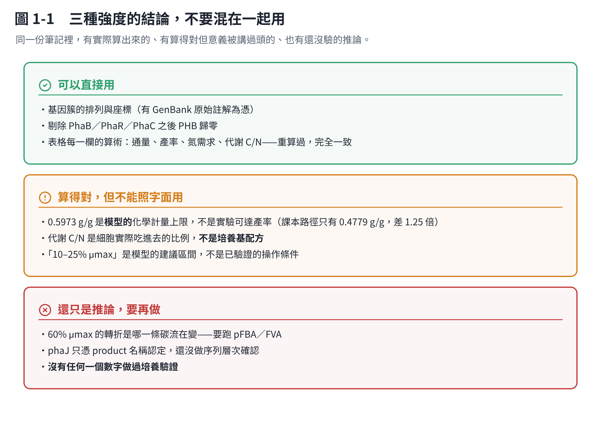
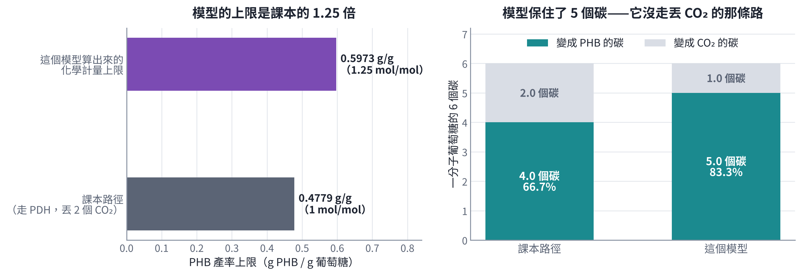

# 第 1 章　結論：模型算出了什麼，哪些可以用

一句話：**把生長壓到最大生長速率的 10–25%，可以保住 86–94% 的理論 PHB 產率；生長超過約 60% μmax 之後，PHB 掉的速度會變成三倍。**

這句話是對的。但它有三個字要特別小心——「理論」。

## 1.1 可以直接用的部分

**已查核。** `code/checks.py` 把取捨表的每一欄重算過：

| 查的東西 | 結果 |
|---|---|
| 9 組生長比例的 Growth flux | 全部等於「比例 × μmax」，誤差在小數第六位內 |
| 9 組的 PHB 質量產率 | 由通量換算，和原文寫的完全一致 |
| 9 組「佔理論上限」的百分比 | 一致 |
| 氮需求 q(NH₄) = 10.7682 × μ | 四個對照點全部一致 |
| 代謝 C/N | 由上面兩項導出，一致 |

**沒有一欄對不上。** 這代表原文的表不是憑印象寫的，是真的從同一次計算抄出來的。

另外兩件不需要重跑模型就能確認的事：

- **基因簇的排列與座標**有 GenBank 原始註解為憑（第 2 章）。
- **剔除 PhaB、PhaR、PhaC 之後 PHB 歸零**，三個都歸零。這代表模型裡沒有繞過這三個基因的替代路徑（第 6 章）。

## 1.2 算得對，但意義被講過頭的部分

### 0.5973 g/g 這個數字

**這是整份分析最容易被誤用的一個數字。**

原文說「理論質量產率 0.5973 g-PHB/g-glucose」。算術是對的：12.5 mmol PHB 重複單元 ÷ 10 mmol 葡萄糖 = 1.25 mol/mol，乘上分子量比就是 0.5973。

但是——

**課本路徑的 PHB 上限只有 0.4779 g/g。**

算法很簡單：葡萄糖（6 個碳）經過糖解與丙酮酸脫氫酶（PDH）變成 2 個乙醯輔酶 A，**過程中丟掉 2 個 CO₂**。2 個乙醯輔酶 A 縮合成 1 個 PHB 重複單元（4 個碳）。所以 1 mol 葡萄糖最多做出 1 mol PHB 重複單元，碳回收率 4/6 = 66.7%，質量產率 0.4779 g/g。

模型算出 1.25 mol/mol，碳回收率 83.3%——**它保住了 5 個碳，只丟掉 1 個**。

**這代表模型用了一條不經過 PDH 的路**。最常見的就是磷酸酮醇酶（phosphoketolase）：它把 5 碳或 6 碳糖直接切出乙醯磷酸，不丟 CO₂。CarveMe 的 Gram-positive 通用模型裡本來就有這條反應，而且 *Bacillus* 確實有這類酵素。

所以要問的是：**這條路在你的菌裡、在你的培養條件下，真的跑得動嗎？** 模型不會回答這個，它只是「只要質量守恆就可以用」。

> **實務上的結論**：拿 0.5973 去跟你的實驗產率比，會得到一個失真的「達成率」。要比就跟 0.4779 比，或者先去模型裡看磷酸酮醇酶那條反應的通量是多少。

### 代謝 C/N 不是培養基 C/N

原文已經講得很清楚，這裡再強調一次：表裡的 `Metabolic_C_N_ratio` 是**細胞實際吃進去的 mol 碳 / mol 氮**。它是算出來的結果，不是你能直接旋的鈕。

要換成培養基配方，還得考慮底物攝取速率、菌體濃度、發酵時間、氮鹽的含氮量、酵母萃取物這類有機氮、殘氮、以及 fed-batch 怎麼進料。

**所以不能講「最佳培養 C/N = 50」。** 正確的講法是原文自己寫的那一句：

> 模型預測維持約 10–25% 最大生長速率時，可保留 86–94% 的理論 PHB 產率，對應代謝 C/N 約 50–126 mol-C/mol-N，可作為後續氮限制培養條件設計的**篩選區間**。

### 「10–25% μmax」是建議，不是已驗證的條件

這個區間是從模型的取捨曲線讀出來的。沒有任何一個點做過培養驗證。

## 1.3 還只是推論的部分

- **60% μmax 的轉折是哪一條碳流在變**——原文推測是碳與還原力開始轉向 biomass、TCA 與呼吸。這個推測很合理，但要跑 pFBA 才知道（第 6 章最後有現成的程式）。
- **phaJ 只憑 product 名稱認定**，還沒做序列層次確認。
- **phaZ 在後期會把 PHB 吃回去多少**——模型不會告訴你，只能做時間序列實驗。
- **沒有任何一個數字做過培養驗證。**

## 1.4 一個小修正

原文說「轉折點在 55–60% μmax，在此之前每增加 5% μmax，PHB 約掉 0.36；超過之後每 5% 掉約 1.0」。

**已查核，但要修一下。** 逐段算出來是這樣：

| 區間 | 每多讓 5% μmax，PHB 掉多少 |
|---|---|
| 0% → 55% | **0.36**（每一格都是 0.36，完美線性） |
| 55% → 60% | 0.56 |
| 60% → 100% | **1.00**（每一格都是 1.00） |

所以：

- 「之前每 5% 掉 0.36」——對，而且是從 0% 一路到 55% 都剛好 0.36。
- 「之後每 5% 掉 1.0」——對，但那是 **60% 以後**，不是 55% 以後。
- 55–60% 那一格是 0.56，是**唯一**的過渡格。

**真正的轉折點是 60%**，55–60% 是斜率開始變的那一格。差別不大，但如果你要設計一個「卡在轉折前」的製程，講 60% 比講 55–60% 精確。

## 1.5 兩個候選製程策略

原文提出兩個，照錄：

| 策略 | 生長 | PHB 產率 |
|---|---|---|
| **A：最大 PHB 累積** | 10–25% μmax | 約 0.51–0.56 g/g |
| **B：兼顧菌體與 PHB** | 約 50% μmax | 約 0.43 g/g |

以及 fed-batch 的構想：第一階段高生長速率快速長菌，第二階段降低有效氮供應、把生長降到 10–25% μmax，碳流轉向 PHB。

這比一開始就極端斷氮合理——**但要記得第 1.2 節那個 1.25 倍的落差**，實際能拿到多少還是要做。
