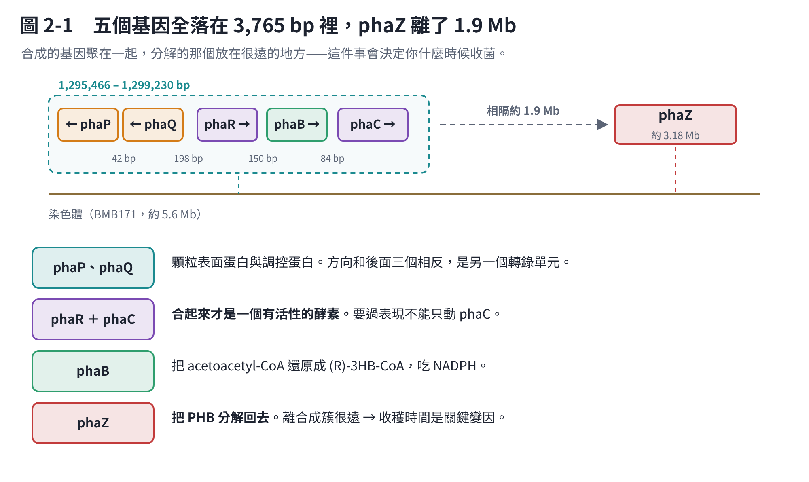

# 第 2 章　基因：BMB171 的 PHA 基因簇

在建任何模型之前，要先確認一件事：**這株菌到底有沒有完整的 PHB 合成路徑？**



## 2.1 核心的五個基因

從 GenBank 註解抓出來的候選 CDS 一共 15 個。依座標排序之後，核心的五個擠在染色體約 **1,295,466–1,299,230 bp**，排成方向相反的兩個模組：

```text
← phaP ─42 bp─ ← phaQ ──198 bp── phaR → ─150 bp─ phaB → ─84 bp─ phaC →
```

| 基因 | Locus tag | Protein ID | 做什麼 |
|---|---|---|---|
| phaP | — | — | phasin，PHB 顆粒表面的蛋白 |
| phaQ | — | — | 會被 PHB 本身調控的抑制子 |
| phaR | BMB171_RS06645 | WP_000566942.1 | PHA 合成酶的一個次單元 |
| phaB | BMB171_RS06650 | WP_000250409.1 | acetoacetyl-CoA 還原酶 |
| phaC | BMB171_RS06655 | WP_000206336.1 | class III PHA 合成酶的另一個次單元 |
| phaZ | 約 3.18 Mb | — | 胞內的 PHB 分解酶，**不在這個簇裡** |

phaB 那一列的註解**沒有寫 gene name**，是靠 product 名稱（acetoacetyl-CoA reductase）加上它夾在 phaR 和 phaC 中間的位置推定的。這種推定在基因簇裡算可靠——合成路徑的基因本來就常排在一起——但它畢竟是推定，不是註解直接給的。

## 2.2 三件會影響後面怎麼做的事

### PhaR 與 PhaC 必須當成一組

*Bacillus* 的 PHA 合成酶是 **class III**，要兩個次單元才有活性。這和 *Cupriavidus necator* 那種單一次單元的 class I 不一樣。

**實務後果：未來要做過表現，不能只動 phaC。** 只把 phaC 的表現量拉高，PhaR 會變成限制因子。模型裡也要照這樣寫——第 5 章的 GPR 規則寫成 `PhaR and PhaC`，就是這個意思。

### phaZ 離得很遠

分解酶 phaZ 在約 3.18 Mb，和合成簇隔了約 1.9 Mb。它不在同一個操縱組裡，意味著**它的表現不受合成簇的調控**。

**實務後果：收穫時間是關鍵變因。** 培養後期碳源耗盡的時候，菌會把累積的 PHB 再吃回去。你量到的產量會隨取樣時間而變，而且可能變很多。這件事模型完全算不出來，只能做時間序列。

### spo0A 有、sigH 沒抓到

文獻上破壞這兩個基因會嚴重降低 PHB。15 個候選裡找到了 spo0A，沒抓到 sigH。

但原文自己的判斷是：**它們比較適合當「生長階段的標誌」，不是優先的敲除目標。** 理由是這兩個都是全域性的調控因子，動了它們會同時改掉一大堆別的事情，不會只影響 PHB。

sigH 沒抓到可能只是關鍵字沒命中（第 4 章的篩選是靠 gene name 和 product 名稱做的）。要確認得另外用同源性比對去找。

## 2.3 從基因到路徑

確認完基因，PHB 的合成路徑就定下來了：

```text
乙醯輔酶 A
   ↓ PhaA（乙醯輔酶 A 乙醯轉移酶）
acetoacetyl-CoA
   ↓ PhaB，消耗 NADPH
(R)-3-hydroxybutyryl-CoA
   ↓ PhaR + PhaC
PHB
```

**注意那個 (R)。** PhaB 做出來的、PhaC 吃進去的，都是 **(R) 型**。這看起來是個化學細節，但它是第 5 章整個分析最大的一個坑——代謝資料庫裡那個名字很像的代謝物是 **(S) 型**，接錯了模型會悄悄繞過 PhaB。

路徑裡還缺一個 **phaA**。15 個候選裡沒有明確抓到它，但 CarveMe 建出來的草稿模型裡有一條現成的 `ACACT1r`（乙醯輔酶 A 乙醯轉移酶），所以第 5 章直接沿用，沒有另外新增。這是一個取捨：**用了模型自帶的反應，等於接受了它的 GPR**，而那個 GPR 不一定對應到 BMB171 真正的 phaA。
