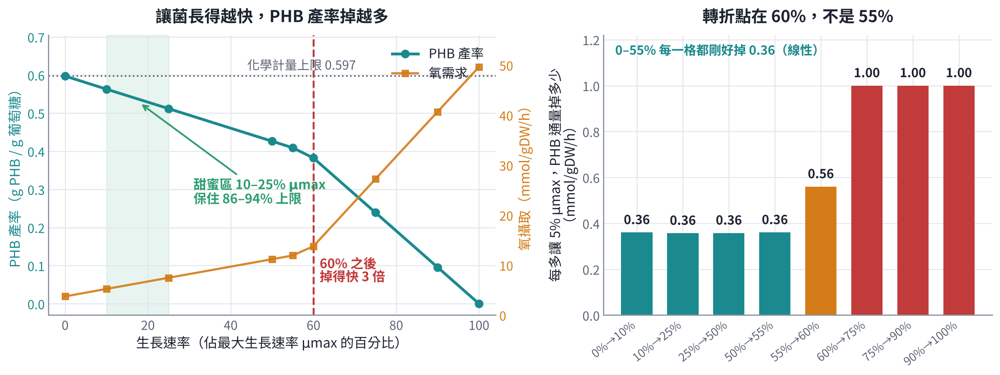
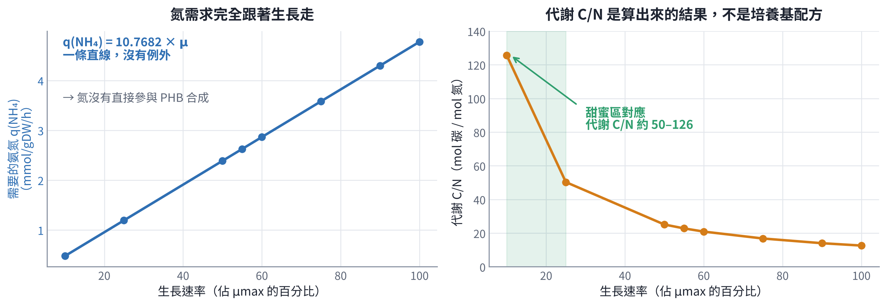

# 第 3 章　數字：生長與 PHB 的取捨

模型最後要回答的是一個很實際的問題：**要讓菌長多快？**

直覺上「長愈多菌、做愈多 PHB」，但這是錯的。葡萄糖的碳只有一份，拿去長菌就不能拿去做 PHB。



## 3.1 基準條件

所有數字都建立在同一組條件上，換條件就要重算：

| 項目 | 設定 |
|---|---|
| 葡萄糖攝取 | 10 mmol/gDW/h（固定基準） |
| 氧氣上限 | 60 mmol/gDW/h（氧氣充足） |
| 氨氮 | 充足（不限氮） |
| 最大生長速率 μmax | **0.443536 h⁻¹** |

氧氣那個 60 是測出來的，不是隨便給的——第 6 章會說怎麼掃出「飽和點約 50」。

## 3.2 取捨表

**已查核。** 下表每一欄都用 `code/checks.py` 重算過，和原文完全一致。

| 生長佔 μmax | Growth flux | PHB 通量 | PHB 產率 (g/g) | 佔化學計量上限 | 氧攝取 | 代謝 C/N |
|---:|---:|---:|---:|---:|---:|---:|
| 0% | 0 | 12.50 | **0.597** | 100% | 3.75 | — |
| 10% | 0.0444 | 11.78 | **0.563** | 94% | 5.24 | 126 |
| 25% | 0.1109 | 10.71 | **0.512** | 86% | 7.47 | 50 |
| 50% | 0.2218 | 8.92 | 0.426 | 71% | 11.18 | 25 |
| 55% | 0.2439 | 8.56 | 0.409 | 68% | 11.93 | 23 |
| 60% | 0.2661 | 8.00 | 0.382 | 64% | 13.78 | 21 |
| 75% | 0.3327 | 5.00 | 0.239 | 40% | 27.22 | 17 |
| 90% | 0.3992 | 2.00 | 0.096 | 16% | 40.67 | 14 |
| 100% | 0.4435 | ≈0 | ≈0 | 0% | 49.63 | 13 |

三件可以讀出來的事：

**第一，前半段是一條直線。** 從 0% 到 55%，每多讓 5% μmax，PHB 通量就掉 0.36——每一格都剛好 0.36，一點誤差都沒有。這種完美線性代表在這個區間裡，碳就是在兩個去處之間線性分配，沒有別的事情發生。

**第二，60% 之後斜率變三倍。** 從 60% 開始，每 5% 掉 1.00。55–60% 那一格是 0.56，是唯一的過渡格。所以**轉折點是 60%**（原文寫 55–60%，見第 1.4 節）。

**第三，氧需求在轉折之後爆增。** 0% 生長時只要 3.75，100% 生長要 49.63，差 13 倍。而且增加得最陡的正是 60% 以後那一段。這不只是模型上的數字——**發酵槽的供氧能力是有上限的**，你可能根本開不到那個生長速率。

## 3.3 甜蜜區在哪

把「保住多少產率」和「長多少菌」放在一起看：

| 生長 | 保住的產率 | 代價 |
|---|---|---|
| 10% μmax | 94% | 菌長很慢，整批時間拉長 |
| 25% μmax | 86% | 還可以接受的生長 |
| 50% μmax | 71% | 掉了快三成 |
| 75% μmax | 40% | 掉掉超過一半 |

**10–25% μmax 是模型建議的區間。** 從 25% 再往下壓到 10%，產率只多拿 8 個百分點，但菌長的速度慢了 2.5 倍——以整批的體積產率（g/L/h）來說不一定划算。

> **這是模型的建議，不是驗證過的操作條件。** 整批的體積產率要考慮菌體濃度和時間，那是模型算不出來的（第 8 章）。

## 3.4 氮限制到底是怎麼起作用的

這一節很重要，因為它改掉了一個很常見的誤解。



模型顯示 **氨氮幾乎完全只用在長菌上，不直接參與 PHB 合成**。證據是這條關係：

```text
q(NH₄) = 10.7682 × μ
```

**已查核。** 四個對照點全部落在這條直線上，誤差在小數第四位：

| Growth flux | 算出來的 q(NH₄) | 原文 |
|---|---|---|
| 0.04435 | 0.4776 | 0.4776 |
| 0.11088 | 1.1940 | 1.1940 |
| 0.22177 | 2.3881 | 2.3880 |
| 0.33265 | 3.5820 | 3.5821 |

這個係數剛好就是 biomass 反應裡的氮係數。**一條完美的直線，沒有例外**——代表氮在這個模型裡除了長菌沒有別的去處。

所以：

> **氮限制之所以有效，是「限制氮 → 限制生長 → 把乙醯輔酶 A 和 NADPH 讓給 PHB」，不是低氮直接去啟動 phaABC。**

這兩種機制在實驗上會有完全不同的表現。如果是前者，那麼**用任何方法限制生長都會有同樣的效果**（限碳、限磷、限氧都行）；如果是後者，就只有限氮有用。模型支持前者。

**但注意：模型只知道化學計量，不知道調控。** 真實的菌裡 phaQ 是會被 PHB 調控的抑制子，PHB 的合成確實有轉錄層次的管制。模型看不到這一層。所以正確的說法是「**在化學計量的層次上**，氮限制是透過限制生長起作用的」。

## 3.5 代謝 C/N：別把它當配方

表最後一欄的代謝 C/N 是算出來的：攝取的碳（葡萄糖 10 × 6 = 60 mmol C）除以攝取的氮。

甜蜜區 10–25% μmax 對應代謝 C/N 約 **50–126**。

**這不是培養基配方的 C/N。** 兩者差在：

- 培養基的 C/N 是你**投進去**的重量比，代謝 C/N 是細胞**實際吃進去**的莫耳比
- 培養基裡有殘留不被利用的碳或氮
- 酵母萃取物這類有機氮既是氮源也是碳源
- fed-batch 的進料方式會讓瞬時的比例一直在變

所以你不能拿「C/N = 50」直接去配培養基。它是一個**篩選區間**：先用它決定要掃哪幾個 C/N，再用實驗去定。
