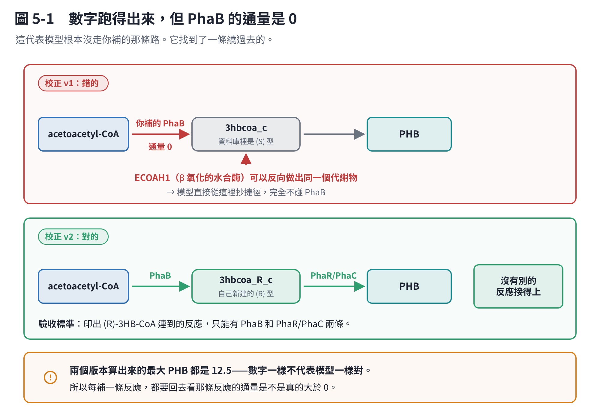

# 第 5 章　自己重跑（二）：建模、校正，和那個最大的坑

## 5.1 用 CarveMe 建草稿

```bash
conda activate btcobra
cd ~/Bt_PHA_analysis

PROT=$(find ~/Bt_PHA_analysis/02_reference_genomes/BMB171 -type f -name "protein.faa" | head -n 1)
echo "$PROT"

carve "$PROT" \
  -u grampos \
  --fbc2 \
  --solver scip \
  -o ~/Bt_PHA_analysis/09_GEM/draft/BMB171_carveme_draft.xml
```

三個參數的意思：

- `-u grampos`：用 Gram-positive 的通用模型當模板
- `--fbc2`：輸出 SBML-FBC2，COBRApy 可以直接讀
- `--solver scip`：沒有 CPLEX／Gurobi 時用開源的 SCIP（比較慢）

**第一版不要做 gap filling。**

gap filling 是「自動補反應讓模型長得起來」。它很方便，但補進來的反應**不一定有基因證據**——它只保證數學上通得過。第一版先看：能不能產生 biomass、哪些反應被封死、PHA 路徑有沒有被收錄、transporter 合不合理。等你有「實際證明可以生長的培養基」之後再補，才知道自己在補什麼。

## 5.2 MEMOTE 品質檢查

```bash
memote report snapshot \
  --filename ~/Bt_PHA_analysis/09_GEM/reports/BMB171_MEMOTE.html \
  09_GEM/draft/BMB171_carveme_draft.xml
```

會檢查質量平衡、電荷平衡、註解完整度、接不上的反應、biomass 一致性。產出是一份 HTML 報告。

## 5.3 在草稿裡找 PHA 反應

用關鍵字粗篩會得到 **269 條**，太多太雜。改用 BiGG 的代謝物 id 精準篩，收斂到 **47 條**。

要確認存在的核心代謝物：

```text
accoa_c      乙醯輔酶 A
aacoa_c      acetoacetyl-CoA
3hbcoa__R_c  (R)-3-hydroxybutyryl-CoA   ← 關鍵
coa_c  nadph_c  nadp_c  h_c
```

**結論：CarveMe 建了 acetyl-CoA → acetoacetyl-CoA 的入口（`ACACT1r`），但抓錯了 PhaB，而且完全沒有 PhaR/PhaC 的聚合反應，也沒有 PHB 的累積出口。必須人工補。**

這不是 CarveMe 做得不好——它的官方定位本來就是「草稿，需要人工校正」。自動建模能把通用代謝建得不錯，但**產物路徑幾乎一定要自己接**。

## 5.4 人工校正 v1

原則：**不覆蓋原始模型，另存新檔。**

```bash
cat > 09_GEM/scripts/curate_BMB171_PHA_model.py <<'PY'
#!/usr/bin/env python3
from cobra.io import read_sbml_model, write_sbml_model
from cobra import Metabolite, Reaction

INPUT  = "09_GEM/draft/BMB171_carveme_draft.xml"
OUTPUT = "09_GEM/curated/BMB171_PHA_curated.xml"

PHAB_GENE = "WP_000250409_1"
PHAR_GENE = "WP_000566942_1"
PHAC_GENE = "WP_000206336_1"

model = read_sbml_model(INPUT)

def get_metabolite(model, ids, name_keywords):
    for mid in ids:
        if mid in model.metabolites:
            return model.metabolites.get_by_id(mid)
    for m in model.metabolites:
        n = (m.name or "").lower()
        if any(k in n for k in name_keywords):
            return m
    raise KeyError(f"找不到：{ids}")

accoa = get_metabolite(model, ["accoa_c"], ["acetyl-coa"])
aacoa = get_metabolite(model, ["aacoa_c"], ["acetoacetyl-coa"])
coa   = get_metabolite(model, ["coa_c"],   ["coenzyme a"])
nadph = get_metabolite(model, ["nadph_c"], ["nadph"])
nadp  = get_metabolite(model, ["nadp_c"],  ["nadp"])
h     = get_metabolite(model, ["h_c"],     ["proton"])
hbcoa = get_metabolite(model, ["3hbcoa__R_c","3hbcoa_R_c","3hbcoa_c"],
                       ["3-hydroxybutyryl-coa","3-hydroxybutanoyl-coa"])

# PhaA：沿用 CarveMe 的 ACACT1r，不自行新增

# PhaB：acetoacetyl-CoA + NADPH + H+ -> (R)-3HB-CoA + NADP+
if "PHAB_NADPH" in model.reactions:
    model.remove_reactions(["PHAB_NADPH"], remove_orphans=False)
phab = Reaction("PHAB_NADPH")
phab.name = "Acetoacetyl-CoA reductase (NADPH-dependent PhaB)"
phab.lower_bound, phab.upper_bound = 0, 1000
phab.add_metabolites({aacoa: -1, nadph: -1, h: -1, hbcoa: 1, nadp: 1})
phab.gene_reaction_rule = PHAB_GENE
model.add_reactions([phab])

# PHB 重複單元：一個虛擬代謝物
PHB_ID = "phb_repeat_c"
if PHB_ID in model.metabolites:
    phb = model.metabolites.get_by_id(PHB_ID)
else:
    phb = Metabolite(PHB_ID, formula="C4H6O2", charge=0,
                     name="Poly(3-hydroxybutyrate) repeat unit", compartment="c")
    model.add_metabolites([phb])

# PhaR/PhaC：(R)-3HB-CoA -> PHB repeat + CoA
RID = "PHAC_PHB_POLYMERIZATION"
if RID in model.reactions:
    model.remove_reactions([RID], remove_orphans=False)
phac = Reaction(RID)
phac.name = "PHB polymerization by PhaR/PhaC"
phac.lower_bound, phac.upper_bound = 0, 1000
phac.add_metabolites({hbcoa: -1, coa: 1, phb: 1})
phac.gene_reaction_rule = f"{PHAR_GENE} and {PHAC_GENE}"
model.add_reactions([phac])

# PHB 累積的出口
DEMAND_ID = "DM_phb_repeat_c"
if DEMAND_ID not in model.reactions:
    model.add_boundary(phb, type="demand", reaction_id=DEMAND_ID)

print("PhaB mass balance:", phab.check_mass_balance())
print("PhaC mass balance:", phac.check_mass_balance())

write_sbml_model(model, OUTPUT)
print("已輸出：", OUTPUT)
PY

python 09_GEM/scripts/curate_BMB171_PHA_model.py
```

**兩個 mass balance 都要印出 `{}`**（空字典 = 完全平衡）。印出一堆元素就是反應式配平錯了，或是代謝物的 formula／charge 填錯。

注意 `phac.gene_reaction_rule` 寫的是 `PhaR and PhaC`——這對應第 2 章講的「兩個次單元要合起來才有活性」。寫成 `or` 的話，剔除驗證就會過不了。

## 5.5 這個坑：模型根本沒走你補的路

第一次跑最大 PHB，得到 12.5。看起來很好。但是：

```text
PHAB_NADPH = 0        ← PhaB 根本沒被用到！
```



**原因是立體化學。**

BiGG 裡的 `3hbcoa_c` 指的是 **(S)**-3-hydroxybutanoyl-CoA，不是 PHB 合成需要的 **(R)** 型。而 `ECOAH1`（`3hbcoa_c ⇌ b2coa_c + h2o_c`，β 氧化路徑上的 enoyl-CoA 水合酶）可以**反向**產生同一個 `3hbcoa_c`。

於是模型發現：與其走你補的 PhaB（要花 NADPH），不如從 β 氧化那邊反向做一個出來。它就這麼做了。

**而且它照樣給你 12.5。** 數字完全正常，不會有任何錯誤訊息。

### 解法不是把 ECOAH1 關掉

把 `ECOAH1` 的上下限設成 0 會破壞 β 氧化，而那條路在別的地方是對的。

**正確的解法是建立一個專屬的 (R)-3HB-CoA 代謝物**，讓 PHB 路徑和 β 氧化徹底分開：

```bash
python - <<'PY'
from cobra.io import read_sbml_model, write_sbml_model
from cobra import Metabolite, Reaction

INPUT  = "09_GEM/curated/BMB171_PHA_curated.xml"
OUTPUT = "09_GEM/curated/BMB171_PHA_curated_v2.xml"
model = read_sbml_model(INPUT)

# 1. 建立真正的 (R)-3-hydroxybutyryl-CoA
R3HB_ID = "3hbcoa_R_c"
if R3HB_ID in model.metabolites:
    r3hbcoa = model.metabolites.get_by_id(R3HB_ID)
else:
    r3hbcoa = Metabolite(R3HB_ID, name="(R)-3-Hydroxybutanoyl-CoA",
                         formula="C25H38N7O18P3S", charge=-4, compartment="c")
    model.add_metabolites([r3hbcoa])

aacoa = model.metabolites.get_by_id("aacoa_c")
nadph = model.metabolites.get_by_id("nadph_c")
nadp  = model.metabolites.get_by_id("nadp_c")
h     = model.metabolites.get_by_id("h_c")
coa   = model.metabolites.get_by_id("coa_c")
phb   = model.metabolites.get_by_id("phb_repeat_c")

# 2. 移除舊的（接錯代謝物的）PhaB / PhaC
for rid in ["PHAB_NADPH", "PHAC_PHB_POLYMERIZATION"]:
    if rid in model.reactions:
        model.remove_reactions([rid], remove_orphans=False)

# 3. 重建 PhaB
phab = Reaction("PHAB_NADPH")
phab.name = "PhaB NADPH-dependent (R)-3-hydroxybutyryl-CoA formation"
phab.lower_bound, phab.upper_bound = 0, 1000
phab.add_metabolites({aacoa: -1, nadph: -1, h: -1, r3hbcoa: 1, nadp: 1})
phab.gene_reaction_rule = "WP_000250409_1"
model.add_reactions([phab])

# 4. 重建 PhaR/PhaC
phac = Reaction("PHAC_PHB_POLYMERIZATION")
phac.name = "PHB polymerization from (R)-3-hydroxybutyryl-CoA by PhaR/PhaC"
phac.lower_bound, phac.upper_bound = 0, 1000
phac.add_metabolites({r3hbcoa: -1, coa: 1, phb: 1})
phac.gene_reaction_rule = "WP_000566942_1 and WP_000206336_1"
model.add_reactions([phac])

# 5. 確認 (R)-3HB-CoA 只連到這兩條反應
print("(R)-3HB-CoA connected reactions")
for rxn in r3hbcoa.reactions:
    print(rxn.id, "|", rxn.reaction, "| GPR:", rxn.gene_reaction_rule or "無")

print("\nPhaB mass balance:", phab.check_mass_balance())
print("PhaC mass balance:", phac.check_mass_balance())

write_sbml_model(model, OUTPUT)
print("\n已輸出：", OUTPUT)
PY
```

**驗收標準**：印出來的 connected reactions 只能看到 `PHAB_NADPH` 和 `PHAC_PHB_POLYMERIZATION` 兩條，**不可以**再出現 `ECOAH1` 或 `HACD1_1`；兩個 mass balance 都要是 `{}`。

重跑最大 PHB：

```text
ACACT1r                 = 12.5
PHAB_NADPH              = 12.5     ← 現在有通量了
PHAC_PHB_POLYMERIZATION = 12.5
DM_phb_repeat_c         = 12.5
```

每一步都是 12.5，代表沒有繞路。路徑是：

```text
葡萄糖 → 乙醯輔酶A →(PhaA)→ acetoacetyl-CoA →(PhaB+NADPH)→ (R)-3HB-CoA →(PhaR+PhaC)→ PHB
```

## 5.6 這個坑真正的教訓

v1 和 v2 的最大 PHB 都是 12.5。

**數字一樣，不代表模型一樣對。** v1 的 12.5 是透過一條錯誤路徑算出來的，不能信。

這件事值得變成一個習慣：

> **每補一條反應，都要回去看那條反應的通量是不是真的大於 0。**

如果你補的反應通量是 0，只有兩種可能：那條路徑真的沒必要（很少見），或者模型從別的地方繞過去了（很常見）。兩種都要查清楚才能往下走。

**同一類的坑還有**：代謝物名字很像但區隔（compartment）不同、同一個反應在模型裡已經存在但 id 不一樣（你補了一條重複的）、可逆性設反了讓反應可以倒著跑。檢查方式都一樣——看通量。
